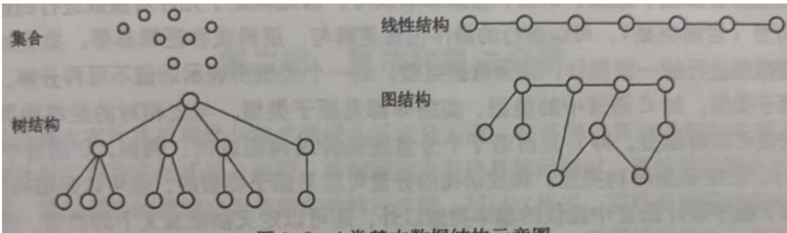
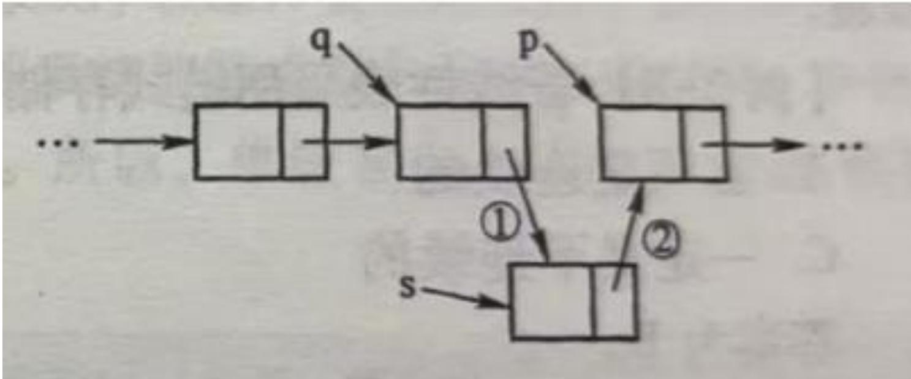
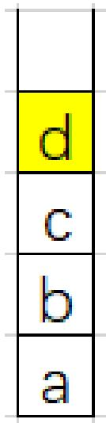
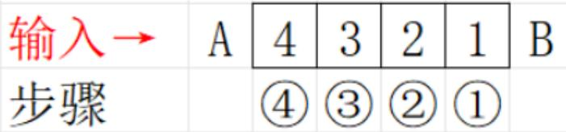
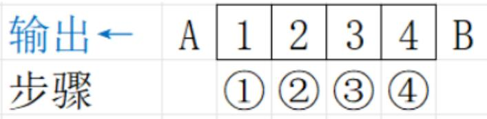
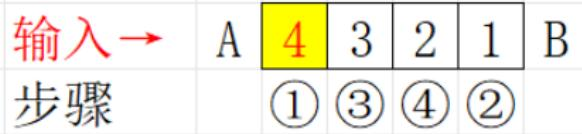
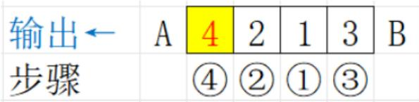
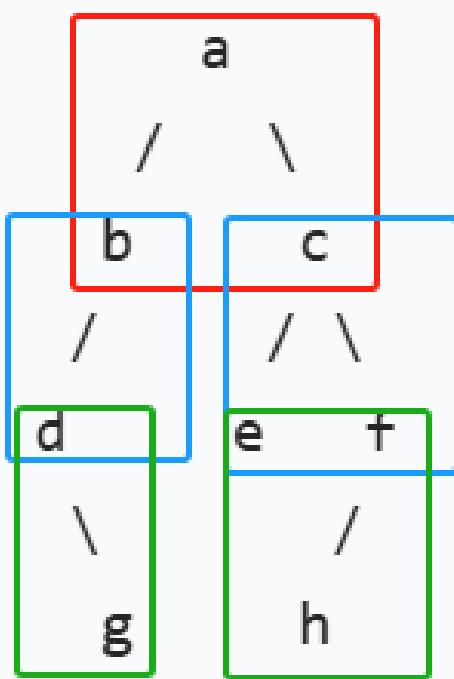
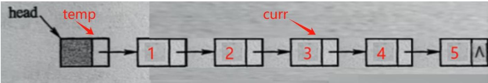

## 13003数据结构与算法

2024年10月真题解析

## 13003数据结构与算法【202410】

## 一、单项选择题：本大题共15小题，每小题2分，共30分。在每小题列出的备选项中只有一项是最符合题目要求的，请将其选出。 6

1.下列任何两个结点之间都没有逻辑关系的是A. 图形结构 B. 线性结构C. 集合 D. 树形结构

答案 ：C

解析

集合由元素构成，没有逻辑关系；树结构和图结构，都是非线性结构

  
图1-2 4类基本数据结构示意图

## 13003数据结构与算法【202410】

2.下列选项中，定义抽象数据类型时不需要做的事情是A. 给出类型的名字 B. 定义类型上的操作C. 实现类型上的操作 N D. 用某种语言描述抽象数据类型

答案 ：C

解析

• 定义类型的名字

· 定义类型上的操作

不实现类型上操作

# 13003数据结构与算法【202410】

3. 在单链表L 中，已知 q所指结点是 p所指结点的前驱结点，next是结点的指针域，若在q和p之间插入s所指结点，则执行的操作是

$$
\scriptstyle { \mathrm { s } } \to \mathrm { n e x t } = \mathrm { p } \to \mathrm { n e x t } ; \mathrm { p } \to \mathrm { n e x t } = \mathrm { s } ;
$$

B. $\mathrm { p ^ { - } { > } n e x t { = } s ^ { - } { > } n e x t { : } } ~ \mathrm { s ^ { - } { > } n e x t { = } p ; }$

C. $\mathrm { p \mathrm { - } \rangle n e x t { = } s ; } \mathrm { s \mathrm { - } \rangle n e x t { = } q ; }$

D. $\scriptstyle \mathbf { q } \to \mathbf { n e x t } = \mathbf { s } ; \mathbf { s } \to \mathbf { n e x t } = \mathbf { p }$ p

答案 ：D

解析



## 13003数据结构与算法【202410】

4.元素a、b、c、d和e依次进入初始为空的栈中，在所有可能的出栈序列中，以元素d开头的序列个数是A.3 B.4C.5 D.6

答案： ：B  
解析  
① dec b a②dceb a③d c be a④ d c b a e



## 13003数据结构与算法【202410】

5. 读入数据元素序列 a, b, c, d,e,f, g 并入栈。下列选项中，不可能是出栈序列的是A. f, e, g, d, a, c, b B. c, d, b, e, f, a, gC. e, f, d, g, c, b, a D. d, e, c, f, b, g, a

答案 ：A

解析

d出栈后，此时栈顶是c，不可能出栈a，所以不可能的出栈序列是：A

## 13003 数据结构与算法【202410】

6.若以1，2，3，4作为双端队列的输入序列，则既不能由输入受限的双端队列得到，又不能由输出受限的双端队列得到的输出序列是A.1, 2, 3, 4 B.4, 1, 3, 2C.4, 2, 3, 1 D.4, 2, 1, 3

答案 ：C

解析 A选项（1、2、3、4）

对于输入受限：假设：A端为输入端，另一端为B端

A端依次输入1、2、3、4，B端依次输出，可得到1,2,3,4




对于输出受限：假设：A端为输出端，另一端为B端

B端依次输入1、2、3、4，A端依次输出，可得到1,2,3,4




## 13003数据结构与算法【202410】

B选项(4、1、3、2)

对于输入受限：假设：A端为输入端，另一端为B端

从A端依次输入1,2,3,4。A端输出4，B端输出1，A端输出3，B端输出2，可得到4,1,3,2




对于输出受限：X

C选项(4、2、3、1)

对于输入受限：X

对于输出受限：

核心：3一定不会在1和2的中间，可能是序列是：321、312、123和213。

设1和2已经入队，2一定与1相连，第3个入队的是3，无论它从哪一段入队，都不会插入到1和2的中间

D选项（4、2、1、3)


对于输入受限：×

对于输出受限：假设：A端为输出端，另一端为B端

步骤：先从B端输入1，A端输入2，B端输入3，A端输入4，可得到4,2,1,3




## 13003数据结构与算法【202410】

7.广义表 A=(a, b,(c, d)，(e,(f, g)))，则 Head(Tail(Head(Tail(Tail(A)))))的值为 A. (g) B. (d) C. c D.d

答案：D

解析

Tail $\scriptstyle ( \mathbf { A } ) = ( \mathbf { b } , ( \mathsf { c } , \mathbf { d } ) , ( \mathbf { e } , ( \mathsf { f } , \mathsf { g } ) ) )$

Tail $| ( \mathbf { T a i l } ( \mathbf { A } ) ) { = } ( ( \mathsf { c } , \mathsf { d } ) , ( \mathsf { e } , ( \mathsf { f } , \mathsf { g } ) ) )$

## 13003数据结构与算法【202410】

8. 若串 $\scriptstyle \mathbf { S } = { \ ' } \mathbf { \{ \ o f t w a r e }  ^ { \prime \prime }$ ，其子串的数目是A.8 B.9C.36 D.37

答案 ：D

解析

代入公式： $\mathsf { n } ( \mathsf { n } + 1 ) / 2 \ + \ 1$

假设一个长度为n的串，求子串的数目？ $[ { \mathsf { S } } = " { \mathsf { a b c d e } } " ]$ 理解分析：

$$
8 \times ( 8 + 1 ) / 2 + 1 = 3 6 + 1 = 3 7
$$

• 非空子串个数

长度为1的子串有n个【5】

长度为2的子串有n-1个【4】

长度为3的子串有n-2个【3】

长度为n的子串有1个【1】

$$
\mathsf { n } ( \mathsf { n } + 1 ) / 2
$$

空串个数：1个

综上所述：子串的数目为： $\mathsf { n } ( \mathsf { n } + 1 ) / 2 \ + \ 1$

## 13003数据结构与算法【202410】

9. 带头结点的单链表的头指针为head，表为空的判定条件是 A. head==NULL; B. head->next==NULL; C. head!=NULL; D. $\scriptstyle \mathtt { h e a d \mathrm { - } } \gamma \mathtt { n e x t } = = \mathtt { h e a d } ;$

答案 ：B

解析

在带头结点的单链表中，表为空的判定条件是： $\mathsf { h e a d - } > \mathsf { n e x t } = = \mathsf { N U L l }$

## 13003数据结构与算法【202410】

10.稀疏矩阵的存储结构中，除存储三元组线性表的所有元素外，还包括A. 稀疏矩阵的所有零元素及其位置B.稀疏矩阵的行数、列数及非零元素的个数 6C.三元组线性表元素之间的关系 65.comD.矩阵元素的数据类型

答案： ：B

解析

三元组表，i，j，v，行，列，值

## 13003数据结构与算法【202410】

11.对n个元素的表做顺序查找时，若查找每个元素的概率相同，则平均查找长度为A. $( n + 1 ) / 2$ B. $n / 2$ kaC. n D. $( 1 + \mathtt { n } ) * \mathtt { n } / 2$

答案 ：A

解析

因为查找每个元素的概率相同，均为1/n， $\mathsf { A S L } = ( 1 + 2 + \hdots + \mathsf { n } ) \times 1 / \mathsf { n } = ( \mathsf { n } + 1 ) / 2$

## 13003数据结构与算法【202410】

12. 某二叉树的先序遍历序列是 abdgcefh，中序遍历序列是 dgbaechf，则其后序遍历 序列是 ww A. gdbehfca B. abcdefgh C. gdbaefch D. ghbcdefa

答案：A

解析

先序遍历：abdgcefh

中序遍历：dgbaechf

扩展法：

bca

→db efc a

→gdb ehfc a



a   
b C   
d f   
g h

## 13003数据结构与算法【202410】

13.在一个具有n个顶点的有向图中，所有顶点的出度之和为d，则所有顶点的入度之和为A. n B.d-1C. d D. d+1

答案： ：C

解析

无向图中，总度数=2边；

有向图中，所有顶点的入度之和=出度之和=边数

## 13003数据结构与算法【202410】

14.对线性表进行二分查找时，要求线性表必须A. 以顺序方式存储 B. 以顺序方式存储且元素有序C. 以链式方式存储 D. 以链式方式存储且元素有序

答案： ：B

解析

前提条件：顺序存储，元素有序

## 13003数据结构与算法【202410】

15.下列排序方法中，辅助空间为O(n)的是A. 希尔排序 B. 堆排序C. 选择排序 D. 归并排序

答案：D

解析

希尔排序是一种改进的插入排序，它在排序过程中只需要几个临时变量来辅助交换元素，辅助空间复杂度为O(1)堆排序是利用堆这种数据结构来进行排序的算法，在排序过程中只需要常数级别的额外空间来进行元素的交换操作辅助空间复杂度为O(1)

选择排序在每一轮找到最小（或最大）的元素，然后与未排序部分的第一个元素交换位置，整个过程只需要几个临时变量来辅助交换，辅助空间复杂度为O(1)

归并排序是采用分治法的思想，将数组不断地分成两半，直到子数组只包含一个元素，然后再将这些子数组合并起来。在合并过程中，需要额外的空间来存储临时的合并结果，其辅助空间复杂度为O(n)

## 13003数据结构与算法【202410】

二、填空题：本大题共10小题，每小题2分，共20分。

16.在数据结构中， 是数据元素之间存在着先后次序关系的结构。

## 答案：线性结构

解析

线性结构：是数据元素之间存在着先后次序关系的结构，每个元素都对应着一个唯一的次序，这个次序决定着元素的位置。

## 13003数据结构与算法【202410】

17.设顺序表的每个元素占8个存储单元。若第1个元素的存储首地址为100，则第6个元素占用的最后一个存储单元的地址是

答案：147

解析

LOC(ai) = LOC(a₀) +i×d

$$
\mathsf { a } _ { 0 } \mathsf { = } 1 0 0 , \ \mathsf { d } = 8
$$

$$
\mathsf { a } _ { 6 } ^ { } \ = \ 1 0 0 + 6 \times 8 = 1 4 8
$$

(第7个元素的首地址)

所以：第6个元素占用的最后一个存储单元的地址是：148-1=147

备注：数组从下标0开始，即：第一个元素是a。

## 13003数据结构与算法【202410】

18.在数组中保存的链表称为

答案：静态链表

解析

用一维数组实现的链表，兼具顺序表和链表优点→静态链表【新增内容】

## 13003数据结构与算法【202410】

19.在图的存储结构中，链式存储结构以 为代表。

答案：邻接表

解析：

顺序存储结构－邻接矩阵

链式存储结构－邻接表和逆邻接表

## 13003数据结构与算法【202410】

20.广义表G=（a，b，（c，d，（e，f）），g)的长度为。

答案 ：4

解析

$$
\mathrm { \bf G = \left( { \bf a } , { \bf b } , \left[ { \bf \left( c , { \bf d } , \Lambda \left( e , { \bf \Lambda f } \right) \right]}  , { \bf \Lambda g } \right) \right]}  , 
$$

## 13003数据结构与算法【202410】

21. 链式队列采用带头指针及尾指针的\_作为队列的存储结构。

答案：单链表

解析

不能确定队列中同时保存的元素个数的上限时，采用链式存储方式，使用一个单链表保存队列

## 13003数据结构与算法【202410】

22.一棵二叉树共有20个结点，其中叶结点为5个，则度为1的结点的个数是

答案：11

解析

由性质3可知： $2 0 = 5 + \mathsf { n } _ { 1 } + \mathsf { n } _ { 2 }$ 和 $5 \mathrm { = } \mathsf { n } _ { 2 } + 1$ ，得出 $\mathsf { n } _ { 2 } = 4 , \mathsf { n } _ { 1 } = 1 1$

性质3：对任何非空二叉树T，设二叉树中结点总数为 $\mathsf { n }$

度为0的结点数(叶结点数)为 ${ \mathfrak { n } } _ { 0 }$ 度为1的结点数为 $\mathsf { n } _ { 1 }$ 1

度为2的结点数为 ${ \mathsf { n } } _ { 2 }$ ，则有 $n = n _ { 0 } + n _ { 1 } + n _ { 2 }$ 和 $n _ { 0 } = n _ { 2 } + 1$

## 13003数据结构与算法【202410】

23.影响排序效率的两个因素是关键字的次数和记录的移动次数。

答案：比较

解析

## 13003数据结构与算法【202410】

24.若用起泡排序方法对序列11，15，27，29，42，53进行降序排序，则需要进行比较操作的次数是 5

答案 ：15

解析

数据元素个数n=6，进行比较的次数是： $\scriptstyle \mathtt { n } \times ( \mathtt { n } - 1 ) / 2 = 6 \times 5 / 2 = 1 5 .$

备注：起泡排序比较的次数是： $\ n { \times } ( n - 1 ) / 2$

## 13003数据结构与算法【202410】

25. 若连通图的顶点个数是n，则该图的最小生成树的边数是 二。

答案：n-1

解析

n个顶点，最小生成树的边：n-1

## 13003数据结构与算法【202410】

## 三、解答题：本大题共4小题，每小题5分，共20分。

26.构造哈希函数时通常考虑的因素有哪些？

27.简述算法的五个特性。

## 26题答案

①计算哈希函数所需的时间。

②关键字的长度。

③哈希表的大小。

④关键字的分布情况。

⑤记录的查找频率。

## 助记：时长表布频

## 27题答案

①输入：有0或多个输入值。

②输出：有1或多个输出值。

③有穷性：一个算法必须在执行有穷步骤之后结束。

④确定性：算法的每一个步骤都必须有确切的含义。

⑤可行性：算法中要做的运算都是基本的、能够精确进行的。

助记：出入有确（喜鹊）行（同行）

## 13003数据结构与算法【202410】

28. 若无向图G 中含有 n 个顶点和 e条边，则它的邻接矩阵中0的个数是多少？

答案：n×n-2e

解析

①因为图G中含有n个顶点，所以邻接矩阵中元素个数为n×n，即： ${ \mathsf { n } } ^ { 2 }$

②无向图的邻接矩阵是对称矩阵，一条边连接两个顶点，所以有2e个1

③ 所以0的个数是： $\mathsf { n } ^ { 2 } - 2 \mathsf { e }$

## 13003数据结构与算法【202410】

29. 设5个元素1、2、3、4、5依次入栈，以push(x)表示 x入栈，pop(x)表示x出栈，写出得到出栈序列2、1、4、3、5的操作过程。

答案： push(1), push(2), pop(2), pop(1), push(3), push(4), pop(4), pop(3), push(5), pop(5)

解析

<table><tr><td rowspan=1 colspan=1></td><td rowspan=1 colspan=1></td><td rowspan=1 colspan=1></td><td rowspan=1 colspan=1></td><td rowspan=1 colspan=1></td><td rowspan=1 colspan=1></td><td rowspan=1 colspan=1></td><td rowspan=1 colspan=1></td><td rowspan=1 colspan=1></td><td rowspan=1 colspan=1></td><td rowspan=1 colspan=1></td></tr><tr><td rowspan=1 colspan=1>2</td><td rowspan=1 colspan=1>)</td><td rowspan=1 colspan=1></td><td rowspan=1 colspan=1>à</td><td rowspan=1 colspan=1>4</td><td rowspan=1 colspan=1>7</td><td rowspan=1 colspan=1></td><td rowspan=1 colspan=1>+</td><td rowspan=1 colspan=1></td><td rowspan=1 colspan=1>十</td><td rowspan=1 colspan=1></td></tr><tr><td rowspan=1 colspan=1>1</td><td rowspan=1 colspan=1></td><td rowspan=1 colspan=1></td><td rowspan=1 colspan=1></td><td rowspan=1 colspan=1>3</td><td rowspan=1 colspan=1></td><td rowspan=1 colspan=1></td><td rowspan=1 colspan=1></td><td rowspan=1 colspan=1>5</td><td rowspan=1 colspan=1></td><td rowspan=1 colspan=1></td></tr></table>

# 13003数据结构与算法【202410】

## 四、算法阅读题：本大题共4小题，每小题5分，共20分。

30.程序的功能是返回指针curr指向结点的位置，请在空白处填上适当内容以将算法补充完整。 W

```c
Position func (LinkList *head, LinkNode *curr)
{ LinkNode *temp=*head;
int count=0;
if(*head==NULL_①_curr==NULL)
printf("指针无效\n");
return②;
}
while(temp!=curr&&temp!=NULL)
{ temp=__③__;
_④；
}
return_⑤__;
}
```



答案

①II

② ERROR

③ temp->next

④ count++

⑤ count

备注：教材P71，【例2-9】原题，原函 数名setPos

## 13003数据结构与算法【202410】

31.已知线性表的存储结构为顺序表，阅读下列算法，并回答问题：

void func (SeqList \*L)  
{ int i, j;  
for(i=j=0;i<L->length;i++)  
if(L->data[i]>=0)  
{if(i!=j)  
L->data[j]=L->data[i];  
j++;  
}  
L->length=j;  
}  
(1)设线性表L=(19,-6,-9,26,0,-21,74,35,-30)，写出执行 func(&L)后  
的L状态；  
(2) 简述算法 func 的功能。

## 答案

① L=(19,26,0,74,35)

②算法的功能：删除顺序表中负值元素。

将顺序表L中的非负元素依次移动到顺序表的前部，保持它们的相对顺序不变，并且更新顺序表的长度

## 13003数据结构与算法【202410】

## 32.已知顺序表的表结构定义如下：

```c
#define MAXLEN 100
typedef int KeyType;
typedef struct
{
KeyType key;
InfoType otherinfo;
}
NodeType;
typedef NodeType SqList[MAXLEN];
阅读下列程序，并回答问题：
int func (SqList R, NodeType X, int p, int q)
{ int m;
if (p>q) return -1;
m=(p+q)/2;
if(R[m]. key==X. key)
returnm;
if(R[m]. key>X. key)
return func (R, X, p, m−1) ;
else return func (R, X, m+1, q) ;
```

（1）若顺序表R的关键字序列为(3,6,15,28,53,70,115)，分别写出 X.key=19和 X. key=28时，执行函数调用 func(R, X, 0,6)的函数返回值；

(2) 简述算法 func 的功能。

## 答案

①-1; 3

②算法的功能：折半查找给定的关键字，若存在则返回关键字在表中的位置(或下标),否则返回-1。

## 13003数据结构与算法【202410】

33.阅读下列算法，并回答问题：

```prolog
void func(int r[], int n)
{ int i, j;
for(i=2;i<n;i++)
i=2 { r[0]=r[i];
r[0]=r[i]=r[2]=35
j=i-1=1 j=i-1;
while(35<68)
{ while (r[0]<r[j])
r[2]=r[1]=68 { r[j+1]=r[j] ;
j=j-1=0
1 j=j-1;
r[1]=r[0]=35
}
r[1], r[2] r[j+1]=r[0];
35 68
}
}
```

(1）这是哪一种插入排序算法？该算法是否稳定？

(2)设置r[0]的作用是什么？

## 考点1 插入排序-直接插入排序

基本思想：每趟把[无序区]的第一个数据插入到[有序区]中的合适位置方法：初始时第一个数据是[有序区]，其他数据是[无序区]

42,68,35,1,70,25,79,59,63,65 [42][68,35,1,70,25,79,59,63,65]

答案

①直接插入排序；该算法稳定。

②r[0]用来存储每次待插入的元素，免去查找过程中 每次都要检测整个表是否查找完毕，提高了查找效

## 13003数据结构与算法【202410】

## 五、算法设计题：10分。

34.存储二叉树的二叉链表定义如下：

答案：后序遍历(左右根)，递归

```c
void PostOrder(BinTree root)
typedef struct node
{
{ char data; if(root!= NULL)
{
struct node *lchild, *rchild;
Postorder(root->lchild) ;
} PostOrder(root->rchild) ;
BinTNode; printf("%c",root->data) ;
}
typedef BinTNode *BinTree; }
请编写一个后序遍历二叉树的递归程序 void PostOrder(BinTree root)，并输出遍
历序列。其中root指向二叉树根结点。
```

## 谢谢大家