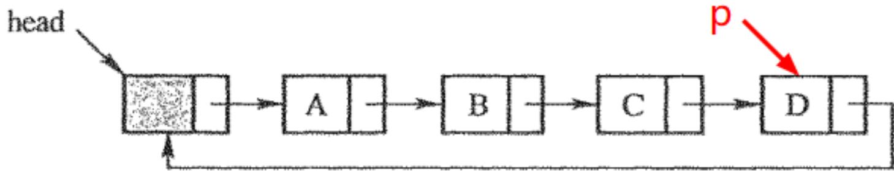
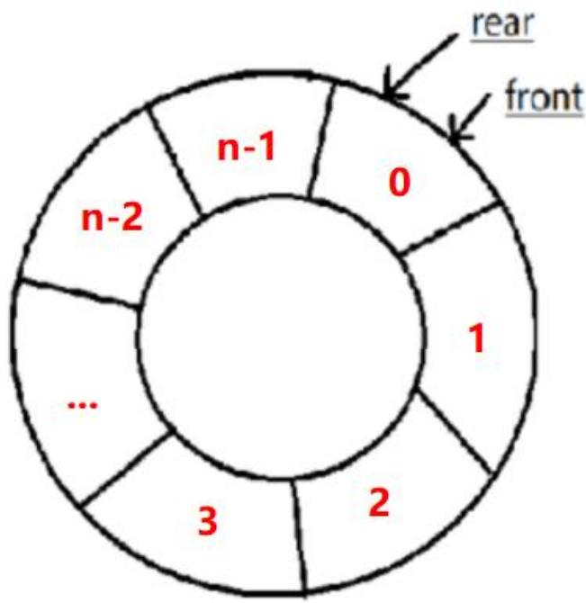
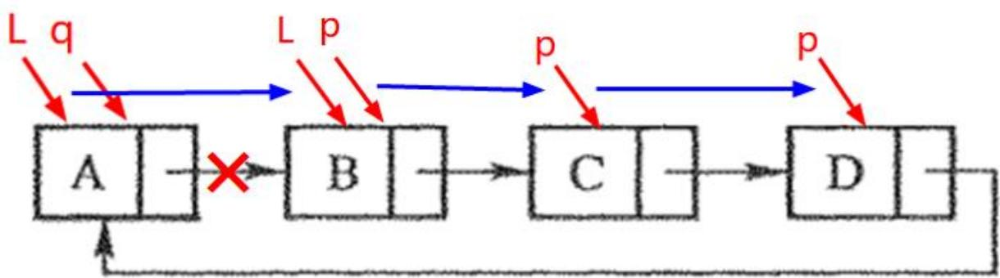
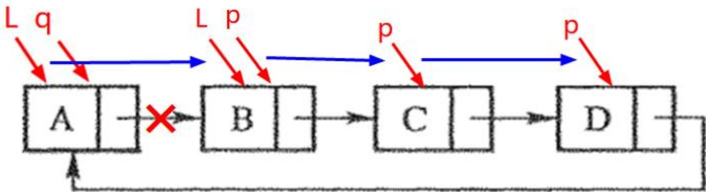

## 13003 数据机构与算法

2025年4月 真题解析

## 13003 数据结构与算法【202504】

一、单项选择题：本大题共15小题，每小题2分，共30分。在每小题列出的备选项中只有一项是最符合题目要求的，请将其选出。

1.下列关于数据的逻辑结构的叙述中，不正确的是A. 数据的逻辑结构是数据间关系的描述B. 数据的逻辑结构抽象反映数据元素间的逻辑关系C.数据的逻辑结构具体反映数据在计算机中的存储方式D. 数据的逻辑结构分为线性结构和非线性结构

答案：C

解析：

数据的逻辑结构是独立于存储方式的

## 13003 数据结构与算法【202504】

2. 算法分析要评估的两个主要方面是  
A. 空间复杂度和时间复杂度  
B. 正确性和简明性  
C. 可读性和文档性  
D.数据复杂性和程序复杂性

答案：A

解析：

## 13003 数据结构与算法【202504】

3. 将斐波那契数列前n项保存在数组中，设计算法时适宜使用的策略是  
A. 分治法 B. 穷举法  
C. 递归法 D. 递推法

答案：D

解析：

递推法的一种典型例子：斐波那契数列

## 13003 数据结构与算法【202504】

4.设顺序表中有n个数据元素，若删除表中第i个元素则需要移动的元素个数是A. i B. $n { + } 1 { - } i$   
C. $n { - } 1 { - } i$ D. $n { - } i$

答案：D

解析：

移动 i+1 \~ n 的所有元素，一共 n-i 个元素

<table><tr><td rowspan=1 colspan=1>1</td><td rowspan=1 colspan=1>2</td><td rowspan=1 colspan=1>1  1  </td><td rowspan=1 colspan=1>1</td><td rowspan=1 colspan=1>i+1</td><td rowspan=1 colspan=1>1  11  1</td><td rowspan=1 colspan=1>n</td></tr></table>

举例子：一共5个，当i=3, 挪动3,4,5，就是5-i

## 13003 数据结构与算法【202504】

5. 在头指针为head的非空单向循环链表中，指针 $\mathfrak { p }$ 指向尾结点，下列关系成立的是A. $\scriptstyle { \mathrm { p } } \to \mathrm { n e x t } = = { \mathrm { h e a d } }$ B. $\scriptstyle { \mathrm { p } } \to \mathrm { n e x t } - \gamma \mathrm { n e x t } = = \mathrm { h e a d }$ C. $\scriptstyle { \mathrm { p } } \to \mathrm { n e x t } = = { \mathrm { N U L L } }$ D. $\scriptstyle \mathtt { p } = = \mathtt { h e a d }$

答案：A

解析：

## 13003 数据结构与算法【202504】

6.一个栈的输入序列为1，2，3，..，n，若输出序列的第一个元素是n，则第i（1<i≤n）个输出元素是A. n-i-1 B. n-i+1C. n-i D. i

答案：B

解析：

和 = n + 1，第 i 个，就是：n + 1 - i

<table><tr><td rowspan=1 colspan=1>n</td><td rowspan=1 colspan=1>1</td></tr><tr><td rowspan=1 colspan=1>n   1</td><td rowspan=1 colspan=1>2</td></tr><tr><td rowspan=1 colspan=1>■  1  1</td><td rowspan=1 colspan=1>I  1  1</td></tr><tr><td rowspan=1 colspan=1>1</td><td rowspan=1 colspan=1>？</td></tr><tr><td rowspan=1 colspan=1>1  1  ■</td><td rowspan=1 colspan=1>1  1  1</td></tr><tr><td rowspan=1 colspan=1>2</td><td rowspan=1 colspan=1></td></tr><tr><td rowspan=1 colspan=1>1</td><td rowspan=1 colspan=1></td></tr></table>

## 13003 数据结构与算法【202504】

7.入栈序列是1，2，3，4，出栈序列是2，4，3，1，则栈的容量最小是A. 1 B.2C.3 D.4

答案：C

解析：

<table><tr><td rowspan=1 colspan=1></td><td rowspan=1 colspan=1></td><td rowspan=1 colspan=1></td><td rowspan=1 colspan=1></td><td rowspan=1 colspan=1></td></tr><tr><td rowspan=1 colspan=1></td><td rowspan=1 colspan=1></td><td rowspan=1 colspan=1></td><td rowspan=1 colspan=1></td><td rowspan=1 colspan=1>4</td></tr><tr><td rowspan=1 colspan=1>2</td><td rowspan=1 colspan=1></td><td rowspan=1 colspan=1></td><td rowspan=1 colspan=1>→</td><td rowspan=1 colspan=1>3</td></tr><tr><td rowspan=1 colspan=1>1</td><td rowspan=1 colspan=1></td><td rowspan=1 colspan=1>1</td><td rowspan=1 colspan=1></td><td rowspan=1 colspan=1>1</td></tr></table>

## 13003 数据结构与算法【202504】

8. 已知循环队列存储在一维数组 A[0...n-1]中，且队列非空时 front和 rear 分别指向队头元素与队尾元素。若初始时队列为空，且要求第一个进入队列的元素存储在A[0]处，则初始时 front 和 rear 的值分别是A.0, 0 B.0, n-1C. n-1, 0 D. n−1, n−1

答案：B

解析：

入队，队尾 + 1 到A[0]处所以，初始时：

$$
\mathbf { f r o n t } = \mathbf { 0 }
$$

$$
\boldsymbol { \ r e a r } = \mathbf { n } - \mathbf { \tilde { l } }
$$

## 13003 数据结构与算法【202504】

9.广义表((a),a)的表头和表尾分别是 A. a, ((a)) B.((a)), a C. (a), a D. (a), (a)   
答案：D   
解析： ((a) ,a)

## 13003 数据结构与算法【202504】

10. 设有两个串p和q，其中 q是 p的子串，求 q在 p 中首次出现的位置的运算称为A. 模式匹配 B. 联接C. 求子串 D. 求串长

答案： A

解析：

模式匹配就是找子串首次出现的位置

## 13003 数据结构与算法【202504】

11.若一棵二叉树中度为1的结点个数是3，度为2的结点个数是4，则该二叉树叶 子结点的个数是 A.4 B.5 C.7 D.8

答案：B

解析：

度为 0 的结点数(叶结点数)为 $\mathsf { n } _ { 0 }$ 度为 1 的结点数为 ${ \mathfrak { n } } _ { 1 } = 3$ 度为 2 的结点数为 $\mathsf { n } _ { 2 } = 4$ $\mathsf { n } _ { 0 } = \mathsf { n } _ { 2 } + 1 = 4 + 1 = 5$

## 13003 数据结构与算法【202504】

12. 求带权图单源最短路径的算法称为A. 迪杰斯特拉(Dijkstra) 算法B. 克鲁斯卡尔(Kruskal) 算法C. 普里姆(Prim)算法D.广度优先搜索算法

答案：A

解析：

Dijkstra算法用于单源最短路径

## 13003 数据结构与算法【202504】

13. 平均时间复杂度为 $O \left( n \mathrm { l o g } n \right)$ 的稳定排序算法是A. 快速排序 B. 堆排序C. 归并排序 D. 冒泡排序

答案：C

解析：

表7-1 几种内部排序方法的时间复杂度和稳定性
<table><tr><td rowspan=10 colspan=1>动比•插泡归基稳定无疑</td><td></td><td></td><td></td><td></td><td></td></tr><tr><td rowspan=1 colspan=1>排序方法</td><td rowspan=1 colspan=1>最优情况时间复杂度</td><td rowspan=1 colspan=1>平均情况时间复杂度</td><td rowspan=1 colspan=1>最差情况时间复杂度</td><td rowspan=1 colspan=1>稳定性</td></tr><tr><td rowspan=1 colspan=1>直接插入排序</td><td rowspan=1 colspan=1> $O ( n )$ </td><td rowspan=1 colspan=1> $O ( n ^ { 2 } )$ </td><td rowspan=1 colspan=1> $O ( n ^ { 2 } )$ </td><td rowspan=1 colspan=1>稳定</td></tr><tr><td rowspan=1 colspan=1>起泡排序</td><td rowspan=1 colspan=1> $O ( n ^ { 2 } )$ </td><td rowspan=1 colspan=1> $O \{ n ^ { 2 } \}$ </td><td rowspan=1 colspan=1> $O ( n ^ { 2 } )$ </td><td rowspan=1 colspan=1>稳定</td></tr><tr><td rowspan=1 colspan=1>简单选择排序</td><td rowspan=1 colspan=1> $O ( n ^ { 2 } )$ </td><td rowspan=1 colspan=1> $O \big ( n ^ { 2 } \big )$ </td><td rowspan=1 colspan=1> $O ( n ^ { 2 } )$ </td><td rowspan=1 colspan=1>不稳定</td></tr><tr><td rowspan=1 colspan=1>希尔排序</td><td rowspan=1 colspan=1> $O ( n ^ { 3 / 2 } )$ </td><td rowspan=1 colspan=1></td><td rowspan=1 colspan=1></td><td rowspan=1 colspan=1>不稳定</td></tr><tr><td rowspan=1 colspan=1>快速排序</td><td rowspan=1 colspan=1> $O \left( n \mathrm { l o g } n \right)$ </td><td rowspan=1 colspan=1> $O \left( n \mathrm { l o g } n \right)$ </td><td rowspan=1 colspan=1> $O ( n ^ { 2 } )$ </td><td rowspan=1 colspan=1>不稳定</td></tr><tr><td rowspan=1 colspan=1>归并排序</td><td rowspan=1 colspan=1> ${ \mathcal { O } } ( n \mathrm { l o g } n )$ </td><td rowspan=1 colspan=1> $O ( n \mathrm { l o g } n )$ </td><td rowspan=1 colspan=1> $O ( n \log n )$ </td><td rowspan=1 colspan=1>稳定</td></tr><tr><td rowspan=1 colspan=1>堆排序</td><td rowspan=1 colspan=1> $ { \mathcal Ḋ O Ḍ } ( n \mathrm { l o g n } )$ </td><td rowspan=1 colspan=1> $O ( n \mathrm { l o g } n )$ </td><td rowspan=1 colspan=1> $\ O \left( n \mathrm { l o g } n \right)$ </td><td rowspan=1 colspan=1>不稳定</td></tr><tr><td rowspan=1 colspan=1>基数排序</td><td rowspan=1 colspan=1> $O ( d n )$ </td><td rowspan=1 colspan=1> $O ( d n )$ </td><td rowspan=1 colspan=1> $O ( { d n } )$ </td><td rowspan=1 colspan=1>稳定</td></tr></table>

## 13003 数据结构与算法【202504】

14.分块查找方法将表分为多块，并要求A. 块内有序 B. 各块等长C. 块间有序 D. 链式存储

答案：C

解析：

<table><tr><td>2,1,3</td><td></td><td>5,4,6,7</td></tr></table>

## 13003 数据结构与算法【202504】

15.下列关键字序列中，构成大根堆的是A.5, 8, 1, 3, 9, 6, 2, 7 B.9, 8, 1, 7, 5, 6, 2, 3C.9, 8, 6, 3, 5, 1, 2, 7 D.9, 8, 6, 7, 5, 1, 2, 3

答案： D

解析：

大根堆：上比下大

<table><tr><td>9 1</td><td>1 6 1 8 1</td><td>2 1 5 7</td><td>3</td></tr><tr><td>9</td><td>6 一 8</td><td>1 1 1 _</td><td>2 1 5 3</td><td>7</td></tr><tr><td>1 9 一</td><td>1 8</td><td>1</td><td>2 6 5 7</td><td>1 3</td></tr><tr><td>一 5 </td><td>1 8</td><td>1</td><td>2 6 9 3</td><td>7</td></tr></table>

## 13003 数据结构与算法【202504】

二、填空题：本大题共10小题，每小题2分，共20分。

16. 在数据结构中， 作为一个完整的对象（整体）是构成数据的基本单位。

答案：数据元素

解析：

概念

## 13003 数据结构与算法【202504】

17.算法中要做的运算都是相当基本的、能够精确进行的，这个特性是算法的

## 答案：可行性

解析：

可行性：算法中要做的运算都是相当基本的、能够精确进行的。

## 13003 数据结构与算法【202504】

18. 线性表基本操作的具体实现需要依赖线性表的。

答案：存储结构

解析：

概念

## 13003 数据结构与算法【202504】

19. 在有 n个顶点的无向图中，其边数最多可达\_\_。

答案： $\scriptstyle \mathbf { n } ( \mathbf { n - 1 } ) / 2$

解析：

n 个顶点 全相连，完全图

$$
C _ { n } ^ { 2 } = { \frac { n ! } { 2 ! ( n - 2 ) ! } } = { \frac { n ( n - 1 ) } { 2 } }
$$

## 13003 数据结构与算法【202504】

20. 高度为4的AVL树中，最少有\_个结点。

答案：7

解析：

分析：假设高度为 h的AVL树所含有结点个数为： $N _ { H }$

己知： $\Lambda _ { 0 } { = } 0 , \Lambda _ { 1 } { = } 1$

$N _ { 2 } = N _ { 1 } + N _ { 0 } + 1$ 9 即： $N _ { 2 } = 2$

$N _ { 3 } = N _ { 2 } + N _ { 1 } + 1$ ，即： $N _ { 3 } = 4$ ，依此类推，利用递推法： $\Nu _ { \mathrm { h } } { = } \Nu _ { \mathrm { h - 1 } } { + } \Nu _ { \mathrm { h - 2 } } { + } \mathrm { 1 } ( \mathrm { h } { > } 1 )$

所以： $N _ { 4 } = N _ { 3 } + N _ { 2 } + 1$ ，即： $N _ { 4 } = 7$ 扩展： $N _ { 5 } = N _ { 4 } + N _ { 3 } + 1$ ，即： $N _ { 5 } { = } 1 2$

## 13003 数据结构与算法【202504】

21.在有序表（1 3 9 12 32 41 45 62 75 77 82 95 100）中，进行折半查找时，若查找关键字9时的比较次数为2，则查找关键字75时的比较次数是

答案：4

解析：

方法：先确定中间位置，目标值=中间位置值，查找成功；

目标值<中间位置值，查找前一半；

目标值>中间位置值，查找后一半；

确定中间位置，可以向下取整 $\mathrm { { ( m i d { = } L \Omega \ ( \ l o w { + } h i g h ) / 2 \rfloor \ } }$ )，也可以向上取整$\scriptstyle \left( { \mathrm { m i d } } = { \Gamma } \ \left( { \mathrm { l o w } } + { \mathrm { h i g h } } \right) / 2 7 \ \right)$

通过对关键字 9 的比较次数为2，可知：向下取整

<table><tr><td rowspan=1 colspan=1>1</td><td rowspan=1 colspan=1>3</td><td rowspan=1 colspan=1>9</td><td rowspan=1 colspan=1>12</td><td rowspan=1 colspan=1>32</td><td rowspan=1 colspan=1>41</td><td rowspan=1 colspan=1>45</td><td rowspan=1 colspan=1>62</td><td rowspan=1 colspan=1>75</td><td rowspan=1 colspan=1>77</td><td rowspan=1 colspan=1>82</td><td rowspan=1 colspan=1>95</td><td rowspan=1 colspan=1>100</td></tr></table>

## 13003 数据结构与算法【202504】

22. 影响排序效率的两个因素是关键字的 次数和记录的移动次数。

答案：比较

解析：

概念

## 13003 数据结构与算法【202504】

23. 对特殊矩阵进行压缩的目的是节省

答案：存储空间

解析：

## 13003 数据结构与算法【202504】

24. 对序列{55,46,13,94,17,42}进行基数排序，第一趟排序后的结果是 0

答案：42,13,94,55,46,17

解析：

<table><tr><td rowspan=1 colspan=1>个位</td><td rowspan=1 colspan=1></td></tr><tr><td rowspan=1 colspan=1>0</td><td rowspan=1 colspan=1></td></tr><tr><td rowspan=1 colspan=1>1</td><td rowspan=1 colspan=1></td></tr><tr><td rowspan=1 colspan=1>2</td><td rowspan=1 colspan=1>42</td></tr><tr><td rowspan=1 colspan=1>3</td><td rowspan=1 colspan=1>13</td></tr><tr><td rowspan=1 colspan=1>4</td><td rowspan=1 colspan=1>94</td></tr><tr><td rowspan=1 colspan=1>5</td><td rowspan=1 colspan=1>55</td></tr><tr><td rowspan=1 colspan=1>6</td><td rowspan=1 colspan=1>46</td></tr><tr><td rowspan=1 colspan=1>7</td><td rowspan=1 colspan=1>17</td></tr><tr><td rowspan=1 colspan=1>8</td><td rowspan=1 colspan=1></td></tr><tr><td rowspan=1 colspan=1>9</td><td rowspan=1 colspan=1></td></tr></table>

## 13003 数据结构与算法【202504】

25.设某棵二叉树的中序遍历序列为ABCD，后序遍历序列为BADC，则其先序遍历序列为

答案：CABD

解析：

中序遍历：左 → 根 → 右，AB | CD

后序遍历：左 → 右 → 根，BAD | C

先序遍历：根 → 左 → 右  
C (AB) D  
A B

C B

## 13003 数据结构与算法【202504】

三、解答题：本大题共4小题，每小题5分，共20分。

26.列出五种构造哈希函数的方法。

27. 含有 n 个顶点的连通图 G的最小生成树有哪些性质？

28.设二维数组A[5][6]的每个元素占4个字节，已知数组首地址为1000，A共占多少个字节？分别按行和列优先存储时，A[2][5]的起始地址分别为多少？

29.简述二叉树先序遍历算法的过程。

## 13003 数据结构与算法【202504】

## 答案：

26. 五种构造哈希函数的方法：

1）直接定址法

2）平方取中法

3）折叠法

4）基数转换法

5）除留余数法

27. 含有 n 个顶点的连通图 G 的最小生成树的性质：

1）包含 n 个顶点

2）有 n-1 条边

3）是连通图，但是没有回路

4）权值之和最小（可能不唯一）

## 13003 数据结构与算法【202504】

## 答案：

## 28. 二维数组 A[5][6] 的计算：

A 共占字节数：5 × 6 × 4 = 120 字节。

行优先存储时，A[0][0]和A[2][5]之间有 (2 × 6 + 5 = 17) 个元素，每个元素占4个存储单元，A[2][5] 的地址：1000 + (2 × 6 + 5) × 4 = 1068

列优先存储时，A[0][0]和A[2][5]之间有 (5 × 5 + 2 = 27) 个元素，每个元素占4个存储单元，A[2][5] 的地址：1000 + (5 × 5 + 2) × 4 = 1108

## 29. 二叉树先序遍历算法的过程：

1）访问根结点

2）先序遍历左子树

3）先序遍历右子树（递归或迭代实现）

<table><tr><td rowspan=1 colspan=1></td><td rowspan=1 colspan=1>0</td><td rowspan=1 colspan=1>1</td><td rowspan=1 colspan=1>2</td><td rowspan=1 colspan=1>3</td><td rowspan=1 colspan=1>4</td><td rowspan=1 colspan=1>5</td></tr><tr><td rowspan=1 colspan=1>0</td><td rowspan=1 colspan=1>1000</td><td rowspan=1 colspan=1></td><td rowspan=1 colspan=1></td><td rowspan=1 colspan=1></td><td rowspan=1 colspan=1></td><td rowspan=1 colspan=1></td></tr><tr><td rowspan=1 colspan=1>1</td><td rowspan=1 colspan=1></td><td rowspan=1 colspan=1></td><td rowspan=1 colspan=1></td><td rowspan=1 colspan=1></td><td rowspan=1 colspan=1></td><td rowspan=1 colspan=1></td></tr><tr><td rowspan=1 colspan=1>2</td><td rowspan=1 colspan=1></td><td rowspan=1 colspan=1></td><td rowspan=1 colspan=1></td><td rowspan=1 colspan=1></td><td rowspan=1 colspan=1></td><td rowspan=1 colspan=1></td></tr><tr><td rowspan=1 colspan=1>3</td><td rowspan=1 colspan=1></td><td rowspan=1 colspan=1></td><td rowspan=1 colspan=1></td><td rowspan=1 colspan=1></td><td rowspan=1 colspan=1></td><td rowspan=1 colspan=1></td></tr><tr><td rowspan=1 colspan=1>4</td><td rowspan=1 colspan=1></td><td rowspan=1 colspan=1></td><td rowspan=1 colspan=1></td><td rowspan=1 colspan=1></td><td rowspan=1 colspan=1></td><td rowspan=1 colspan=1></td></tr></table>

{ if(L&&L->next)   
L p   
{ q=L;L=L->next;p=L;   
S1: while(p->next)p=p->next; A B C D   
S2: p->next=q;q->next=NULL;   
return L;

# 13003 数据结构与算法【202504】

## 四、算法阅读题：本大题共4小题，每小题5分，共20分。

30.阅读下列程序，并回答问题：

LinkListmynote(LinkListL)//L 是不带头结点的单链表的头指针

(1)说明语句 S1 及 S2 的功能;

(2)设链表表示的线性表为 $( \mathsf { a } _ { 1 } , \mathsf { a } _ { 2 } , \cdots , \mathsf { a } _ { \mathsf { n } } )$ ，写出算法执行后的返回值所表示的线性表。

## 13003 数据结构与算法【202504】

答案：

(1) 语句功能

S1：通过while(p->next)循环，让指针p不断向后移动，直到p指向链表的最后一个节点。

S2：将原链表的第一个节点连接到当前链表的末尾，并且将原第一个节点的next指针置为NULL，使其成为新链表的最后一个节点。

(2) 算法执行后线性表

原线性表为 $( \mathsf { a } _ { 1 } , \mathsf { a } _ { 2 } , . . . \mathsf { a } _ { \mathsf { n } } )$ ，经过算法操作后，返回值所表示的线性表为 $( \mathsf { a } _ { 2 } , . . . \mathsf { a } _ { \mathsf { n } } , \mathsf { a } _ { 1 } )$ 0

## 13003 数据结构与算法【202504】

.阅读下列程序，并回答问题： main()  
#include<stdio. h>  
{ char str[100]="String";  
substr(char \*t, char \*s, int pos, int len)  
{ while (len>0&&\*s) printf("%s\n", func (str));  
{\*t=\*(s+pos-1);  
t++;s++;len （1）请写出执行该程序后的输出结果；  
}  
(2）简述函数 func的功能。  
\*t='\0';  
  
char \*func (char \*s)  
{ char t[100] ; 答案：  
if (strlen(s)=1) return s; (1) 输出结果：gnirtS  
(2) 函数 func 的功能：  
func (s) ;  
递归地将字符串的第一个字符移到末尾，  
return strcat (s, t) ;  
最终实现字符串的反转。

## 13003 数据结构与算法【202504】

32. 阅读下列算法，并回答问题：

(注：InitQueue、EnQueue、DeQueue和QueueEmpty分别是队列初始化、入队、出  
队和判队空的操作）  
void func (Queue \*Q, Queue \*Q1, Queue \*Q2)  
{ int e;  
InitQueue (Q1) ; InitQueue (Q2) ;  
while(!QueueEmpty (Q))  
{e=DeQueue(Q) ;  
if(e>=0) EnQueue(Q1, e) ;  
else EnQueue (Q2, e)  
}  
为队头元素，写出执行 func(&Q, &Q1, &Q2)之后队列Q、Q1和Q2的状态。  
（2）简述算法 func 的功能。

## 13003 数据结构与算法【202504】

## 答案：

（1）队列状态队列 Q：执行func函数时，不断从队列Q中出队元素，所以执行后队列Q为空。

队列 Q1：当出队元素 ${ \tt e } \geq 0$ 时，将e入队到Q1，所以执行后 $\ Q 1 = ( 2 , 0 , 5 , 6 )$

队列 Q2：当出队元素 ${ \tt e } < 0$ 时，将e入队到Q2，所以执行后 $\mathsf { Q } 2 = ( - 8 , - 3 , - 7 )$

（2）算法功能算法func的功能是：将队列Q中的元素按非负和负进行分类，非负元素依次入队到队列Q1，负元素依次入队到队列Q2，最后队列Q为空。

## 13003 数据结构与算法【202504】

33.下面程序实现插入排序算法，请在空白处填上适当内容以将算法补充完整。

typedef struct {int key; Info otherinfo; } SeqList;   
void InsertSort (SeqList R[], int n)   
{ SeqList x;   
int i, j, k, lo, hi, mi ;   
for (i=2;i<=n;i++)   
① ; lo=1; hi=i-1;   
while (lo<=hi)   
{mi=(lo+hi) /2;   
if（②) break;   
if (R[mi]. key>x. key) hi=mi-1;   
else lo=③;   
if (mi==lo) k=④;   
else k=i-mi-1;   
for (j=0;j<k;j++)   
\_⑤\_;   
R[i-j]=x;

## 13003 数据结构与算法【202504】

## 五、算法设计题：10分。

34.无向图G采用邻接矩阵存储，存储定义如下：

define MAXV 50//最大顶点个数

typedef struct {

int arcs[MAXV][MAXV];//邻接矩阵，顶点关系（0或1）

int vexnum, arcnum;//顶点数，弧数

VertexTypevexs[MAXV];//存放顶点信息

}MGraph;

设计算法求图G中顶点度的最大值。

(1）给出算法的基本设计思想。（4分)

(2)根据设计思想，采用C或C++语言描述算法，关键之处给出注释。(6分)

## 13003 数据结构与算法【202504】

$$
\begin{array} { r } { \mathbb { A } \times \frac { \mathbb { A } \times \mathbb { B } } { \mathbb { A } \times \mathbb { P } _ { 1 } } \mathbb { 1 } \mathbb { 1 } } \\ { \mathbb { B } \times \mathbb { C } \mathbb { 1 } \times \mathbb { 0 } \mathbb { 0 } } \\ { \mathbb { B } \times \mathbb { C } \mathbb { C } \mathbb { 1 } \times \mathbb { 0 } \mathbb { 0 } } \end{array}
$$

## 13003 数据结构与算法【202504】

// 求图G中顶点度的最大值的函数  
int maxVertexDegree (MGraph G) {  
//用于记录最大的顶点度  
int maxDegree = 0;  
for (int i = 0; i < G.vexnum; i++) {  
//用于记录当前顶点的度  
int degree = 0;  
//遍历当前顶点所在行的所有元素  
for (int j = 0; j < G.vexnum; j++) {  
//如果邻接矩阵中当前元素为1，说明有边，顶点度加：  
if (G.arcs[i][j] == 1) {  
degree++;  
}  
}  
// 更新最大顶点度  
if (degree > maxDegree) {  
maxDegree = degree;  
}  
}  
// 返回最大顶点度  
return maxDegree;

## 答案：

(1) 算法的基本设计思想对于无向图的邻接矩阵，顶点的度是其对应行（或列）中1的个数。  
所以算法的基本思想是：遍历邻接矩阵的每一行，计算每行中1的个数（即对应顶点的度），同时记录最大的度值。

## 谢谢大家