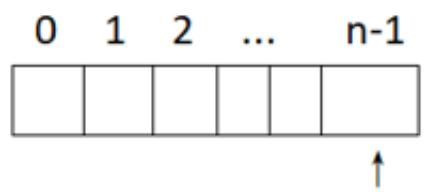
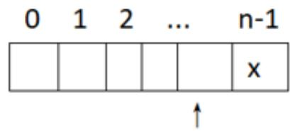
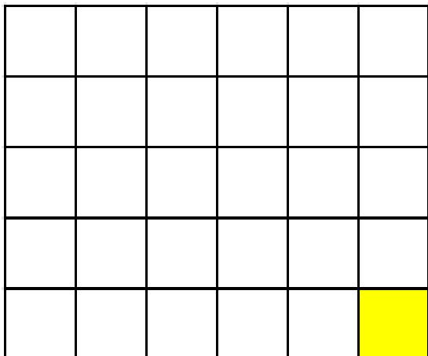
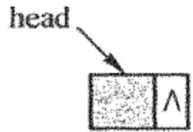
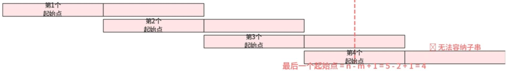
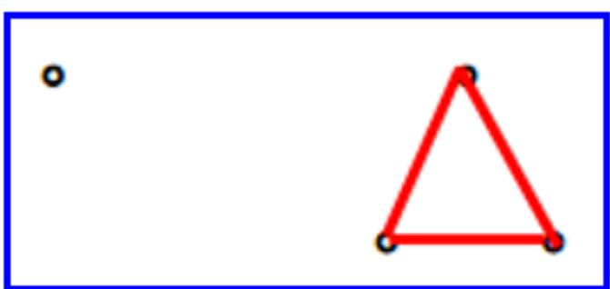
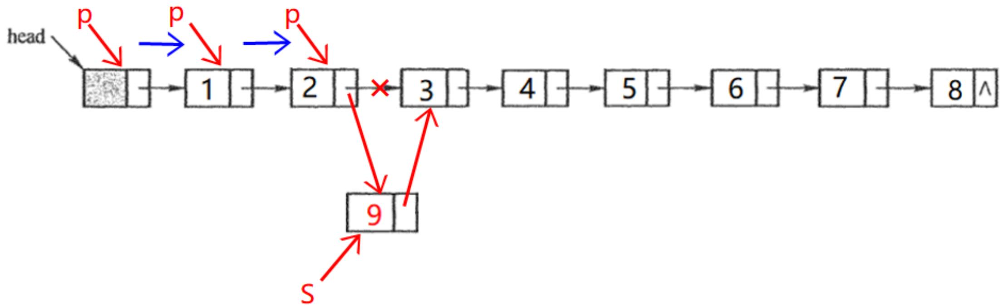

## 13003 数据结构与算法

2025年10月 真题解析

绝密★启用前

# 2025年10月高等教育自学考试全国统一命题考试数据结构与算法

(课程代码 13003)

## 单选题

## 一、单选题（共15小题，每小题2分，共30分）

1. 下列关于顺序存储结构与链式存储结构的叙述中，正确的是A. 顺序存储结构的存储空间是连续的，链式存储结构的存储空间不一定连续B. 顺序存储结构只用于线性结构，链式存储结构只用于非线性结构  
C. 顺序存储结构一定比链式存储结构节省存储空间  
D. 链式存储结构一定比顺序存储结构节省存储空间

答案：A

解析：

顺序存储用连续空间（数组）

链式存储结点可分散，靠指针链接，空间不一定连续（链表）

## 一、单选题（共15小题，每小题2分，共30分）

2. 下列关于算法的叙述中，正确的是A.算法最终必须由计算机程序实现B.一个算法所花的时间等于该算法中每条语句的执行时间之和  
C. 算法的可行性是指指令不能有二义性  
D. 算法不能使用自然语言描述

答案：B

解析：

算法总时间等于每条语句执行时间的总和

## 一、单选题（共15小题，每小题2分，共30分）

3. 下列选项中，不属于链表特点的是A. 插入、删除时不需要移动元素 B. 可随机访问任一元素C. 不必事先估计存储空间 D. 所需空间与元素个数成正比

答案：B

解析：

随机访问是顺序存储的特点（数组），链表只能顺序遍历

## 一、单选题（共15小题，每小题2分，共30分）

4. 若线性表采用链式存储结构保存，则要求内存中可用存储单元的地址A. 必须是连续的 B. 部分地址必须是连续的C.一定是不连续的 D. 连续或不连续都可以

答案： D

解析：

链式结构靠指针链接，结点地址连续或不连续均可

## 一、单选题（共15小题，每小题2分，共30分）

5. 栈和队列的共同点是A. 都是先进后出 B. 都是先进先出C.只允许在端点处插入和删除元素 D. 没有共同点

答案：C

解析：

栈仅在栈顶操作

队列仅在队头 / 队尾操作，均限制在端点插入 / 删除元素

## 一、单选题（共15小题，每小题2分，共30分）

6. 若一个栈保存在数组 $\mathbf { V } [ 0 \cdots _ { \mathbf { n } - 1 } ]$ 中，初始时栈顶指针top为n，则下列选项中，能够正确实现x入栈操作的语句序列是A. $\scriptstyle \mathbf { { t o p } } = \mathbf { { t o p } } + 1 ; \mathbf { V } [ \mathbf { { t o p } } ] = \mathbf { { x } } ;$ $\mathbf { V } [ \mathsf { t o p } ] { = } \mathbf { x } ; \mathsf { t o p } { = } \mathsf { t o p } { + } 1$ C. $\scriptstyle \mathbf { t o p } = \mathbf { t o p } - \mathbf { 1 } : \mathbf { V } [ \mathbf { t o p } ] = \mathbf { x } ;$ $\mathbf { V } [ \mathsf { t o p } ] = \mathbf { x } ; \mathsf { t o p } = \mathsf { t o p } - 1$

答案：C

解析：

$\tan \rho -$ 1指向数组最后一个可用位置V[n-1]，再存入x

① 先调整栈顶指针：

先进行 $\mathsf { t o p } { = } \mathsf { t o p - }$ 1操作，调整栈顶指针

② 然后将元素存入栈顶位置：即： $V [ \mathrm { \ t o p } ] = x$

  
top

  
top

## 一、单选题（共15小题，每小题2分，共30分）

7. 若使用不带头结点的单链表存储队列，则进行入队操作时A. 仅需要修改队头指针，不需要修改队尾指针B. 仅需要修改队尾指针，不需要修改队头指针C.队尾指针一定要修改，队头指针也一定要修改D. 队尾指针一定要修改，队头指针可能要修改

答案：D

解析：

队列结构：front（队头）、rear（队尾），空队列时 front=rear=NULL。

入队逻辑：在队尾插入新结点，

若队列空，需同时修改front和rear

若队列非空，仅修改rear。

## 一、单选题（共15小题，每小题2分，共30分）

8. 串的长度是指A. 串中所含不同字母的个数 B. 串中所含字符的个数C. 串中所含不同字符的个数 D. 串中所含非空格字符的个数

答案：B

解析：

串的长度定义为串中所有字符的个数（包含重复字符、空格）。

## 一、单选题（共15小题，每小题2分，共30分）

9. 数组A[5][6]的每个元素占5个单元，将其按行优先次序存储在起始地址为1000的连续内存单元中，则A[4][5]的起始地址是A.1120 B.1125C.1140 D.1145

答案： D

解析：

公式：LOC(A[i][j]) = 起始地址 + (i×列数 + j)×元素大小= 1000 + (4×6+5) × 5= 1000 + 29 × 5= 1145

## 一、单选题（共15小题，每小题2分，共30分）

10.已知广义表的表头为A，表尾为(B,C)，则此广义表为 A. (A, (B, C)) B.((A),B,C) C. (A, B, C) D.((A, B, C))

答案：C

解析：

表头：广义表的第一个元素

表尾：除表头外的剩余元素组成的子表

## 一、单选题（共15小题，每小题2分，共30分）

11.二叉树和度为2的树的相同之处是A. 每个结点都有一个或两个孩子结点 B. 至少有一个根结点C. 至少有一个度为2的结点 D. 每个结点最多只有一个双亲结点

答案： D

解析：

二者均为树结构，树的核心性质：每个结点最多只有一个双亲结点（根结点无双亲）。

## 一、单选题（共15小题，每小题2分，共30分）

12.根据使用频率为5个字符设计的哈夫曼编码不可能是A. 111,110,10,01,00 B.000,001,010,011,1C. 100, 11, 10, 1,0 D.001,000,01,11,10

答案：C

解析：

夫曼编码是前缀码：任意编码不能是其他编码的前缀。

1 是10、11、100的前缀，违反前缀码规则，不可能是哈夫曼编码。

## 一、单选题（共15小题，每小题2分，共30分）

13. 在图的广度优先搜索算法中用到一个队列，每个顶点最多进队的次数是A.1 B.2C.3 D.4

答案：A

解析：

广度优先搜索中，每个顶点被访问一次，入队一次。

## 一、单选题（共15小题，每小题2分，共30分）

14.在用希尔排序方法对一个数据序列进行排序时，若第一趟排序结果为9，1，4，13，7，8，20，23，15,则该趟排序采用的增量（间隔）可能是A.2 B.3C.4 D.5

答案：B

解析：

## 一、单选题（共15小题，每小题2分，共30分）

15. 采用顺序查找方法查找长度为n的线性表时，不成功查找的平均查找长度为A. n B. n/2C.(n-1)/2 D. (n+1)/2

答案：A

解析：

不成功查找需比较所有n个元素，比较次数为n，平均长度为n。

## 二、 填空题

## 二、填空题（共10小题，每小题2分，共20分）

16.在数据结构中，数据的最小不可分割单位是

答案：数据项

解析：

数据的基本单位是数据元素，数据元素还可以细分为数据项

## 二、填空题（共10小题，每小题2分，共20分）

17.表中元素的值不满足按位置顺序递增或递减关系的线性表称为

答案：无序表

解析： 【P51】

表中元素的值不满足按位置顺序递增或递减关系的线性表则称为无序表。

## 二、填空题（共10小题，每小题2分，共20分）

18.不带头结点的单链表L（head为头指针）为空的判定条件是

答案： $\mathbf { \boldsymbol { \mathsf { h e a d } } } = = \mathbf { \boldsymbol { \mathsf { N U L l } } }$

解析：

扩展：在带头结点的单链表中，表为空的判定条件是： $h e a d - > n e x t = = N U L l$

a) 带头结点的空单链表

## 二、填空题（共10小题，每小题2分，共20分）

19.循环队列用数组 A[m…n](m<n)存储元素，其中队头指针f指向队头元素的前一个位置，队尾指针r指向队尾元素，则该队列中的元素个数是

答案： $( r - f + \boldsymbol { \mathsf { m } } - \boldsymbol { \mathsf { m } } + 1 ) \% ( \boldsymbol { \mathsf { n } } - \boldsymbol { \mathsf { m } } + 1 )$

解析：

循环队列元素个数的通用公式为：

元素个数 = (队尾指针 − 队头指针 + 数组长度) % 数组长度

## 二、填空题（共10小题，每小题2分，共20分）

20.若n为主串长度，m为子串长度，采用BF模式匹配算法，在最坏的情况下需要的字符比较次数为

答案： $( n - m + 1 ) \times m$

解析：

BF算法的最坏情况是：每次匹配到子串的最后一个字符才发现不匹配，需要回溯主串指针。

主串(长度n=5)
<table><tr><td rowspan=1 colspan=1>A</td><td rowspan=1 colspan=1>B</td><td rowspan=1 colspan=1>C</td><td rowspan=1 colspan=1>D</td><td rowspan=1 colspan=1>E</td></tr></table>

## 二、填空题（共10小题，每小题2分，共20分）

21.一棵含有50个结点的完全二叉树中，第6层有个结点。

答案：19

解析：

50 - 20 - 21 - 22 - 23 - 24 = 50 - 1 - 2 - 4 - 8 - 16 = 19

第1层： 1

第2层： 2 3

第3层： 5 6 7

第4层： 8-15 (共8个结点)

第5层： 16-31 (共16个结点，满)

第6层： 32-50(共19个结点，从左到右排列)

## 二、填空题（共10小题，每小题2分，共20分）

22. 有n个顶点的有向图最多有 条边。

答案： $\mathsf { n } ( \mathsf { n } = 1 )$

解析：

方法一：

从 n 个顶点中任选两个不同的顶点，有 $\begin{array} { r } { C _ { n } ^ { 2 } = \frac { n ( n - 1 ) } { 2 } } \end{array}$ 种组合【无向图】每一对顶点之间可以有 2 条有向边。

因此，有向图最多的边数为：n(n-1)

方法二：

有向图中，每个顶点可以向其余n-1个顶点各发送一条有向边，因此最多边数为 n(n-1)（无向图最多边数为其一半，即 $\begin{array} { r } { C _ { n } ^ { 2 } = \frac { n ( n - 1 ) } { 2 } ~ ) } \end{array}$

## 二、填空题（共10小题，每小题2分，共20分）

23.含有n个顶点、e条边的有向无环图，拓扑排序算法的时间复杂度为

答案： ${ \bf O } ( { \bf n } + { \bf e } )$

解析：

采用邻接表存储时，拓扑排序的时间复杂度为 ${ \bf O } ( { \bf n } + { \bf e } )$ ，其中 n 为顶点数，e 为边数。

## 二、填空题（共10小题，每小题2分，共20分）

24.对一组数据(4,48,96,23,12,60,45,73)，采用直接插入排序算法进行递增排序当把60插入到有序表中时，为寻找插入位置需比较 次。

答案：2

解析：

当插入 60 时，前面已有序表为：[4, 12, 23, 48, 96]

从后往前比较：

60 与 96 比较，60 < 96

60 与 48 比较，60 > 48

此时确定应插在 48 和 96 之间，所以共比较 2 次。

## 二、填空题（共10小题，每小题2分，共20分）

25.给定有序表：2468101214 161820,采用折半查找方法查找元素14.依次比较的元素是。

答案：10、16、12、14

解析：

<table><tr><td rowspan=1 colspan=1>2</td><td rowspan=1 colspan=1>4</td><td rowspan=1 colspan=1>6</td><td rowspan=1 colspan=1>8</td><td rowspan=1 colspan=1>10</td><td rowspan=1 colspan=1>12</td><td rowspan=1 colspan=1>14</td><td rowspan=1 colspan=1>16</td><td rowspan=1 colspan=1>18</td><td rowspan=1 colspan=1>20</td></tr><tr><td rowspan=1 colspan=1></td><td rowspan=1 colspan=1></td><td rowspan=1 colspan=1></td><td rowspan=1 colspan=1></td><td rowspan=1 colspan=1></td><td rowspan=1 colspan=1></td><td rowspan=1 colspan=1></td><td rowspan=1 colspan=1></td><td rowspan=1 colspan=1></td><td rowspan=1 colspan=1></td></tr><tr><td rowspan=1 colspan=1>2</td><td rowspan=1 colspan=1>4</td><td rowspan=1 colspan=1>6</td><td rowspan=1 colspan=1>8</td><td rowspan=1 colspan=1>10</td><td rowspan=1 colspan=1>12</td><td rowspan=1 colspan=1>14</td><td rowspan=1 colspan=1>16</td><td rowspan=1 colspan=1>18</td><td rowspan=1 colspan=1>20</td></tr><tr><td rowspan=1 colspan=1></td><td rowspan=1 colspan=1></td><td rowspan=1 colspan=1></td><td rowspan=1 colspan=1></td><td rowspan=1 colspan=1></td><td rowspan=1 colspan=1></td><td rowspan=1 colspan=1></td><td rowspan=1 colspan=1></td><td rowspan=1 colspan=1></td><td rowspan=1 colspan=1></td></tr><tr><td rowspan=1 colspan=1>2</td><td rowspan=1 colspan=1>4</td><td rowspan=1 colspan=1>6</td><td rowspan=1 colspan=1>8</td><td rowspan=1 colspan=1>10</td><td rowspan=1 colspan=1>12</td><td rowspan=1 colspan=1>14</td><td rowspan=1 colspan=1>16</td><td rowspan=1 colspan=1>18</td><td rowspan=1 colspan=1>20</td></tr><tr><td rowspan=1 colspan=1></td><td rowspan=1 colspan=1></td><td rowspan=1 colspan=1></td><td rowspan=1 colspan=1></td><td rowspan=1 colspan=1></td><td rowspan=1 colspan=1></td><td rowspan=1 colspan=1></td><td rowspan=1 colspan=1></td><td rowspan=1 colspan=1></td><td rowspan=1 colspan=1></td></tr><tr><td rowspan=1 colspan=1>2</td><td rowspan=1 colspan=1>4</td><td rowspan=1 colspan=1>6</td><td rowspan=1 colspan=1>8</td><td rowspan=1 colspan=1>10</td><td rowspan=1 colspan=1>12</td><td rowspan=1 colspan=1>14</td><td rowspan=1 colspan=1>16</td><td rowspan=1 colspan=1>18</td><td rowspan=1 colspan=1>20</td></tr></table>

## 三、解答题

## 三、解答题（共4小题，每小题5分，共20分）

## 26. 简述数据与数据元素的概念及关系。

## 答案：

数据是指所有能输入计算机并被计算机程序处理的符号的集合。

构成数据的基本单位称为数据元素。

数据与数据元素之间的关系是集合与元素之间的关系。

<table><tr><td>AP321 PA321</td><td></td></tr><tr><td></td><td></td></tr><tr><td>P3A21</td><td>3</td></tr><tr><td>P32A1</td><td>2</td></tr><tr><td>P321A</td><td>1</td></tr></table>

## 三、解答题（共4小题，每小题5分，共20分）

27.设输入元素为1、2、3、P和A，输入次序为123PA，元素经过一个栈后产生输出序列，在所有输出序列中，有哪些序列可作为高级语言的变量名（以字母开头的字母数字串）？

答案：

## 三、解答题（共4小题，每小题5分，共20分）

## 28.图G是一个非连通图，共有28条边，该图最少有多少个顶点？为什么？

答案：

最少有 9 个顶点。

由于 G 是一个非连通图，在边数固定时，顶点数最少的情况是该图由两个连通分量构成，

且其中之一只含一个顶点（没有边），另一个为完全无向图。

设该完全无向图的顶点数为 n，其边数为 $n ( n - 1 ) / 2$ ，即 $n ( n - 1 ) / 2 = 2 8$ ，得 $n = 8$

所以，这样的非连通图最少有 $1 + 8 = 9$ 个顶点。

从 n 个顶点中任选两个不同的顶点，有 $\begin{array} { r } { C _ { n } ^ { 2 } = \frac { n ( n - 1 ) } { 2 } } \end{array}$ 种组合【无向图】

## 三、解答题（共4小题，每小题5分，共20分）

## 29. 二叉查找树具有什么特点？

## 答案：

（1）若它的左子树不空，则左子树所有结点保存的记录的关键字值均小于它的根结点保存的记录的关键字值。

（2）若它的右子树不空，则右子树所有结点保存的记录的关键字值均大于它的根结点保存的记录的关键字值。

（3）它的左子树、右子树也都是二叉查找树。

## 四、算法阅读题

## 四、算法阅读题（共4小题，每小题5分，共20分）

30.阅读下列关于单链表L的算法，并回答问题：

bool fun (LinkNode \*&L, int i, ElemType e)   
{ int j=0; (1) 指出 fun (L, i, e) 算法的功   
LinkNode \*p=L, \*S; (2) 当L=(1,2,3,4,5,6,7,8)日   
while(j<i-1&&p!=NULL)   
{j++; p=p->next;   
if(p==NULL)   
return false;   
else   
{s= (LinkNode \*) malloc (sizeof(LinkNode));   
s->data=e; s->next=p->next; p->next=s;   
return true;

## 四、算法阅读题（共4小题，每小题5分，共20分）

答案：

(1) 算法的功能是在单链表 L 中的第 i 个结点插入元素值为 e ，成功插入时返回 true，否则返回 false。

(2) 执行 fun(L, 3, 9) 后 L=(1, 2, 9, 3, 4, 5, 6, 7, 8)。

int LevelLeafkCount (BTNode \*b, int h, int k)   
{ int num1, num2, num=0;   
if(b!=(1))   
{if(h==k&&b->1child==NULL&&b->rchild==NULL)   
(2);

## 四、算法阅读题（共4小题，每小题5分，共20分）

31. 程序的功能是求二叉树b中第k层上的叶子结点个数，请在空白处填上适当内容

以将算法补充完整。

答案：

(1) NULL

(2) num++

(3) num1+num2

(4) num

(5) 0

else return(5);  
}  
int LevelLeafk(BTNode \*b, int k)//求 b 中第 k层上的叶子结点个数  
{ return LevelLeafkCount (b, 1, k) ;  
一

## 四、算法阅读题（共4小题，每小题5分，共20分）

32. 阅读下列算法，并回答问题：

int fun(int a[], int low, int high, int k) 答案：  
{ int mid; (1) 算法的功能是在有序数组 a[low…high]  
if(low<=high)  
中采用折半查找方法查找值为 k 的元素的  
{mid=(low+high)/2;  
下标，没有找到时返回 -1。  
if(a[mid]<k) return fun(a, mid+1, high, k);  
else if(a[mid]>k) (2) 返回结果是 4。  
return fun(a, low, mid-1, k);  
else return mid;  
}  
else return(-1);  
(1)指出 fun(a, low, high, k) 算法的功能。  
(2)当a[]={1,2,3,4,5,6,7,8}时，执行fun(a,0,7,5)后的返回结果是什么?

## 四、算法阅读题（共4小题，每小题5分，共20分）

33.下面程序判断一个数据序列R[1…n]是否构成一个大根堆，请在空白处填上适当内容以将算法补充完整。

答案：

## 五、算法设计题

## 五、算法设计题（共1小题，每小题10分，共10分）

34.假设一个顺序表L中所有元素为整数，设计一个算法调整该顺序表，使其中所有小于零的元素放在所有大于等于零的元素的前面。

答案：   
-1 -2 3 1 -3 5   
void fun(SqList \*&L) i   
{   
int i=0,j=L->length-1;   
while (i<j) -1 -2 -3 1 3 5   
{   
while (L->data[i]<0)   
i++；//若当前元素<0，i后移，直到找到≥0的元素时停止   
while (L->data[j]>=0)   
if (i<j)   
swap(L->data[i], L->data[j]);   
}   
一

## 谢谢大家