# 数据结构与算法

（含：数据结构与算法自学考试大纲）课程代码 13003(2024年版)

全国高等教育自学考试指导委员会 组编

辛运帏 陈朔鹰 编著

(本书配有数字资源)

全国高等教育自学考试指定教材

# 数据结构与算法

(2024年版)

(含：数据结构与算法自学考试大纲)

全国高等教育自学考试指导委员会 组编

辛运帏 陈朔鹰 编著


机械工业出版社

本书是根据全国高等教育自学考试指导委员会最新制定的《数据结构与算法自学考试大纲》，为参加自学考试的考生编写的教材。在本书编写过程中，参考了国内外目前比较流行的相关教材，并结合作者多年来从事相关课程的教学心得，以及编写、出版教材和辅助教材的经验与体会，选材适当，叙述简洁且针对要点，符合自学考试的特点与要求。

本书共8章，各章由浅入深，详细讲解相关的概念和知识点，配合适量的例题以辅助对重要知识点内容的理解及掌握。对于相关算法，在讲解实现思路的同时，给出了实现代码。各章的最后配以适量的习题供考生练习使用，并提供配套的习题解答，旨在给学习这门课程的考生以启发，以达到掌握相关知识和开阔视野的目的。本书还在大纲中列出了要完成的实习题目，完成这些实习题目既能提升考生的编程能力，又有助于培养考生分析问题、解决问题的能力。

本书不仅适合作为自学考试的教材，还可用作相关专业数据结构与算法课程的教材。

本书配有电子课件、习题解答等教辅资源，需要的老师可登录www.cmpedu.com免费注册，审核通过后下载，或扫描关注机械工业出版社计算机分社官方微信订阅号一身边的信息学，回复76103即可获取本书配套资源链接。

## 图书在版编目（CIP）数据

数据结构与算法：2024年版/全国高等教育自学考试指导委员会组编；辛运帏，陈朔鹰编著．--北京：机械工业出版社，2024.7. --(全国高等教育自学考试指定教材). --ISBN 978-7-111-76103-7

I. TP311. 12

中国国家版本馆CIP数据核字第20246G5S53号

机械工业出版社（北京市百万庄大街22号 邮政编码100037)

策划编辑：王 斌 责任编辑：王斌马超

责任校对：潘蕊李小宝责任印制：郜敏

三河市国英印务有限公司印刷

2024年7月第1版第1次印刷

184mm×260mm·21.25印张·524千字

标准书号：ISBN978-7-111-76103-7

定价：75.00元

电话服务 网络服务

客服电话：010-88361066 机工官网：www.cmpbook.com

010-88379833 机工官博：weibo.com/cmp1952

010-68326294 金书网：www.golden-book.com

封底无防伪标均为盗版 机工教育服务网：www.cmpedu.com

## 组编前言

21世纪是一个变幻莫测的世纪，是一个催人奋进的时代。科学技术飞速发展，知识更替日新月异。希望、困惑、机遇、挑战，随时随地都有可能出现在每一个社会成员的生活之中。抓住机遇，寻求发展，迎接挑战，适应变化的制胜法宝就是学习依靠自己学习、终身学习。

作为我国高等教育组成部分的自学考试，其职责就是在高等教育这个水平上倡导自学、鼓励自学、帮助自学、推动自学，为每一个自学者铺就成才之路。组织编写供读者学习的教材就是履行这个职责的重要环节。毫无疑问，这种教材应当适合自学，应当有利于学习者掌握和了解新知识、新信息，有利于学习者增强创新意识，培养实践能力，形成自学能力，也有利于学习者学以致用，解决实际工作中所遇到的问题。具有如此特点的书，我们虽然沿用了“教材”这个概念，但它与那种仅供教师讲、学生听，教师不讲、学生不懂，以“教”为中心的教科书相比，已经在内容安排、编写体例、行文风格等方面都大不相同了。希望读者对此有所了解，以便从一开始就树立依靠自己学习的坚定信念，不断探索适合自己的学习方法，充分利用自己已有的知识基础和实际工作经验，最大限度地发挥自己的潜能，达成学习的目标。

欢迎读者提出意见和建议。

祝每一位读者自学成功。

全国高等教育自学考试指导委员会

2023年12月

## 目 录

## 组编前言

## 大纲前言

1.课程性质与课程目标 ………3  
I.考核目标………5  
ⅢI.课程内容与考核要求………6  
IV.实验环节…… ……………………17  
V. 关于大纲的说明与考核实施要求…… 20  
VI. 题型举例……… …22  
VII.题型举例参考答案………24  
后记…… ……26

## 数据结构与算法

第一章 绪论……… . 31  
第一节 基本概念和术语………31  
第二节 算法和算法分析………… 37  
第三节 算法设计策略简介……42  
内容小结…… ……48  
习题…… … 48  
第二章线性表………… ……50  
第一节 线性表的定义和基本操作……50  
第二节 线性表的顺序存储及实现…… 53  
第三节 线性表的链式存储及实现…… 62  
第四节 进一步讨论两种基本实现  
方式…… ……76  
第五节 单链表的应用………85  
内容小结…… … 91  
习题……… ……91  
第三章 栈和队列……… …98  
第一节 栈……… … 98  
第二节 队列 ……… … 109  
第三节 进一步讨论栈与队列 ……118  
第四节 栈和队列的应用 ……… 124  
内容小结…… ……135  
习题… …136  
第四章 数组、广义表和串 …………141  
第一节 数组及广义表 ……………141  
第二节 串…………154  
内容小结…… ……160  
习题…… ………160  
第五章 树与二叉树…………………163  
第一节 树的基本概念 …………163  
第二节 二叉树…………………………166  
第三节 二叉树的操作 …………………172  
第四节 堆及优先队列 ………… 183  
第五节 树和森林 ……………190  
第六节 哈夫曼树及哈夫曼编码 …… 197  
内容小结………………… ………201  
习题… ……202  
第六章 图结构 ……… ……207  
第一节 图的基本概念与基本操作 … 207  
第二节 图的存储结构 ……………… 212  
第三节 图的基本操作的实现 …… 215  
第四节 图的搜索…………219  
第五节 图的生成树与图的最小  
代价生成树…………226  
第六节 有向无环图及其应用 ………236  
第七节 最短路径……… ……246  
内容小结： … 252  
习题… … 252  
第七章 内部排序 … …255  
第一节 排序的基本概念 ………255  
第二节 插入排序 …… ……257  
第三节 交换排序 …… ……263  
第四节 选择排序 ………… … 273  
第五节 归并排序……………280  
第六节 分配排序……………285  
第七节 有关内部排序算法的比较 …290  
内容小结……… …291  
习题……… ……292  
第八章 查找……… ………295  
第一节 查找的基本概念 …………296  
第二节 顺序表的查找……………297  
第三节 树形结构的查找……… 305  
第四节 哈希表及其查找 ………… 320  
内容小结…………………………329  
习题……… ……329  
参考文献…… ……332  
后记…… ……333

全国高等教育自学考试

# 数据结构与算法自学考试大纲

全国高等教育自学考试指导委员会 制定

## 大纲前言

为了适应社会主义现代化建设事业的需要，鼓励自学成才，我国在20世纪80年代初建立了高等教育自学考试制度。高等教育自学考试是个人自学、社会助学和国家考试相结合的一种高等教育形式。应考者通过规定的专业课程考试并经思想品德鉴定达到毕业要求的，可获得毕业证书；国家承认学历并按照规定享有与普通高等学校毕业生同等的有关待遇。经过40多年的发展，高等教育自学考试为国家培养造就了大批专门人才。

课程自学考试大纲是规范自学者学习范围、要求和考试标准的文件。它是按照专业考试计划的要求，具体指导个人自学、社会助学、国家考试及编写教材的依据。

为更新教育观念，深化教学内容方式、考试制度、质量评价制度改革，更好地提高自学考试人才培养的质量，全国考委各专业委员会按照专业考试计划的要求，组织编写了课程自学考试大纲。

新编写的大纲，在层次上，本科参照一般普通高校本科水平，专科参照一般普通高校专科或高职院校的水平；在内容上，及时反映学科的发展变化以及自然科学和社会科学近年来研究的成果，以更好地指导应考者学习使用。

全国高等教育自学考试指导委员会

2023年12月

## 1. 课程性质与课程目标

## 一、课程性质和特点

“数据结构与算法”是高等教育自学考试计算机科学与技术（专升本）、软件工程（专升本）等专业考试计划中的一门专业课，是学习计算机其他专业课程的基础。课程内容包括从简单数据类型在计算机中表示及存储的方法到抽象数据类型的定义及类型上操作的实现过程：从各类线性结构和非线性结构上已有的各种经典算法到根据实际问题设计并实现高效的算法；从算法的时间、空间复杂度概念到对算法进行效率评估。可以说，涉及数据及对数据进行操作的方方面面。数据结构与算法是理论和实践相结合的课程，需要用到数学等基础理论知识，也需要使用高级程序设计语言来实现并验证算法，更需要一种逻辑思维模式来设计算法以解决实际应用问题。通过本课程的学习，考生能够了解数据结构与算法的基础知识和基本原理，掌握数据结构的定义、存储方式及相关操作的实现，能够针对具体问题采用相应的策略来设计算法，并能够对算法的效率进行评估，具备运用数据结构与算法的基本知识编与程序以处理本专业领域实际问题的能力。

## 二、课程目标

本课程的目标是全面贯彻落实立德树人根本任务，考生通过本课程的学习，可以了解数据结构的基本概念、基本原理和基本方法，掌握数据结构的逻辑结构和存储结构，实现基本操作；掌握经典算法；具备利用数据结构的基本概念、基本原理及算法的基本设计策略来设计算法并编写程序以处理本专业领域实际问题的能力；能够对相关的算法进行基本的时间复杂度与空间复杂度的评估。通过本课程的学习，考生能够从中得到启迪，有助于考生理解国家的计算机科学发展战略，将爱国之心化为报国之行。

通过本课程的学习，考生应达到以下目标。

（1）了解数据结构与算法课程的特点，了解该课程在计算机及相关专业课程体系中承上启下的关键作用。掌握数据结构与算法课程的基本概念、基本原理和基本方法，理解线性结构和非线性结构各自的特点，理解数据结构的逻辑结构与存储结构的定义及相互关系，掌握数据结构的4种基本存储方式。

(2)能够运用数据结构与算法的基本概念，针对具体问题，建立抽象数据类型，设计数据的逻辑结构和存储结构。

(3)掌握线性表、树和图的基本概念与基本特性，了解各具体数据类型的定义、特点和存储方式，掌握不同存储方式下基本操作的实现，并分析各操作实现的效率。掌握线性表、树和图中的经典算法，并能够求解具体问题。

(4)了解排序及查找的基本概念，掌握排序及查找的基本算法、算法特点及适用条件，并能对各排序算法和查找算法进行分析比较。

(5)了解算法的基本概念，掌握实现算法的基本原则，了解设计算法的基本策略，能

够使用程序设计语言针对具体问题设计相关算法以解决实际问题。

## 三、与相关课程的联系与区别

学习本课程应具有一定的高等数学和程序设计（如C语言）基础，本课程的先修课程为高等数学和C语言程序设计。有些内容也会涉及集合论等相关知识，考生遇到时可以参考离散数学的相关书籍。

本课程的学习可以为后续课程（如操作系统、数据库原理、计算机网络等）的学习奠定必要的理论基础。

## 四、课程的重点和难点

本课程的重点是线性表、树和图的定义、特性及存储方式，以及在不同存储方式下各基本操作的实现；排序和查找算法的特点、实现及比较。

本课程的难点是针对各数据结构不同存储方式的相关基本操作的实现，线性结构及非线性结构中经典算法的原理、过程及实现，以及解决具体问题的算法设计与实现。

## Ⅱ.考核目标

本考试大纲是数据结构与算法（本科段）课程的个人自学、社会助学和考试命题的依据，本课程的考试范围以本考试大纲所限定的内容为准。

本大纲在考核目标中，按照识记、领会、简单应用和综合应用四个层次规定其应达到的能力层次要求。四个能力层次是递升的关系，后者必须建立在前者的基础上。各能力层次的含义如下。

识记（Ⅰ）：要求考生能够识别和记忆数据结构与算法课程中有关知识点的概念性内容(如教材中给出的基本定义、基本特点和特性等)，并能够根据考核的不同要求，做出正确的表述、选择和判断。

领会（Ⅱ）：要求考生在识记的基础上，能够领悟各知识点的内涵和外延，掌握算法的基本原理和执行过程，熟悉各知识点之间的区别与联系，能够根据相关知识点的特性来解决不同的问题，并能够进行简单的分析。

简单应用（Ⅲ）：要求考生运用数据结构与算法的少量知识点，分析和解决一般的应用问题，如给出解题结果、填充程序中的空白、编写简单程序等。

综合应用（Ⅳ）：要求考生综合运用数据结构与算法的多个知识点，分析解决较复杂的应用问题，如给出解题结果、填充程序中的空白、针对应用问题设计算法并编写程序等。

# Ⅲ.课程内容与考核要求

## 第一章 绪 论

## 一、学习目的与要求

本章的学习目的是让考生了解数据结构在计算机应用领域中的作用，掌握数据结构、算法的基本概念和术语，了解4类基本数据结构，理解逻辑结构与存储结构的含义及相互关系，了解数据结构的4种基本存储方法；掌握抽象数据类型的表示与描述，能够用抽象数据类型表示实际问题；掌握算法的基本概念及重要特性，能够使用类C语言描述算法；掌握算法评估和复杂性度量的基本概念，能够对简单算法进行复杂度评估；领会算法的基本设计策略的特点，使用基本的算法策略实现简单程序。

## 二、课程内容

1. 基本概念和术语

2. 算法和算法分析

3. 算法设计策略简介

## 三、考核知识点与考核要求

## 1. 基本概念和术语

识记：数据；数据元素；数据项；数据结构；逻辑结构；存储结构；基本操作；集合；线性结构；树结构；图结构；抽象数据类型。

领会：数据项之间的关系；逻辑结构与存储结构之间的关系，存储结构对基本操作实现的影响；数据结构的4种基本存储方法；线性结构与非线性结构的特性。

简单应用：定义抽象数据类型。

## 2. 算法和算法分析

识记：算法及其5个特性；问题规模。

领会：时间复杂度；空间复杂度；大0表示法；增长函数。

简单应用：描述算法，分析程序段的时间复杂度。

## 3. 算法设计策略简介

识记：算法策略。

领会：递推法、迭代法、递归法、贪心法、分治法、动态规划法的基本特点。

简单应用：使用基本的算法策略实现简单程序。

## 四、本章重点、难点

本章的重点：数据结构的逻辑结构、存储结构及相互关系；线性结构与非线性结构；数

据结构的4种基本存储方法；算法复杂度的概念及分析方法。

本章的难点：算法复杂度的概念；描述算法；算法复杂度的分析；使用基本的算法策略实现简单程序。

## 第二章 线 性 表

## 一、学习目的与要求

本章的学习目的是让考生理解线性表的相关概念，了解其逻辑定义及基本操作，理解线性表数据元素之间的逻辑关系：掌握线性表的顺序存储方式及链式存储方式，领会各自的特点；重点掌握顺序表及链表基本操作的实现，并能进行复杂度分析；掌握静态链表基本操作的实现，并能进行复杂度分析：针对具体问题，灵活选择合适的存储结构，结合运用线性表的基本操作，设计算法解决与线性表相关的实际问题。

在学完本章后，应完成实习题目1（见“Ⅳ.实验环节”）。

## 二、课程内容

1. 线性表的定义和基本操作

2. 线性表的顺序存储及实现

3. 线性表的链式存储及实现

4. 进一步讨论两种基本实现方式

5. 单链表的应用

## 三、考核知识点与考核要求

1. 线性表的定义和基本操作

识记：线性表；表长；表头元素；表尾元素；直接前驱；直接后继；前驱；后继；有序表；无序表。

领会：线性表的抽象数据类型定义；线性表中元素之间的逻辑关系；线性表中位置的含义；线性表的特点；线性表各基本操作的含义。

简单应用：基于线性表的逻辑定义，给出相关操作结果的逻辑表示。

## 2. 线性表的顺序存储及实现

识记：顺序表；位置。

领会：顺序存储的基本思想；随机访问的含义；操作位置；表空；表满；长度。

简单应用：下标地址计算；顺序表基本操作的实现；顺序表基本操作的前提条件及时间复杂度分析。

综合应用：基于顺序表设计算法来解决具体的应用问题。

## 3. 线性表的链式存储及实现

识记：单链表；表头结点；首结点；表尾结点；终端结点；头结点；表头指针；头指针：单向循环链表：双向链表：双向循环链表。

领会：链式存储的基本思想；头结点的作用；操作位置；顺序访问的含义。

简单应用：链表基本操作的实现及时间复杂度分析；根据问题选择链表类型并实现相关操作；能够计算结构性开销。

综合应用：基于链表设计算法来解决具体的应用问题。

4. 进一步讨论两种基本实现方式

识记：空闲单元链表；静态链表。

领会：顺序访问与随机访问方式的对比；顺序表、链表和静态链表的使用条件；空闲单元链表的作用；静态链表的实现机制。

简单应用：静态链表基本操作的实现及时间复杂度分析；根据问题选择顺序表、链表或静态链表并实现相关操作。

综合应用：根据问题选择顺序表、链表或静态链表，设计算法来解决具体的应用问题。

## 四、本章重点、难点

本章的重点：顺序表及链表的定义、存储特点；顺序表中地址计算；顺序表及链表基本操作的实现；空闲单元链表的实现；静态链表基本操作的实现。

本章的难点：运用顺序表、链表和静态链表的基本操作；设计算法解决应用问题。

## 第三章栈和队列

## 一、学习目的与要求

本章的学习目的是让考生掌握栈和队列的定义、特点及基本操作，了解它们的逻辑表示方法及使用场景；掌握栈的两种存储方式及各自的特点，掌握两种方式下基本操作的实现及复杂度分析；掌握队列的两种存储方式及各自的特点，掌握两种方式下基本操作的实现，重点掌握循环队列的实现及复杂度分析：掌握结合栈和队列特点的双端队列；了解线性表与栈及队列之间的关系：灵活运用栈和队列的基本操作，设计算法来解决相关的实际问题。

在学完本章后，应完成实习题目2。

## 二、课程内容

1. 栈

2. 队列

3. 进一步讨论栈与队列

4. 栈和队列的应用

## 三、考核知识点与考核要求

## 1. 栈

识记：栈；栈的容量；顺序栈；链式栈；栈顶；栈底；栈顶元素；入栈；出栈；出栈序列；栈空；栈满。

领会：栈的先进后出特性；能够得到的合理出栈序列；顺序和链式实现方式下栈空、栈满的判定条件；顺序和链式实现方式下栈基本操作的定义。

简单应用：能够判定序列是否为栈的合理出栈序列；顺序栈及链式栈基本操作的实现。

综合应用：括号匹配算法的实现；中缀表达式转换为后缀表达式算法的实现；计算后缀表达式算法的实现；设计算法解决栈的应用问题。

## 2. 队列

识记：队列；队头；队尾；队列长度；队头元素；队尾元素；入队；出队；循环队列；链式队列；队列空；队列满；队头指针；队尾指针。

领会：循环队列的特点、存储结构及实现机制；循环队列中空、满的含义及判定；队头和队尾的不同设定方式；链式队列的特点，在链式队列中实现空闲单元链表的机制。

简单应用：循环队列和链式队列基本操作的实现。

综合应用：设计算法解决队列的应用问题。

3. 进一步讨论栈与队列

识记：双端队列；对底栈；输入受限的双端队列；输出受限的双端队列。

领会：双端队列操作的机制；双端队列空、满的含义及判定。

简单应用：双端队列操作的实现。

综合应用：设计算法解决双端队列的应用问题。

## 四、本章重点、难点

本章的重点：栈的概念及合理的出栈序列；顺序栈、链式栈基本操作的实现：循环队列的概念及基本操作的实现：循环队列空、满的判定：链式队列基本操作的实现：带空闲单元链表的链式队列的实现；双端队列的实现。

本章的难点：设计算法解决与栈和队列相关的应用问题。

## 第四章 数组、广义表和串

## 一、学习目的与要求

本章的学习目的是让考生掌握数组、广义表和串的基本概念，掌握多维数组按行主序和按列主序的存储方式及多维数组地址计算方法：掌握特殊矩阵的压缩存储方式及相应的地址计算方法：理解广义表的概念，掌握广义表的表示及基本操作：了解模式匹配的概念，掌握串的模式匹配算法；能够设计算法来解决以数组作为存储结构的简单应用问题。

在学完本章后，应完成实习题目3。

## 二、课程内容

1. 数组及广义表

2. 串

## 三、考核知识点与考核要求

## 1. 数组

识记：多维数组；数组首地址；数组下标；行主序；列主序；地址映射函数；三元组；

三元组表。

领会：多维数组地址计算方法；特殊矩阵的定义、特点及对应的压缩存储方法。

简单应用：构造地址映射函数；访问采用压缩方式存储的数组中的元素。

综合应用：实现以数组作为存储结构的简单算法。

## 2. 广义表

识记：广义表；表头；表尾；原子；子表；广义表的长度；广义表的深度。

领会：空表；递归表的深度。

简单应用：广义表的基本操作。

## 3. 串

识记：串；子串；空串；串的长度；主串；模式串。

领会：比较次数；串模式匹配的含义；特征向量。

简单应用：串的基本操作；BF算法；串的特征向量计算；KMP算法。

## 四、本章重点、难点

本章的重点：数组行主序、列主序的存储方法；多维数组元素存储地址计算；特殊矩阵压缩存储方法；实现以数组作为存储结构的简单算法；BF算法；特征向量计算；KMP算法。

本章的难点：特殊矩阵存储地址计算；实现以数组作为存储结构的简单算法；特征向量计算；KMP算法。

## 第五章 树与二叉树

## 一、学习目的与要求

本章的学习目的是让考生了解层次结构的概念，了解层次结构与线性结构的不同属性：掌握二叉树的基本概念、基本性质及两种存储方式；能够实现二叉树的基本操作及遍历算法：能够运用二叉树的遍历思想设计算法来解决简单应用问题：理解树及森林的基本概念和存储方式，能够进行树、森林与二叉树之间的相互转换；掌握堆的基本概念及基本操作的实现，理解优先队列的基本概念；掌握哈夫曼树及哈夫曼编码的概念，能够针对字符集构造哈夫曼树并设计哈夫曼编码，能够进行编码和译码。

在学完本章后，应完成实习题目4。

## 二、课程内容

1. 树的基本概念

2. 二叉树

3. 二叉树的操作

4. 堆及优先队列

5. 树和森林

6. 哈夫曼树及哈夫曼编码

## 三、考核知识点与考核要求

## 1. 树的基本概念

识记：树；子树；结点：边；根结点：父结点：兄弟结点；祖先结点：后代结点：子结点；层；深度；高度；结点的度；树的度；路径；路径长度；叶结点；分支结点；有序树；森林。

领会：层次结构的含义；层次结构中的前驱和后继；树的递归定义；树的表示形式；树中结点个数与边数的关系。

简单应用：使用不同的方式表示树。

## 2. 二叉树及其操作

识记：二叉树；左子树；右子树；左子结点；右子结点；左指针；右指针；满二叉树；完全二叉树；二叉链表；二叉树的遍历。

领会：二叉树的递归定义；二叉树的性质及证明；二叉树的顺序存储方式；二叉树顺序存储时保存结点的下标位置；二叉树的链式存储方式；二叉树的遍历过程；二叉树遍历时使用的辅助数据结构；表达式树与表达式的关系。

简单应用：二叉树顺序存储结构与链式存储结构下基本操作的实现；二叉树遍历算法的递归实现及非递归实现；根据二叉树的遍历序列还原二叉树；表达式树。

综合应用：实现与二叉树相关的算法；基于二叉树遍历思想实现相关算法来解决应用问题。

## 3. 堆及优先队列

识记：堆；最大堆；最小堆；堆顶；子堆；优先队列。

领会：堆的存储方式；堆与完全二叉树的关系；堆的有序性；堆的建立过程。

简单应用：堆的建立；堆的插入；删除堆顶；堆的整理。

综合应用：设计算法以利用堆的特性解决相关的应用问题。

## 4. 树和森林

识记：树的父结点表示法；树的孩子结点表示法；树的父结点-孩子结点表示法；树的孩子-兄弟表示法；森林；树、森林的遍历。

领会：树、森林之间的关系；树、森林与二叉树之间的相互转换：树和森林的遍历与二叉树遍历的关系。

简单应用：树、森林遍历的实现；树和森林的其他相关算法的实现。

## 5. 哈夫曼树及哈夫曼编码

识记：定长编码；变长编码；编码长度；前缀特性；编码；译码；字符的权；编码树； 哈夫曼编码；哈夫曼树；叶结点的带权路径长度；二叉树的外部带权路径长度（WPL)；带 权平均码长。

领会：具有前缀特性的编码方案；哈夫曼编码及哈夫曼树的不唯一性。

简单应用：验证编码方案具有前缀特性；哈夫曼树的构造；哈夫曼编码的生成；译码；树的 WPL计算。

综合应用：借助哈夫曼树及哈夫曼编码的思想来解决具体问题。

## 四、本章重点、难点

本章的重点：树、森林及二叉树的基本概念和存储方式；树、森林与二叉树之间的相互转换；二叉树的基本性质；基于二叉链表的递归程序的实现；堆的概念及基本操作的实现；树、森林及二叉树的遍历；哈夫曼树及哈夫曼编码的构造。

本章的难点：树、森林与二叉树之间的相互转换；基于二叉链表的递归程序的实现；堆基本操作的实现；哈夫曼树及哈夫曼编码的构造。

## 第六章 图 结 构

## 一、学习目的与要求

本章的学习目的是让考生掌握图结构的概念、术语及特性，掌握图的顺序存储结构和链式存储结构；掌握图的基本操作的实现；掌握图的深度优先搜索和广度优先搜索算法，理解图的连通性及连通分量概念；理解图的生成树概念，掌握求图最小生成树的普里姆算法和克鲁斯卡尔算法：理解有向无环图的概念。掌握图的拓扑排序算法，掌握关键路径的求解过程；理解最短路径的概念，掌握迪杰斯特拉算法和弗洛伊德算法；了解各算法的时间复杂度。

在学完本章后，应完成实习题目5。

## 二、课程内容

1. 图的基本概念与基本操作

2. 图的存储结构

3. 图的基本操作的实现

4. 图的搜索

5. 图的生成树

6. 有向无环图及其应用

7. 最短路径

## 三、考核知识点与考核要求

## 1. 图的基本概念与基本操作

识记：图；子图；边；顶点；边集；顶点集；稀疏图；密集图；有向边；弧头；弧尾；无向边；有向图；无向图；带权图；邻接点；关联；边的权；顶点的度；顶点的入度；顶点的出度；完全图；路径；有向路径；简单路径；回路；简单回路；路径长度；有向无环图；连通图；连通分量；强连通图；弱连通图。

领会：顶点与边的关联性；邻接的含义；边与顶点的度的关系；有向路径。

简单应用：与图的特性相关的简单应用。

2. 图的存储结构及基本操作的实现

识记：邻接矩阵；邻接表；逆邻接表；表结点。

领会：邻接矩阵、邻接表、逆邻接表与图的对应关系。

简单应用：根据图的存储结构实现图的基本操作；根据邻接矩阵、邻接表、逆邻接表获取图的基本信息。

综合应用：针对具体应用问题，选择图的存储结构并设计算法来解决问题。

## 3. 图的搜索

识记：图的搜索；深度优先搜索；广度优先搜索。

领会：图搜索的特性；图的搜索序列；图搜索时使用的辅助数据结构。

简单应用：实现图的搜索算法；基于图搜索思想的算法的实现。

综合应用：基于图搜索思想，设计算法解决相关问题。

## 4. 图的生成树

识记：生成树；深度优先生成树；广度优先生成树；最小生成树。

领会：生成树的特性；最小生成树的特性；普里姆算法的求解策略；克鲁斯卡尔算法的求解策略；最小生成树代价的计算。

简单应用：求图的生成树；根据普里姆算法求图的最小生成树；普里姆算法的实现；根据克鲁斯卡尔算法求图的最小生成树；克鲁斯卡尔算法的实现。

综合应用：基于求图生成树的算法策略，设计算法解决相关问题。

## 5. 有向无环图及其应用

识记；AOV网；源点；汇点；前驱；后继；直接前驱；直接后继；活动；拓扑排序；拓扑序列；入度值表；关键路径；关键活动；事件；最早开始时间；最迟开始时间；时间余量；活动的持续时间。

领会：拓扑排序的过程；组成关键路径的关键活动；求解关键路径。

简单应用：判断有向图中是否存在环；求有向无环图的拓扑序列；求关键路径。

## 6. 最短路径

识记：源点；终点；带权图中的路径长度；单源最短路径；所有点对间的最短路径。

领会：迪杰斯特拉算法的求解过程；弗洛伊德算法的求解过程。

简单应用：使用迪杰斯特拉算法求图的单源最短路径；使用弗洛伊德算法求图所有点对间的最短路径。

## 四、本章重点、难点

本章的重点：图的基本概念；图的邻接矩阵、邻接表及逆邻接表存储结构：图的基本操作的实现；图的深度优先搜索和广度优先搜索遍历算法；图的生成树概念及求带权图的最小生成树的算法；有向无环图的概念；求有向无环图的拓扑排序算法；求图的关键路径算法；迪杰斯特拉算法；弗洛伊德算法。

本章的难点：图的各经典算法的求解过程、实现及时间复杂度分析。

## 第七章 内部排序

## 一、学习目的与要求

本章的学习目的是让考生了解排序的基本概念，掌握各排序算法的基本思想、排序过程

及其特点，能够实现各排序方法并对各算法进行稳定性和复杂度分析，能够对各排序算法进行比较，理解各排序算法的使用条件。

在学完本章后，应完成实习题目6。

## 二、课程内容

1. 排序的基本概念

2. 插入排序

3. 交换排序

4. 选择排序

5. 归并排序

6. 分配排序

7. 有关内部排序算法的比较

## 三、考核知识点与考核要求

## 1. 排序的基本概念

识记：排序；关键字；主关键字；次关键字；升序；降序；逆序对；内部排序；外排序；稳定排序；交换次数；比较次数。

领会：稳定的含义；评价排序算法的标准；数据的初始排列；排序中的主要操作。

## 2. 插入排序

识记：直接插入排序；有序子段；待排序元素；希尔排序；增量；增量序列。

领会：直接插入排序的基本思想、特性及复杂度分析，希尔排序算法的基本思想、特性及复杂度分析；组内排序；希尔排序与直接插入排序的相关性。

简单应用：灵活运用直接插入排序和希尔排序算法；能够实现直接插入排序和希尔排序 算法。

综合应用：能够运用插入排序的思想设计算法来解决应用问题。

## 3. 交换排序

识记：起泡排序；快速排序；枢轴；整体有序；划分；三元取中方法。

领会：起泡排序的基本思想、特性及复杂度分析；快速排序的基本思想、特性及复杂度分析；枢轴的选择方法；枢轴对快速排序效率的影响；分治思想。

简单应用：灵活运用起泡排序和快速排序算法；能够实现起泡排序和快速排序算法。

综合应用：能够运用交换排序的思想设计算法来解决应用问题。

## 4. 选择排序

识记：直接选择排序；堆排序；初始堆。

领会：直接选择排序的基本思想、特性及复杂度分析；堆排序的基本思想、特性及复杂度分析。

简单应用：灵活运用直接选择排序和堆排序算法；能够实现直接选择排序和堆排序算法。

综合应用：能够运用选择排序的思想设计算法来解决应用问题。

## 5. 归并排序

识记：合并；有序段；归并段；归并排序。

领会：非递归实现的归并排序的基本思想、特性及复杂度分析；递归实现的归并排序的基本思想、特性及复杂度分析。

简单应用：灵活运用归并排序算法；能够实现归并排序算法。

综合应用：能够运用归并排序的思想设计算法来解决应用问题。

## 6. 分配排序

识记：盒子排序；基数排序；分配；收集。

领会：基数排序的基本思想、特性及复杂度分析。

简单应用：灵活运用基数排序算法；能够实现基数排序算法。

## 7. 有关内部排序算法的比较

领会：各排序算法适用的条件；各排序算法的特性。

简单应用：根据不同条件选择合适的排序算法；从排序结果推测所采用的排序算法。

## 四、本章重点、难点

本章的重点：排序的基本概念；各排序算法的基本思想、排序过程及其特性；各排序算法的实现及复杂度分析；各种排序算法的比较及使用条件。

本章的难点：各排序算法的实现、特点及相互比较。

## 第八章 查 找

## 一、学习目的与要求

本章的学习目的是让考生理解查找的基本概念，掌握顺序查找、折半查找、索引顺序查找方法的基本思想及实现过程，理解各种查找方法的适用条件；理解二叉查找树的基本概念，掌握二叉查找树操作的定义及实现；理解AVL树的基本概念，掌握AVL树基本操作的定义及实现；理解B树的概念，掌握B树查找及插入操作的定义及实现；理解哈希方法中的基本概念，掌握哈希方法；能够对各查找方法进行比较分析。

在学完本章后，应完成实习题目7。

## 二、课程内容

1. 查找的基本概念

2. 顺序表的查找

3. 树形结构的查找

4. 哈希表及其查找

## 三、考核知识点与考核要求

## 1. 查找的基本概念

识记：查找；单值查找；范围查找；查找表；成功查找；不成功查找；外部查找；内部

查找；平均查找长度。

领会：查找算法的适用条件；查找长度的含义。

## 2. 顺序表的查找

识记：顺序表；顺序查找方法：折半查找方法；折半查找判定树；索引：索引顺序查找；分块查找。

领会：折半查找方法的适用条件。

简单应用：计算顺序查找的平均查找长度；计算折半查找的平均查找长度；分块查找块数和块大小的最优配置。

## 3. 树形结构的查找

识记：二叉查找树；二叉查找树的特性；查找过程中关键字比较序列；AVL树；平衡因子；B树。

领会：二叉查找树基本操作的过程；初始数据生成二叉查找树的树形；二叉查找树的树形与查找效率的关系；二叉查找树的插入、查找和删除；B树的查找；B树的插入；B树中结点的分裂过程。

简单应用：实现二叉查找树的基本操作；AVL树的旋转；树形查找效率的分析。

## 4. 哈希表及其查找

识记：哈希表；哈希函数；完美哈希函数；哈希方法；哈希地址；冲突；基本聚集；二级聚集；同义词表；查找成功的平均查找长度；查找失败的平均查找长度；装填因子。

领会：直接定址法；平方取中法；折叠法；基数转换法；除留余数法；开放地址法；线性探测法；二次探测法；链地址法；影响哈希方法效率的因素。

简单应用：设计哈希函数；建立哈希表；解决冲突。

## 四、本章重点、难点

本章的重点：顺序查找方法；折半查找方法；分块查找方法；索引查找方法；二叉查找树的插入、删除及查找；B树的插入和查找；哈希方法。

本章的难点：二叉查找树的删除；B树的插人；哈希函数的设计；冲突解决方法。

## IV.实验环节

## 一、类型

课程实验。

## 二、目的与要求

通过上机实践加深对课程内容的理解，更好地理解数据结构与算法课程的内容，掌握实现算法的基本方法，提高综合应用能力。

要求编写的程序能够正确运行，并给出相应的注释及对程序的相关说明。对程序进行必要的测试，列出程序运行结果。

## 三、与课程考试的关系

本课程实验必须在课程考试前完成，以促进学习者掌握课程内容。实验环节为2学分，下面列出了实验大纲的具体内容。

## 四、实验大纲

学习本课程必须结合实验，实验量不能少于6个。这里给出7个可供选择的实验，它们涵盖了课程的不同内容。这些实验能加深对教材内容的理解，建议考生尽可能多做实验。要完成实验，必须加强自学；实验对理解相关知识点起到事半功倍的效果。

## 实习题目1

实验名称：链表的实现及应用。

实验目的与要求：掌握链表的结构特点，实现链表的基本操作，灵活运用链表的基本操作解决具体的应用场景问题。

实验内容：

（1）从键盘读入偶数个整数，建立带头结点的单链表A。

(2)根据单链表A，建立带头结点的双向链表B，将A中的全部元素复制到B中，并保证B是有序链表。

(3) 设 $\mathrm { B } = \left( \mathrm { a } _ { 1 } , \mathrm { a } _ { 2 } , \cdots , \mathrm { a } _ { 2 1 - 1 } , \mathrm { a } _ { 2 1 } \right)$ ，将B变为 $( \mathrm { a } _ { 2 } , \mathrm { a } _ { 1 } , \cdots , \mathrm { a } _ { 2 \ell } , \mathrm { a } _ { 2 \ell - 1 } )$ ，即将B中相邻两项互换。要求空间复杂度为0(1)。

(4)从键盘输入一个整数值m，分别在原始的表A和（2)中得到的表B中进行查找，显示m值是否存在，并统计查找过程中的比较次数。

## 实习题目2

实验名称：循环队列的实现及应用。

实验目的与要求：掌握循环队列的存储特点，实现循环队列的基本操作，求解约瑟夫问题。

实验内容：

约瑟夫问题是一个著名的问题：编号从1到N的N个人围成一圈，从第一个人开始报数，报到M的人退出。再从下一个人开始报数，仍然是报到M的人退出。例如，当N=6，M=5时，退出的人的编号依次是5、4、6、2、3，剩余最后一人的编号是1。

(1) 从键盘输入N和M的值。

(2) 输出对应的退出编号。

(3) 输出最后一人的编号。

## 实习题目3

实验名称：模拟走迷宫过程。

实验目的与要求：掌握二维数组的存储特点，根据下标随机访问数组元素，给出迷宫中从入口到出口的所有路径。

## 实验内容：

（1）使用二维数组保存迷宫信息，二维数组的初值可以在程序中直接设置，也可以从文件中读入。

（2）设计算法，从入口进入迷宫，在有路径的情况下，找到从入口到出口的所有路径。走步的方向既可以是水平和垂直的，又可以是斜向的。

## 实习题目4

实验名称：哈夫曼树及哈夫曼编码的构造。

实验目的与要求：掌握二叉树的二叉链表存储结构，能够实现哈夫曼算法。

实验内容：

（1）从键盘读入若干个字符及对应的权值，建立哈夫曼树。

（2）根据（1）中建立的哈夫曼树，构造各字符的哈夫曼编码。

(3)给定字符串S，对它进行编码，输出对应的01串。

（4）给定01串，进行译码，输出对应的原文字符串。

## 实习题目5

实验名称：判断有向图中是否存在环。

实验目的与要求：掌握图的邻接矩阵、邻接表和逆邻接表存储结构，借助于图的基本操作实现本算法。

## 实验内容：

(1）使用邻接矩阵或邻接表表示有向图，从键盘输入或从文件读入图的点集和边集信息，建立图的邻接矩阵、邻接表和逆邻接表。

（2）根据邻接表和逆邻接表，查找某指定顶点的所有入边和出边。

(3)借助于图的深度优先搜索遍历算法，遍历过程中判断图里是否存在环。

(4）借助于图的广度优先搜索遍历算法，遍历过程中判断图里是否存在环。

## 实习题目6

实验名称：排序算法的实现及效率比较。

实验目的与要求：实现基本的排序算法，并比较关键字比较次数和元素移动次数。

实验内容：

（1）产生10000个随机整数，保存在数组M中。

(2)将M中的数据复制至数组B中。实现简单插入排序，对B中的数据进行排序，记录排序过程中关键字比较次数和元素移动次数。

(3)将M中的数据复制至数组B中。实现快速排序，对B中的数据进行排序，记录排序过程中关键字比较次数和元素移动次数。

（4)将M中的数据复制至数组B中。实现堆排序，对B中的数据进行排序，记录排序过程中关键字比较次数和元素移动次数。

(5)对(2)\~(4)中得到的比较次数和移动次数进行分析。推断各算法的时间复杂度。

## 实习题目7

实验名称：基于折半查找思想的查找过程。

实验目的与要求：掌握折半查找的思想，实现查找过程。

实验内容：

(1)输入一个m×n的矩阵Y，其中保存不多于m×n个整数，每一行的数据都从左到右有序，每一列的数据都从上至下有序。

(2)在【中查找给定的元素target，若查找成功，则算法返回1，否则返回0。

(3)若Y中数据不足m×n个，则在Y中插入一个整数，并使得Y仍保持各行有序且各列有序。

# V.关于大纲的说明与考核实施要求

## 一、自学考试大纲的目的和作用

课程自学考试大纲是根据专业自学考试计划的要求，结合自学考试的特点而确定的。其目的是对个人自学、社会助学和课程考试命题进行指导与规定。

本课程自学考试大纲明确了课程学习的内容，以及深度和广度，规定了课程自学考试的范围和标准。因此，它是编写本课程自学考试教材和辅导书的依据，是社会助学组织进行自学辅导的依据，是自学者学习教材、掌握课程内容知识范围和程度的依据，也是自学考试命题的依据。

## 二、自学考试大纲与教材的关系

课程自学考试大纲是进行学习和考核的依据，教材是学习掌握课程知识的基本内容与范围，教材的内容是大纲所规定的课程知识和内容的扩展与发挥。课程内容在教材中可以体现一定的深度或难度，但在大纲中对考核的要求一定要适当。

大纲与教材所体现的课程内容应基本一致；大纲里面的课程内容和考核知识点，教材里一般也要有。反过来，教材里有的内容，大纲里却不一定体现。如果教材是推荐选用的，其中有些内容与大纲要求不一致，则应以大纲规定为准。

## 三、关于自学教材

《数据结构与算法》，全国高等教育自学考试指导委员会组编，辛运韩、陈朔鹰编著，机械工业出版社出版，2024年版。

## 四、关于自学要求和自学方法的指导

本大纲的课程基本要求是依据专业考试计划和专业培养目标而确定的。课程基本要求还明确了课程的基本内容，以及对基本内容掌握的程度。基本要求中的知识点构成了课程内容的主体部分。因此，课程基本内容的掌握程度、课程考核知识点是高等教育自学考试考核的主要内容。

为有效指导个人自学和社会助学，本大纲已指明了课程的重点和难点，在章节的基本要求中一般也指明了章节内容的重点和难点。

本课程共6学分，其中2学分为实验内容的学分。学习本课程时应注意以下3点。

（1）在学习本课程教材之前，应先仔细阅读本大纲，了解本课程的性质和特点，熟知本课程的基本要求，在学习本课程时，能紧紧围绕本课程的基本要求。

(2)在自学每一章的教材之前，先阅读本大纲中对应章节的学习目的与要求、考核知识点与考核要求，以便自学时做到心中有数。

(3）在学习数据结构与算法的基本概念、基本方法的同时，还要注重编程能力的提升。

考生应尽量完成每章结尾处给出的习题，并完成实验内容所规定的实习题目。动手上机实践是学习数据结构与算法课程的必要环节。

## 五、考核内容的说明

本课程要求考生学习和掌握的知识点内容都作为考核的内容。课程中各章的内容均由若干知识点组成，在自学考试中称为考核知识点。因此，课程自学考试大纲中所规定的考试内容是以分解为考核知识点的方式给出的。由于各知识点在课程中的地位、作用，以及知识自身的特点不同，因此自学考试对各知识点分别按四个认知层次确定其考核要求。

## 六、关于考试方式和试卷结构的说明

（1）本课程的考试方式为闭卷，笔试，满分100分，60分及格。考试时间为150分钟。

(2)本课程在试卷中对不同能力层次要求的分数比例大致为：识记占20%，领会占30%，简单应用占30%，综合应用占20%。

(3）要合理安排试题的难易程度，试题的难度可分为四个等级：易、较易、较难和难。必须注意，试题的难易程度与能力层次有一定的联系，但二者不是等同的概念。在各个能力层次中，对于不同的考生，都存在着不同难度的试题。要在大纲中特别强调这个问题，应告诫考生切勿混淆。

（4）课程考试命题的主要题型有单项选择题、填空题、解答题、算法阅读题、算法设计题。

在命题工作中，必须按照本课程大纲中所规定的题型命制，考试试卷使用的题型可以略少，但不能超出本课程对题型的规定。

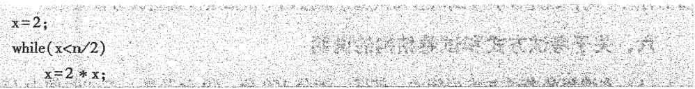

# VI.题型举例

## 一、单项选择题

1. 设n是描述问题规模的非负整数，下列程序片段的时间复杂度是 0

A. $O \big ( \log _ { 2 } n \big )$ B. $O ( n )$ C. $O ( n \mathrm { l o g } _ { 2 } n )$ D. $ { \mathcal { O } } ( n ^ { 2 } )$

2. 人栈序列是 ${ \mathrm { a } } _ { 1 } , { \mathrm { a } } _ { 3 } , { \mathrm { a } } _ { 5 } , { \mathrm { a } } _ { 2 } , { \mathrm { a } } _ { 4 } , { \mathrm { a } } _ { 6 }$ ，出栈序列是 $\mathrm { a } _ { 5 } , \mathrm { a } _ { 4 } , \mathrm { a } _ { 2 } , \mathrm { a } _ { 6 } , \mathrm { a } _ { 3 } , \mathrm { a } _ { 1 }$ ，则栈的容量最小是 0A. 2 B. 3 C. 4 D. 5

3. 下列关于二叉树的叙述中，正确的是A. 二叉树的度为2B. 一棵二叉树的度可以小于2C. 二叉树中至少有一个结点的度为2D. 二叉树中任何一个结点的度都为2

## 二、填空题

1. 采用静态方式压缩保存稀疏矩阵的方法是

2. 有一个二维数组A[10][5]，每个数据元素占1字节，按行主序保存，且 $A \left[ 0 \right] \left[ 0 \right]$ 的存储地址是1000，则 $A \left[ i \right] \left[ j \right]$ 的存储地址是

3. 具有18个结点的完全二叉树的高度是

## 三、解答题

1. 有5个元素，其人栈次序为A,B,C,D,E，在各种可能的出栈序列中，以元素C、D先依次出栈（即C第一个出栈，且D第二个出栈）的序列有哪些？

2. 有4个结点的二叉树共有多少种不同的树形？分别画出。

## 四、算法阅读题

1. 二叉链表中结点类的定义及二叉树的定义如下。

```c
typedef int ELEMType;
typedef struct BNode //二叉树结点
ELEMType data; //数据域
struct BNode * left, * right; //指向左子结点、右子结点的指针
BinTNode;
typedef Bin'TNode * BTree; //二叉树
```

以下程序返回二叉树的高度，请在空白处填上适当内容以将算法补充完整。

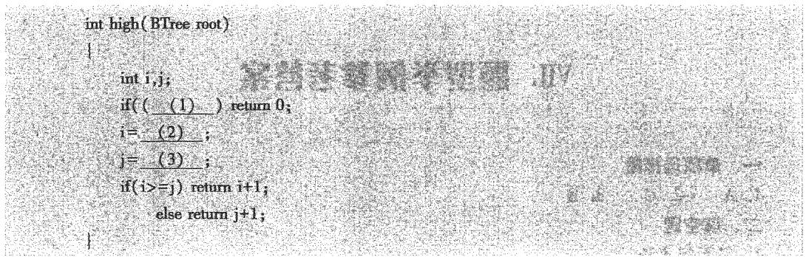

## 2. 二叉链表中结点类的定义及二叉树的定义如下。

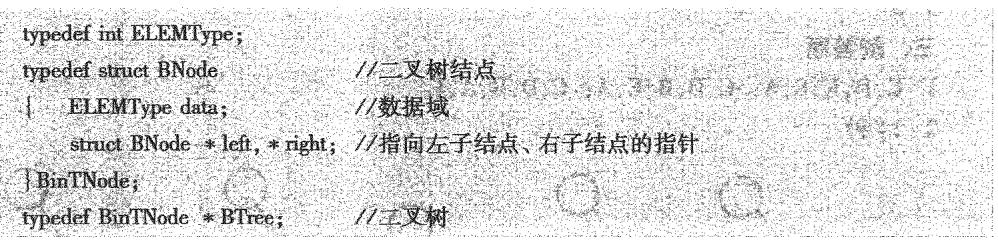

阅读以下程序，说明change函数的功能。

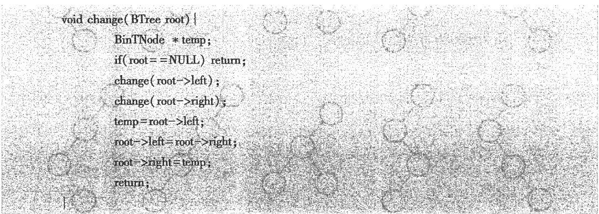

## 五、算法设计题

设计一个算法，计算含n个元素的数据序列中逆序数据对的个数。

## VII.题型举例参考答案

## 一、单项选择题

1. A 2. C 3. B

## 二、填空题

1. 三元组表法

2. 1000+5i+j

3. 5

## 三、解答题

1. C,D,E,B,A; C,D,B,E,A; C,D,B,A,E

2. 14种

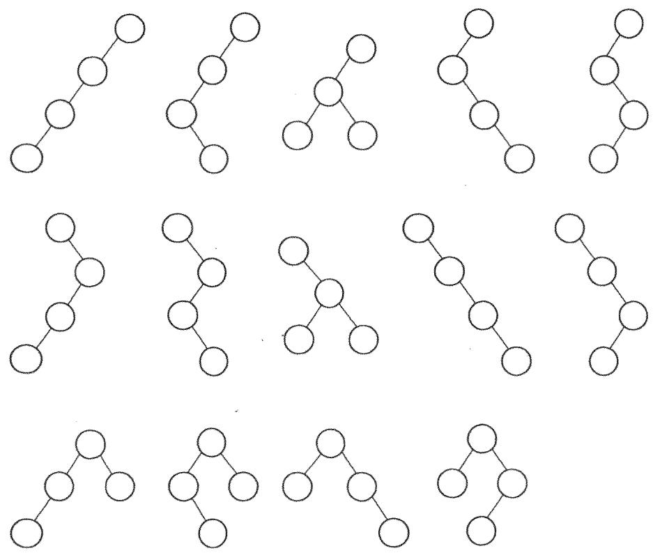

## 四、算法阅读题

1. (1) root= =NULL

(2) high(root->left)

(3) high(root->right)

2. 将二叉树中所有结点的左、右子树相互交换。

## 五、算法设计题

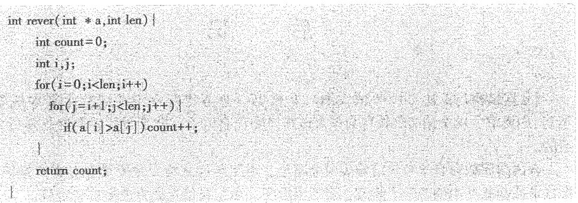

## 后 记

《数据结构与算法自学考试大纲》是根据《高等教育自学考试专业基本规范（2021年)》的要求，由全国高等教育自学考试指导委员会电子、电工与信息类专业委员会组织制定的。

全国高等教育自学考试指导委员会电子、电工与信息类专业委员会对本大纲组织审稿，根据审稿会意见由编者做了修改，最后由电子、电工与信息类专业委员会定稿。

本大纲由南开大学辛运韩教授、北京理工大学陈朔鹰副教授编写；参加审稿并提出修改意见的有国防科技大学熊岳山教授、天津大学喻梅教授。

对参与本大纲编写和审稿的各位专家表示感谢。

全国高等教育自学考试指导委员会

电子、电工与信息类专业委员会

2023年12月

全国高等教育自学考试指定教材

# 数据结构与算法

全国高等教育自学考试指导委员会 组编

## 编者的话

本书是根据全国高等教育自学考试指导委员会最新制定的《数据结构与算法自学考试大纲》编写的自学教材。

百年大计，教育为本。习近平总书记在党的二十大报告中强调“教育、科技、人才是全面建设社会主义现代化国家的基础性、战略性支撑”，首次将教育、科技、人才一体安排部署，赋予教育新的战略地位、历史使命和发展格局。

当今的世界。信息技术的飞速发展使得计算机及其相关技术已经成为各个学科不可或缺的基础，现在热门的大数据、人工智能、软件工程和物联网技术等新兴专业均是以计算机专业为基础发展而来的；传统的电子信息、自动控制等信息类专业已经与计算机技术进行了深度融合，计算机技术已经在这些专业中得到深入应用：传统的机械制造、力学工程、机电工程和生物工程等非信息类的专业与计算机技术融合交叉，已经发展出新型学科，成为这些传统专业不断创新的突破点。

教育部出台的一系列相关文件，对人才培养提出了更加具体的要求。自学考试作为高等教育的良好补充，理应跟上时代的步伐。为此，我们根据新的《数据结构与算法自学考试大纲》编写了本教材。

数据结构与算法课程作为计算机科学与技术、软件工程等专业的重要基础理论，在整个计算机相关课程体系中占有重要的地位，不仅是计算机学科的核心课程，而且已经成为许多相关学科所必须学习和掌握的课程。

根据大纲要求，学习数据结构与算法课程的考生应该已经掌握了C语言程序设计的基础知识，这是本书的编写前提。教材内给出的算法实现均是用C语言完成的。

本书在吸收国内外相关教材的精华和其他数据结构与算法参考资料的基础上，围绕最新版的《数据结构与算法自学考试大纲》，覆盖了数据结构与算法课程的核心内容。教材编写过程中还参考了《高等学校计算机科学与技术专业公共核心知识体系与课程》规范，以及数据结构与算法的相关课程标准。

本书共分8章。第一章介绍了数据结构、抽象数据类型的基本概念，描述了4类数据结构及其特点，介绍了数据的4种基本存储方式。另外，还介绍了算法的基本概念及对算法进行评估的基本概念和基本方法，以及算法设计的基本策略及相应的特点。第二章介绍了线性表的概念，给出了线性表的两种存储方式，并分别在两种存储方式下实现了基本操作，分析了各操作的时间复杂度，对比了两种存储方式的空间开销；介绍了结合线性表顺序存储和链式存储特点的静态链表：介绍了若于应用。第三章讨论了栈和队列，分别讨论了栈和队列的两种实现方式，重点讨论了顺序栈和循环队列；介绍了双端队列。本章介绍的相关应用可以加深对栈及队列特点的理解。第四章介绍了多维数组行主序、列主序的存储方式及其相应方式下的地址计算方法，介绍了特殊矩阵的压缩存储。本章还介绍了广义表和串的基本概念、模式匹配的BF算法和KMP算法。第五章介绍了树、森林的基本概念及几种常用的表示方法，着重介绍了二叉树的相关概念及基本操作，实现了相关算法；介绍了堆的概念和基本操作，实现了相关算法；最后介绍了哈夫曼树及哈夫曼编码。第六章介绍了图的基本概念、存储方式及相关操作的实现，着重介绍了图的几个经典问题，给出了算法实现。第七章介绍了内部排序方法，描述了各排序算法的基本思想，给出了相应算法的实现，并对各算法进行了比较分析。第八章介绍了查找的概念，介绍了基于顺序表的查找方法、基于树形结构的查找方法和哈希方法。

为便于考生进行自学，在每章的开始列出了该章的学习目标，在每章的结尾给出了内容小结，帮助考生学习时抓住重点。本书在内容安排上连贯有序、层次分明、循序渐进，力求表述严谨、语言精练、通俗易懂，既便于教学，又便于考生自学。

每章最后列出一些习题，考生需要认真完成，以加深对课程中知识点的认知和理解，检验学习效果。本书配套的数字资源中给出了习题的参考答案，供考生参考。

本课程要求考生使用C语言至少完成6个实习题目。

为方便参加自考的考生切实领会本课程知识，掌握基础理论，学会解题方法，本书在以下几方面完成相关工作。

（1)采用“工科”思维，启发考生掌握如何从问题入手，通过抽象、分析来寻求问题的答案。

（2）覆盖考试大纲中的全部知识点，对线性表、栈、队列、数组、广义表、串、树和图等基础内容进行了详细讲解，对排序和查找等内容进行了深人讨论。通过多种应用实例，使考生了解如何根据不同的应用问题选择不同的数据结构进行求解。本书中没有包含数据结构与算法课程中更深入的内容，并非因为这些内容不重要，而是要避免超纲的内容冲淡内容的主体。

（3）本书的章节顺序与考试大纲的顺序完全一致，书中选用了本课程的典型算法和典型例题，并增加了一些以应用为背景的例题，以突出本课程的应用特点；每章之后的习题以基础知识为主导，放弃了一些过于理论性、探索性的题目，覆盖了自学考试中的全部题型，以利于考生自学和复习备考。

（4）为适应学生自学的需求，本书在讲解基本原理的过程中，以清楚易懂为首要原则，对于重要的原理，尽量进行详细阐述，对于算法的关键点，尽量进行细致介绍，增加了一些传统教材中忽略的细节，不再过分强调编程语言的简明，同时避免了过多的理论推导和知识扩展。

(5）本书中的算法描述力求结构化，全部程序采用C语言作为描述语言，注重编程风格，程序中尽量避免使用过多的涉及C语言本身的编程技巧，通过适当的注释增加程序的可读性，避免陷入C语言实现的细节中。因为各IDE存在细微差异，所以可能会有个别程序需要稍加修改，以便在其他环境下正确运行。算法实现中增加了很多注释，以帮助考生理解程序。

(6)本书中的全部程序均为真实的、可运行的程序，但这种“可运行”并不是简单地将书中给出的程序输入C编程环境中就可以直接编译运行，而是需要编写相关的其他辅助函数。例如，需要编写调用函数、输入对应于问题情况的数据输入函数，以及输出计算结果的输出函数，同时，为保证程序能够正常运行，还需要设计并准备相关的数据。由于篇幅的限制，因此本书中仅给出核心算法程序的实现主体。

（7）本书提供了配套的基础版电子教案（PPT)，以帮助助学教师进行教学。

本书由南开大学辛运韩教授、北京理工大学陈朔鹰副教授共同编写。全国高等教育自学考试指导委员会电子、电工与信息类专业委员会组织审稿，秘书长、上海交通大学韩韬教授为本书审定做了大量组织工作。在本书的编写过程中，得到了东南大学姜浩教授的鼎力支持和帮助，他提出了许多宝贵的意见和建议，在此表示衷心的感谢。另外，本书还参考了大量的图书和资料，在此一并向这些图书和资料的作者致以诚挚的谢意。

本书经熊岳山教授（国防科技大学）、喻梅教授（天津大学）认真审阅，在全国考委电子、电工与信息类专业委员会2023年11月组织召开的审稿会上，以上专家对本书提出了中肯的修改意见，特向他们表示衷心的感谢。

本书既可供计算机科学与技术（专升本）、软件工程（专升本）等专业自学考试的考生使用，也可供普通高等院校计算机专业及相关专业的学生使用，或作为教学参考书。

由于作者水平有限，加之时间仓促，书中难免存在一些错误和不足，敬请读者批评指正，不胜感谢。

编 者

2023年12月

## 第一章 绪 论

学习目标：

1. 了解数据结构及算法在计算机软件和计算机应用中的作用。

2. 掌握数据结构中的基本概念和术语，了解4类基本数据结构，理解逻辑结构与存储结构的含义及相互关系，了解数据结构的4种基本存储方法。

3. 掌握抽象数据类型的表示与描述，能够用抽象数据类型表示实际问题。

4. 掌握算法的基本概念及重要特性，能够使用类C语言描述算法。

5. 掌握算法评估和复杂性度量的基本概念；能够对简单算法进行复杂度评估。

6. 领会算法的基本设计策略的特点，使用基本算法策略实现简单程序。

建议学时：3学时。

教师导读：

1. 本章将揭开数据结构与算法课程的序幕，让考生初步了解数据结构与算法课程的全貌，了解该课程在计算机及相关专业的课程体系中承上启下的关键作用。

2. 结合实例让考生理解数据类型与抽象数据类型的含义，理解逻辑结构与存储结构的关系，了解数据结构的4种基本存储方法。

3. 从使用自然语言描述算法过渡到使用类C语言描述算法。说明给出的算法示例满足算法的五大特性。

4. 以循环结构为例，向考生介绍常见程序结构的时间复杂度评估方法。

5. 从示例入手，向考生介绍基本的设计策略。

数据结构与算法是计算机专业的必修课程，在课程体系中占据着非常重要的地位，起着承上启下的作用，是学习其他计算机专业课程的基础和前提。

自计算机问世以来，计算机的处理能力越来越强，处理数据的类型越来越多样、复杂，需要更强有力的数据表示及处理方法。

高级程序设计语言都提供了基本数据类型，有些语言还提供了让程序员构造更高级、更复杂类型的机制。随着时间的推移，这些技术逐渐成熟，形成了一个完整的独立体系，这就是最初的数据结构思想，数据结构课程也应运而生。

本章将介绍数据结构的基本概念，算法及其特性，时间复杂度、空间复杂度的概念，在此基础上，还将介绍对算法进行复杂度评估的基本方法。

## 第一节 基本概念和术语

## 一、数据与数据结构

世界上第一台通用计算机是 ENIAC(Electronic Numerical Integrator And Calculator，电子数值积分计算机），它的用途是计算弹道，是名副其实的“数值”计算机。那时的计算机仅能处理通常意义下的“数”，完全没有办法处理现在司空见惯的文档、照片、视频等类型的对象，处理的数据也谈不上有什么“结构”。

需求推动技术的发展，程序设计语言内置的数据类型越来越多样，提供的处理手段越来越方便、快捷。当需要方便地处理众多同类型的数据时，出现了数组，“结构”的雏形显现了。例如，在需要保存100个整数时，若使用100个变量分别保存，则每个变量都是独立的个体；如果将它们保存在一个数组中，则它们是一个整体。数组就是保存这100个整数的“结构”。又如，复数的实部和虚部可以使用两个实数分别表示。如果分开来看它们，那么它们是各自独立的，但在合并组成的二元组中，它们又是相互关联的。这样的二元组也是一种“结构”，结构中两个数据域是同类型的。在C语言中，可以定义struct类型来表示这样的“结构”，结构中数据域的个数可以是任意的，类型可以相同，也可以不同。例如，可以定义struct类型来保存学生信息，各数据域的类型可以是字符串、数值、日期等。各数据域中保存的一组值称为记录。

渐渐地，独立于程序设计语言，专门研究数据的表示方式、存储方法及处理方法，进而研究相关的算法实现的数据结构与算法课程出现了。

数据结构与算法作为一门独立的课程，已经有很多年了。世界著名计算机科学家高德纳（DonaldE.Knuth）教授的巨著《计算机程序设计艺术》，全面系统地论述了数据的逻辑结构和存储结构，并且给出了多种典型算法，为数据结构奠定了理论基础。著名计算机科学家N. 沃思（N.Wirth）编写的《算法+数据结构=程序》一书明确指出，在程序设计中，数据结构与算法同等重要。

20世纪80年代以后，抽象数据类型概念将数据和对数据进行操作的定义紧密关联起来，但不涉及操作的具体实现，也就是说，将操作的具体实现和操作的定义分离。特别是在面向对象程序设计方法论中提出类的概念，从而将数据结构的理论和实践都提高到一个新水平。

“数据”这个词出现得越来越频繁，那么“数据”包括什么呢？在计算机科学中，数据是指所有能输入计算机并被计算机程序处理的符号的集合。数据绝不能仅仅理解为整数或实数这种狭义的“数值”。源程序、文档、地图、照片、歌曲、视频等，都可以被视为“数据”。今后，随着计算机技术的发展，计算机能够处理的对象会更加多元，应用领域会不断拓展，还将不断扩大数据的范畴。

数据是多种多样的，有些复杂，有些简单，复杂的数据往往是由简单的数据构成的。构成数据的基本单位称为数据元素。数据元素可大可小，大到可以是一幅地图、一本书、一部电影，小到可以是一个字符，甚至是计算机中的1位（bit）。

数据元素还可以细分为数据项。例如，要保存100名学生的信息，每名学生的信息包括学号、姓名、所学各科成绩等，可使用一条记录来保存。一条记录可以被看作一个数据元素，而记录中的学号、姓名、各科成绩等都可以被看作数据项。全部学生的记录构成了数据。

又如，某图书馆的图书管理系统中保存了馆内所有图书的信息和借阅情况，构成图书信息的书名、作者名、出版社名、书号和出版日期等都可以被看作数据项，由一本书的信息组成的一条记录即一个数据元素。

【例1-1】学生信息示例。

某班30名学生的基本信息见表1-1。

表1-1 某班30名学生的基本信息
<table><tr><td rowspan=1 colspan=1>学   号</td><td rowspan=1 colspan=1>姓名</td><td rowspan=1 colspan=1>性 别</td><td rowspan=1 colspan=1>出生日期</td><td rowspan=1 colspan=1>籍贯</td></tr><tr><td rowspan=1 colspan=1>M2022103001</td><td rowspan=1 colspan=1>王义平</td><td rowspan=1 colspan=1>男</td><td rowspan=1 colspan=1>2004年11月22日</td><td rowspan=1 colspan=1>山东</td></tr><tr><td rowspan=1 colspan=1>M2022103002</td><td rowspan=1 colspan=1>陆东</td><td rowspan=1 colspan=1>男</td><td rowspan=1 colspan=1>2004年02月05日</td><td rowspan=1 colspan=1>河南</td></tr><tr><td rowspan=1 colspan=1>M2022103003</td><td rowspan=1 colspan=1>李晓敏</td><td rowspan=1 colspan=1>女</td><td rowspan=1 colspan=1>2005年01月15日</td><td rowspan=1 colspan=1>江苏</td></tr><tr><td rowspan=1 colspan=1>…</td><td rowspan=1 colspan=1>：</td><td rowspan=1 colspan=1>：</td><td rowspan=1 colspan=1>…</td><td rowspan=1 colspan=1></td></tr><tr><td rowspan=1 colspan=1>M2022103030</td><td rowspan=1 colspan=1>杨志强</td><td rowspan=1 colspan=1>男</td><td rowspan=1 colspan=1>2004年10月30日</td><td rowspan=1 colspan=1>陕西</td></tr></table>

一名学生的基本信息形成一条记录，对应于表1-1中的一行，每一行信息是一个数据元素。表1-1中有30个数据元素。每个数据元素又含有5个数据项，分别是学号、姓名、性别、出生日期和籍贯。“M2022103003”“王义平”和“陕西”等都是数据项的值。每行中包含的数据项都是一样的，数据项的值可以相同，也可以不同。学号是一定不相同的，因为这个数据项有特殊的含义，它与每名学生一一对应。如果学生中有同乡，那么他们的“籍贯”数据项的值就会相同。如果有重名的学生，那么他们的“姓名”数据项的值就会相同。

表1-1中的各记录可以按任意的次序排列，如可以按学号递增排列。

在数据结构中，数据的最小不可分割的单位是数据项：逻辑上相关的、具有物理意义的若干数据项构成一个数据元素；数据元素作为一个完整的对象（整体）是构成数据的基本单位。

【例1-2】一本名为《数据结构与算法》的书的目录如图1-1所示。

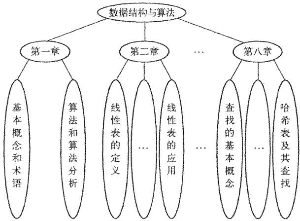  
图1-1一本书的目录构成的树

在图1-1中，每个椭圆都表示一个数据元素。最上层的一个数据元素与第二层的8个数据元素存在“上下级”的关系，第二层的每个数据元素，又分别与第三层中的若干个数据元素存在“上下级”的关系。有“上下级”关系的两个数据元素，在图1-1中使用连线连接。在本例中，“上下级”代表的是包含关系，如“第一章”包含“基本概念和术语”

等。可以用图1-1这样的机制表示家族、组织机构等，在表示实际的情况时，这些“上下级”对应的含义会依具体情况而定。

数据元素之间的相互关系构成结构，带有结构特性的数据元素集合构成数据结构。具体来说，数据结构又分为逻辑结构和存储结构。逻辑结构主要是指数据元素之间的逻辑关系，存储结构主要是指数据元素在计算机中的表示及存储方式。

数据的逻辑结构从逻辑上描述数据，表明数据元素之间的关系，与数据的存储方式无关，既独立于计算机，又独立于程序设计语言。

从逻辑角度来看，基本的数据结构包括4类，分别是集合、线性结构、树结构和图结构。

集合由元素构成，是数学中最基本的概念之一。集合中各元素之间没有次序关系，涉及元素与集合的操作包括：将新元素加入集合、从集合中删除指定元素、判定某元素是否属于集合等。还可以对集合进行操作，如判定集合是否为空、求两个集合的并集、求两个集合的交集、求一个集合的补集等。

线性结构是数据元素之间存在着先后次序关系的结构，每个元素都对应着一个唯一的次序，这个次序决定着元素的位置。例1-1中给出的学生基本信息表就是一个线性结构，各数据元素按照学号的次序排列。包含“M2022103001”的记录是第一个元素，包含“M2022103030”的记录是第30个元素。排在每个数据元素前面的元素是唯一的，称为直接前驱。同样地，排在每个数据元素后面的元素也是唯一的，称为直接后继。在例1-1中，排在“陆东”前面的是“王义平”，排在其后面的是“李晓敏”。当然，第一个和最后一个元素是例外的，第一个元素没有直接前驱，最后一个元素没有直接后继。

树结构是一种层次结构，其中的数据元素按层排列。除了顶层的元素以外，每个数据元素都对应一个上一层元素，同时可以有数目不等的下一层元素。图1-1即树结构。“基本概念和术语”对应的上一层元素仅有一个，即“第一章”，“第一章”对应的下一层元素有多个，“基本概念和术语”对应的下一层元素有零个。仿照线性关系，可以将元素的上一层看作其直接前驱，将元素的下一层看作其直接后继。

图结构是一种网状结构，其中的每个数据元素都可以与多个其他的数据元素相关。树结构可以被看作图的特例。树结构和图结构都是比线性结构更复杂的结构，它们属于非线性结构。

如果考查数据元素之间存在关系的元素个数，那么，线性结构中元素之间是一对一的关系，树结构是一对多的关系，而图结构是多对多的关系。

集合的操作可以借用线性结构的操作来完成，一般不单独讨论集合。当需要使用集合来描述操作对象时，可以借用线性结构来完成。当然，如果还有其他的需求，则也可以使用树结构来完成。

图1-2形象地表示了集合、线性结构、树结构及图结构中数据元素之间的关系。

数据元素及其关系在计算机内的存储方式，称为数据的存储结构，也称为物理结构。算法的设计主要基于数据的逻辑结构，关注的是哪些数据元素之间存在相互关系，以及算法中要按照什么样的次序对哪些数据元素进行何种操作。而具体实现算法时要依赖于相应的存储结构，只有知道了数据元素的存储方式，才能实际访问数据元素和对其进行具体的操作。

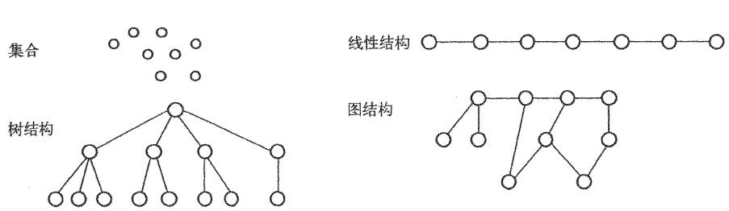  
图1-2 4类基本数据结构示意图

## 二、常用存储方法

数据结构常用的存储方法有以下4种。

（1）顺序存储方法。逻辑上相邻的数据元素，存储到物理位置相邻的存储单元中，这样的存储方法称为顺序存储方法。在使用程序设计语言中的一维数组保存线性结构中的数据元素时，采用的就是顺序存储方法。相应的存储结构称为顺序存储结构。

(2)链式存储方法。逻辑上相邻的数据元素，不要求其存储的物理位置也相邻，通常借助于程序设计语言中的指针来指示数据元素间的逻辑关系。这样的存储结构称为链式存储结构。

(3)索引存储方法。除了保存数据元素以外，索引存储方法还针对数据元素建立索引表。索引表由索引项组成，索引项指示数据元素所在的物理位置。通过索引项，可以加快查找数据元素的速度。这种方法是索引存储方法。

（4）散列（哈希）存储方法。散列存储方法是一种特殊方法，它根据数据元素的关键字计算出该元素的物理存储位置。通常，使用称为散列表的一维数组作为保存元素的结构。

【例1-3】下列关于顺序存储结构与链式存储结构的叙述中，正确的是（）。A. 顺序存储结构的存储空间是连续的，链式存储结构的存储空间不一定连续B. 顺序存储结构只用于线性结构，链式存储结构只用于非线性结构  
C. 顺序存储结构一定比链式存储结构节省存储空间  
D. 链式存储结构一定比顺序存储结构节省存储空间  
答案为A。

数据结构在采用顺序存储结构保存时，对于逻辑上相邻的数据元素，其存储单元的物理位置也相邻，因此存储空间必然是连续的。而采用链式存储结构保存时，通常使用指针来指示数据元素之间的逻辑关系，指针保存的是相关数据元素的存储地址。所以这两个元素在内存中可能是相邻的，也可能是不相邻的，所有元素的存储空间不一定是连续的。

顺序存储结构和链式存储结构，既可以保存线性结构，又可以保存非线性结构。至于哪种存储结构更节省存储空间，要视具体情况而定。

综上所述，选项A是正确的。

## 三、抽象数据类型

所有程序设计语言都会提供基本类型。类型即值的一个集合。例如，整型就是整数的集合。可以为这些类型定义运算，使用相应的运算符表示对应的操作。例如，对于整数集合，定义的运算有加法、减法、乘法、整除和取模等，由此确定了允许对整数进行的操作。对于布尔类型（逻辑类型），可以进行的操作包括逻辑与、逻辑或和逻辑非等。类型加上允许对该类型数据进行的一组操作，称为数据类型。若一个类型所表示的值不可再分解，则该类型称为原子类型，如C语言中的整型、实型等都是原子类型。与之相对的是结构类型。结构类型的值可以再细分。即它是由若于个分量按某种结构组成的。例如，C语言中的结构体(struct)、数组都是结构类型。构成结构的分量可以是原子类型的，也可以是结构类型的。

除了程序设计语言中提供的基本类型以外，还可以定义抽象意义下的类型，并为该类型定义一组相关的操作。这样定义的数据类型称为抽象数据类型（Abstract Data Type，ADT)。抽象数据类型的定义包括类型的名字及对各个操作的刻画，也就是要明确“做什么”。对于每个操作，要规定操作的名字、操作执行的前提条件、输入和输出分别是什么等。每个操作通常表示为一个函数或方法。

“抽象数据类型”是相对于程序设计语言中的“基本类型”来说的。抽象数据类型通常都是程序设计语言中没有提供的类型。在给出抽象数据类型的定义时，尚未明确所定义类型的数据元素的存储方式，当然也没有给出各操作的实现细节。在实现环节，才会给出所定义的类型中涉及的数据元素使用哪种方式保存及如何保存。有了存储结构，才能具体实现各操作，也就是实现“如何做”。

【例1-4】定义抽象数据类型Triangle，它表示三角形。

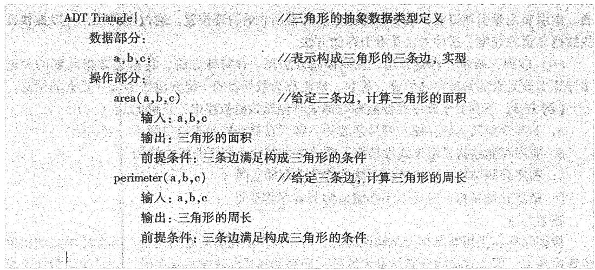

例1-4首先定义了一个称为Triangle的抽象数据类型，它的数据部分包括3个实型值，它们是组成三角形3条边的长度值：然后定义了两个操作，一个是根据3条边的长度计算三角形的面积，另一个是根据3条边的长度计算三角形的周长。这两个操作都表示为函数的形式，三角形的3条边是输入参数，仅当3条边的长度满足构成三角形的条件后，函数才能执行。

这个抽象数据类型的定义中，并没有说明3条边使用什么样的结构来保存，是使用数组呢？还是使用记录呢？或者就是使用3个独立的变量？另外，这两个函数中也都没有给出具体的实现代码。这些都表明例1-4给出的仅是一个抽象数据类型的定义。

## 第二节 算法和算法分析

算法的概念在计算机科学与技术领域几乎无处不在，在各种计算机系统的实现过程中，算法的设计与实现往往处于核心地位。在编写程序解决具体问题时，算法的思想是计算机程序的灵魂，算法规定的流程决定着程序的执行步骤。可以这样说，程序使用某种程序设计语言描述数据的表示方式，并实际展现算法。即使对同一个算法，实现的程序也会有不同的形式。不仅使用的程序语言可以不同，实际的实现细节也可以不同。

在使用计算机解决问题时，总会要求所花的时间越短越好，占用的计算机资源越少越好。除了正确性以外，多、快、好、省也都是一直追求的目标。那么，计算机内部的资源有哪些呢？CPU时间和内存空间肯定是紧俏的两种资源。一般地，分别使用时间复杂度和空间复杂度来评估这两种资源的使用效率。本节将介绍算法的基本概念及衡量算法好坏的评价标准。

## 一、算法的基本概念

算法（algorithm）概念的出现与计算机及程序设计无关，事实上，远在计算机出现之前，就已经有算法被提出了。例如，使用辗转相除法求两个正整数最大公因子的欧几里得(Euclid)算法，出现在2300多年前，这是目前已知的最古老的算法。

定义1-1 算法是一个由若干确定的(无二义性的)、可执行的步骤组成的肯定能够终止的有序步骤集合。

算法描述一个问题的求解过程，由一系列解决问题的清晰指令构成。这些指令可以使用自然语言表示，也可以使用计算机程序设计语言表示，甚至可以混合使用自然语言与计算机程序设计语言来描述。C语言与自然语言的混合有时称为类C语言，这样描述的算法称为伪代码。

例如，温度通常有两种常用的计量表示方法，一种称为华氏温标，另一种称为摄氏温标。现在要求编制一个小程序，将摄氏温标值C转换为华氏温标值 $\boldsymbol { F } _ { \odot }$ 已知温标转换计算公式为： $F { = } C { \times } ( 9 / 5 ) { \div } 3 2$ ，使用自然语言描述的转换过程如下。

（1）输入一个摄氏温标值 $\scriptstyle { C _ { \circ } }$

(2) C乘以常数9/5(或1.8)。

（3）将步骤（2）的乘积与常数32相加，得到 $ { \boldsymbol { F } } _ { \circ }$

(4)输出结果F，即转换后的华氏温标值。

进一步地，采用类C语言进行描述如下。

(1)输人值 ${ \bf \mathcal { C } } _ { \bf \epsilon }$ //C为摄氏温标值

(2) $P = C \times ( 9 / 5 ) + 3 2$

(3)输出值 ${ \dot { \bar { \varepsilon } } } ,$ //F为华氏温标值

在计算机问世之后，人们将一些问题交给计算机来求解，但计算机不能识别上述那样描述的算法，所以很多算法要具体化为一个计算机程序，程序是算法的另一种表现形式。在有些语境中，算法与程序变成了同义词。本书采用C语言实现相关的算法。

使用C语言实现温标转换算法的程序如下。

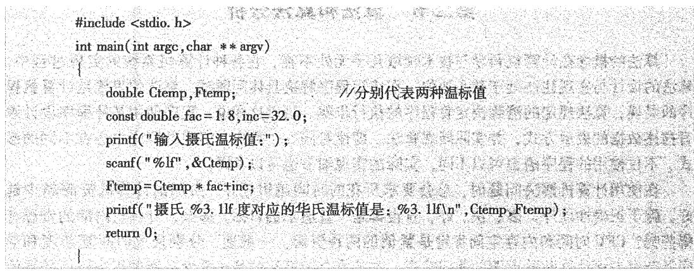

算法是一系列指令的描述，但并不是任意的描述都可以构成算法。算法必须满足如下5个重要特性。

(1)输入：有0或多个输入值。

(2) 输出：有1或多个输出值。

（3)有穷性：一个算法必须在执行有穷步骤之后结束。

（4)确定性：算法的每一个步骤都必须有确切的含义。

(5)可行性：算法中要做的运算都是相当基本的、能够精确进行的。

算法可以没有输入，但必须有输出，通常输出的是算法的执行结果。实现算法的程序的运行时间是有限的。算法的每个执行步骤不能有歧义，且必须是能够执行的。

## 二、算法的评估和复杂性度量

算法必须正确，错误的算法不可能得到正确的求解结果。所以，算法的正确性成为评判算法的首要指标。除此之外，还要评判算法的其他方面，包括它的执行效率。为简单起见，本书中只对正确的算法进行评判。

即使使用同一种程序设计语言描述同一个算法，也会有不同的方式。特别是当数据采用不同的存储方式时，算法的实现细节可能会有很大的差异。

计算机中最重要的资源之一是CPU，完成具体任务的算法的效率是决定程序执行快慢的重要因素。如何衡量算法的效率呢？最先想到的应该是使用执行程序所花费的时间来表示快慢，执行程序所花费的时间短，表示程序执行得快：花费的时间长。表示程序执行得慢。

但仅仅这样刻画快慢未免有些武断，还应该考虑其他重要的因素。例如，对于解决同一问题的算法A和算法B，算法A处理10个数据时花费10个时间单位，而算法B处理1000个数据时花费20个时间单位。那么花费时间单位更多的算法B是不是劣于花费时间单位较少的算法 A 呢？

显然，执行程序花费的时间与程序所处理的数据个数有很大的关系，这个数据个数称为问题规模，也称为问题大小。算法花费的时间表示为问题规模的一个函数。

仍以算法A处理10个数据为例，在主频不同的3台计算机上运行时，所花费的时间单位可能各不相同。通常，主频越高的计算机，花费的时间往往越少；主频越低的计算机，花费的时间往往越长。所以，仅仅考虑待处理的数据数量还不够，还需要考虑计算机本身的差异。

为了突出算法自身的特点，故在衡量算法效率时应该屏蔽计算机的差异性，不能使用程序运行的绝对时间作为衡量指标。一般地，选择算法执行的机器指令个数作为衡量指标相对合理一些。计算机的CPU芯片不同，运行的系统不同，导致指令集也可能不同。将机器指令再进一步对应为程序中的语句，统计一个程序在执行期间需要执行的语句总数，将这个数值作为衡量算法的时间指标。并且约定，程序设计语言中一条基本语句的执行时间为1个单位时长，这样处理后将不同语句之间的差异也屏蔽掉了。

一个算法的时间效率可以用问题规模及关键的处理步骤的多少来定义。具体来说，将算法的时间效率表示为问题规模n的一个解析式，对于规模为n的问题，解析式计算的值就是算法处理的步骤数。将关于n的这个解析式称为增长函数，表示为T(n)。

对于一个具体的算法，其增长函数是一个近似的表达式。一个算法处理10个数据时，是执行了100条语句还是102条语句，差别并不大。需要关心的是，当数据量增大若干倍时，算法所花费的时间需要增加多少倍，即需要知道其中的比例关系。这是函数的渐近性，即增长函数与问题规模的变化关系，也就是想知道n增大时函数的一般特性。看下面的例子。

【例1-5】查找给定的含n(n>0)个元素的数组中的最大值。

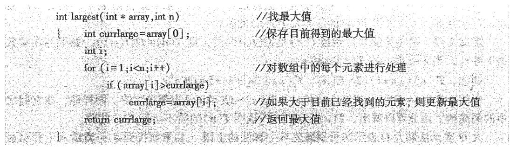

这段程序非常简单，从数组最前面的元素开始，依次扫描每个元素，并记录目前找到的最大值。在扫描全部数据后，将得到数组中的最大值并返回该值。程序的主要部分是for循环，循环体是一条分支语句。循环的执行次数依赖于数组的大小。当数组中有n个数据时，for语句的循环体执行的次数是n-1次，这也是if语句的语句体执行的最大次数。再加上赋初值及返回语句，在不考虑for语句内部的初始化、迭代及更新语句的情况下，largest函数中执行的语句个数最多为1+n-1+1=n+1，得到该算法的增长函数T(n)=n+1。当数组中元素个数为10n时，执行的语句个数最多为10n+1，即问题规模扩大至原来的10倍，所花费的时间也增加至约10倍。

【例1-6】程序段示例。

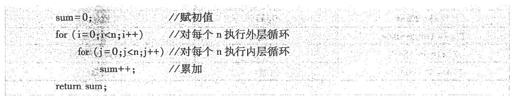

例1-6中程序片段的主体是一个二重循环，外层循环每执行1次，内层循环都执行n次，所以sum++的总执行次数为 $n ^ { 2 }$ ，语句执行的总数是 $n ^ { 2 } + 2$ ，即增长函数 $T ( n ) = n ^ { 2 } + 2$ 。当问题规模扩大至原来的10倍时，所花费的时间需要增加至约100倍。

可以看出，在例1-5和例1-6中，增长函数是不同次数的多项式，前者是线性的，后者是二次的。当n很小时，两者的差别并不明显。但随着n的增大，两者的差距会越来越悬殊。当n增大时，增长函数的变化规律就是算法的渐近变化规律，这是要关心的。从数学原理中知道，这个变化规律依增长函数表达式的主项而定，当n增大时，主项的变化最快。例如，在上述两例中，当n变得非常大时，因为 $n ^ { 2 }$ 项的变化比n项快得多，故常数项是1还是100就变得无足轻重了。而主项的系数对变化趋势没有影响，如 $n ^ { 2 }$ 与 $3 n ^ { 2 }$ 的变化趋势是一样的。

在考查增长函数时，只关心增长函数表达式中的主项，并且不再考虑主项的系数。表达式的主项使用记号0来表示，例如，例1-5中增长函数表示为 $O ( n )$ ，例1-6中增长函数表示为 $O ( n ^ { 2 } )$ 。这称为渐近时间复杂度，也称为算法的阶。

定义1-2 称（复杂度）函数 $T ( n )$ 是 $O ( f ( n ) )$ 的，即 $T ( n ) = O { \bigl ( } f ( n ) { \bigr ) }$ ，如果存在常数$\mathrm { c } > 0$ 与 $n _ { 0 }$ ，当 $n { > } n _ { 0 }$ 时，有 $T ( n ) \leqslant \mathrm { c } f ( n )$ 0

例如， $T _ { 1 } ( n ) = ( n + 1 ) / 2 = O ( n ) , T _ { 2 } ( n ) = 3 n ^ { 2 } + 4 n + 5 = O ( n ^ { 2 } ) ,$

当然， $T _ { 1 } ( n ) = O ( n ^ { 2 } ) \ , T _ { 2 } ( n ) = O ( n ^ { 3 } )$ 也都是对的，但一般取最低阶表示。由此可以看出， $T ( n ) = O { \bigl ( } f ( n ) { \bigr ) }$ 说明 $T ( n )$ 的阶不大于f(n)的阶。

定义1-3 称（复杂度）函数 T(n)是 $\Omega ( f ( n ) )$ 的，即 $T ( n ) = \varOmega { \bigl ( } f ( n ) { \bigr ) }$ ，如果存在常数$\mathrm { c } > 0$ 与 $n _ { 0 }$ ，当 $n > n _ { 0 }$ 时，有 $T ( n ) \geqslant \mathrm { c } f ( n )$

例如， $T _ { 1 } ( n ) = ( n + 1 ) / 2 \ b { = } \ b { \Omega } ( n ) , T _ { 2 } ( n ) \ b { = } 3 n ^ { 2 } \ b { + } \ b { 4 } n \ b { + } \ b { + } \ b { 5 } = \ b { \Omega } ( n ^ { 2 } )$ 0

当然， $T _ { \mathrm { 1 } } ( n ) = \varOmega ( 1 ) \ , T _ { \mathrm { 2 } } ( n ) = \varOmega ( n ) \ , T _ { \mathrm { 2 } } ( n ) = \varOmega ( n \log n )$ 也都是对的，同样地，取它们之中的最高阶。由此可以看出， $T ( n ) = \varOmega ( f ( n ) ;$ 说明 $T ( n )$ 的阶不小于 $f ( n )$ 的阶。

大0表示法和大Ω表示法分别描述某一算法的上限（如果能找到某一类输入下开销最大的函数）和下限（如果能找到某一类输入下开销最小的函数）。当上、下限相等时，可用表示法。如果一种算法既是 $O ( f ( n ) )$ 的，又是 $\Omega ( f ( n ) )$ 的，则称其是 $\Theta ( f ( n ) )$ 的。

若增长函数不随算法问题规模变化，即不管问题规模有多大，花费的时间都是固定的，则增长函数称为0(1)阶，或称常数复杂度。

与问题规模成正比的问题求解算法称为线性操作。许多算法具有 $\log _ { 2 } n$ 的对数复杂度。其他算法有n的某次幂的多项式复杂度，如 $O ( n ^ { 2 } )$ 或 $ { \mathcal { O } } ( n ^ { 3 } )$ 。更坏的算法是指数复杂度，n是指数，如 $O ( 2 ^ { n } )$ 。表1-2中列出了几种增长函数及它们的渐近时间复杂度（即时间复杂度）。

表1-2 一些增长函数和它们的时间复杂度
<table><tr><td rowspan=1 colspan=1>增长函数</td><td rowspan=1 colspan=1>阶</td><td rowspan=1 colspan=1>时间复杂度</td></tr><tr><td rowspan=1 colspan=1> $T ( n ) = 1 7$ </td><td rowspan=1 colspan=1>0(1)</td><td rowspan=1 colspan=1>常数</td></tr><tr><td rowspan=1 colspan=1> ${ \mathcal { T } } ( n ) = 2 0 n { - } 4$ </td><td rowspan=1 colspan=1> $O ( n )$ </td><td rowspan=1 colspan=1>线性</td></tr><tr><td rowspan=1 colspan=1> $T ( n ) = 1 2 n \mathrm { l o g } n + 1 0 0 n$ </td><td rowspan=1 colspan=1> $O \left( n \mathrm { l o g n } \right)$ </td><td rowspan=1 colspan=1>线性对数</td></tr><tr><td rowspan=1 colspan=1> $T ( n ) = 3 n ^ { 2 } + 5 n ^ { - 2 }$ </td><td rowspan=1 colspan=1> $O \{ n ^ { 2 } )$ </td><td rowspan=1 colspan=1>多项式（平方）</td></tr><tr><td rowspan=1 colspan=1> $T ( n ) = 2 ^ { n } + 1 8 n ^ { 2 } + 3 n$ </td><td rowspan=1 colspan=1> $O ( 2 ^ { n } )$ </td><td rowspan=1 colspan=1>指数</td></tr></table>

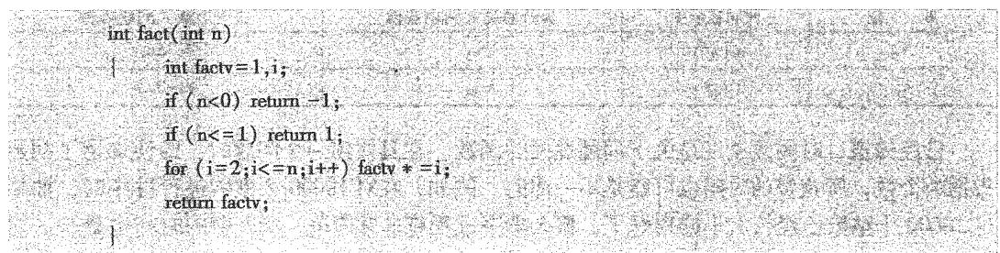

其时间复杂度是（）。A. $O \left( \log _ { 2 } n \right)$ B. $O ( n )$ C. ${ \cal O } \big ( n \mathrm { l o g } _ { 2 } { n } \big )$ D. $O ( n ^ { 2 } )$ 答案是 $\mathbf { B } _ { \mathrm { ~ o ~ } }$

fact函数计算整数n的阶乘，最主要的操作是for循环，另外还有对factv的赋值及返回语句。对于n，循环执行的次数是n-1，所以fact的增长函数 $T ( n ) = n - 1 + 4 = n + 3$ ，时间复杂度为O(n)，即线性的。

【例1-8】有如下程序段：

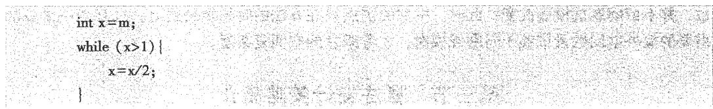

其中 $m { > } 1$ ，则时间复杂度为（）。A. $O ( \log m )$ B. $O ( m ^ { 2 } )$ C. ${ \cal O } ( m ^ { 1 / 2 } )$ D. $O ( m ^ { 1 / 3 } )$ 答案是 $\mathbf { A } _ { \mathrm { o } }$

x的初值是m，程序段中主要的执行语句是 while循环，这个循环的执行次数依x的值而定，当 $\mathbf { x } \leqslant 1$ 时，循环终止。每次执行语句 ${ } ^ { \dag 4 } \mathbf { x } = \mathbf { x } / 2 ^ { \dag 3 }$ ，都会使x值减半，这个循环的执行次数与logm]值相近，故时间复杂度为 $O \{ \log m \}$

渐近时间复杂度对算法的意义是什么呢？它直接影响计算机能力提升后能够处理的数据量增长的大小。假定有不同时间复杂度的4个算法： $\mathrm { A } _ { 1 } , \ \mathrm { A } _ { 2 } , \ \mathrm { A } _ { 3 }$ 和 $\mathbf { A } _ { 4 }$ ，它们的时间复杂度列在表1-3中。当计算机的处理能力提升至原来的10倍时，具有 $O ( n )$ 时间复杂度的算法$\mathrm { A } _ { \mathfrak { i } }$ 处理的数据量确实增长至原来的10倍，也就是问题规模扩大至原来的10倍。但具有$\textstyle { \mathcal { O } } ( n ^ { 2 } )$ 时间复杂度的算法 $\mathrm { A } _ { 2 }$ ，问题规模只扩大至原来的3.16倍。同样，对于算法 $\mathrm { A } _ { 3 }$ ，问题规模只扩大至原来的2.15倍。对于具有指数阶的算法 $\mathbf { A } _ { 4 }$ ，其问题规模几乎没有什么改变。因处理器的处理速度提升而带来的改善比例，敌不过低效率算法导致的速度减弱。在要处理大量数据的系统中，算法的效率越低，提升处理器的处理速度带来的收益越少。

表1-3 处理器处理速度提升10倍后问题规模的增长
<table><tr><td colspan="1" rowspan="1">算法</td><td colspan="1" rowspan="1">时间复杂度</td><td colspan="1" rowspan="1">提升前最大问题规模</td><td colspan="1" rowspan="1">提升后最大问题规模</td></tr><tr><td colspan="1" rowspan="1"> $\mathrm { A } _ { \mathrm { t } }$ </td><td colspan="1" rowspan="1"> $O ( n )$ </td><td colspan="1" rowspan="1"> ${ \mathrm { s } } _ { \mathrm { t } }$ </td><td colspan="1" rowspan="1"> $\mathrm { { 1 0 s _ { 1 } } }$ </td></tr><tr><td colspan="1" rowspan="1"> $\mathbf { A } _ { 2 }$ </td><td colspan="1" rowspan="1"> $O \{ n ^ { 2 } \}$ </td><td colspan="1" rowspan="1"> ${ \bf s } _ { 2 }$ </td><td colspan="1" rowspan="1"> $3 , 1 6 \mathrm { s } _ { 2 }$ </td></tr><tr><td colspan="1" rowspan="1"> $\mathbb { A } _ { 3 }$ </td><td colspan="1" rowspan="1"> $O ( n ^ { 3 } )$ </td><td colspan="1" rowspan="1"> ${ \mathfrak { s } } _ { 3 }$ </td><td colspan="1" rowspan="1"> $2 , 1 5 { \mathrm { s } } _ { 3 }$ </td></tr><tr><td colspan="1" rowspan="1"> $\mathbf { A } _ { 4 }$ </td><td colspan="1" rowspan="1"> $O ( 2 ^ { n } )$ </td><td colspan="1" rowspan="1"> ${ \mathfrak { s } } _ { 4 }$ </td><td colspan="1" rowspan="1"> $\mathbf { s } _ { 4 } + 3 . 3$ </td></tr></table>

已经知道，时间复杂度是关于问题规模的函数。在具体到一个问题时，即使知道了初始数据的个数，所花费的时间也可能是不一样的。例如，在对10000个整数进行排序时，如果这10000个整数已经按大小排列好了，那么排序过程将非常简单，所花费的时间也最少。同样地，可能会有某一种排列情况，使得排序时所花费的时间最多。如果考虑每种排列情况，则可以综合评判它们的平均情况。由此得到时间复杂度的细化指标。当问题规模确定后，时间花费最少的称为最优时间复杂度或最好时间复杂度，时间花费最多的称为最坏时间复杂度或最差时间复杂度，所有情况下的平时花费时间称为平均时间复杂度。

除了要评判算法的时间复杂度以外，算法在运行过程中临时占用的空间大小也要考虑，这称为空间复杂度。一般地，空间复杂度也表示为问题规模的一个函数。在考虑空间存储量时，算法代码占用的空间、算法中初始数据占用的存储空间，都不包含在内。

有些算法，除数据本身占据的空间以外，需要额外分配的空间并不多，可能只是一个定数，并不依问题规模而改变。此时，关注的重点只在算法的时间复杂度上。只有当一个算法需要的额外空间数量依赖于问题规模时，才考虑它的空间复杂度。

## 第三节 算法设计策略简介

算法可以分为多种不同的类型，每种类型都有特定的应用场景和解决问题的方法。在设计算法时，可以配合采用一些设计策略，使得算法的实现更方便。设计策略也称为设计方法，是指在解决特定问题时所采用的一类方法。算法的设计策略有递推法、迭代法、递归法、贪心法、分治法、动态规划法等。

## 一、递推法

递推法是一种直接求解的算法设计策略，利用问题本身所具有的一种递推关系进行求解。找到问题本身的递推关系是问题求解的前提。

递推法的思想是，根据递推关系，能从已求得的问题规模为1,2，…，i-1的一系列解，构造出问题规模为i的解。求解规模为i的解时，有时可能仅需规模为1,2，…,i-1的系列解中的一部分，而不是全部。

例如，将斐波那契数列的前10项保存在数组中，可以采用递推法求解。

已知斐波那契数列 ${ \begin{array} { r l } { F { \big ( } n { \big ) } } & { { } { \big ( } n \geq 1 { \big ) } } \end{array} }$ 的定义如下。

$$
F ( n ) = \left\{ \begin{array} { c c c } { { 1 } } & { { n = 1 } } & { { } } \\ { { } } & { { 1 } } & { { n = 2 } } \\ { { } } & { { } } & { { } } \\ { { F ( n - 1 ) + F ( n - 2 ) } } & { { n > 2 } } \end{array} \right.\tag{1-1}
$$

式（1-1）的最后一行给出的是递推关系，使用斐波那契数列的第n-1项和第n-2项，可以计算出数列的第n项。式（1-1）的前两行是数列最初的两个值，均为1。由递推公式

可计算出数列的第三项，为 $2 _ { \circ }$ 再由第二项和第三项，得到第四项的值 $3 \phantom { . 0 }$ 再由第三项和第四项，得到第五项的值 $5 _ { \circ }$ 依此类推，得到数列的前10项为：1,1,2,3,5,8,13,21,34,55。

设在主程序中已说明整型数组a，调用函数fibonacci(a,10)，将斐波那契数列的前10项保存在数组 a 中，采用递推法实现的函数 fibonacci(int a[],int n)如下。

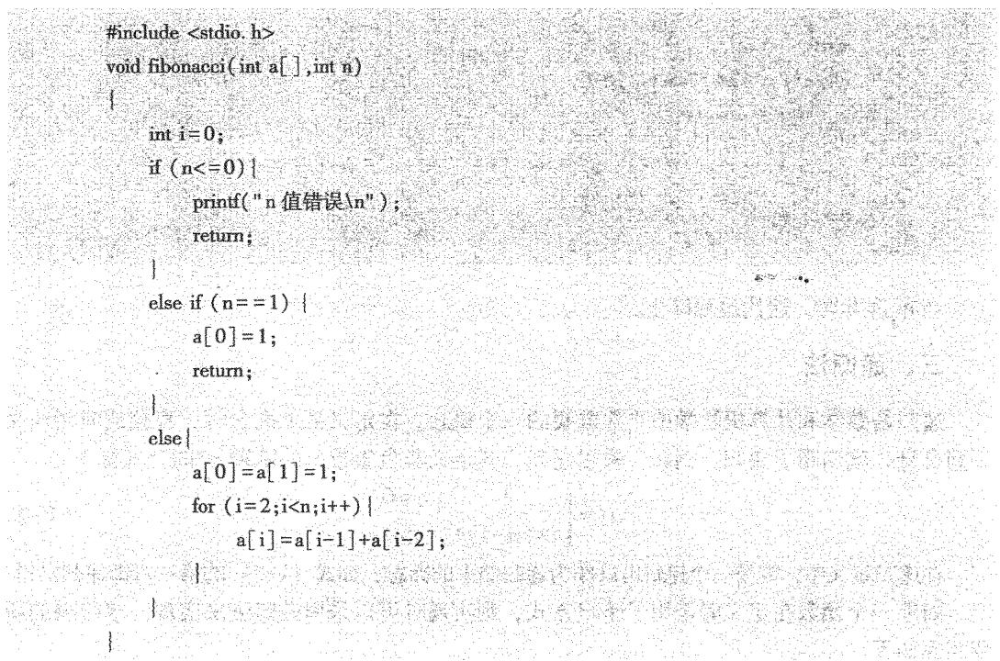

## 二、迭代法

迭代法是一种直接求解的方法，往往需要建立迭代关系式，即根据前一个值推出下一个值的公式。初始时设定初始值（原值），然后根据迭代关系式和原值，求出新值，并用新值替代原值。持续进行这个过程。

迭代过程不能无限进行下去，或者设定一个迭代次数，当达到这个次数时，迭代过程停止；或者设定一个结束条件，当满足这个条件时，迭代过程停止。如果迭代过程正确，则迭代停止时可以得到理想的结果。

求两个正整数最大公约数的辗转相除法可以采用迭代法来实现，代码如下。

```c
#include <stdio. h>
int main(int argc, char * * argv)
int data1=0,data2=0;
printf("请输人两个正整数，以空格分隔，按回车键结束\n")
scanf(" %d %d", &data1, &data2); //读入两个正整数
if(data1<01|data2<0) printf("不能输人负数\n")
else
```

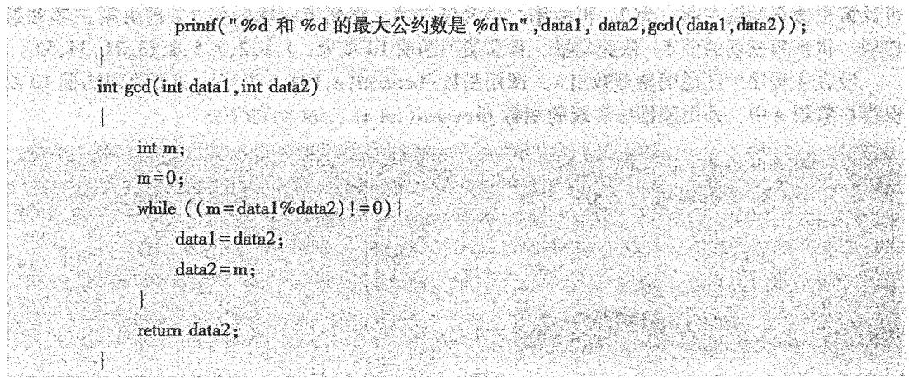

当m为0时，迭代过程终止。

## 三、递归法

递归是数学和计算机科学中非常重要的一个概念。在定义某个概念时，直接或间接地又用到自身，就出现了递归。例如，采用递归方式定义非负整数n的阶乘n!的公式如下。

$$
n ! = \left\{ \begin{array} { c c } { { 1 } } & { { n = 0 } } \\ { { n \times ( n - 1 ) ! } } & { { n > 0 } } \end{array} \right.\tag{1-2}
$$

在递归定义中，需要一个递归出口作为递归结束的标志，如式（1-2）的第一行即递归出口。如果一个函数在定义时采用了递归方式，则实现时可以采用递归法来实现。求阶乘的函数实现如下。

```c
#include <stdio. h>
int main(int argc, char * * argv)
int n;
printf("请输入一个正整数，按回车键结束\n")；
scanf("%d" ,&n);
if(n<0) printf("不能输入负数\n");
else printf("%d 的阶乘是 %d\n",n,fact(n));
return 0;
int fact(int n)
if (n= =0) return 1;
else return n * fact(n-1)
```

在实现fact函数时，需要用到fact(n-1)的结果，所以函数fact是一个递归函数。当n为0时，结束递归，这是递归出口。

在编写递归函数时，需要特别注意，递归的变化方向是：向递归出口靠近并最终到达递归出口。以fact函数为例，如果调用该函数时给n一个小于0的初始值，则n持续地减1，永远不会满足n==0这个条件，即递归不会结束。检查n值的合理性，可以放在调用fact函数的主调函数中，也可以放在fact函数内部。

## 四、贪心法

贪心法也称贪婪算法，它是一种通过每一步选择局部最优解来达到整体最优解的算法，适用于求某些最优解问题。在求解过程中，一步步地进行求解，根据当前的情况选择最优的可能。实际上，这个最优是在当前条件下的最优，称为局部最优。在求解过程中，因为没有考虑各种可能的情况，有可能并不是全局最优。也正是因为贪心法仅考虑局部的情况，而没有穷尽所有的可能，所以避免了耗费大量时间。

贪心法能不能得到真正的最优解，取决于贪心策略的选择。在第五章构造哈夫曼树的过程中，采用了贪心法策略；在第六章求最小生成树的两个算法中，也采用了贪心法求解。这几个算法都能得到满足条件的最优解。

## 五、分治法

当求解一个输人规模为n并且n的取值又很大的问题时，直接求解往往非常困难。可以把这个大规模的问题分解为若干个规模更小且可以独立求解的问题，这些小问题与原问题相同，可以各自求解。然后把各个小问题的解进行合并，得到原问题的解。这就是分治法的思想。

一般来说，分治法的求解过程分为三个阶段，即划分、求解小问题及小问题解的合并。

如果小问题的规模仍然很大，不能直接求解，则再继续划分，直到小问题可以求解。然后将小问题的解合并为大问题的解。

一次划分得到的若干个小问题是相互独立的，它们的求解可以独立完成，这是分治法的重要特点。并且这些小问题的求解次序也没有约束。

求解小问题的解与求解原问题的解，除了规模不同以外，使用的求解算法是相同的，所以分治法中通常还配合使用递归法。

在第七章介绍的快速排序和归并排序的递归实现中，都采用了分治法求解。它们都是将一个大问题分解为两个小问题，递归调用后再对两个小问题分别进行求解。

## 六、动态规划法

动态规划法是求多阶段决策过程最优化的一种方法，它将问题的整体按时间或空间的特征分成若于个前后衔接的阶段，把多阶段决策问题表示为前后有关的一系列单阶段决策问题，然后逐个求解，从而求出整个问题的最优决策。动态规划法强调了时间和空间的连续性。所以，不同阶段的求解往往不是独立进行的，可能存在依赖关系。

求解“最大子序列和”问题是采用动态规划法求解的典型示例。给定一个整数数组A，找到一个具有最大和的连续子数组（至少含有一个元素），返回该最大和。如果数组中保存的全部数据均小于0，则最大和为0，这是特例。

例如，A={-2,1,-3,4,-1,2,1,-5,4}，得到的最大和是6，相应的子数组是{4,-1,2,1}，即从A[3]到A[6]。

最直接的方法是找到数组中所有的子数组，计算所有子数组的和，并选出其中的最大值作为结果。记 $\sin \mathbf { m } _ { i , \phantom { } . }$ 为从A[i]到 $A \{ j \}$ 的子数组的和， $0 \leqslant i \leqslant j \leqslant n - 1$ 。所有子数组的和列在表1-4中。

表1-4 所有子数组的和
<table><tr><td rowspan=1 colspan=1> $\mathbf { s u m } _ { 0 , 0 }$ </td><td rowspan=1 colspan=1> $\mathfrak { s u m } _ { 0 , 1 }$ </td><td rowspan=1 colspan=1></td><td rowspan=1 colspan=1> $\mathtt { s u m } _ { 0 , i }$ </td><td rowspan=1 colspan=1></td><td rowspan=1 colspan=1> $\sin \mho _ { 0 , n - 1 }$ </td></tr><tr><td rowspan=1 colspan=1></td><td rowspan=1 colspan=1> $\operatorname* { s u m } _ { 1 , 1 }$ </td><td rowspan=1 colspan=1></td><td rowspan=1 colspan=1> $\mathrm { s u m } _ { 1 , \ i }$ </td><td rowspan=1 colspan=1></td><td rowspan=1 colspan=1> $\sin \mathtt { m } _ { 1 , n - 1 }$ </td></tr><tr><td rowspan=1 colspan=1></td><td rowspan=1 colspan=1></td><td rowspan=1 colspan=1></td><td rowspan=1 colspan=1></td><td rowspan=1 colspan=1></td><td rowspan=1 colspan=1></td></tr><tr><td rowspan=1 colspan=1></td><td rowspan=1 colspan=1></td><td rowspan=1 colspan=1></td><td rowspan=1 colspan=1></td><td rowspan=1 colspan=1></td><td rowspan=1 colspan=1> $\sin \theta _ { n - 1 , n - 1 }$ </td></tr></table>

计算每个 $\begin{array} { r } { \operatorname { s u m } _ { i , j } \ \left( 0 \leqslant i \leqslant j \leqslant n - 1 \right) } \end{array}$ 时可以使用一重循环，计算所有子数组的和需要三重循环。在子数组和的计算过程中，有许多重复的计算过程，这些是可以精简的。

对于长度为n的给定数组，其连续子数组的长度可以为1\~n的任一长度。长度为1的子数组就是元素本身。长度为2的子数组，可以在长度为1的子数组基础上计算出来。依此类推。根据定义， $\begin{array} { r } { \operatorname { s u m } _ { i , j } \ \left( 0 \leqslant i \leqslant j \leqslant n - 1 \right) } \end{array}$ 是从 $A \left\{ i \right\}$ 到 $A \left\{ j \right\}$ 的子数组的和，实际上，它等于$\mathrm { s u m } _ { i , j - 1 }$ 加上 $A \left[ j \right]$ 的值。也就是说，可以依据前一个阶段的计算结果 $\left( \mathsf { s u m } _ { i , j - 1 } \right)$ 得到下一个阶段的计算结果 $( \mathrm { s u m } _ { i , j } )$ ，使用一次加法替代了一重循环。

将各个阶段的值都保存下来，比如，使用如表1-4所示的一个二维数组保存全部的$\mathrm { s u m } _ { i , j } \ \left( 0 \leqslant i \leqslant j \leqslant n - 1 \right)$ ，从 ${ \mathrm { s u m } } _ { 0 , 0 }$ 开始计算，根据 $\sin ( \mathtt { i } _ { 0 , j - 1 }$ 和 $A \left[ j \right]$ 的值，即能得到 $\sin ( \mathtt { m } _ { 0 , j }$ 的值。可按行的次序得到全部的值。对任一行，从 ${ \sin } { \mathfrak { m } } _ { i , i }$ 开始计算，根据 $\mathrm { s u m } _ { i , j - 1 }$ 和A[j]的值，即能得到 $\operatorname { s u m } _ { i , j }$ 的值。

因为 $\sin { \ m _ { i , j - } }$ 仅用于计算 $\operatorname { s u m } _ { i , j }$ 的值，所以不需要使用数组保存全部的 $\mathrm { s u m } _ { i , j }$ ，使用一个变量sum保存前一个子数组的和，然后计算当前子数组的和，随着计算而更新sum。同时将当前最优结果保存到MaxSum中。相应的实现如下。

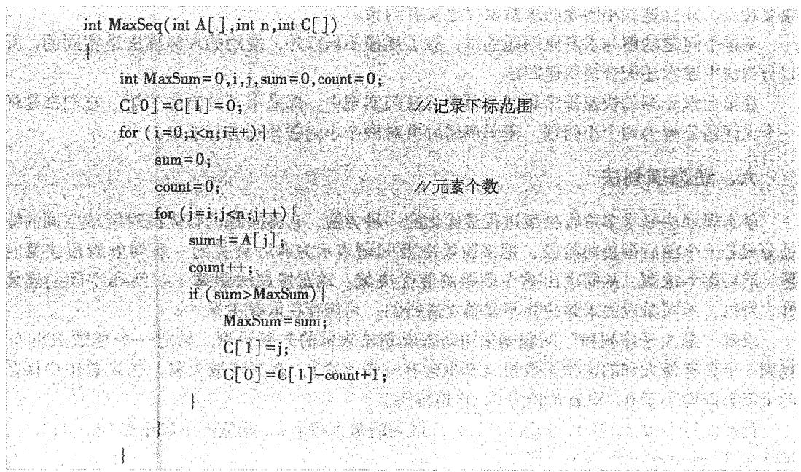

进一步优化算法。

显然，负数不能作为最大和的子数组的起点，因为对于一个以负数为起点的子数组，去掉这个负元素后，剩余元素的和更大。所以，在遇到负数后，可以将它忽略，直到找到一个正数，并将它作为子数组的起点。实际上，0也是可以忽略的。

如果一个子数组最前面子段的和是负数，则这个子段可以被排除。仅当目前子数组的和保持为正时，才持续不断地加入后面的元素，扩大子数组的长度。在扩大子数组的过程中，将新加入的元素值加到原子数组的和上，从而得到更长的子数组的和，并使用一个变量记录所有这些值中的最大值。

对于A={-2,1,-3,4,-1,2,1,-5,4}，求解过程中当前子数组的和到目前为止的最大值见表1-5。

表1-5 算法求解过程中相关变量的值
<table><tr><td rowspan=1 colspan=1>下   标</td><td rowspan=1 colspan=1>0</td><td rowspan=1 colspan=1>1</td><td rowspan=1 colspan=1>2</td><td rowspan=1 colspan=1>3</td><td rowspan=1 colspan=1>4</td><td rowspan=1 colspan=1>5</td><td rowspan=1 colspan=1>6</td><td rowspan=1 colspan=1>7</td><td rowspan=1 colspan=1>8</td></tr><tr><td rowspan=1 colspan=1>A</td><td rowspan=1 colspan=1>-2</td><td rowspan=1 colspan=1>1</td><td rowspan=1 colspan=1>-3</td><td rowspan=1 colspan=1>4</td><td rowspan=1 colspan=1>-1</td><td rowspan=1 colspan=1>2</td><td rowspan=1 colspan=1>1</td><td rowspan=1 colspan=1>-5</td><td rowspan=1 colspan=1>4</td></tr><tr><td rowspan=1 colspan=1>sum</td><td rowspan=1 colspan=1>0</td><td rowspan=1 colspan=1>1</td><td rowspan=1 colspan=1>0</td><td rowspan=1 colspan=1>4</td><td rowspan=1 colspan=1>3</td><td rowspan=1 colspan=1>5</td><td rowspan=1 colspan=1>6</td><td rowspan=1 colspan=1>1</td><td rowspan=1 colspan=1>5</td></tr><tr><td rowspan=1 colspan=1>MaxSum</td><td rowspan=1 colspan=1>0</td><td rowspan=1 colspan=1>1</td><td rowspan=1 colspan=1>1</td><td rowspan=1 colspan=1>4</td><td rowspan=1 colspan=1>4</td><td rowspan=1 colspan=1>5</td><td rowspan=1 colspan=1>6</td><td rowspan=1 colspan=1>6</td><td rowspan=1 colspan=1>6</td></tr></table>

最大子数组和为6，即从A[3]到A[6]。

相应的算法实现如下。

```c
#include <stdio. h>
int MaxSeq(int A[ ],int n,int C[])
int MaxSum=0,sum=0,i,count=0;
C[0]=C[1]=0;
for (i=0;i<n;i++)
sum+=A[i];
count++;
if(sum>MaxSum)
MaxSum = sum;
C[1]=i;
C[0]=C[1]-count+1;
if (sum<0){
sum=0;
count=0;
1
if (MaxSum<0) {
```

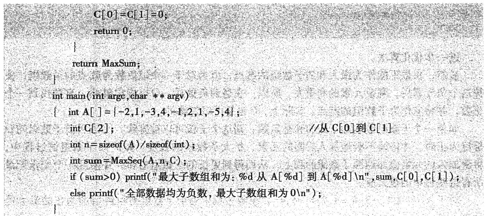

## 内容小结

本章介绍了数据结构的基本概念、4类数据结构及其特点、数据的4种基本存储方式、抽象数据类型的概念，以及定义抽象数据类型的方法。

本章还介绍了算法的基本概念及5个特性、对算法进行评估的基本概念和基本方法(包括时间复杂度和空间复杂度)，以及几种基本的算法策略。

## 习 题

## 一、单项选择题

1. 在数据结构与算法中，从逻辑上可以把数据结构分为A. 紧凑结构和非紧凑结构 B. 线性结构和非线性结构C. 内部结构和外部结构 D. 动态结构和静态结构

2. 数据元素可以细分为A. 数据项 B. 字符 C. 二进制位 D. 数据记录

3. 树结构中元素之间是 关系。A. 一对一的 B. 一对多的 C. 多对多的 D. 不确定的

4. 在数据结构中，数据元素之间均为一对一关系，称为 CA. 线性结构 B. 树结构 C. 图结构 D. 集合结构

5. 下列选项中，不属于数据结构常用存储方式的是A. 顺序存储方式B. 链式存储方式 C. 分布存储方式 D. 散列存储方式

6. 算法分析要评估的两个主要方面是A. 正确性和简明性 B. 时间复杂度和空间复杂度C. 可读性和可维护性 D. 数据复杂性和程序复杂性

7. 下列选项中，定义抽象数据类型时不需要做的事情是 O

A. 给出类型的名字 B. 定义类型上的操作C. 实现类型上的操作 D. 用某种语言描述抽象数据类型

8. 下列算法的时间复杂度中，算法效率最低的是A. $O ( n )$ B. $O ( n ^ { 2 } )$ C. $O ( 2 ^ { n } )$ D. $O ( \log n )$

9. 设n是描述问题规模的非负整数，则下面程序片段的时间复杂度是

$$
( x < n / 2 )
$$

$$
x = 2 * 1
$$

A. $O \{ \log _ { 2 } n \}$ B. $O ( n )$ C. $O ( n \log _ { 2 } n )$ D. $O ( n ^ { 2 } )$

10. 设n是描述问题规模的非负整数，则下列程序片段的时间复杂度是

$$
( n > - ( x + 1 ) * ( x + 1 ) )
$$

$$
\mathbf { \bar { x } = \bar { x } * 2 } ,
$$

A. $O ( n ^ { 1 / 2 } )$ B. $O \{ \log _ { 2 } n \}$ C. $O ( n )$ D. $O ( n \ \log _ { 2 } n )$

11. 在设计求斐波那契数列前n项的算法时，适宜使用的算法策略是A. 分治法 B. 递推法 C. 递归法 D. 穷举法

## 二、填空题

1. 在数据结构与算法中，将所有能输入计算机并被计算机程序处理的符号集合称为

2. 构成数据的基本单位是

3. 数据元素及其关系在计算机内的存储方式称为数据的

4. 数据结构包括4类，分别是集合、线性结构、树结构和 O

5. 构成索引表的基本内容是

6. 一个算法必须在执行有穷步之后结束，这个特性是算法的

7. 设 $A = \left\{ 1 , 3 , - 4 , 5 , - 6 , 4 , 6 , - 3 , - 2 , 6 \right\}$ ，调用函数 $\mathbb { M } \mathrm { { a x } } \mathrm { { S e q } } \left( \mathrm { { \AA } } , \mathrm { { \it n } } , \mathrm { { \cal C } } \right)$ 后，C[1]的值是 0

## 三、解答题

1. 计算机能处理哪些数据？举例说明。

2. 如何理解线性结构中元素之间是一对一的关系？

3. 定义代表交通工具的抽象数据类型vehicle，并添加必要的数据和操作。

4. 定义表示复数的抽象数据类型。

5. 为什么不使用算法的绝对运行时间来衡量算法的时间效率？

6. 在评估算法的空间效率时，需要考虑哪些占用的存储空间？

## 四、算法设计题

1. 试设计一个算法，使用最少的比较次数找出三个不同整数a、b、c的中值。

2. 试设计一个算法，对于给定的正整数n，列出斐波那契数列的前n项，要求该算法的空间复杂度为0(1)。

## 第二章线性表

学习目标：

1. 理解线性表的相关概念，了解其逻辑定义及基本操作，理解线性表数据元素之间的逻辑关系。

2. 掌握线性表的顺序存储方式和链式存储方式，了解它们各自的特点。

3. 掌握顺序表及链表基本操作的实现，并能进行复杂度分析。

4. 掌握静态链表基本操作的实现，并能进行复杂度分析。

5. 能够设计与线性表相关的数据结构，灵活运用线性表的基本操作，设计算法解决与线性表相关的实际问题。

建议学时：8学时。

## 教师导读：

1. 让考生了解线性表的操作是基于实际需求的，本章给出常用基本操作的定义及实现。在此基础上，操作可以有增、删，各操作的参数表也可以有变化。

2. 在实现顺序表的插入及删除操作时，元素移动是关键步骤。让考生理解为什么要进行元素移动，以及如何进行移动。分析元素移动操作对时间复杂度的影响。

3. 在实现链表时，指针操作是关键。让考生理解为什么要添加头结点，以及头结点在单链表中的作用。

4. 让考生对比顺序表与链表中各操作的实现过程，更深入地理解随机访问和顺序访问的特点。

5. 让考生理解实现顺序表和链表各操作时，影响算法时间复杂度的关键操作分别是什么。

6. 让考生掌握静态链表的概念；通过分析静态链表的存储特点及实现过程，让考生进一步加深对顺序表和链表的理解。

7. 在保证考生掌握基本概念的基础上，应要求考生设计并实现与线性表相关的应用程序，掌握程序设计的技巧。

8. 在学习完本章后，应要求考生完成实习题目1。

线性表是最基本的-一种数据结构，在其他非线性数据结构，比如图和树中，也会或多或少地用到线性表。本章介绍线性表的定义与线性表的两种基本存储方式，以及在不同存储方式下基本操作的实现过程，同时分析并比较这些操作的复杂度。本章还将介绍结合了顺序表及链表特性的静态链表。由于线性表的应用非常广泛，因此本章最后会介绍线性表的应用实例。

## 第一节 线性表的定义和基本操作

线性表是一种线性结构。在这种结构中，存在唯一的“第一个”元素、唯一的“第二个”元素，依此类推。

## 一、线性表的定义

线性表中各个元素依次排列。例如，在例1-1中，表1-1列出的某班30名学生的基本信息能够组成一个线性表，可以按照学号排列名单。

例1-1的学生线性表里共有30个元素，每个元素都是一条记录，每条记录中又含有5个数据项。如果有新学生加入，则可以在表中添加一个新元素；同样地，如果有学生转到其他班级，则从表中删除相应的记录。

定义2-1一个线性表（linearlist)是由同类型数据元素构成的有限序列。

一般而言，由 $n ( n { \geqslant } 0 )$ 个元素组成的线性表L可以表示为：

$$
\mathbf { L } { = } \left( \mathbf { a } _ { 0 } , \mathbf { a } _ { 1 } , \cdots , \mathbf { a } _ { n - 1 } \right)
$$

这里， $\mathfrak { a } _ { i } ( 0 \leqslant i \leqslant n - 1 )$ 是线性表中的数据元素，也称为表项。线性表中所有数据元素的数据类型必须相同。数据元素的次序就是它们在表中的排列次序。第一个元素是 ${ \mathrm { a } } _ { 0 }$ ，称为表头元素或开始元素；第二个元素是 $a _ { 1 } \cdots +$ 第n个（即最后一个）元素是 $a _ { n - 1 }$ ，称为表尾元素或终端元素。元素的个数n称为表长。在 $n = 0$ 时，线性表称为空表，表示为()。

【例2-1】将例1-1的学生基本信息表表示为线性表Student。

Student =（(M2022103001王义平男 2004年11月22日山东)，(M2022103002 陆东男2004年02月05日河南），…，(M2022103030杨志强男2004年10月30日陕西)）

每位学生的信息又包含5个数据项，为清楚起见，使用一对括号将数据项括起来。

线性表中常使用从0开始的连续非负整数来表示各元素的位置，表头 ${ \bf a } _ { 0 }$ 的位置为0， ${ \bf a } _ { 1 }$ 的位置为1，一般地， $\mathbf { a } _ { i } ( 0 \leqslant i \leqslant n - 1 )$ 的位置为 $i _ { \circ }$ 对于元素 $\mathsf { a } _ { i } ( 1 \leqslant i \leqslant n - 1 )$ ，元素 $\mathfrak { a } _ { j } \big ( \ 0 \leqslant j < i \big )$ 称为 ${ \mathrm { a } } _ { i }$ 的前驱，其中元素 $\mathrm { a } _ { i - 1 }$ 称为 $\mathbf { a } _ { i }$ 的直接前驱；对于元素 $\mathfrak { a } _ { i } ( 0 \leqslant i \leqslant n ^ { - 2 } )$ ，元素 $\mathfrak { a } _ { j } ( i < j \leqslant n - 1 )$ 称为 ${ \mathrm { a } } _ { i }$ 的后继，其中元素 $\mathrm { a } _ { i + 1 }$ 称为 ${ \mathrm { a } } _ { i }$ 的直接后继。在不引起歧义的情况下，直接前驱简称为前驱，直接后继简称为后继。除表头元素 $a _ { 0 }$ 以外，每个元素有且仅有一个直接前驱；除表尾元素 $\mathrm { a } _ { n ^ { - } }$ 以外，每个元素有且仅有一个直接后继。这些体现的正是“线性”的含义和特点。

线性表中各元素的次序是固有的，即元素 $\mathfrak { a } _ { i } \displaystyle \big ( 1 \leqslant i \leqslant n - 2 \big )$ 排在 $\mathrm { a } _ { \mathrm { i } \sim \tilde { \ell } }$ 之后，且排在元素 $\mathrm { a } _ { i \ast 1 }$ 之前。如果线性表中各元素的值可以进行比较，并且表中元素的值按位置顺序递增或递减排列，即按值的“大小”有序排列，则线性表称为有序表，这个“序”指的是大小有序。与之相对的，表中元素的值不满足按位置顺序递增或递减关系的线性表则称为无序表。

从定义中可以看出，线性表有3个特点，分别是：

（1）所有元素属于同一个类型。

(2) 元素个数是有限的。

(3)各元素之间不一定有大小关系，但一定有次序关系。

【例2-2】写出10以内（不含10）的非负偶数组成的线性表。

10以内（不含10）的非负偶数共有5个，可以写出如下的不同形式的线性表：

$$
\begin{array} { r } { \mathrm { L } _ { 1 } = ( 0 , 2 , 4 , 6 , 8 ) } \\ { \mathrm { L } _ { 2 } = ( 8 , 6 , 4 , 2 , 0 ) } \\ { \mathrm { L } _ { 3 } = ( 2 , 6 , 4 , 0 , 8 ) } \end{array}
$$

前两个都是有序表，分别是递增有序表和递减有序表。第三个是无序表。当然，还可以

写出其他形式的无序表。

以L为例，元素0是表头元素，8是表尾元素，表长为5。元素6的位置是3，它的直接前驱是4，直接后继是8。

## 二、线性表的抽象数据类型

线性表上可以进行的基本操作通常有：向线性表中添加新元素、从线性表中删除某个元素、求线性表的表长、求线性表中某元素的直接前驱或直接后继、判断线性表是否为空、判断线性表是否为满、按位置查找元素、香找某元素所在位置等。

线性表的定义加上对它的操作组成线性表的抽象数据类型（ADT）的定义，表示为LinearList。为简单起见，表中元素的类型使用ELEMType来表示。在实际应用中，可以将ELEMType替换为具体使用的数据类型，如整型(int)，或自定义的复杂结构等。线性表的许多操作都涉及位置，使用Position表示位置类型。

线性表的抽象数据类型定义如下。

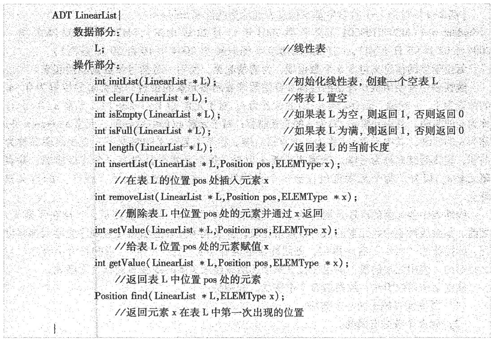

线性表中有几个基本操作会涉及位置Position，操作后有些元素的位置会发生变化。以插入操作insertList为例，当在表L的位置pos处插入元素x后，原pos位置的元素及它的所有后继元素的位置均增1。删除操作removeList也是类似的，当删除表L中位置pos处的元素后，被删除元素的所有后继元素的位置均减1。

LinearList中定义的操作都有返回值，有些返回值代表操作的执行结果，另外一些仅表示操作是否已正确执行。例如，length返回的是线性表的当前长度，即线性表所含元素的个数；find返回的是要查找的元素x在表中第一次出现的位置，如果表中不包含x，则返回-1。当表为空时，isEmpty返回1，否则返回0；当表已满时，isFull返回1，否则返回0。initList、clear、insertList、removeList、setValue、getValue等操作的返回值表示操作是否已正确执行。在这种情况下，通常1代表执行成功，0或-1代表执行时遇到了某些问题，比如参数值不正确。

线性表定义中给出的操作可以根据需要有所变化。例如，可以增加显示（display）操作，即依次列出线性表中的所有元素；也可以增加对位置进行处理的操作，如setFirst用于定位到线性表的首位置，prev和next分别返回当前位置的前驱与后继位置。另外，可以去掉冗余的操作，例如，如果length返回的值是0，则是空表；若返回的值大于0，则是非空表。所以，可以去掉判定表是否为空的isEmpty。

【例2-3】设有线性表LinearLists，表2-1中列出线性表操作的几个示例，这些操作是依次执行的。

表2-1 线性表操作示例
<table><tr><td rowspan=1 colspan=1>序号</td><td rowspan=1 colspan=1>操作</td><td rowspan=1 colspan=1>操作结果</td><td rowspan=1 colspan=1>解释</td></tr><tr><td rowspan=1 colspan=1>1</td><td rowspan=1 colspan=1>initList(&amp;s)</td><td rowspan=1 colspan=1>()</td><td rowspan=1 colspan=1>创建空线性表s</td></tr><tr><td rowspan=1 colspan=1>2</td><td rowspan=1 colspan=1> $\mathrm { f o r ( i { = } 0 ; i { < } 6 ; i { + } + ) ~ } \mathrm { i n s e r t L i s t ( \& s , i , 2 * i ) }$ </td><td rowspan=1 colspan=1>(0,2,4,6,8,10)</td><td rowspan=1 colspan=1>在空表s的表尾处依次插入6个值</td></tr><tr><td rowspan=1 colspan=1>3</td><td rowspan=1 colspan=1>removeList(&amp;s,3,&amp;x)</td><td rowspan=1 colspan=1>(0,2,4,8,10)</td><td rowspan=1 colspan=1>删除位置3的值并由x返回该值</td></tr><tr><td rowspan=1 colspan=1>4</td><td rowspan=1 colspan=1>setValue(&amp;s,3,-10)</td><td rowspan=1 colspan=1>(0,2,4,-10,10)</td><td rowspan=1 colspan=1>给位置3的元素赋值-10</td></tr><tr><td rowspan=1 colspan=1>5</td><td rowspan=1 colspan=1>find(&amp;s,10)</td><td rowspan=1 colspan=1>返回值是4</td><td rowspan=1 colspan=1>在s 中查找10，10在位置4</td></tr><tr><td rowspan=1 colspan=1>6</td><td rowspan=1 colspan=1>find(&amp;s,9)</td><td rowspan=1 colspan=1>返回值是-1</td><td rowspan=1 colspan=1>在 s中查找9，查找失败</td></tr></table>

## 第二节 线性表的顺序存储及实现

线性表基本操作的具体实现需要依赖线性表的存储结构。可以使用顺序存储方式和链式存储方式保存线性表，从而分别得到线性表的顺序存储结构和链式存储结构。顺序存储结构使用数组保存线性表中的各元素，相应的线性表称为顺序表。链式存储结构使用链表保存线性表中的各元素，相应的线性表称为链表。

## 一、顺序表

顺序存储使用一组连续的存储单元依次存储各个元素。在C语言中，一维数组是顺序存储的连续存储空间，所以线性表的顺序存储结构就是将线性表中的各数据元素，按照其逻辑次序，依次保存到数组中。使用顺序存储结构保存的线性表称为顺序表。线性表中的一个元素保存在数组的一个单元中。线性表中逻辑上相邻的两个元素，保存在数组内相邻的两个单元中。

为了保存一个线性表，需要分配一个多大的数组呢？线性表中的元素个数可以是变化的，这意味着数组的单元数也要变化。而一旦数组分配完毕，它的个数就不会改变。一般地，需要分配一个足够大的数组以供线性表使用，这样既保证能够保存线性表中当前的全部元素，又为后续的插入操作预留了空间。在分配数组时，预留的数组空间越大，数组空间占满的可能性越小，空间利用率越低，即存储效率越低。应该根据线性表中可能包含的元素的最大个数来分配数组。为了表示数组中保存的实际元素个数，通常还需要使用一个整型变量来记录顺序表的当前长度。

在分配数组空间后，将线性表中的n个元素依次保存在数组中，从表头至表尾的各个元素分别对应从下标0到下标n-1的位置。数组是内存中一片连续的空间，相邻的两个单元在内存中的实际地址也是相邻的，这表明，线性表中逻辑上相邻的两个元素，其存储地址也是相邻的。这是顺序表的一个显著特点。

线性表中的元素可以是有定义的任何类型，如例2-1中的一条记录或例2-2中的一个整数。在内存中，保存不同类型的元素时会需要数目不等的存储单元。要正确理解“数组中相邻单元的存储地址相邻”这句话的含义。假设有线性表 $\mathrm { L } { = } \left( \mathbf { a } _ { 0 } , \mathbf { a } _ { 1 } , \mathbf { a } _ { 2 } , \mathbf { a } _ { 3 } , \mathbf { a } _ { 4 } , \mathbf { a } _ { 5 } \right)$ ，每个元素需要占用2个字节，要分配一个含8个元素的数组A来保存L，则A在内存中的示意图如图2-1所示。

数组 $A$ 占据内存中从位置M开始的一片连续空间，其中，第1个字节和第2个字节用来保存元素 ${ \bf a } _ { 0 }$ ，第3个字节和第4个字节保存元素 ${ \bf a } _ { \mathrm { i } }$ ，第5个字节和第6个字节保存元素 ${ \bf a } _ { 2 }$ ，依此类推，第11个字节和第12个字节保存元素 ${ \mathfrak { a } } _ { 5 \circ }$ 所以，线性表L共占用

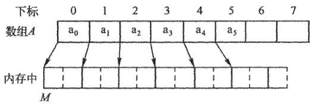  
图2-1 数组A 在内存中的示意图

12个字节。通常每个字节对应于内存中的一个存储单元，而计算机的编址方式可能不完全一致，主要有字编址和字节编址。所以，保存元素 $a _ { 0 }$ 的首地址和保存元素 $a _ { 1 }$ 的首地址不一定是连续的地址编号，但这两个地址编号之间不会再有保存其他元素的地址编号。

数组下标与线性表元素的位置相对应。线性表元素依次存放的特性，决定了表中位置$i \{ i \geqslant 0 \}$ 的元素存储在数组的下标i处。表头元素保存在位置0处，这个位置也称为数组的首地址。有了这个约定，对表中任意一个元素的访问将变得非常容易。只要给出表中元素的序号，就可以根据下标地址计算公式很容易地计算出元素所在的内存位置（实际上是相对于数组首地址的偏移量），因此可以直接访问该元素。顺序表中的访问方式称为随机访问方式，其含义是，只要给定数组下标，就能立即计算出相应元素的存储地址，并据此访问该元素。

设 $\mathrm { L O C } \left( \mathrm { a } _ { i } \right) ( i \geq 0 )$ 表示元素 ${ \mathrm { a } } _ { i }$ 的存储首地址，每个元素需要占用d个存储单元，则有

$$
\mathrm { L O C } ( \mathbf { a } _ { i } ) = \mathrm { L O C } ( \mathbf { a } _ { i - 1 } ) + d\tag{2-1}
$$

进一步地有

$$
\mathrm { L O C } ( \mathrm { a } _ { i } ) = \mathrm { L O C } ( \mathrm { a } _ { 0 } ) + i { \times } d\tag{2-2}
$$

$\mathrm { { L O C } ( a _ { 0 } ) }$ 即数组的首地址。

【例2-4】设顺序表的每个元素占8个存储单元。若第1个元素的存储首地址为100，则第6个元素占用的最后一个存储单元的地址是（）。A. 132 B. 139 C. 140 D. 147

答案是 $\mathrm { D } _ { \circ }$

对于顺序表，存储任一元素 ${ \mathrm { a } } _ { i }$ 的开始地址 $\mathrm { { L O C } ( a _ { i } ) }$ 与数组首地址 $\mathrm { L O C } ( \mathrm { a } _ { 0 } )$ 的关系应满足式（2-2)。本例中，d=8， $\mathrm { L O C } \left( \mathrm { a } _ { 0 } \right) = 1 0 0$ ，第6个元素是 $\mathbf { a } _ { 5 \circ } ~ \mathrm { L O C } \left( ~ \mathbf { a } _ { 5 } \right) = \mathrm { L O C } \left( ~ \mathbf { a } _ { 0 } \right) + 5 \times 8 =$

100+40=140，即第6个元素占用从140开始的8个存储单元，那么最后一个存储单元是147。

也可以使用另一种求解方法。第6个元素占用的最后一个存储单元，实际上是第7个元素占用的第1个存储单元的前一个单元。可以先计算第7个元素的首地址，得到148，再减1，得到相同的答案。

线性表的插入和删除是两个基本操作。顺序表要求表中的相邻元素存储在数组的相邻单元中，所以当在某个位置插人新元素时，必须先为这个元素找到相应的存储空间，同时要保证数组中所有元素依然依次相邻存放。在删除元素时，被删除元素所占用的位置要由其他元素来填补。总的来说，在当前位置插入元素或删除当前位置的元素时，都会涉及从当前位置开始，一直到表尾的所有元素，即这些元素都需要移动。

当在表尾后插入元素或删除表尾元素时，操作是容易实现的，因为操作不会引起其他元素的移动。当插人或删除操作的位置是其他位置时，移动元素的个数依赖于操作的位置。例如，当要在表头插入新元素时，表中当前所有元素都必须向表尾方向移动一个位置以腾出空间。当要在表中（合理的）位置i插人一个新元素时，这个位置及其到表尾的所有元素都必须向表尾方向移动一个位置。删除操作与此类似，只是元素的移动是向表头方向进行的。平均来说，插入和删除操作要移动表中约一半的元素。

设给定一个顺序表，初始时含有5个元素：11、5、23、19和6。在位置2插入元素27，然后删除位置3的元素，每步操作后的顺序表如图2-2所示。

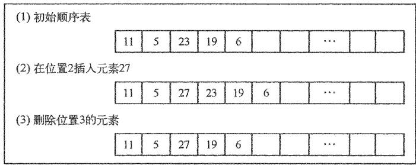  
图2-2 顺序表的插入、删除过程

为了执行“在位置2插入元素27”，需要依次将元素6、19和23向后移动一个位置，注意移动的次序。先移动6，最后移动23。此时，位置2的空间是可用的（其中仍有数据23），将元素27保存在这个位置。这个过程如图2-3所示。

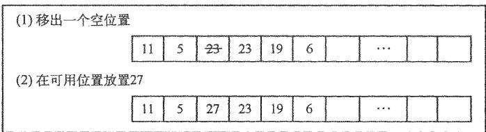  
图2-3 插人27的详细过程

在执行“删除位置3的元素”时，需要将23后面的元素（19和6）依次前移一个位置。移动的次序是，先移动19，再移动 $6 _ { \circ }$ 这个过程如图2-4所示。

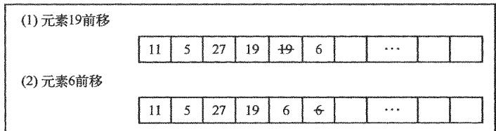  
图2-4 删除位置3元素的详细过程

## 二、顺序表基本操作的实现

下面给出顺序表的实现。

实现基本操作的程序中会用到一些常量，其定义如下。

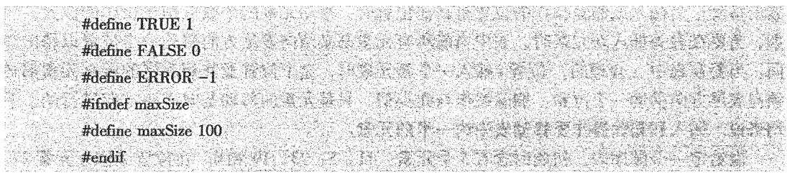

表中每个元素的类型是ELEMType，顺序表的定义如下。

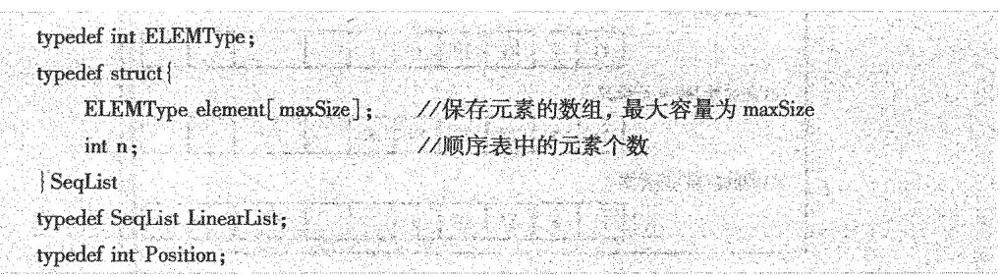

新构造的顺序表为空表。空表中所含的元素个数为零，将表清空也意味着表中元素个数为零。这两个操作的实现非常简单。

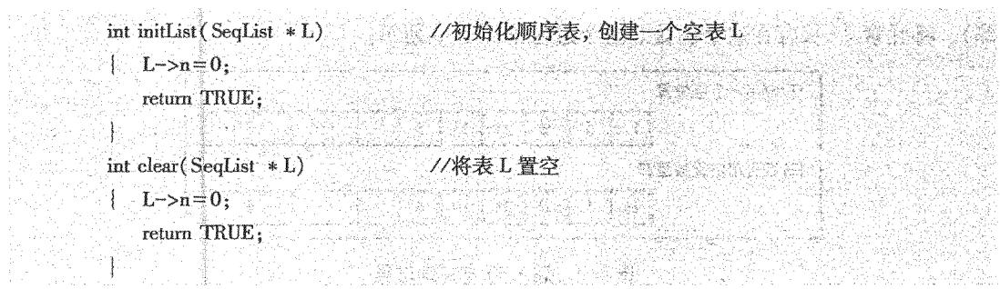

根据顺序表中n的值，可以判断顺序表是否为空、是否已满，值n也直接代表顺序表的长度。

```c
int isEmpty(SeqList * L) //如果表L为空，则返回1，否则返回0
{ if (L->n==0) retum TRUE
else return FALSE
int isFull(SeqList * L) //如果表L已满，则返回1，否则返回0
{ if (L->n==maxSize) retumn TRUE;
else return FALSE;
int length(SeqList * L) //返回表L的当前长度
{ retum L->n;
```

当在不满的顺序表中插人一个元素x时，除了要指明元素的值以外，还要指出插人的位置。insertList函数带有3个参数，分别是顺序表、插入位置及要插入的值。位置值pos必须是一个合理的整数值，即pos值介于0和“L->n”之间。合理的位置值有n+1个。插入在位置0处，意味着插入在表头位置。插入在“L->n”处，意味着添加在原表尾的后一个位置。

当确认表不满且插入位置有效后，从表尾元素开始，到插入位置的元素为止，依次将各元素后移一个位置。移动完毕，将元素x放到移动后出现的空闲位置中。之后将元素个数增1，即表长增1。

插入操作的实现如下。

```c
int insertLást(SeqList * L, Position pos, ELEMType x)
//在表L的位置 pos处插入元素x
inti;
if (isFull(L)= =TRUE) return FALSE; //表已满
if (pos<011pos>L->n) return ERROR //位置错误，与表满区分开
for (i=L->n;i>pos;i--) {
L->element[i] =L->element[i-1]; //移动元素
L->element[i] =x; //放置x
L->n++; //表长增1
return TRUE;
```

对于长度为n的顺序表，当在表尾的后一个位置插入元素时，不需要移动任何元素。如果插入在倒数第一个位置，则需要移动1个元素；如果插人在倒数第二个位置，则需要移动两个元素。依此类推，插入在第一个位置，需要移动n个元素。总之，当在位置i插入元素时，需要移动n-i个元素。

如果在任何位置进行插入的概率都相等，则插入操作中，移动元素的平均次数N为

$$
N = { \frac { \displaystyle \sum _ { k = 0 } ^ { n } k } { n + 1 } } = { \frac { n } { 2 } }
$$

删除操作是类似的，函数removeList中需要指明顺序表及要删除的元素所在的位置。通常，删除的元素值需要通过一个变量返回给操作调用者，所以removeList函数也带有三个参数，前两个参数分别是顺序表和删除位置，删除的元素值将放到第三个参数中。也可以让removeList函数只带前两个参数，而删除的元素值通过函数的返回值带回。

在删除时，需要确认表不为空且位置值pos有效，这里pos应介于0和“L->n-1”之间。合理的位置值有n个。注意，删除的合理位置值比插入的合理位置值少1。移动表元素时，从被删除元素的直接后继开始，一直到表尾结束，各元素依次前移一个位置。同时，表长减1。

删除操作的实现如下。

```c
int removeList(SeqList * L, Position pos, ELEMType * x)
//删除表L中位置 pos处的元素并通过x返回
int i;
if (isEmpty(L) = =TRUE) return FALSE; //表空
if (pos<0||pos>L->n-1)-retum ERROR; //位置错误，与表空区分开
* x=L->element[ pos ] ; //记下被删除的元素值
for(i=pos;i<L->n-1;i++)
L->element[i]=L->element[i+1] //前移元素
L->n--; //表长减1
return TRUE;
```

被删除的元素值通过形参x带给操作调用者，所以形参x是指针形式。

对于长度为n的顺序表，当删除表尾元素时，不需要移动任何元素。当删除倒数第二个元素时，需要向前移动1个元素，依此类推，当删除表头元素时，需要前移n-1个元素。

如果在任何位置进行删除的概率都相等，则删除操作中，移动元素的平均次数N为

$$
N = { \frac { \displaystyle \sum _ { k = 0 } ^ { n - 1 } k } { n } } = { \frac { n - 1 } { 2 } } .
$$

因为能通过数组下标直接定位到元素，从而可以直接访问到元素本身，所以，很容易实现给顺序表中某位置的元素赋值、获取表中某位置处的元素值。在表中查找某个值时，需要从前向后依次判定元素是不是要查找的目标，使用一个循环完成查找过程。当然，也可以从后向前进行依次判别查找。假设，顺序表中一定能找到查找目标，则最优情况下，在数组下标0处即找到查找目标。在最坏情况下，需要查找到数组最后一个元素。所以平均来讲，也需要查找顺序表中约一半的元素。如果查找失败，则需要查找到数组最后一个元素，与查找成功时的最坏情况类似。这三个函数的实现如下。

```c
int setValue(SeqList * L, Position pos, ELEMType x)
//给表L位置 pos 处的元素赋值x
{if(pos>=0&&pos<L->n){
L->element[ pos] =x;
```

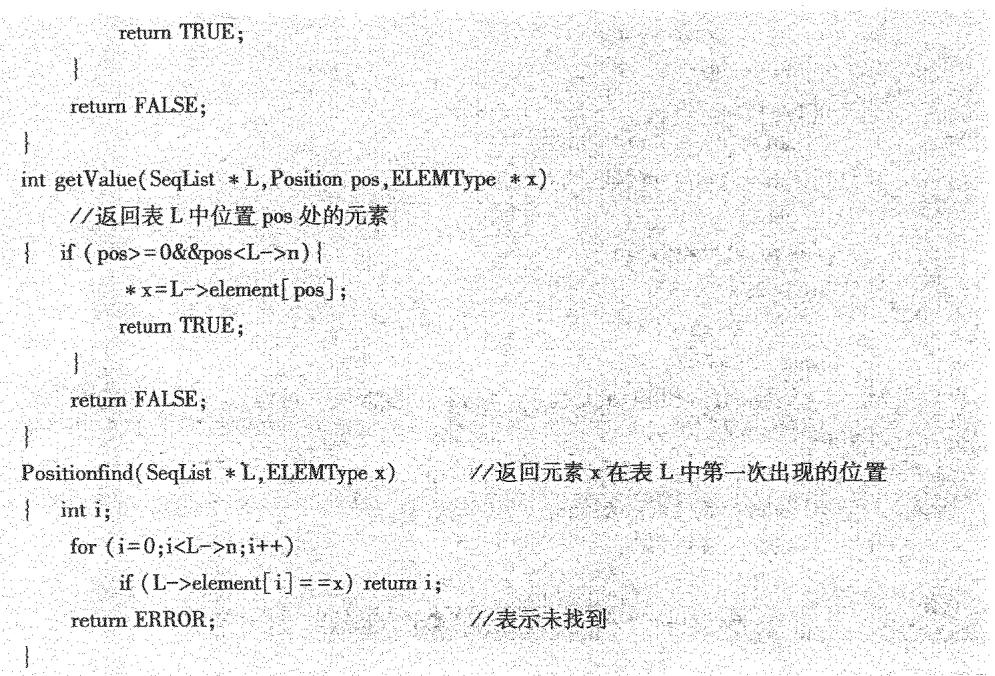

可以使用一个程序验证上述各函数的正确性。为了展示顺序表中各元素的值，可以先实现一个依序列出元素值的辅助函数display。

```c
void display(SeqList * L) //列出顺序表中各元素的值
int i;
if(L->n==0) printf("这是一个空顺序表\n")
else
printf("这是含 %d 个元素的顺序表:\n",length(L));
for (i=0;i<L->n;i++)|
printf("%d ",L->element[ i])
printf(" \n");
```

测试程序如下。

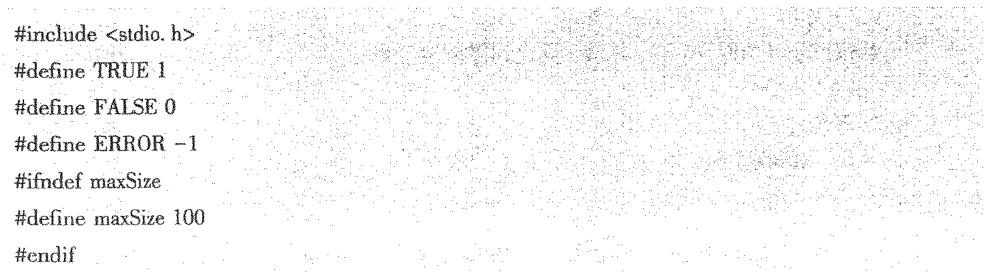

测试程序的输出如下。  
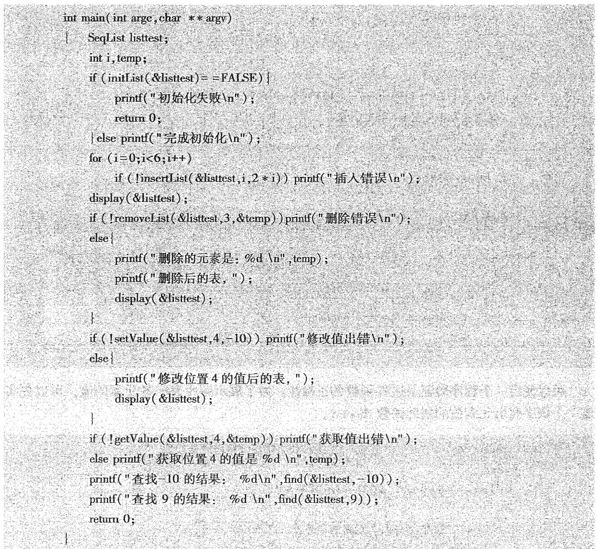

完成初始化  
这是含6个元素的顺序表  
0 2 4 6 810  
删除的元素是：6  
删除后的表，这是含5个元素的顺序表：  
024810  
修改位置4的值后的表，这是含5个元素的顺序表  
0248-10  
获取位置4的值是-10  
查找-10的结果：4  
查找9的结果：

在C语言中，函数参数的传递方式有值传递和地址传递。如果在函数体内修改了实参值，且操作结果需要传递到函数外，即要对相应的实参起作用，则相应的形参选择为指针形式。此外，为了各函数参数表的形式一致及调用时的高效率，形参中的顺序表均使用指针形式。调用时需要传递实参顺序表的地址。以初始化操作initList为例，定义的形参是 SeqList \*L。在main函数中，调用 initList 函数时使用的实参是顺序表的地址 &listtest。

假设顺序表长度为n，则上述系列方法中，插入操作、删除操作与操作的位置有关，这两个方法的时间复杂度均为0(n)。其他操作的时间复杂度均为0(1)。

【例2-5】设有顺序表L，表长为n，保存在数组A中。实现算法将L逆置，即将 $\mathbb { L } =$ $\left( \mathsf { a } _ { 0 } , \mathsf { a } _ { 1 } , \cdots , \mathsf { a } _ { n - 2 } , \mathsf { a } _ { n - 1 } \right)$ 变为 $\mathrm { L } = \left( \mathbf { a } _ { n - 1 } , \mathbf { a } _ { n - 2 } , \cdots , \mathbf { a } _ { 1 } , \mathbf { a } _ { 0 } \right)$ o

当顺序表L不为空时，将 $A [ 0 ]$ 与 $A \left\{ n - 1 \right\}$ 进行交换，然后将A[1]与A[n-2]进行交换，依此类推。当交换到L中间的元素时，算法结束。

如果n是偶数，则交换的元素对刚好是 $n / 2 _ { \circ }$ 如果n是奇数，则L中间的元素不需要交换，交换的元素对也是 $n / 2 ,$ 所以可以使用一个for循环完成交换过程，循环执行的次数为n/2，算法的时间复杂度为0(n)。算法的实现如下。

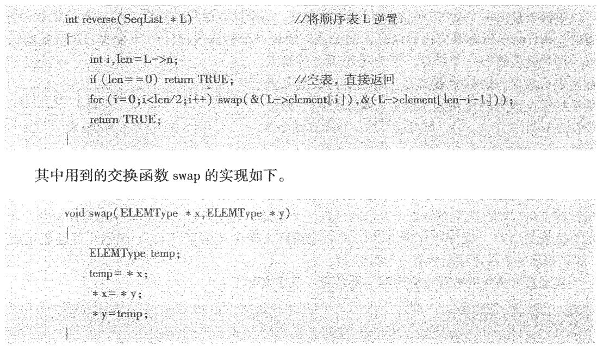

使用顺序存储结构保存线性表非常方便，因为可以通过下标来访问数组元素，所以可以实现对表中元素的随机访向。这是顺序存储结构的优势。

在顺序表中实现插入和删除时可能需要移动元素，如果插入和删除的位置靠近表头位置，则移动的元素个数偏多。当有频繁的插人、删除操作时，元素的移动也会很频繁，操作的效率较低。另外，由于数组的大小是相对固定的，因此，当表的长度有很大变化时，数组空间的利用率也不好控制。有可能会因为表中元素个数过多而导致数组空间不足，也可能会因为表中元素个数较少，使得数组中的很多位置是空置的。这些都是顺序存储结构的不足之处。

针对顺序表的这些问题，提出了线性表的另一种存储方式，即链式存储方式。

## 第三节 线性表的链式存储及实现

线性表还可以使用链式存储方式保存，即线性表中的各个元素保存在各自的存储空间中，形成一个个结点。这些结点在内存中的地址不要求是相邻的，它们之间通过指针连接起来。以这种方式保存的线性表称为链表。每个结点中包含元素值和指向其他结点的指针，指针的个数可以是一个，也可能是两个，从而形成不同形式的链表。

链式存储结构是一种动态且灵活的存储方式，它不要求预先分配一块连续的存储空间，而是按需分配，随时需要，随时分配。同时不要求分配的空间必须是相邻的，而是由系统决定分配的具体位置，既可以相邻，也可以不相邻。所以在执行插入及删除操作时，不再需要为保证存储空间的相邻性而移动元素。因为元素不是保存在数组中，所以执行插入操作时也不再需要判定数组是否已满。链式存储方式下没有容量上限，除非计算机内存资源耗尽。

## 一、单链表

单链表是由一组动态分配的结点形成的链表，每个结点保存线性表中的一个元素及一个指针，指针指向保存其直接后继元素的结点。使用一个特殊的指针指向表头元素所在的结

点，即单链表的第一个结点。表头元素所在的结点称为表头结点，也称为首结点。类似地，表尾元素所在的结点称为表尾结点，也称为终端结点。假设线性表L为(A,B,C,D)，则保存L的单链表如图2-5所示。

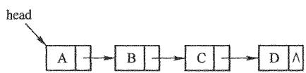  
图2-5 保存L的单链表

指针head指向单链表中的表头结点，head称为表头指针或头指针。每个结点中都有一个指针，指向保存其后继元素的结点。由表头指针可以找到表头结点，然后根据每个结点中指针的指向，可以找到单链表中其余的任何一个结点。表尾元素所在结点中的指针为空，表示单链表的结束。程序中使用NULL表示空指针，图中经常以“入”表示。单链表中的“单”表示每个结点中仅含有一个指针。

实现基本操作的程序中会用到一些常量，其定义如下。

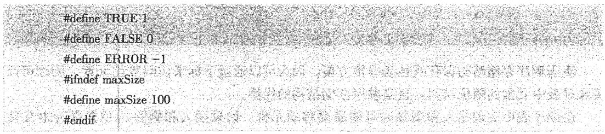

单链表中每个元素的类型是ELEMType，单链表中结点及链表的定义如下。

typedef int ELEMType;  
typedef struct node { //单链表结点ELEMType data; //数据域struct node \* next; //指针域

在使用单链表保存线性表时，不再像顺序表那样需要预先分配一个足够大的数组，而是按需分配，有新元素插人线性表时，申请并动态分配一个结点，将含有新元素的结点插人到单链表中。如果从线性表中删除元素，则从单链表中删除相应的结点，并将结点占用的空间释放。所以，单链表所占用的空间量与表中的结点个数成正比。

单链表中各结点所在的内存地址，并不要求是相邻的，即线性表中逻辑上相邻的元素，在内存中的存放位置并不要求也相邻。因此，当插入或删除结点时，其他结点不需要移动。从而避免了像顺序表进行插入或删除时那样的元素移动。

与顺序表一样，在单链表中进行插入或删除时，仍需要指明操作位置。顺序表中的操作位置是一个合理、有效的非负整数。在单链表中，各元素的位置值也是从0开始计数的一个非负整数。例如，在图2-5所示的单链表L中，元素A、B、C、D的位置依次为0、1、2、3。实际上，元素的位置值也是元素所在的结点的次序值。

在实现基本操作时，因为操作是在单链表中进行的，所以往往使用指针指向相应的结点。例如，要在图2-5所示的单链表L的位置2处插入元素E。从表头指针head开始逐结点向后遍历，可以找到次序值为2的结点，即保存元素C的结点。这个结点称为当前结点，使用指针curr指向这个结点，指针curr称为当前指针，如图2-6所示。

在位置2处插入元素E后得到的线性表为(A,B,E，C,D)，在单链表L上插入的操作步骤是：

①创建一个新结点，新结点中保存值E。

②让新结点的 next 指针指向指针 curr指向的结点（当前结点)。

③让当前结点的直接前驱结点的 next指针指向新结点。

操作过程如图2-7所示。

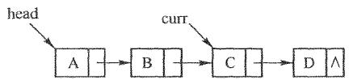  
图 2-6 单链表 L 及当前指针 curr

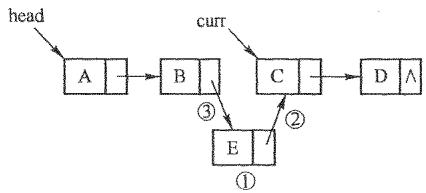  
图2-7 在单链表L中进行插入操作的过程

插入结点的过程中，在分配新结点所使用的空间后，还需要改变两个指针的指向。以图2-7中的单链表L为例，这两个指针分别是元素E所在结点（简称为结点E）的next指针（简称为E指针）和元素B所在结点（简称为结点B）的next指针（简称为B指针）。E指针指向curr所指的结点（简称为结点C），B指针指向结点E。

在创建结点E后，能很容易地访问到E指针，让它指向结点C易如反掌。

如何快速找到B指针是一个问题。在正常情况下，如果没有其他指针指向结点B，则需要使用一个临时工作指针，从单链表的表头指针head开始，沿链的方向逐步后移，直到找

到结点B为止。

删除操作也有类似的情况，也需要找到被删除结点的前驱结点。如果没有其他指针可利用，则也需要从表头指针开始，沿链的方向逐步后移，从而找到相应的位置。

现在考虑当前指针的另一种定义方式。查看操作的步骤可知，插入操作及删除操作涉及的表结点都只有3个，即当前结点及它的前驱结点和新结点。现在改变当前指针指向的位置，让它前移一个位置，即指向当前结点的前驱结点。这样，从当前指针所指位置开始，定位操作中涉及的3个结点就非常方便了。因为它们都在当前指针后面不远的地方。

仍以图2-7为例，让指针cur前移一个结点，即curr指向结点B，那么在插入元素E时，创建新结点后，能很容易地找到并修改相关的指针。为此，修改原来关于当前指针的语义。在插入结点时，新插入的结点作为当前指针所指结点的后继。类似地，在删除操作中，删除的是当前指针所指结点的后继。

在修改为这样的定义后，问题并没有完全解决。试想一下，如果要插入的元素作为单链表的新的首元素，或者要删除单链表中的首元素，那么当前指针cu又指向哪里呢？为此，再进一步修改单链表的定义。让单链表自带一个虚拟结点作为第一个结点，虚拟结点中并不保存线性表中的任何元素。单链表的首元素保存在虚拟结点的后继结点，即单链表的第二个结点中。这个虚拟结点通常称为头结点，相应的单链表称为带头结点的单链表。头结点的data域中可以不保存任何值，也可以保存单链表中的结点个数。表头指针指向头结点。

带头结点的单链表示例如图2-8所示，其中图2-8a是空单链表，图2-8b是非空单链表，使用curr表示当前指针。

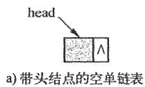

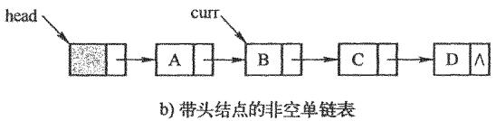  
图2-8 带头结点的单链表

在带头结点的单链表中实现插入操作时，其过程如图2-9所示。创建新结点并在其中保存了值E（步骤①）后，让新结点的next指针指向当前指针所指结点（结点B）的后继结点（结点C）（步骤②），然后让当前指针curx所指结点（结点B）的next指针指向新结点（结点E）（步骤③)。新插入的结点变为当前结点，也就是说，插入后指针cu的值不变。

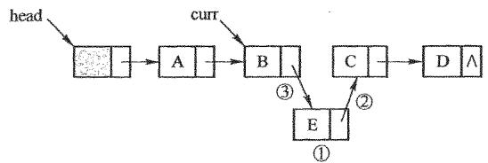  
图2-9 在带头结点的单链表L中进行插入操作的过程

【例2-6】在单链表L中，已知q所指结点是p所指结点的前驱结点，next是结点的指针域，若在q和p之间插入s所指结点，则执行的操作是（）。A. $\mathrm { s ^ { - } { > } n e x t { = } p {  } n e x t { : } \ p {  } n e x t { = } s }$ B. $\mathrm { p ^ { - } { > } n e x t = s ^ { - } { > } n e x t ; } \mathrm { s ^ { - } { > } n e x t = p ; }$ C. $\mathrm { p } {  } \mathrm { n e x t } { = } \mathrm { s } , \quad \mathrm { s } {  } \mathrm { n e x t } { = } \mathrm { q } ,$ D. $\mathrm { q \mathrm { - } \mathrm { > n e x t } = s \ ; ~ \Delta ~ \ s \mathrm { - } \mathrm { > n e x t } = p }$

答案是 $\mathfrak { d } _ { \circ }$

初始时，单链表L中部分结点及待插入结点的状态如图2-10所示。

因为插入位置附近的两个结点都有独立的指针指向，所以指针s所指结点（结点s）的next 指针和指针 q 所指结点（结点 $_ { \mathfrak { g } } )$ 的next指针，其修改次序可以是任意的，先修改哪一个都是可以的。

结点s的后继结点是指针p指向的结点(结点 p)，所以修改结点 s 的 next 指针的语句是 $\mathbf { \mu } ^ { * * } \mathbf { s } \mathbf { - } > \mathbf { n } \mathbf { e x t } = \mathbf { p } \mathbf { \ ; } ^ { \prime \prime }$ 。而结点s成为结点 $\mathfrak { q }$ 的后继结点，相应的修改语句是 ${ } ^ { \omega } \mathbb { q } ^ { - } > \mathrm { n e x t } = \mathbf { s } \ ; { } ^ { \ n }$ 0选项D是正确的，对应选项D在单链表L中插入结点s的过程如图2-11所示。

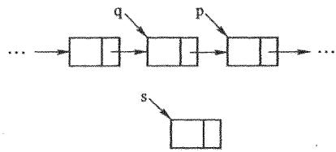  
图2-10 单链表L中部分结点及待  
插入结点的初始状态

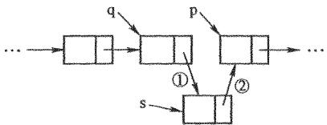  
图2-11 对应选项 D在单链表L 中  
插人结点 s的过程

对于选项A，语句 $\mathrm { \Phi ^ { * } s } \mathrm { - } \mathrm { > n e x t } { } = \mathrm { p } \mathrm { - } \mathrm { > n e x t }$ ；”将结点p的后继结点作为结点s的后继结点，这是错误的。对于选项B，语句 $\mathrm { \mathrm { ^ { \circ } p \mathrm { - } > n e x t = s \mathrm { - } > n e x t } }$ ”将结点 s 的 next 域的值赋给了结点 p的 next 域，通常，结点 s 的 next 域的值是NULL，也就是说，将结点p与其后继结点断开了。如果结点s的 next域的值不是NULL，则意味着将结点s的后继结点作为结点p的后继结点。这两种情况都与题意不符。对于选项C，语句 $\mathrm { { } ^ { * } p \mathrm { { - } > n e x t = s ; } }$ ”将结点s作为结点p的后继结点，也是错误的。

删除操作的过程如图2-12所示。先使用一个临时指针temp指向即将被删除的结点（结点C）（步骤①），然后修改当前指针cu所指结点（结点B）的指针域（步骤②），让其指向 temp指向结点的后继结点（结点D)。在进行删除操作后，当前指针curr的值不变。

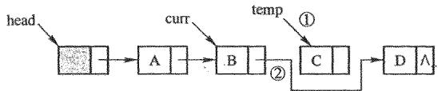  
图2-12 在带头结点的单链表L中进行删除操作的过程

注意，要删除的是当前指针所指结点（结点B）的后继结点（结点C）。因为这个结点的空间不再使用，所以使用一个临时指针指向它，其目的是使用完结点值后可以释放空间，释放空间的步骤不要忘记。实际上，在释放之前，结点C的next域仍指向结点 $\mathfrak { d } _ { \mathfrak { c } }$

【例2-7】在带头结点的单链表中，若删除指针p所指结点的后继结点，则执行的操作是（）。A. $\mathrm { p \mathrm { - } > n e x t } = \mathrm { p \mathrm { - } > n e x t } \mathrm { - } > \mathrm { n e x t }$ B. $\mathrm { p } { \stackrel { } { = } } \mathrm { p } { \stackrel { - } { \to } } \mathrm { n e x t } ; \mathrm { p } { \stackrel { - } { \to } } \mathrm { n e x t } { } = \mathrm { p } { \stackrel { - } { \to } } \mathrm { n e x t } { } \to \mathrm { n e x t }$ C. $\mathrm { p { \mathrm { - } } { \mathrm { > } } n e x t { = } } \mathrm { p { \mathrm { - } } { \mathrm { > } } n e x t { ; } }$ D. $\mathbf { p } { = } \mathbf { p } { \mathrm { - } } { > } \mathbf { n e x t - } { > } \mathbf { n e x t } ;$

答案为A。

不妨设p所指结点是X，其后继结点是Y，根据题意，要删除的是结点 ${ \tt Y } _ { \mathrm { o } }$ 需要让结点

X的 next 指针指向结点 Y的后继，即“p->next=p->next->next;”。选项 A 是正确的。如果结点Y没有后继，则意味着删除操作后p所指结点为终端结点，语句“p->next=p->next->next;”会让结点 X 的 next 域的值为 NULL。

对于选项B，语句 $\mathrm { \mathrm { ' } } \mathrm { p } { = } \mathrm { p } { - } \mathrm { > } \mathrm { n e x t }$ ”使得指针p指向结点Y，而语句 $\mathrm { \mathrm { ~ \sqrt [ { 4 } ] { p - 5 n e x t } = p - > n e x t } }$ ->next;”删除的是结点Y的后继结点，不符合题意。

对于选项C，语句“p->next=p->next;”没有改变任何值，也没有删除任何结点。

对于选项D，语句“p=p->next->next;”只是让指针p指向了结点Y的后继，没有删除任何结点。

实际上，如果删除了单链表中的某个结点，则还应该通过free语句将结点占用的空间释放。

【例2-8】若线性表采用链式存储结构保存，则要求内存中可用存储单元的地址（）。A. 必须是连续的 B. 部分地址必须是连续的C. 一定是不连续的 D. 连续或不连续都可以

答案为D。

对于采用链式存储方式保存的线性表，其各元素所在的地址在系统分配内存空间时确定，既不要求所有元素的地址是连续的（选项A），也不要求部分元素的地址是连续的（选项B），连续和不连续都有可能（选项D正确），所以，“一定是不连续的”这个说法也是错误的（选项C）。

## 二、单链表基本操作的实现

下面给出带头结点的单链表基本操作的实现。

在带头结点的单链表中，始终会有一个头结点，这个结点在初始化时创建。

```c
int initList(LinkList * head) //构造一个带头结点的空单链表
(* head) = (LinkList) malloc(sizeof(LinkNode) );
if ( * head = =NULL) return FALSE; //分配空间失败
(* head)->data=0; //在头结点中记录链表长度
(*head)->next=NULL;
return TRUE;
```

清空单链表的结果是只留下头结点，其余结点所占用的空间都需要使用free释放。

int clear(LinkList \* head) //将表 head 置空   
LinkNode \* p;   
if ( \* head = =NULL) { //表头指针错误，返回0   
printf("链表错误\n");   
retur FALSE;   
p= ( \* head) ->next;

```c
while (p!=NULL){ //依次释放各结点占用的空间
( * head)->next=p->next;
free(p);
p=( * head)->next;
(*head)->data=0; //结点个数为0
return TRUE;
```

单链表中结点占用的空间是随需分配的，不会像顺序表那样受数组元素个数的限制，而仅受内存空间大小的限制。所以，对于单链表，只要系统能够成功分配结点的空间，单链表就不会满。即一旦分配失败，就相当于单链表满了。所以，单链表中无须实现isFull函数。空单链表至少含有一个表头结点。

```c
int isEmpty(LinkList * head) //如果表head为空，则返回1，否则返回0
if (*head = =NULL) //表头指针错误，返回-1
printf("链表错误\n");
return ERROR;
if (( * head) ->data= =0) return TRUE
else retum FALSE; //链表不为空时返回0
```

在头结点的data域中已经保存了结点的个数，当求单链表长度时，可以直接返回这个值。如果没有在头结点中保存这个值，那么求单链表长度时需要从表头开始，逐个结点进行计数。两种实现版本如下。

```c
int length(LinkList * head) //返回表head的当前长度，采用域值方式
if ( * head = = NULL) { //表头指针错误，返回-1
printf("链表错误\n");
return ERROR;
return( * head) ->data;
int length(LinkList * head) //返回表head的当前长度，采用计数方式
LinkNode * p;
int i=0;
if ( * head = = NULL) { //表头指针错误，返回-1
printf("链表错误\n");
return ERROR;
```

在插入、删除操作中，形参表中给定的位置值需要转换为指向单链表中相应结点的指针，即要给当前指针进行赋值，用函数setCurr实现这个功能。

//设置当前指针的值 //表头指针无效

while (temp!=NULL && pos>0) temp=temp->next;

在单链表中插入一个新元素时，调用setCurr函数以根据位置值来设置curr的值，由curr指明插入的位置，插入的新结点作为curr所指结点的后继。

int insertList(LinkList \* head, Position pos, ELEMType x) //在表 head的位置pos 处插入元素x LinkNode \* temp, \* curr; if (\* head= =NULL) retumn FALSE //表头指针无效 curr=setCurr(head,pos); if (curr= =NULL) return FALSE; //插入位置无效 temp =(LinkNode \*)malloc(sizeof(LinkNode)) temp->data=x; temp->next=curr->next; curr->next=temp; (\* head)->data++ return TRUE

删除结点与插入结点类似，也需要调用setCur函数并根据位置值来设置cur的值。删除的是 curx所指结点的后继结点，结点中的值赋给x，在调用removeList的程序中可以使用。

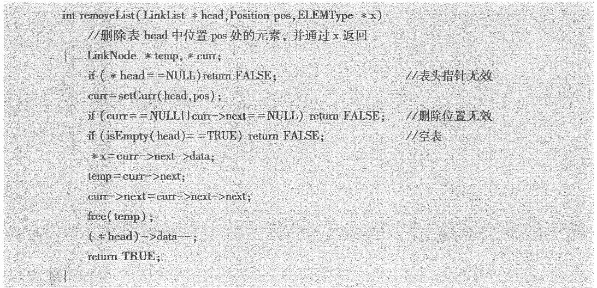

setValue 和 getValue 的实现如下，其中也需要调用 setCurr 函数并根据位置值来设置 cur的值。

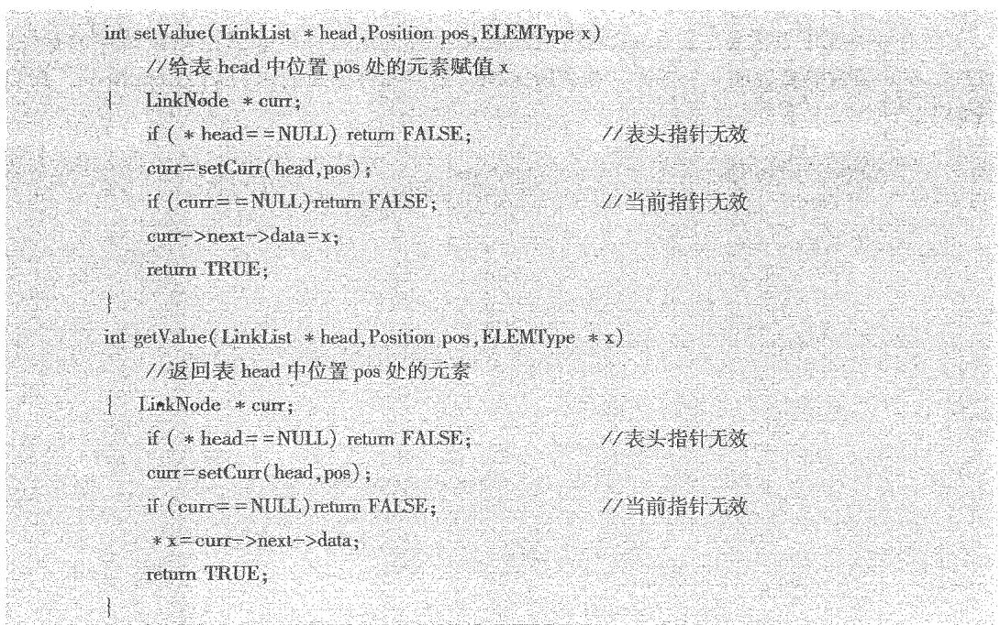

函数find 返回元素 x在表head 中第一次出现的位置。temp指针从链表头开始，逐个结点向表尾的方向，边移动，边进行判断，同时使用count记下移动的步数。find函数的实现如下。

Position find(LinkList \* head, ELEMType x)//返回元素x在表head中第一次出现的位置LinkNode \* temp = \* head;

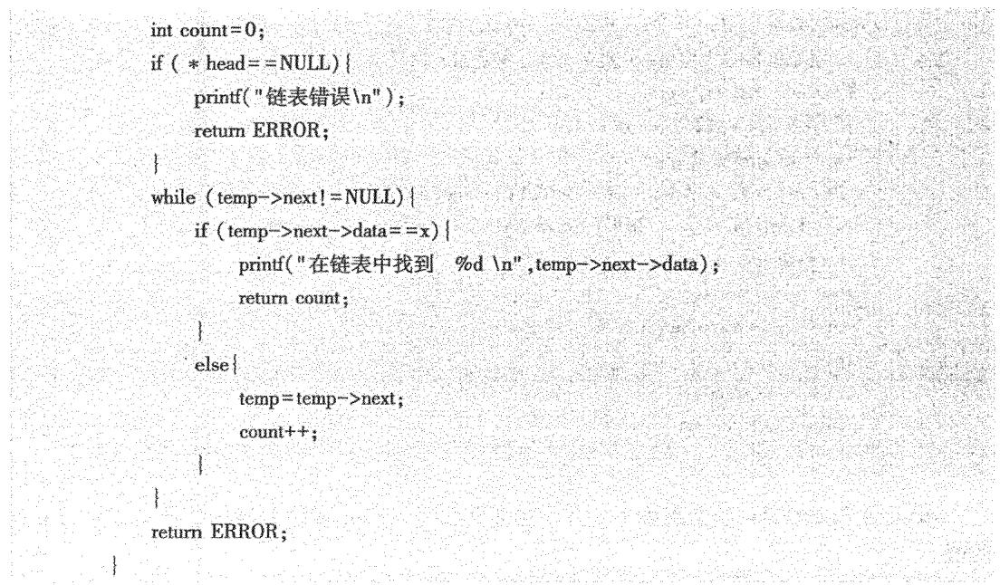

在有些情况下，需要在表head中找到元素x所在的结点，并返回指向该结点的指针。此时，find函数需要返回一个指针。为有所区别，返回指针形式的函数名为findNode，其实现如下。

```c
LinkNode * findNode(LinkList * head, ELEMType x)
//返回元素x在表head中第一次出现的位置，返回指向该结点的指针
LinkNode * temp=head;
if (* head= =NULL)
printf("链表错误\n");
return NULL;
while (temp->next!=NULL) {
if (temp->next->data==x)
printf("在链表中找到 %d \n",temp->next->data)
retum temp;
else temp= temp->next;
returnNULL;
```

列出链表中各元素的辅助函数display的实现如下。

```c
int counter= 0;
if (*head==NULL){
printf("链表错误\n");
return;
if((*head)->next==NULL) printf("这是一个空链表\n")
else{
printf("这是含%d 个元素的链表：",length(head));
p=( * head)->next;
while (p!=NULL){
printf(" %d,", p−>data) ;
counter++;
p=p->next;
printf(" \n");
return;
```

在单链表中，由指针指向结点是方便的，有时需要知道指针指向的结点的位置，这个功能由 setPos 函数实现，见例 2-9。

【例2-9】编写程序 setPos函数，返回指针 curr指向结点的位置。

setPos与 setCurr的作用刚好相反。setPos 函数的实现如下。

```c
Position setPos(LinkList * head, LinkNode * curr) //返回 curr指向结点的位置
LinkNode * temp = * head;
int count=0;
if(*head==NULL11curr==NULL) //指针无效
printf("指针无效\n");
return ERROR
while (temp!=curr&&temp!=NULL){
temp =temp->next;
count++;
return count;
```

在访问带头结点的单链表中的结点时，必须从头结点开始逐结点后移来寻找，这种访问方式是顺序访问方式，不能像顺序表那样根据位置直接定位到访问目标。所以，在进行插入、删除操作时，如果给定的参数是位置，则需要在链表中先进行定位操作。若插入、删除的位置都在表的最前面，则时间复杂度均为0(1)，这是最方便的位置。如果操作位置都在表尾，则时间复杂度均为0(n)，n是链表的长度。插人、删除操作的平均时间复杂度也均为0(n)。

如果已经设定当前指针的指向，则进行插入、删除操作时，时间复杂度均为0(1)，因为操作过程中不需要进行元素的移动，也不需要将当前指针从表头后移到当前位置。

在判定单链表是否为空时，只需要查看头结点中指针域的值，时间复杂度也为0(1)。对于清空表操作，因为要将所有数据结点所占用的空间释放，所以时间复杂度是 $O ( n )$ 。对于求表长操作，如果在头结点中保存了链表的长度，则时间复杂度是 $O ( \mathfrak { k } )$ 。如果采用计数方式实现，即从表头开始，一个结点一个结点地计数，则时间复杂度为 $O ( n )$ 。查找操作的时间复杂度由查找目标在链表中的位置而定。若在单链表中一定能找到查找目标，则在最优情况下，比较1次就能找到，时间复杂度为 $\mathcal { O } ( 1 )$ ；在最坏的情况下，需要进行n次比较，时间复杂度为 $O ( n )$ 。平均来看，需要查找链表中约一半的元素，所以时间复杂度是 $O ( n )$ 0在查找失败时，查找操作的时间复杂度也是 $O ( n )$

在线性表采用链式存储时，每个结点中除存储元素值以外，还需要保存一个指针。指针的空间属于额外的空间开销。对于有n个元素的线性表，采用单链表存储时，占用的空间为$n { \times } ( E { + } P )$ ，其中E是结点中数据域占用的空间量，P是结点中指针域占用的空间量，用于数据的部分是 $\scriptstyle n \times E$ ，属于有效部分，用于额外开销的部分是 $n { \times } P$ ，属于结构性开销部分。

## 三、循环链表

在单链表中，每个结点都带有一个指向其后继结点的指针，因为表尾元素没有后继结点，所以表尾结点的指针域为空，表明它不指向任何结点，并表示这个结点是表中的最后一个结点。

现在修改这个约定，将表尾结点的指针指回头结点，从而形成一类新链表。在这样的链表中，从任何一个结点出发，沿着指针域的指示，可以再回到这个结点，好像转了一个圈，可形象地称这样的链表为循环链表，更准确地说，它是单向循环链表。在不引起歧义的前提下，可以将它简称为循环链表。

在循环链表中，表结点的定义与单链表中相同。同样地，也可以定义一个头结点，其目的是保持和单链表的一致性，方便在循环链表中进行插入和删除操作。在循环链表中，因为表尾结点的指针指向头结点，所以可以根据这个特性来判断是否已经到达表的最后。

在有些情况下，表尾结点的net指针并不指向头结点，而是指向链表中的某一个数据结构，从而构成带环的单链表。这是一种不规整的循环链表。

循环链表的直观形式如图2-13所示。

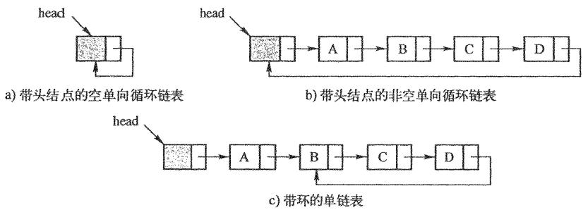  
图2-13 带头结点的单向循环链表

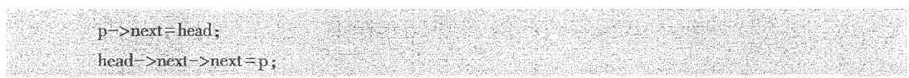

在带头结点的单链表中，表为空的判定条件是head->next==NULL，而在循环链表中，表为空的判定条件是head->next==head。这两类链表具有明显的特征，使用head->next的值，或表尾结点的next值，就可以判定链表是单链表还是循环链表。单链表中存在唯一的空指针，循环链表中不存在空指针。

想要判定一个单链表是否是如图2-13c所示的带环的单链表，并不简单。这样的链表不存在空指针，但又不像循环链表那样可以使用表尾结点的next值与head值的关系来判定。可以使用两个指针，初始时均指向头结点，一个指针每次走两步，另一个指针每次走一步。当两个指针“遇上”（即指向同一个结点）时，表明单链表中存在环。如果“快”（每次走两步）的指针先遇到NULL，则表明是普通的单链表。具体实现留作习题。

【例2-10】设带头结点的单向循环链表L中仅含有一个数据结点，head是L的头指针。现要在该数据结点之后添加一个新结点，指针p指向该新结点，给出相应的语句序列。

根据题意，插入的新结点是L的终端结点，它的next域应该指向头结点。然后让L中现有的唯一数据结点的next域指向该结点。相应的语句序列如下。

当然，还可以写出其他的语句形式。

## 四、双向链表

在单链表中，每个结点中都仅含有一个指针，除表尾结点以外，该指针指向后继结点，故查找后继结点的操作很方便。从插人及删除操作的实现步骤中了解到，查找前驱结点很不方便。为此，修改单链表中结点的定义，在表结点中，除保留指向后继结点的指针以外，再增加一个指向该结点的前驱结点的指针，即每个结点都含有两个指针，一个指向该结点的后继结点。另一个指向该结点的前驱结点。如果结点的前驱结点或后继结点不存在。则相应的指针为空。这样的链表称为双向链表，也称为双链表。

在双向链表中，表结点及链表的定义如下。

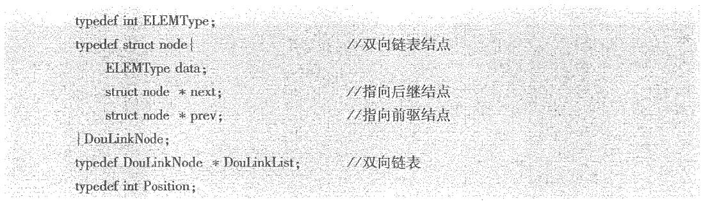

在双向链表中，如果某结点存在前驱结点和后继结点，则通过当前指针及结点内的指针，能够很容易地找到并访问它们。所以头结点在双向链表中是可选的，可有可无。为了与单链表在结构上保持一一致，双向链表中也常常定义头结点，即头指针指向的结点是一个虚拟结点，其中的data域可用来保存表中元素的个数。双向链表中指针可以沿两个方向移动，除头指针head以外，通常还定义一个指向表尾结点的尾指针tail。带头结点的双向链表如图2-14所示。

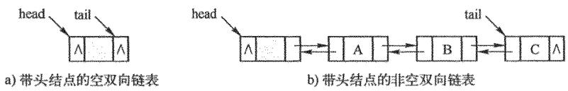  
图2-14 带头结点的双向链表

施加于双向链表的操作与在单链表中的操作是类似的，实现过程中会涉及更多的指针操作，有些地方也需要增加更多的判断。

仍以带头结点的链表为例来实现双向链表。初始化函数中创建一个头结点，头结点的next指针和 prev指针的初值都置为空。

```c
int initList(DouLinkList * head) //构造一个带头结点的空双向链表
(* head) = (DouLinkList) malloc(sizeof(DouLinkNode));
if(*head= =NULL) return FALSE；//分配空间失败
(*head)->data=0; //记录结点个数
(* head)->next=NULL;
(* head)->prev=NULL;
return TRUE;
```

双向链表上有些操作的实现与在单链表上对应操作的实现，除了链表的类型不同以外，其他是完全一样的。这些操作包括清空链表clear、判断链表是否为空isEmpty、求链表长度length、给位置 pos 处的元素赋值 setValue、返回位置 pos 处的元素 getValue等。

在双向链表中插入一个新元素时。一般情况下需要修改4个指针。插入的元素也可能是新的表尾结点，它不存在后继结点，故这时要增加对表尾结点的判断。删除操作也是类似的。与单链表中实现插入、删除操作时一样，双向链表实现插入、删除操作时也需要辅助函数 setCurr，其实现如下。

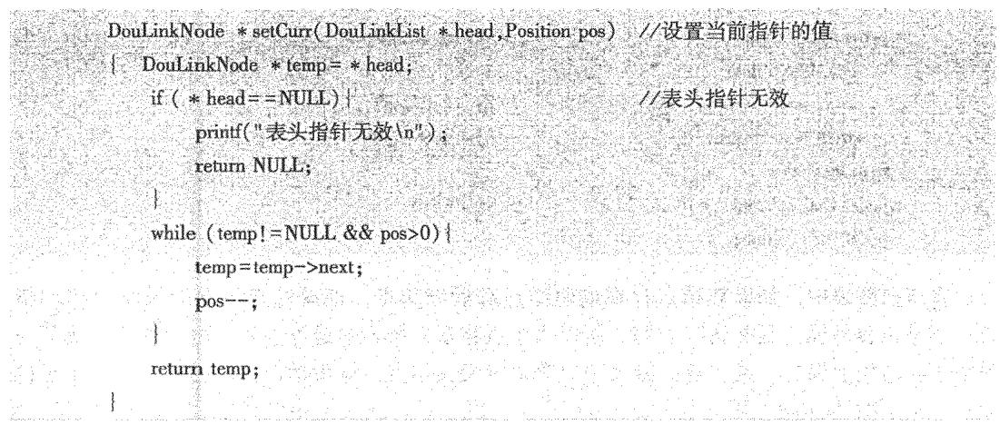

插入、删除两个操作的实现如下。

b)带头结点的非空双向循环链表  
```c
int insertList( DouLinkList * head, Position pos, ELEMType x)
//在表 head的位置 pos 处插人元素 x
DouLinkNode * temp, * curr;
if ( * head= =NULL) return FALSE; //表头指针无效
curr= setCurr(head, pos);
if (curr= =NULL) return FALSE //插入位置无效
temp =(DouLinkNode * ) malloc(sizeof(DouLinkNode))
temp->data=x;
temp->next=curr->next;
if (curr->next !=NULL) cur->next->prev=temp;
temp->prev=curr;
curr->next=temp;
(*head)->data++;
retum TRUE;
int removeList(DouLinkList * head, Position pos, ELEMType * x)
//删除表head中位置pos处的元素，并通过x返回
DouLinkNode * temp, * curr;
if ( * head = = NULL) return FALSE //表头指针无效
curr=setCurr(head,pos);
if(curr= =NULLIcur->next= =NULL) retum FALSE；//删除位置无效
if (isEmpty(head) = =TRUE) return FALSE; //空表
* x=curr->next->data;
temp=curr->next;
curr->next=curr->next->next;
if (curr->next! =NULL) curr->next->prev=curr;
free(temp);
(* head)->data-;
return TRUE;
```

在空双向链表中，头结点的next和prev指针都为空。在非空双向链表中，头结点的prev指针为空，表尾结点的next指针为空。也可以像单向循环链表那样，将这些空指针利用起来，由此得到双向循环链表。在双向循环链表中，通过头结点的prev指针，可以方便地找到表尾结点，所以可以不定义尾指针。带头结点的双向循环链表如图2-15所示。

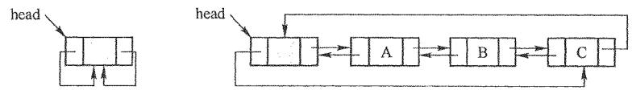  
图2-15 带头结点的双向循环链表

【例2-11】在双向循环链表中，将指针s指向的结点插入到指针p所指的结点（非尾结点）之后，下列选项中，正确的指针修改语句序列是（）。

A. $\mathrm { p ^ { - > n e x t = s } ; \ s ^ { - } \to p r e v = p ; \ p ^ { - } > n e x t ~ - > p r e v = s ; \ s ^ { - } > n e x t = p ^ { - } > n e x t ; }$   
B. $\mathrm { p ^ { - > n e x t - > p r e v } = s ; \ p ^ { - > n e x t } = s ; \ s ^ { - } > p r e v = p ; \ s ^ { - } > n e x t = p ^ { - > } n e x t ; }$   
C. $\mathrm { s \mathrm { - } > p r e v = \ p ; \ s \mathrm { - } > n e x t = p \mathrm { - } > n e x t ; \ p \mathrm { - } > n e x t = s _ { 3 } , p \mathrm { - } > n e x t \mathrm { - } > p r e v = s _ { 3 } , }$   
D. $\mathbf { s } - > \mathbf { p r e v } = \mathbf { p } ; \mathbf { s } - > \mathbf { n e x t } = \mathbf { p } - > \mathbf { n e x t } ; \mathbf { p } - > \mathbf { n e x t } - > \mathbf { p r e v } = \mathbf { s } ; \mathbf { p } - > \mathbf { n e x t } = \mathbf { s } ;$

答案是 $\mathfrak { d } _ { \circ }$

选项D中的4条赋值语句对应的4个指针操作及次序如图2-16所示，语句的结果能达到插入结点的目的。

其他几个选项的操作次序或操作语句均存在错误之处。选项A 中第一条语句 ${ } ^ { * } \mathbf { p } \mathrm { - } { > } \mathbf { n } \mathrm { e x t } \ = \mathbf { s } \ ; { } ^ { * }$ 已经将双向循环链表中指针p所指结点与其后继结点断开，第三条语句 ${ \bf \dot { \bar { \mathbf { p } } } } \mathrm { - } \bf >$ $\mathrm { n e x t - } \mathrm { > p r e v } = \mathrm { s } ^ { \prime \prime }$ 实际上是将指针s 所指结点的 prev 又指向自身。选项B中第二条语句 $\mathbf { \mu } ^ { * } \mathbf { { p } } { \mathrm { - } } { \mathrm { > } } \mathbf { \mathrm { n e x t } } = \mathbf { \mu _ { S } } ,$ ”已经将指针p所指结点与指针s所指结点相连，而第四条语句 $^ { 6 6 } \mathrm { s } \mathrm { - } > \mathrm { n e x t } = \mathrm { p } \mathrm { - } >$ next；”的原意是想将指针s所指结点与指针p所指结点的后

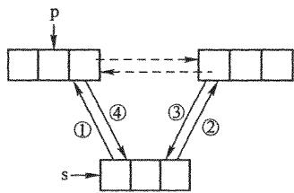  
图2-16 双向循环链表的插人

继结点连接起来，但实际上p->next 已指向s 所指结点，故操作的结果是s->next 又指向自身。其他选项的错误之处不再赘述。

## 第四节 进一步讨论两种基本实现方式

## 一、两种基本实现方式的比较

线性表有两种基本实现方式，分别是顺序实现和链式实现。那么，哪一种方法更好呢？这两种实现方式各有优势，在不同的情况下，对应于不同的操作，某一种方式可能会优于另外一种。但是哪种方式都不能适用于所有情况。

顺序表的优点是存储每个数据元素时空间比较紧凑，并且会占用连续的空间。数组的每个单元中只需要保存数据本身，没有额外的开销。与此相对的是，链表在每个结点上除存储数据元素以外，还要留出空间存放指针。单链表中每个结点包含一个指针，双向链表中每个结点包含两个指针。这些指针占用的空间称为结构性开销。存储一个指针的空间大小是固定的，与使用的具体系统相关。如果数据域data占用的空间较小，则结构性开销的比例就会较大。

为顺序表分配的数组，通常要宽松一些。当线性表中元素个数没能达到顺序表的最大容量时，数组中仍然会有空闲的空间，此时并没能充分利用数组的全部空间。而链表中占用的空间大小与链表中的元素个数成正比，分配的结点是全部使用的。所以，当线性表的元素个数相对较少时，链表的实现比顺序表的实现更节省空间。反之，当线性表中的元素个数接近数组分配的最大个数，数组几乎被填满时，空闲的单元不多，它的空间存储效率很高。

设n表示线性表中当前元素的个数，D表示最多可以在数组中存储的元素个数，也就是数组的大小，P表示指针的存储单元大小，E表示数据元素的存储单元大小。按照这个假设，顺序表的空间需求为D×E，单链表的空间需求为 $n { \times } ( P { \ + } E )$ 。对于给定的n值，以上两个表达式中哪一个的值较小呢？列方程后可以求出n的临界值，即 $\scriptstyle n = D \times E / \left( P + E \right)$ 。当线性表中元素个数超过这个值时，顺序表的空间效率更高，反之单链表的存储效率更优。如果P=E（如指针占2字节，数据元素也占2字节），则临界值 $n = D / 2$

【例2-12】设采用单链表保存的线性表L的每个元素需要的空间为10字节，一个指针占2字节。若采用单链表或含30个元素的数组保存L，试分析哪种方式的空间存储效率更高，仅需要考虑L中的元素。

根据题意，在采用单链表保存L时，每个结点占用的空间为12字节。

如果采用数组保存，则需要的空间是 $3 0 \times 1 0 = 3 0 0$ 字节。若使用这些空间来保存单链表中的结点，则可以保存 $3 0 0 / 1 2 = 2 5 $ 个结点，即在不考虑头结点所占用空间的前提下，如果L中元素个数少于25个，则采用单链表更省空间；如果多于25个元素，则采用数组更省空间：如果正好是25个元素，则两种方式占用的空间是一样大的。

选择顺序表或链表的一个因素是，当线性表元素个数变化较大或者未知时，最好使用链表实现。如果用户事先知道线性表的大致长度，则使用顺序表的空间效率会更高些。还有一个因素需要考虑，即顺序表占用的空间是连续的，而链表占用的空间可能是零散的，并且还需要程序员来管理空间的分配及释放。

再来看看操作的时间效率。以访问线性表的第i个元素为例，在顺序表中是直接定位的，可以实现随机访问，操作的时间复杂度是0(1)。相比之下，单链表不能随机访问指定的元素。访问时必须从表头开始逐个结点进行查找，直到找到第i个结点为止。这个操作的平均时间复杂度和最差时间复杂度均为0(n)。关于插入操作和删除操作，在给出指向链表合适位置的当前指针后，在单链表内进行插人和删除操作的时间复杂度也可以达到0(1)。而顺序表的插入操作和删除操作必须在数组内将当前位置之后的各元素分别向后与向前移动，这种移动的平均和最差时间复杂度均为0(n)。对于线性表的许多应用，插入和删除都是主要的操作，因此它们的时间效率是举足轻重的，仅就这个原因而言，单链表通常比顺序表更灵活。

双向链表的操作实现起来与单链表类似，其空间效率要低于单链表，因为表中每个结点都带有两个指针，比单链表中每个结点的指针数多1个。所以双向链表的结构性开销是单链表的2倍。双向链表各个操作的时间复杂度分析留作习题。

【例2-13】将下列特性分别对应到顺序表和链表中。A. 逻辑上相邻的元素，在内存中的存储位置也相邻B. 不必事先估计存储空间  
C. 所需空间与元素个数成正比  
D. 插入、删除时不需要移动元素  
E. 支持随机存取  
F. 支持顺序存取

顺序表具有的特性有：A、E和F，链表具有的特性有：B、C、D和F。

注意，顺序表支持随机存取，也支持顺序存取。所以最后一个特性（F），既是顺序表的特性，也是链表的特性。

## 二、空闲单元链表

在链表中，当需要在链表中插入一个结点时，需要调用malloc函数分配相应的空间。当在链表中删除一个结点时，需要调用free函数释放空间。如果在链表中频繁进行插入、删除结点的操作，则频繁调用这些函数的时间开销会是非常可观的。

可以针对实际应用的每类链表，定义一个“伙伴链表”，表结点的结构与所使用链表的结构一致。伙伴链表用来管理暂时不用的结点，也可以将伙伴链表称为空闲单元链表。

以本章第三节中定义的单链表为例，链表的类型定义如下。

```c
typedef int ELEMType
typedef struct node //单链表结点
ELEMType data; //数据域
struct node * next; //指针域
LinkNode
typedef LinkNode * LinkList; //单链表
typedef LinkNode * Position; //位置
```

定义与之对应的空闲单元链表freelist如下。

LinkList freelist=NULL;

假设保存数据的单链表为 $\scriptstyle \mathrm { { L } } _ { \mathrm { o } }$ 当从链表L中删除一个结点时，将这个结点插入到freelist中。当需要申请新的结点空间时，先查看链表freelist。如果freelist不为空，则从freelist中获取一个结点，结点中保存相应的值，并将该结点插入到L的相应位置，否则调用malloc函数分配新的空间，并完成后续的插入操作。

freelist链表的作用是暂时保管要归还给系统的结点空间，结点中的数据是无意义的，所以插入及删除的操作都可以在表头进行。而且，链表中也不需要头结点。因此，对freelis链表操作的效率非常高。

对于有相同结点结构的所有链表，可以共用一个freelist链表，也可以将其设置为一个全局变量，初始时，freelist是一个空链表。在程序的最后，freelist中结点占用的空间需要全部释放。

在增加freelist链表后，可以修改前面实现的在单链表中进行插人结点及删除结点的操作，实现如下。

```c
int insertList(LinkList * head,Position curr,ELEMType x)
//在表 head的位置 cur 处插入元素x
LinkNode * temp;
if ( * head = =NULL&&curr= =NULL) return FALSE; //指针无效
if (freelist= =NULL){
temp=(LinkList)malloc(sizeof(LinkNode));
1
else{
```

```c
temp=freelist;
freelist=freelist->next;
temp->data=x;
temp->next=curr->next;
curr->next=temp;
(* head)->data++;
retum TRUE;
int removeList(LinkList * head,Position curr, ELEMType * x)
//删除表head中位置 cur处的元素，并通过x返回
LinkNode * temp;
if((*head= =NULL&&curr= =NULL) 11curr->next= =NULL) retum FALSE;//指针无效
if (isEmpty(head) = =TRUE) return FALSE; //空表
* x=curr->next->data;
temp=curr->next;
curr->next=curr->next->next;
temp->next=freelist;
freelist=temp;
(* head)->data--
return TRUE;
```

清空链表的操作也需要进行相应的修改，实现如下。

```c
int clear(LinkList * head)
{LinkNode * p;
if (*head= =NULL) {
printf("链表错误\n");
return FALSE;
p=( * head)->next;
while (p!=NULL) {
(* head)->next=p->next;
p->next=freelist;
freelist=p;
p= ( * head) ->next;
(* head)−>data =0;
return TRUE;
```

## 三、静态链表

从例2-13中可以看出，顺序表和链表的一些特点是相互对立的，比如，当插入元素时，在顺序表中可能要移动元素，但在链表中完全不需要移动。顺序表的空间是一次性预分配的，而链表的空间是随用随分配的。顺序表中查找某位置的元素非常方便，但多数情况下在链表中进行查找则不是一个便捷的操作。特别是，顺序表占用的空间完整，而链表占用的空间零散。

在有些应用中，需要一种兼具顺序表和链表特性的结构，既要具有顺序表的空间整体性，不必进行零散的空间处理，又要具有链表的灵活性，在插入或删除时不必进行数据的大量移动。静态链表正好能满足这种需求。数据结构中的静态链表，即使用一维数组实现的链表。下面以单链表为例，介绍静态链表。实际上，还可以实现静态双向链表及静态循环链表。

假设静态链表保存在一维数组A中，每个元素的类型与单链表结点类型一致，也有数据域data和指针域next。将A[0]当作一个特殊结点，类似于单链表中的表头结点，在A[0]的数据域data中保存链表中元素的个数，在指针域next中保存静态链表中第一个元素在数组中的下标。初始时，data的值是0，next的值是-1。

例如，将图2-17a所示的单链表head中的各元素，依次保存在数组A最前面的几个单元中，得到的静态链表如图2-17b所示。

  
b)保存单链表head各元素的静态链表  
图 2-17 单链表 head及静态链表

在静态链表中实现基本操作的过程类似于在链表中的实现过程。例如，在静态链表中进行图2-9所示的插入操作，新元素E应在元素B与C之间。在图2-17b所示的一维数组中找到一个空闲位置，如下标5处，这相当于在单链表中进行插入操作时调用malloc函数得到一个新的结点空间。将元素E放在这个位置的data域中(类似于图2-9中的步骤①)。E的后继是元素C，所以下标5处的next值应为3(类似于图2-9中的步骤②），而E的前驱是元素B，即B的next值应为5(类似于图2-9中的步骤③)。最后，将链表中的元素个数加1。在插人操作完成后，得到的静态链表如图2-18所示。

<table><tr><td colspan="11">3 4 5 6 7</td></tr><tr><td rowspan="2">data next</td><td>0 5</td><td>1 A</td><td>2 B</td><td>C</td><td>D</td><td>E</td><td></td><td></td><td>8</td></tr><tr><td>1</td><td>2</td><td>5</td><td>4</td><td>-1</td><td>3</td><td></td><td></td><td></td></tr></table>

图2-18 在图2-17b所示的静态链表中插入元素E后的静态链表

现在，在图2-18所示的静态链表中删除元素D。删除的元素D是静态链表中的表尾元素，删除后，它的前驱（元素C）的next值应为元素D的next值，即-1，表示静态链表的结束。同时，在静态链表中将这个位置标识为空闲位置，这相当于在单链表中进行删除操作时调用delete函数。得到的静态链表如图2-19所示。

<table><tr><td rowspan=1 colspan=1>4</td><td rowspan=1 colspan=1>A</td><td rowspan=1 colspan=1>B</td><td rowspan=1 colspan=1>C</td><td rowspan=1 colspan=1></td><td rowspan=1 colspan=1>E</td><td rowspan=1 colspan=1></td><td rowspan=1 colspan=1></td><td rowspan=1 colspan=1></td></tr><tr><td rowspan=1 colspan=1>1</td><td rowspan=1 colspan=1>2</td><td rowspan=1 colspan=1>5</td><td rowspan=1 colspan=1>-1</td><td rowspan=1 colspan=1></td><td rowspan=1 colspan=1>3</td><td rowspan=1 colspan=1></td><td rowspan=1 colspan=1></td><td rowspan=1 colspan=1></td></tr></table>

图2-19 在图2-18所示的静态链表中删除元素D后的静态链表

在静态链表使用的数组中，可以将单元的状态分为两类，一类是已经被占用的单元，如图2-19中下标为0、1、2、3、5的单元，另一类是空闲单元，如图2-19中下标为4、6、7、8的单元。空闲单元又分为两种，一种是曾经使用过但现在空闲的，如下标为4的单元，另一种是从未使用过的，如下标为6、7、8的单元。

在静态链表中，可以使用一个特殊标记来标识空闲单元，插入时将新元素放置在有特殊标记的单元中。初始时，数组中所有单元均为空闲单元，故需要为每个单元设置特殊标记。在插入时，需要逐个单元进行查找。当然，可以采用更有效的方法标记空闲单元，其目的是方便后面的插入操作。

数组中所有未曾使用过的单元必定是一片连续单元，可以使用整型变量unused记录这片连续单元的首位置，凡是下标大于等于unused且不越界的单元，均为空闲单元。例如，在图2-19中，unused的值是6。下标大于等于6且小于9的单元即这类空闲单元。对于数组中曾经使用过且目前空闲的所有单元，建立另一个静态链表将其链接起来，可以将这个链表称为空闲单元链表，用整型变量available记录这个链表首结点的下标。例如，对于图2-19所示的静态链表，available值为4。因为目前只有这一个空闲位置，故它也是表尾，位置4的 next 值为-1。

程序中用到的一些常量及静态链表的定义如下。


初始化过程是构造一个空的静态链表，并给静态链表中的各个变量赋初值。

int initList(ArrayList \* L) //构造一个空静态链表L   
L->element[ 0]. data=0;   
L->element[ 0]. next =-1;   
L->available=-1;   
L->unused=1;   
return TRUE;

清空静态链表与初始化过程是类似的。

```c
int clear(ArrayList * L) //将表L置空
L->element[0]. data=0; //element[0]:头结点，data 保存链表长度
L->element[0]. next=-1; //element[0]：头结点，链表结束，置next为-1
L->available=-1; //空闲单元链表首位置，初始时无空闲结点置为-1
L->unused=1; //未用空间首位置，初始为element[1]
return TRUE;
```

判定静态链表的空或满状态是很容易实现的。数组第一个单元的data域保存了链表中元素的个数，如果该值是0，则链表是空链表，如果是maxSize-1，则表示链表已满。

```c
int isEmpty(ArrayList * L) //如果表L为空，则返回1，否则返回0
{if (L->element[0]. data= =0) return TRUE;
else return FALSE;
int isFull(ArrayList * L) //如果表L为满，则返回1，否则返回0
{if (L->element[ 0]. data= =maxSize-1) return TRUE;
else return FALSE:
求表长的实现如下。
int length(ArrayList * L) //返回表L的当前长度
{return L->element[0]. data;
```

在静态链表中进行插入操作时，如果空闲单元链表为空，即available==-1，则使用un-used位置的单元，同时unused++；如果空闲单元链表不为空，即available!=-1，则取表头单元来使用，即使用available位置的单元，同时更新空闲单元链表，available值更新为链表中下一个元素的下标。

```c
insertArayList( ArrayList * L, Position pos, ELEMType x)
//在表L的位置 pos处插入元素x
int i, k, curr;
if (isFull(L) = =TRUE) retur FALSE //表满
if(pos<01|pos>L->element[0]. data) return ERROR；//位置错误，与表满区分开
if (L->available==-1){ //空闲单元链表为空
k=L->unused; //新申请的数据结点的下标
L->element[L->unused++]. data=x;
else /有空闲空间，取出空闲单元链表的首结点
k=L->available //新申请的数据结点的下标
L->element[ k]. data=x;
L->available=L->element[ k]. next; /将新结点从空闲单元链表中删除
L->element[0]. data++;
current=0; //头位置
for (i=0;i<pos;i++)| //在数据链表中定位位置在pos的结点
curr=L->element[ curr]. next;
L->element[k]. next=L->element[ curr]. next; //将新数据结点插人到链表中
L->element[ curr]. next=k; //放置x
return TRUE;
```

当从静态链表中删除一个元素时，元素的值通过x带回。从表头开始找到被删除元素的前驱，修改该元素的next值，与被删除元素的后继相连。而该元素占用的空间会链接到空闲单元链表中。

int removeArrayList( ArrayList \* L, Position pos, ELEMType \* x)  
//删除表L中位置position处的元素并通过x返回  
{ int i,k, curr;  
if (isEmpty(L)= = 1) return FALSE; //表空  
if(pos<01|pos>=L->element[0]. data) returm ERROR；//位置错误，与表空区分开  
curr=0; //头位置  
for (i=0;i<pos;i++){  
curr = L->element[ curr]. next;  
k=L->element[ curr]. next;  
\* x = L−>element[ k]. data; //记下被删除的元素值  
L->element[ cur]. next= L->element[ K]. next; //删除  
L->element[ k]. next =L->available;  
L->available=k;

双向链表也可以保存在一维数组中，成为双向静态链表，见例2-14。

【例2-14】双向静态升序链表操作示例。

设双向静态升序链表L保存在含8个元素的数组A中，表头结点在A[0]中。依次执行下列操作，并给出每个操作后得到的数组A。

(1) 初始化L。

(2)将序列618,205,103,501,781,910依次插入到L中，建立双向静态升序链表。

(3)从L中依次删除元素501、103。

(4)将元素301插入到L中。

解：（1）初始化L，得到的数组A如图2-20所示。

  
图2-20 保存静态链表的数组A的初态

(2)插入数据序列后，得到的数组A如图2-21所示。

  
图2-21 插入数据序列后的数组A

先插入第一个值618，使用 unused指示的位置1来保存618。unused更新为2。618的next 中保存 A[0]. next 的值，而 A[0]. next 更新为 618 的下标 1。类似地，618 的 prev 的值为0。

再插入第二个值205。这个值保存在下标2处，因为要保持有序性，故205要链接在618的前面。所以618的prev的值是2，而205的 next值是1。103的插入，类似于205的处理。

501应该插入到205和618之间，所以501的 prev应是2，而205的 next是4。501的next是1，而618的 prev是4。781和910的插入过程不再赘述。

(3)从L中依次删除元素501、103，得到两个空闲单元，这两个单元链入到空闲单元链表中。这个链表中的每个结点都只需要用到一个指针域，不妨设使用next域，其prev域简单地赋为-1。得到的数组A如图2-22所示。

  
图2-22 删除元素 501、103后的数组A

(4)将元素301插人到L中，因为空闲单元链表非空，所以，新插入的301使用该链表的首结点，得到的数组A如图2-23所示。

  
图2-23 将元素 301 插入到L后的数组 A

静态链表的本质是链表，初始化链表、清空链表、判空及判满操作的时间复杂度都是0(1)。因为插入及删除都需要寻找操作位置，所以它们的时间复杂度都是0(n)。

## 第五节 单链表的应用

本节给出单链表的4个应用示例。单链表结点的定义与本章第三节中的定义相同。为了方便，重新写出来。

```c
#define TRUE 1
#define FALSE 0
#define ERROR -1
typedef int ELEMType
typedef struct node{ //单链表结点
ELEMType data //数据域
struct node * next //指针域
LinkNode;
typedef LinkNode * LinkList; //单链表
typedef LinkNode * Position;
```

为了展示单链表的应用，需要先创建一个单链表。单链表中各元素的值从键盘读入。定义单链表的头指针LinkList head=NULL，然后调用本章第三节中的initList(&head)进行初始化。接下来，调用createMyList(&head)创建单链表。

在createMyList中，先从键盘上输入元素个数，然后依次读入相应个数的整数值，使用这些值构造一个带头结点的单链表。相应的实现如下。

```c
int createMyList(LinkList * head) //构造一个带头结点的单链表
{int i, counter,k;
printf("请输入单链表元素个数：")
scanf( " %d" , &counter);
if (counter>0)
printf("请输入构成链表的%d个整数：",counter)
for (i=0;i<counter;i++){
scanf(" %d",&k);
if (insertList(head,i, k) = = FALSE) return FALSE;}
display(head);
return TRUE;
```

在程序运行后，从键盘输入的单链表元素个数保存在变量counter中。只有当counter大于0时，才依次读人单链表各元素的值。读入的值使用本章第三节实现的insertList()函数插入到单链表的表尾。

也可以将待输入的数据预先保存在一个一维数组中，假设数组是a，数组元素个数是na，则在完成初始化后，调用 createMyListFromArray(head,a，na)来构建单链表。createMy-ListFromArray 的实现如下。

```c
int createMyListFromArray(LinkList * head , int * a,int n)
//读取数组中元素的值，构造一个带头结点的单链表
{ int i;
if(n>0){
```

## 一、查找单链表倒数第k个结点

我们已经知道，在单链表中，每个结点含有的指针只有一个，它指向当前结点的后继结点。当要访问单链表中正数第k个结点时，从头指针开始，沿指针的方向依次后移k-1次，就可以定位到要访问的结点。为了统一，如果单链表中有头结点，则将头结点也一起编号。

如果要查找单链表中倒数第k(k≥1)个结点，则没有这么简单。因为不能从表尾向表头进行遍历，所以不能直接从表尾向表头直接数k个结点。

至少有两个办法可以实现这个操作。如果知道单链表的长度，那么查找倒数第k个结点就很容易了。假设单链表中含有n个结点，则倒数第k个结点即第n-k+1个结点。如果单链表头结点的数据域中保存了单链表的长度，则可以很方便地找到这个值。如果没有保存，则需要遍历一遍单链表，并对结点个数进行计数，从而得到单链表的长度。

当不知道单链表的长度时，还可以使用下面介绍的方法来查找单链表倒数第k个结点。

使用两个指针front 和 rear，均从表头开始向表尾方向移动。初始时，先令front前进k步，当个“排头兵”。这样front和rear指向的位置相距k个结点。然后两个指针同步前进。当front到达表尾时，rear即指向倒数第k个结点。

在这个过程中，可能会出现几种例外情况，需要加以特殊处理。一种例外是，给定的单链表是空表。对于空表，不能进行相应的查找。所以程序需要判定给定的单链表是不是空表。另一种例外是，给定的k值不合理。程序中需要判定k值是不是不大于表长的一个正整数。程序的实现如下。


## 二、查找单链表的中间结点

单链表的长度是任意的，所以中间结点并不能确定是其中的第几个结点，具体的值要依单链表的长度而定。而且，当单链表结点个数是偶数时，会有两个中间结点，这里只求前一个结点。不能简单地调用上面给出的findKth函数，但实现思想是类似的。

仍然使用两个指针，并从表头开始同步地向表尾方向移动，一个指针每次走两步，另一个指针每次走一步。这样，当“排头兵”指针到达表尾时，后面的指针即指向链表的中间结点。与findKth函数中一样，两个指针分别是front和rear。程序的实现如下。

```c
LinkNode * findMiddle(LinkList *head) //查找中间结点，返回指向中间结点的指针
LinkNode * front, * rear
if ( * head = =NULL)
printf("链表错误\n");
return NULL;
front= * head;
rear= * head;
while (front! =NULL) //当前指针front没有移动到最后一个结点之前，继续循环
front =front->next;
if (front! = NULL){
front = front->next;
rear= rear->next:
else{
```

## 三、将单链表逆置

例2-5实现了顺序表的逆置，现在来实现单链表的逆置。假设单链表中含有头结点。

原单链表的头结点保留，仍为逆置后新单链表的头结点。所以，对于头指针head，先不进行处理。从第一个数据结点开始，依次让每个结点的指针域反向，由指向其后继结点转为指向其前驱结点。

为了使处理过程中单链表的链接不中断，使用三个指针分别指向相邻的三个结点，如图2-24所示。

  
图2-24 逆置单链表L时的指针

第一个数据结点需要特殊处理，因为它将是逆置后单链表的表尾结点，next域必须置为NULL。

对于单链表中的其他结点，让middle所指结点的 next域指向left所指结点，即 left所指结点的原后继（middle所指）变为它的新前驱。然后，三个指针依次后移一个位置。

当所有结点中的next域都转向后，再将head所指的头结点链接在表头处。程序的实现如下。


## 四、验证本章给出的单链表的实现

为了验证本章所给单链表程序的正确性，可以编写如下驱动程序。

int main(int argc, char \* \* argv)   
{LinkList head=NULL LinkNode \* result; int i,k; LinkNode \* temp; i=initList(&head); if(i==0) printf("链表初始化错误\n"); else printf("初始化完成\n"); createMyList(&head); printf("请输入要查找的值：")； scanf( " %d", &i); k=find(&head,i); if (k= =ERROR) printf("没有找到 %d\n",i)； insertmy(&head,k,100); printf("插入后的链表，")； display(&head); printf("请输人要删除的值："); scanf(" %d",&i); k=find(&head,i); removemy(&head, k, &k); printf("删除后的链表，")； display(&head); printf("请输入要查找的结点的倒数位置：") scanf(" %d",&k); result=findKth(&head,k); if (result != NULL) printf( " data = %d\n", else printf("给定的参数不正确\n"); result=findMiddle(&head) if (result ! = NULL) printf( " middle data = %d\ else printf("给定的参数不正确\n"); printf("单链表逆置后：\n"); reverse(&head); display(&head); return 0;

## 内容小结

本章首先介绍了最基础的一种数据结构：线性表，其中首先介绍了线性表的概念，然后给出了线性表的两种存储方式，并分别在两种存储方式下实现了基本操作，最后分析了各操作的时间复杂度、对比了两种存储方式下的空间开销、比较了两种实现方式的特点及应用条件。链式存储方式实现的链表包括单链表、循环链表和双向链表。

然后，在线性表的基础上，本章介绍了静态链表的概念，实现了其基本操作。另外，本章还介绍了链式存储方式下空闲单元链表的概念。

最后，本章介绍并实现了线性表的若干应用实例。

## 习 题

## 一、单项选择题

1. 下列选项中，不属于链表特点的是 OA. 插入、删除时不需要移动元素 B. 可随机访问任一元素C. 不必事先估计存储空间 D. 所需空间与元素个数成正比

2. 下列关于线性表的叙述中，错误的是A. 线性表采用链式存储方式，便于进行插入和删除操作B. 线性表采用顺序存储方式，便于进行插入和删除操作C. 线性表采用链式存储方式，不必占用一片连续的存储单元D. 线性表采用顺序存储方式，必须占用一片连续的存储单元

3. 若一个线性表分别采用下列存储结构进行存储，则读取一个指定位置（序号）的元素所花费时间最少的是A. 顺序表 B. 单向链表 C. 双向链表 D. 循环链表

4. 下列关于线性表的叙述中，错误的是A. 除第一个元素以外，均有唯一的前驱B. 除最后一个元素以外，均有唯一的后继C. 元素的个数可以是0，此时表为空表D. 若元素的个数为无穷，则表为无穷表

5. 下列关于线性表L的叙述中，正确的是A. L是由n个相同元素组成的离散数据序列B. L中任意一个元素有且仅有唯一直接前驱C. 可以在L中进行取元素、查找或排序等操作D. 不能在L的任意位置插人或删除一个元素

6. 若线性表L的常用操作有访问任一位置的元素和在最后进行插入和删除操作，为使操作的时间复杂度好，则下列选项中，为L选择的存储结构为 OA. 顺序表 B. 双向链表C. 带头结点的双向循环链表 D. 单向循环链表

7. 线性表L中常用的操作有在最后一个元素之后插入一个元素和删除第一个元素，为使操作的时间复杂度好，则下列选项中，为L选择的存储结构为 0A. 单链表 B. 仅有头指针的单向循环链表C. 双向链表 D. 仅有尾指针的单向循环链表

8. 为了提供全程对号入座的高速铁路售票系统，保证每一位旅客从上车到下车期间都  
有独立座位，并且在短途乘客下车后，该座位可以销售给其他乘客，铁路公司设计了基于内  
存的系统，系统中需要描述座位信息和每个座位的售票情况。保存座位信息和每个座位售票  
情况的数据结构分别是A. 数组，数组 B. 数组，链表C. 链表，数组 D. 链表，链表

9. 若长度为n的线性表采用顺序存储结构，则在其第 $\ i \ \left( 0 \leqslant i \leqslant n \right)$ 个位置插入一个新元素的算法的时间复杂度为 0A. 0(1) B. O(i) C. O(n) D. $O ( n ^ { 2 } )$

10. 对于含n个元素且采用顺序存储的线性表，访问位置 $i ( 0 \leqslant i \leqslant n ^ { - 1 } )$ 处的元素和在位置 $i ( 0 \leqslant i \leqslant n )$ 插入元素的时间复杂度分别为A. O(n)和 O(n) B. O(n)和 O(1) C. O(1)和O(n) D. 0(1)和 0(1)

11. 线性表 $( \mathbf { a } _ { 0 } , \mathbf { a } _ { 1 } , \cdots , \mathbf { a } _ { n - 1 } )$ 以链接方式存储时，访问位置i的元素的时间复杂度为 0A. 0(1) B. 0(i-1) C. O(i) D. O(n)

12. 在带头结点的非空单向循环链表 head 中，指向表尾结点的指针p满足的条件是A. $\mathbf { p } = \mathbf { - N U L L }$ B. $\mathrm { p } { \stackrel {  } { - } } = \mathrm { h e a d }$ C. $\mathrm { p } { \mathrm { - } } { \mathrm { } } { \mathrm { } } { \mathrm { } } { \mathrm { } } { \mathrm { } } { \mathrm { n e x t } } { \mathrm { = } } { \mathrm { = } } { \mathrm { h e a d } }$ D. $\mathrm { p { \mathrm { - } } { \mathrm { > n e x t } } } = = \mathrm { N U L L }$

13. 带头结点的单链表head为空的判定条件是 A. ${ \bf h e a d } = = { \bf N U L } { \bf I } ,$ B. $\mathbf { \hat { h e a d } ! = N U L L }$ C. $\scriptstyle \mathrm { h e a d - > n e x t } = = \mathrm { h e a d }$ D. ${ \mathrm { h e a d } } { \mathrm { - } } { \mathrm { > n e x t } } = { \mathrm { = N U L L } }$

14. 在双向循环链表中，在指针p所指结点之后插人指针s所指结点的操作是 0A. $\mathrm { p ^ { - } { > } n e x t = s _ { 3 } , s ^ { - } > p r e v = p _ { 3 } , p ^ { - } { > } n e x t ^ { - } > p r e v = s _ { 3 } , s ^ { - } > n e x t = p ^ { - } { > } n e x t ; }$ B. $\mathrm { p ^ { - > n e x t } = s ; p ^ { - > } n e x t ^ { - } > p r e v = s ; s ^ { - } > p r e v = p ; s ^ { - } > n e x t = p ^ { - } > n e x t ^ { - } > p r e v = p ; s ^ { - } = n , }$ C. $\mathrm { s \mathrm { - } > p r e v = p ; ~ } \mathrm { s \mathrm { - } > n e x t = p \mathrm { - } > n e x t ; ~ p \mathrm { - } > n e x t = s ; ~ p \mathrm { - } > n e x t \mathrm { - } > p r e v = s ; }$ D. $\mathrm { s \mathrm { - } \mathrm { > p r e v = p ; ~ } s \mathrm { - } \mathrm { > n e x t = p \mathrm { - } \mathrm { > n e x t ; } p \mathrm { - } \mathrm { > n e x t \mathrm { - } \mathrm { > p r e v = s ; ~ p \mathrm { - } \mathrm { > n e x t = s ; } } } } }$

15. 在一个单链表中，已知q所指结点是p所指结点的前驱结点，若在q和p之间插人s所指结点，则执行的操作是A. $\mathrm { s { \mathrm { - } } > n e x t = p { \mathrm { - } } > n e x t ; p { \mathrm { - } } > n e x t = s ; }$ B. $\mathrm { p ^ { - } { > } n e x t = s { - } > } \mathrm { n e x t } ; \mathrm { s } { \mathrm { - } } > \mathrm { n e x t } = \mathrm { p }$ C. $\mathrm { q \mathrm { - } \mathrm { > n e x t } = s , s \mathrm { - } \mathrm { > n e x t } = p ; }$ D. $\mathrm { p \mathrm { - } > n e x t } = \mathrm { s } , \mathrm { s \mathrm { - } > n e x t } = \mathrm { q } ;$

16. 在一个单链表中，若p所指结点不是终端结点，在p所指结点之后插入s所指结点，则执行的操作是 0A. $\mathrm { s } { \mathrm { - } } > \mathrm { n e x t } { } = \mathrm { p } ; \mathrm { p } { \mathrm { - } } > \mathrm { n e x t } { } = \mathrm { s } _ { }$ B. $\mathrm { s \mathrm { - } > n e x t } = \mathrm { p \mathrm { - } > n e x t } ; \ \mathrm { p \mathrm { - } > n e x t } = \mathrm { s } ;$

C. $\mathrm { s { \mathrm { - } } > n e x t } = \mathrm { p { \mathrm { - } } > n e x t } ; \ \mathrm { p } = \mathrm { s } ;$ D. $\mathrm { p { \mathrm { - } } { \mathrm { > } } \mathrm { n e x t } { = } \mathrm { s } , \mathrm { s } { \to } \mathrm { n e x t } { = } \mathrm { p } }$ e9

17. 下列关于带头结点的单向循环链表L的叙述中，正确的是A. L中最后一个结点的指针域要指向头结点B. 循环链表的长度为L中数据元素个数加1C. 因为L是环形的，所以无法计算链表长度D. L中最后一个结点的指针域指向首个数据结点

18.含6个元素的线性表保存在如下的数组中，它表示的是一个静态

<table><tr><td rowspan="3">0 </td><td>表元素关键字</td><td>表元素之间的联系</td></tr><tr><td>6</td><td>3</td></tr><tr><td>618</td><td>5</td></tr><tr><td>2</td><td>205</td><td>1</td></tr><tr><td>3</td><td>103</td><td>4</td></tr><tr><td>4</td><td>501</td><td>2</td></tr><tr><td>5</td><td>781</td><td>6</td></tr><tr><td>6</td><td>910</td><td>0</td></tr><tr><td>7</td><td></td><td></td></tr></table>

A. 单链表 B. 双向链表C. 单向循环链表 D. 双向循环链表

## 二、填空题

1. 线性表是一个有限序列，组成线性表的是n(n≥0)个

2. 不带头结点的单链表L（head为头指针）为空的判定条件是 0

3. 带头结点的双向循环链表L（head为头指针）为空的判定条件是

4. 在带头结点的单链表中，当删除某一指定结点时，必须找到该结点的 0

5. 在数组中保存的链表称为

6. 设一个非空的静态链表保存在数组中，以-1表示表尾所在结点为表尾结点，则含-1的单元个数最多为 0

7. 若线性表中每个元素占size个单元，采用顺序存储方式，第一个数据元素的存储位置是1000，则线性表第i个元素的存储位置 $\mathrm { { L o c } ( a _ { i } ) = }$ 0

## 三、解答题

1. 在单链表中设置头结点的作用是什么？

2. 什么是单链表中的头结点、第一个数据结点和头指针？

3. 假设线性表L=(51,40,19,15,24,36)，使用线性表ADT中定义的方法，列出删除19时对应的语句序列。

4.已知线性表中一个元素占8字节，一个指针占2字节，数组的大小为20个元素。在顺序及链式两种存储方式中，线性表应该采用哪种方式保存？为什么？

5. 在单链表和双向链表中，从当前结点出发，能否访问到表中的任何一个结点？

6. 若线性表 $( \mathbf { a } _ { 0 } , \mathbf { a } _ { 1 } , \cdots , \mathbf { a } _ { n - 1 } )$ 采用顺序存储方式，那么 ${ \mathrm { a } } _ { i }$ 和 $\mathrm { a } _ { i + 1 } \pmod { - 1 }$ 的物理位置相邻吗？若采用链式方式，那么结果如何？

7. 试分析双向链表中插入、删除、查找等基本操作的时间复杂度。

8. 在静态链表中，如何同时保存单链表及空闲单元链表？

9. 在静态链表中，unused的作用是什么？

## 四、算法阅读题

1. 在如图2-13b所示的带头结点的非空单向循环链表中保存了若干整数。算法average可求出这些整数的平均值。请在空白处填上适当内容以将算法补充完整。


## 2. 单链表的结点及链表定义如下：


算法largest可找出这些整数中的最大值。请在空白处填上适当内容以将算法补充完整。

int largest(LinkList head) LinkNode \* p; int maxitem; if(head==NULL){ printf("链表错误\n") return FALSE;


## 3. 阅读程序，并回答下列问题。

```c
int counterofodd(LinkList head)
LinkNode * p;
int counter=0;
if(head==NULL)
printf("链表错误\n")
return FALSE;
if(head->next==NULL) printf("这是一个空链表\n");
else
p=head->next;
while (p! =NULL) {
if (p->data%2!=0) counter++;
p=p->next;
return counter;
```

(1) 若单链表 head 中保存的是(1,3,5,7,10)，则执行 counterofodd(head)后，返回的结果是什么？

(2) counterofodd()的功能是什么?

## 五、算法设计题

1. 表2-1给出一个线性表操作示例，请采用顺序存储方式保存线性表，编程使用基本操作验证表中的结论。

2. 表2-1给出一个线性表操作示例，请采用链式存储方式保存线性表，编程使用基本操作验证表中的结论。

3. 表2-1给出一个线性表操作示例，请采用单向静态链式存储方式保存线性表，编程使用基本操作验证表中的结论。

4. 例2-14给出一个采用带头结点的双向静态链式存储方式保存一个升序线性表的示例，编程使用基本操作验证示例中的结论。

5. 设有一个正整数序列组成的有序单链表（按递增次序有序，且允许有相等的整数存在），试编写能实现下列功能的算法：

(1）确定在序列中比正整数x大的数有几个（相同的数只计算一次，如有序序列{10，20,30,30,40,41,50,50,51}中比30大的数有4个)；

(2)将单链表中比正整数x小的数按递减次序重排，仍放置在单链表中，如在保存有序序列{10,20,30,30,40,41,50,50,51}的单链表中，将比40小的数重排后，得到的单链表中保存的序列是{30,30,20,10,40,41,50,50,51}；

(3)将比x大的偶数从单链表中删除。

6. 在单链表L中保存了若干整数。实现算法将L分为两个单链表： ${ \bf { L } } _ { 1 }$ 和 ${ \bar { \mathbf { L } } } _ { 2 }$ ，其中 ${ \mathfrak { L } } _ { \mathtt { J } }$ 中保存奇数， ${ \bf { L } } _ { 2 }$ 中保存偶数。

7. 已知带头结点的单链表的每个结点中保存一个整数，数据结点有n个。请设计算法以判断该链表中保存的值是否构成斐波那契数列中的前n项。若是，则算法返回1，否则返回 $0 _ { \mathrm { o } }$

8. 实现算法，判断带头结点的单链表中所保存的整数是否构成递增有序序列。若是递增有序序列，则算法返回1；若不是，则算法返回0。

9. 设线性表元素为整数，其中可能有相同的元素。试设计一个算法，删除表中重复的元素（即相同元素只保留一个），使删除后表中各元素均不相同。给出在顺序存储和链式存储两种方式下的实现程序。

10. 设有两个按元素值递增有序排列的单链表：A和B。试实现算法，将它们合并成一个单链表C，要求C的元素值仍递增有序排列（允许C中有值相同的元素）。

11. 已知链表结点及带头结点的单链表定义如下：


请编写函数 int appendList(LinkList head,ELEMType x)，将 x 插入到 head 指向的单链表的表尾。

12. 已知链表结点及带头结点的单链表定义如下：


请编写函数 int deleteNode(LinkList head，ELEMType x)，在 head 指向的单链表中删除data等于x的结点，如果删除成功，则函数返回值为1，否则返回值为 $0 _ { \varsigma }$

13. 判定给定的单链表中是否存在环，如果存在，则函数返回1，否则返回 $0 _ { \circ }$

## 第三章栈和队列

学习目标：

1. 掌握栈和队列的逻辑定义、特点及基本操作，了解它们的逻辑表示方法及使用场景。

2. 掌握栈的两种存储方式及各自的特点，掌握两种方式下基本操作的实现及复杂度分析。

3. 掌握队列的两种存储方式及各自的特点，掌握两种方式下基本操作的实现，重点掌握循环队列的实现及复杂度分析。

4. 掌握结合了栈和队列特点的双端队列。

5. 了解线性表与栈及队列的关系。

6. 灵活运用栈和队列的基本操作，设计算法来解决与此相关的实际问题。

建议学时：7学时。

教师导读：

1. 要让考生了解栈、队列与线性表的关系，了解栈及队列之于线性表的特殊之处，掌 握栈及队列的特点。

2. 在采用顺序存储方式实现栈的入栈、出栈操作时，要让考生了解为什么能避免实现顺序表时出现的数据元素的移动。

3. 在采用顺序存储方式实现队列时，要让考生了解采用循环队列的原因，掌握循环队列中各基本操作的实现，掌握循环队列为空、为满的判定条件。

4. 要让考生分别了解链式栈和链式队列与链表的异同点。

5. 结合实例，让考生了解在什么情况下使用栈或队列。

6. 让考生了解双端队列的特点，了解栈与队列相互模拟的实现过程。

7. 掌握将中缀表达式转换为后缀表达式的算法，掌握计算后缀表达式值的算法。

8. 在学习完本章后，应要求考生完成实习题目2。

栈和队列是线性表的两个经典特例，它们都是操作受限的线性表，即操作的位置需要满足各自的条件。这些条件的特殊性，使得实现各自的操作时过程简洁、效率更高。这两个数据结构的应用也非常广泛。

自助餐厅单的一摞盘子或一擦碟子就是常见的桟的例子。在栈中，只能在栈顶位置添加或删除数据项。排队是日常生活中熟悉的场景，人们排的那个队就是队列，如服务窗口前等待的一排顾客就排成了一个队列。在队列中，数据项在一端进入，在另一端离开。

## 第一节 栈

栈是一种特殊的线性表，它的特殊性体现在操作的位置上。在含n个元素的线性表中进行插入或删除时，操作位置可以有n+1个或n个。当将操作位置限定在线性表的同一端时，

得到的数据结构就是栈。它是一种受限的线性表。

## 一、栈的定义及其基本操作

定义3-1 栈（stack）是限定仅在一端进行插入和删除的线性表。能进行插入和删除的一端称为栈顶（top），另一端称为栈底（bottom）。

在栈顶插入一个元素称为人栈（push)，也称为进栈或压栈；从栈顶删除一个元素称为出栈（pop），也称为退栈。可以沿用线性表的表示方法，将栈S表示为：

$$
{ \bf S } = \left( { \sf a } _ { 0 } , { \sf a } _ { 1 } , \cdots , { \sf a } _ { n - 1 } \right)
$$

在这个表示中，将哪一端规定为栈顶都是可以的，通常指定 $\ a _ { n - 1 }$ 一端为栈顶， ${ \mathfrak { a } } _ { 0 }$ 一端是栈底。栈中元素个数n称为栈的长度，当$n = 0$ 时，称为空栈。栈中最多能保存的元素个数称为栈的容量。栈及入栈和出栈操作的示意图如图3-1所示。

入栈操作及出栈操作只能在栈顶进行，实际上，只能看到栈顶元素，栈顶之下的所有元素都是不可见的，即不允许访问非栈顶元素。

  
图3-1 栈及入栈、出栈操作示意图

栈中每个元素的类型都是ELEMType，定义如下。

栈的抽象数据类型为Stack，为简单起见，仅列出栈的基本操作如下。

```c
//栈的基本操作
int initStack( Stack * mys); //初始化栈，创建一个空栈mys
int clear(Stack * mys) //将栈 mys 清空
int pop( Stack * mys, ELEMType * x); //将栈顶元素出栈
int push( Stack * mys, ELEMType x) ; //将元素x人栈
int gettop(SeqStack * mys, ELEMType * x) ; //获取栈顶元素（不出栈）
int isEmpty(Stack * mys); //如果栈mys为空，则返回1，否则返回0
int isFull( Stack * mys); //如果栈mys为满，则返回1，否则返回0
```

设有栈S，元素 ${ \mathfrak { a } } _ { 0 } , { \mathfrak { a } } _ { 1 } , \cdots , { \mathfrak { a } } _ { n - 1 }$ 依次入栈，然后依次出栈。人栈时，首先 ${ \bf a } _ { 0 } .$ 入栈，然后 $\mathrm { a _ { i } }$ 人栈……最后 $\mathrm { a } _ { n - 1 }$ 入栈。出栈时，首先 $\mathbf { a } _ { n - 1 }$ 出栈，然后 $\ a _ { n - 2 }$ 出栈……最后 ${ \bf \ddot { a } _ { \mathrm { 0 } } }$ 出栈。得到的出栈次序刚好与人栈次序相反，最先入栈的元素最后出栈。所以栈具有后进先出（LIFO，LastIn First Out) 的特性。

对于栈，给定了入栈序列，是不是只能得到唯一的出栈序列？一般来说，只要栈不空，就允许出栈；只要栈不满，就允许人栈。当没有其他的特殊限制时，对于同一个入栈序列，可能会得到很多个正确合理的出栈序列。

从另一方面来说，对于含 $\begin{array} { r l } { n } & { { } \left( n \geqslant 3 \right) } \end{array}$ 个元素的入栈序列，它的全排列共有n!个。这些序列不全是合理的出栈序列，实际上，合理的出栈序列个数为

$$
C _ { n } = \frac { C _ { 2 n } ^ { n } } { n + 1 }\tag{3-1}
$$

例如，当 $n = 2$ 时，

$$
C _ { 2 } = \frac { C _ { 4 } ^ { 2 } } { 2 + 1 } = \frac { 4 ! } { 3 \times 2 ! \times 2 ! } = \frac { 4 \times 3 \times 2 ! } { 3 \times 2 ! \times 2 ! } = 2
$$

即两个元素的合理出栈序列个数为 $2 _ { \circ }$ 当 $n = 5$ 时，

$$
C _ { 5 } = \frac { C _ { 1 0 } ^ { 5 } } { 5 + 1 } = \frac { 1 0 ! } { 6 \times 5 ! \times 5 ! } = \frac { 1 0 \times 9 \times 8 \times 7 \times 6 \times 5 ! } { 6 \times 5 ! \times 5 ! } = 4 2
$$

即5个元素的合理出栈序列个数为 $4 2 _ { \circ }$ 式（3-1）的证明已超出本书范畴，本书不做介绍。

对于含 $\begin{array} { l l } { n } & { ( n \geqslant 3 ) } \end{array}$ 个元素的入栈序列，既然其全排列的n!个不同序列不全是合理的出栈序列，那么需要判断一个序列是不是针对人栈序列的合理的出栈序列。

例如，3个元素1、2和3依次进入栈S中，那么能得到哪些合理的出栈序列呢？

按照后进先出的特性，3.2,1肯定是能得到的出栈序列，这是以3开头的唯一一个出栈序列。1,2,3也是正确的出栈序列。按照元素1入栈再出栈、元素2人栈再出栈、元素3入栈再出栈的次序，就能得到出栈序列1,2,3。此外，1,3,2也是正确的出栈序列。以1开头的出栈序列共有两个。类似地，以2开头的出栈序列也有两个。

【例3-1】设5个元素1、2、3、4和5依次入栈，以push(x)表示x人栈， $\ p \circ \mathfrak { p } \left( \mathfrak { x } \right)$ 表示x出栈，试写出得到出栈序列2,1,4,3,5的操作过程。

操作过程为：push(1)，push(2)，pop(2)，pop(1)，push(3)，push(4)，pop(4)，$\mathrm { p o p } ( 3 ) , \mathrm { p u s h } ( 5 ) , \mathrm { p o p } ( 5 )$ 0

为了让元素2第一个出栈，必须让元素1、2依次入栈，此时栈顶是2，出栈后得到2。

接下来，要得到元素1，此时栈顶正好是元素1，出栈。现在，栈为空栈，目前得到的部分出栈序列是2,1。

剩余的人栈序列是3,4,5，要得到的出栈序列是4,3,5。类似于前面得到出栈序列2,1的过程，为了得到元素4，必须要将元素3和4均入栈，栈顶为4，出栈。然后栈顶3再出栈。最后，元素5人栈再出栈。元素全部处理完毕。

【例3-2】读入数据元素序列 ${ \bf a } , { \bf b } , { \bf c } , { \bf d } , { \bf e } , { \bf f } , { \bf g }$ 并入栈。下列选项中，不可能是出栈序列的是（）。A. $\mathrm { d } , \mathrm { e } , \mathrm { c } , \mathrm { f } , \mathrm { b } , \mathrm { g } , \mathrm { a }$ B. $\mathrm { ~ c ~ } , \mathrm { d ~ } , \mathrm { b ~ } , \mathrm { e ~ } , \mathrm { f ~ } , \mathrm { a ~ } , \mathrm { g }$ C. $\mathbf { e } , \mathbf { f } , \mathbf { d } , \mathbf { g } , \mathbf { c } , \mathbf { b } , \mathbf { a }$ D. ${ \mathrm { f , e , g , d , a , c , b } }$

答案为 ${ \mathfrak { D } } _ { \circ }$

若以 push(x)表示 x 人栈， $\displaystyle \operatorname { p o p } ( \mathbf { x } )$ 表示x出栈，则对合理的出栈序列可以写出一个完整的操作序列。如果写不出一个完整的操作序列，则表明得不到这样的出栈序列。

选项 A 中的出栈序列的操作序列是：push(a)，push(b)，push(c)，push(d)，pop(d)，$\mathrm { p u s h ( \textup { e } ) , ~ p o p ( \textup { e } ) , ~ p o p ( \textup { c } ) , ~ p u s h ( f ) , ~ p o p ( f ) , ~ p o p ( b ) , ~ p u s h ( g ) , ~ p o p ( g ) , ~ p o p ( a ) _ { \textup { e } } ~ }$

选项B和C中给出的序列，也都是正确的出栈序列。例如，选项B中的出栈序列的栈状态变化过程如图3-2所示。

对于选项D中的序列，操作序列是：push(a)，push(b)，push(c)，push(d)，push(e)，$\mathrm { p u s h ( f ) , p o p ( f ) , p o p ( e ) , p u s h ( g ) , p o p ( g ) , p o p ( d ) }$ ，能得到出栈序列f，e，g，d，此时栈顶是c，但得不到元素a，故选项D中的序列是得不到的。

  
图 3-2 对应选项B 的栈变化状态

【例3-3】一个栈的输入序列为1,2,3，…，n，若输出序列的第一个元素是n，则第i(1<$i \leqslant n )$ 个输出元素是（）。A. 不确定 B. n-i+1 C. i D. n-i答案为 $\mathfrak { B } _ { \circ }$

如果第一个输出元素是n，则意味着全部数据都入栈后才开始出栈。在全部数据入栈后，栈中从栈底到栈顶的数据依次是1,2,3，，n。n出栈后，栈顶是n-1，此时只能出栈n-1。依此类推，后面依次出栈的元素是 $n { - } 2 , n { - } 3 , n { - } 4 , \cdots , 3 , 2 , 1 ,$ 出栈序列是入栈序列的逆序列。

实际上，当入栈序列是升序时，如人栈序列是1,2,3，…，n，那么，在任一合理的出栈序列 $\mathbf { b } _ { 0 } , \mathbf { b } _ { 1 } , \cdots , \mathbf { b } _ { n - 1 }$ 中，对于任一元素 $\ b _ { i } ( 0 \leqslant i \leqslant n - 2 )$ ，位于 $\mathbf { b } _ { i }$ 之后的小于 $\mathbf { b } _ { i }$ 的所有元素构成一个降序序列。

例如，对于入栈序列1,2,3,4,5,6，序列4,3,5,6,2,1是合理的出栈序列。元素4后面小于4的元素构成序列3,2,1，元素3后面小于3的元素构成序列2,1，元素5后面小于5的元素构成序列2,1，等等，它们都是降序序列。

【例3-4】元素a、b、c、d和e依次进入初始为空的栈中，在所有可能的出栈序列中，以元素d开头的序列个数是（）。A. 3 B. 4 C. 5 D. 6答案为 $\mathrm { { B _ { s } } }$

如果元素d排在出栈序列的开头，则意味着a,b,c必须在d之前入栈且未出栈。a,b，c，d依次人栈。且从栈底到栈顶依次为a，b.c.d。此时d出栈，故它才能排在第一个位置。栈中剩余的元素为a,b,c，栈顶是 $\mathrm { ~ c ~ } _ { 0 }$ 栈外还有元素 ${ \tt e } _ { \tt o }$ 栈中三个元素的出栈相对次序只能是c,b，a，元素e可以在此期间的任何时候入栈，因为它是最后一个元素，所以入栈后立即出栈。具体来说，e可以在c出栈前入栈且出栈、在b出栈前入栈且出栈、在a出栈前入栈且出栈，或在a出栈后入栈且出栈。

因此，以d开头的出栈序列有4种，分别是：d,e,c,b,a、d,c,e,b,a、d,c,b,e,a和d，c,b,a,eo

【例3-5】入栈序列是1,2,3,4，出栈序列是2,4,3,1，则栈的容量最小是（）。A. 1 B. 2 C. 3 D. 4

答案为 $\mathrm { { C } } _ { \circ }$

用图3-3表示得到出栈序列2,4,3,1的过程中，栈状态的变化情况。

  
图3-3 得到出栈序列2,4,3,1的过程中栈的状态

可以看到，在4人栈后，栈中有3个元素，这是栈含元素最多的时刻。所以栈的容量最小是3。也就是说，如果栈容量小于3，则对于1,2,3,4的入栈序列，得不到2,4,3,1的出栈序列。

实际上，如果出栈序列与人栈序列完全相同，则操作序列一定是入栈一次、出栈一次，栈中的元素个数始终不多于1个。如果出栈序列与入栈序列完全相反，即互为逆序，则一定是所有元素均人栈，然后依次出栈。人栈序列的元素个数n为栈中要占用的位置数，要求栈的容量必须大于等于 $n _ { \mathrm { ~ C ~ } }$

## 二、栈的存储及其实现

和线性表一样，栈也有两种主要的存储方式，分别是顺序存储和链式存储。顺序存储方式使用数组保存栈元素，得到的是顺序栈。链式存储方式使用单链表保存栈元素，得到的是链式栈。

## 1.顺序栈及其实现

在顺序栈中，栈中的元素保存在一维数组中，为方便起见，将栈底定义在数组下标为0的位置。同时还需要一个变量来标记栈顶的位置，即栈顶位置。习惯上，栈顶位置也称为栈顶指针，不过它只是数组中的一个下标，并不是真正意义上的一个指针。

顺序栈的定义如下。


顺序栈的基本操作如下。

栈顶位置top具体指向数组中的哪个位置呢？它有两种不同的定义方式，一种是定义在紧邻栈顶元素的下一个空位置，如图3-4a所示；另一种是定义在栈顶元素所在的位置，如图3-4b所示。本书实现时采用图3-4a所示的定义方式。

  
图3-4 栈顶位置 top的两种定义方式

对于采用图3-4a的方式定义的顺序栈，空栈时，top的值是0。在初始化一个栈时，得到一个空栈，即设定top值为0。初始化操作的实现如下。


清空栈的结果也是得到一个空栈，可以将栈顶top设为0，即表示空栈。

根据栈顶top的值，可以判定栈是空或是满。判定栈空的实现如下。

当top值等于maxSize时，表示栈满，判定栈满的实现如下。

如果栈mys为满，则返回1，否则返回0

入栈时，新元素放在elementtop处，然后top值加1，表明栈顶移向下一个位置，为下一次的入栈操作做好准备。第一个元素入栈时放在数组下标为0的位置。因为数组空间有限，最大容量是maxSize，所以人栈时需要判定栈是否是满的。

出栈时，需要先将top值减1，然后将 element[top]处的值通过参数x返回。与入栈操作时要判定栈是否为满类似，出栈时需要判定栈是否是空的。

top的值既是保存下一个人栈元素的位置，也是栈中所含元素个数的计数器，可谓“身兼数职”。

人栈操作和出栈操作的实现如下。


获取栈顶元素的实现类似于出栈的实现，差别在于，前者在操作后不会修改栈顶指针top。实现如下。


因为栈的入栈操作及出栈操作都在栈顶进行，入栈及出栈时都不需要移动栈中已有的元素，避免了顺序表中插入及删除操作时的数据移动，故顺序栈入栈操作、出栈操作及获取栈顶元素操作的时间复杂度都是0(1)。判定栈空及栈满等操作的时间复杂度也是0(1)。

有时，也可以将数组下标最大的一端作为栈底，入栈时，栈顶指针减1，出栈时，栈顶指针加 ${ \mathfrak { k } } _ { \circ }$ 另外，栈顶指针可以定义在栈顶元素所在的位置。

【例3-6】若一个栈保存在数组 $\mathbf { V } [ 0 . . . n { - } 1 ]$ 中，初始时栈顶指针top为n，则下列选项中，能够正确实现x入栈操作的语句序列是（）。A. $\scriptstyle { \mathrm { t o p } } = { \mathrm { t o p } } + 1 \ ; \ \nabla [ { \mathrm { ~ t o p } } ] = \mathbf { x } ;$ B. $\mathbb { V } \left[ \mathrm { \ t o p \right] = x : \mathrm { \ t o p = \mathrm { t o p } + 1 } }$ C. $\scriptstyle { \mathrm { t o p } } = { \mathrm { t o p } } - 1 \ ; \ \nabla [ { \mathrm { ~ t o p } } ] = \mathbf { x } \ ,$ D. $\mathrm { V [ \ t o p ] = x ; \ t o p = t o p - 1 }$ \*

答案为 $\mathbb { C } _ { \infty }$

如果初始时栈顶指针top为n，则意味着栈底在 $\mathbb { V } \{ n { - } 1 \}$ 处，入栈时，栈顶指针top要减$\mathfrak { X } _ { \circ }$ 所以排除了选项A和 $\scriptstyle \mathbf { B } _ { o }$

另外，对于选项A，语句 $^ { * 6 } \{ \mathrm { o p } = \mathrm { t o p } + 1 $ ；”使得 top的值为 $n + 1$ ，导致语句 $\mathrm { { } ^ { * } V [ \ t o p ] = _ { x } , }$ 中出现数组下标越界错误。

对于选项B，语句 ${ \bf \mathrm { \Omega } } ^ { * } \bf V [ \mathrm { { \Omega t o p } ] = _ { X } , \mathrm { { \Omega } } ^ { * } \mathrm { { \Omega } } ^ { * } }$ 将x放置在数组V下标为n的单元中，而数组V的下标范围是 $0 \sim n ^ { - 1 } \epsilon$ 同样出现数组下标越界错误。

对于选项D，语句 ${ \bf \sqrt [ 5 6 , 7 5 ] } = \bf { x } _ { 3 } \cdot \bf { \sigma } ^ { 3 7 }$ 也会出现与选项B同样的错误。

对于选项C，先将栈顶指针减1，即 $\log = n - 1$ ，然后将x放在 $\mathbb { V } \{ n { - } 1 \}$ 中。这是正确的。

当两个栈的空间占用出现此消彼长的情况时，还可以让这两个栈共用一个数组。例如，有数组 $\mathrm { a r r } [ m ]$ ，其下标范围为 $0 \sim m ^ { - 1 } ,$ 。数组的两端分别作为两个栈的栈底。一个栈（左侧栈， $\mathrm { S } _ { \mathrm { i } } )$ 占用数组中0\~h的单元，栈顶在 $k + 1$ 位置；另一个栈（右侧栈， $\mathrm { S } _ { 2 } )$ 占用数组中$m - 1 \sim h$ 的单元，栈顶在h-1位置。此时必须满足 $k { < } h$ ，以保证两个栈不会重叠。在栈 $\mathrm { S } _ { 1 }$ 人栈时，栈顶指针值增大，出栈时栈顶指针值减小。栈 $\mathrm { S } _ { 2 }$ 刚好相反，人栈时栈顶指针值减小，出栈时栈顶指针值增大。这样的两个栈称为对顶栈，如图3-5所示。

  
图3-5 对顶栈示意图

在实现对顶栈时，两个栈中的元素个数之和不能超出数组的最大容量。并且，当一个栈中的元素个数增多时，另一个栈的元素个数减少是比较理想的情况。

【例3-7】若栈采用顺序存储方式存储，现有两个栈共享空间V[0...m-1]，栈1的底在  
V[0]，栈2的底在V[m-1]，初始时，栈1的栈顶top1=0，栈2的栈顶top2=m-1，则栈满  
的条件是（）。A. |top2-top1 | = = 0 B. top1==top2+1C. top1+top2= =m−1 D. topl = =top2

答案为B。

本例题干中描述的两个栈是对顶栈。根据条件，初始时栈1的栈顶top1=0，表明栈顶在栈顶元素所在位置的下一个位置。当两个栈呈现为图3-6所示的状态时，栈满。

## 2. 链式栈及其实现

与顺序表类似，顺序栈也受数组大小的限制。如果不能提前预知栈中元素的最大个数，就不能精确地设定maxSize的值，这种情况下可以使用链式栈。

链式栈，可以看作一个仅在表头位置进行操作的单链表。将头指针所指的这一端作为栈顶，表尾一端作为栈底。人栈操作及出栈操作都可以通过头指针完成。所以，在链式栈中，可以只定义头指针，尾指针及头结点都可以不定义。

链式栈中仍沿用顺序栈中定义的常量。链式栈的定义如下。


例如，图3-4a所示的顺序栈使用链式方式存储时，得到的链式栈如图3-7所示。

  
图3-6 对顶栈满状态示意图

  
图3-7 链式栈示例

链式栈的基本操作要实现的基本功能与顺序栈的基本操作是一样的，但因为两种栈的存储方式不同，所以实现方式也不同。

初始时栈是一个空栈，所以指向栈顶元素的栈顶指针被赋值为NULL。

```c
int initStack(LinkStack * mys) //初始化栈
{*mys=NULL;
return TRUE;
1
```

仅当栈不为空时才能执行出栈操作，所以pop函数中要先判断栈不为空。出栈后，将栈顶元素的值通过x返回给调用者，元素所占用的空间要释放。

```c
int pop(LinkStack * mys, ELEMType * x)
LinkStackNode * temp
if (isEmpty( * mys) = =FALSE)
*x=( * mys)->data
temp= ( * mys)
* mys = ( * mys) ->next;
free(temp)
return TRUE
else
printf("栈空\n");
return FALSE
```

当栈顶指针不空时，持续调用出栈操作，可以将栈清空。

清空栈使得栈变空。注意，不能简单地将栈顶指针赋值为NULL。清空栈时要把所有元素占用的空间释放，可以在clear函数中实现，也可以调用pop函数实现。

```c
int clear(LinkStack * mys)
int elem;
while (( * mys)! =NULL) {
pop(mys, &elem);
return TRUE
```

//将栈 mys 清空

入栈时，需要创建一个新结点，并将新结点插入在栈顶位置。

判定栈是否为空的操作实现如下。

int isEmpty(LinkStack \* mys) {if ( \* mys= =NULL) retum TRUE; else retur FALSE

/如果栈mys为空，则返回1，否则返回0

与顺序栈一样，链式栈的入栈、出栈等操作的时间复杂度也都是0(1)。

## 3. 顺序栈与链式栈的比较

从前面的分析中知道，实现顺序栈和链式栈的所有操作都只需要常数时间，因此栈的两种实现方式的优劣仅体现在它们的存储效率上。

顺序栈需要预先申请一个固定长度的一维数组，并自始至终全部占用。当栈中元素个数相对较少时，空间浪费较大。虽然链式栈的长度可变，但是每个元素都需要一个指针域，这又产生了结构性空间开销。链式栈的空间可能会非常零碎，且需要在程序中动态申请及释放。根据以上分析，两种实现方式在优劣方面没有本质差别，在实际中都可选用。当不能预先估算出栈中元素最大个数时，只能使用链式栈，而如果知道栈的最大元素个数，则可以使用顺序栈。

## 三、栈与函数调用

设计程序时不可避免地会出现函数调用。系统如何处理这些函数调用呢？通常来讲。当遇到函数调用语句时。当前正在执行的函数被暂停，程序控制转去执行被调用的函数。函数中直接或间接调用自身的函数称为递归函数，相应的函数调用称为递归调用。

以函数A调用函数B为例。在函数A的语句序列中遇到调用函数B的语句时，函数A暂停，这个位置不妨称为断点。接下来执行函数B的函数体。函数B执行完毕，程序又回到断点，继续执行函数A中后续的语句。为了能让函数A接续执行，转去函数B之前的相关信息都要保存起来，其目的是从函数B返回后，这些信息逐一恢复，从而函数A能继续执行。

用什么结构来保存这些信息呢？如果只有这一次函数调用，那么使用哪种数据结构来保存这些信息都不是问题。关键是，函数调用可能是一系列的，甚至函数还可以调用自身，形成递归调用，这样的调用通常都不是一次性的，需要保存的信息会是一系列的。

例如，函数A调用函数B，函数B又调用函数C，函数C又调用函数D，这个调用过程如图3-8所示。

  
图3-8 函数调用及返回示例

在图3-8所示的一系列函数调用中，系统需要依次保存函数A中的断点、函数B中的断点和函数C中的断点。当函数D的执行结束后，最先返回到函数C中的断点继续执行，然后返回到函数B中的断点继续执行，最后返回到函数A中的断点继续执行。可以看出，保存与恢复的次序刚好是互逆的。这表明，栈是保存这些信息的最佳结构。实际上，系统内部会开辟一个函数调用栈用来保存函数在调用过程中所需的一些信息。

## 第二节 队 列

队列也是一种特殊的线性表，其特殊性也体现在操作的位置上。队列在日常生活中很常见，在数据结构中，它的含义与日常的通用意思是一样的。例如，人们在日常生活中经常见到的排队，先到的人排在前面，后到的人应该排在队尾等候，排在最前面的人办完事情后离开。这就是一个队列，它具有优先的特性，即先来的人优先得到服务。这种先来先服务的特性称为先进先出(First In First Out，FIFO)。

## 一、队列的定义及其基本操作

定义3-2队列（queue）是只能在表的一端插入、在另一端删除的线性表。能进行插入的一端称为队列尾，简称队尾；能进行删除的一端称为队列头，简称队头。

在队尾插入元素称为入队（enqueue)，从队头删除元素称为出队(dequeue)。仍然可以沿用线性表的方法来表示队列，队列Q可以表示为：

$$
\mathrm { Q } = \left( \mathrm { a } _ { 0 } , \mathrm { a } _ { 1 } , \cdots , \mathrm { a } _ { n - 1 } \right)
$$

$\mathrm { a } _ { \mathrm { 0 } }$ 称为队头元素， $\mathrm { a } _ { n ^ { - } }$ 称为队尾元素，元素个数n称为队列长度。

当给定队列的入队序列后，仅能得到一个出队序列，而且它是与人队序列完全相同的序列。这是由队列先进先出的特性决定的。

队列中元素的类型是ELEMType，另外，还有指示队头和队尾的两个量，定义如下。


队列的抽象数据类型为Queue，队列操作的定义如下。

int initQueue(Queue \* myq); //构造一个空队列myq  
int clear( Queue \* myq); //将队列 myq 清空  
int isEmpty( Queue \* myq) //如果队列myq为空，则返回1，否则返回0  
int isFull(Queue \* myq) //如果队列myq为满，则返回1，否则返回0  
int length(Queue \* myq) //返回队列myq的当前长度  
int enqueue( Queue \* myq, ELEMType x) ; //人队x  
int dequeue( Queue \* myq, ELEMType \* x); //出队列，并通过 x 返回

## 二、队列的存储及实现

与线性表及栈一样，队列也有两种实现方式，分别为顺序队列和链式队列。

## 1. 顺序队列

使用--个一维数组A（下标从0到n-1）来保存队列，数组的存储特点要求其中的元素必须紧凑存放在数组最前面的若干连续位置中，也就是不允许中间有空闲的位置。假定队列中含有m（m≤n）个元素，选择A[0]作为队头，那么A[m-1]就是队尾。当出队时，队头A[0]从数组中删除，此时要依次将后面的m-1个元素前移一个位置。在这种情况下，出队操作的时间复杂度是0(m)。

现在交换队头和队尾的位置，选择A[m-1]是队头，那么A[0]是队尾。入队时，队列中原有的m个元素均需要后移一个位置，腾出A[0]的位置来放置新元素。此时人队操作的时间复杂度为0(m)。

根据队列的定义，入队操作的位置一定在队尾，出队操作的位置一定在队头。无论采用哪种约定，数组下标为0的位置是放置队头元素还是队尾元素，其中必定有一种操作需要移动大量的元素，这显然得不偿失。

之所以出现这个问题，是因为约定了“元素保存在数组从下标0开始的连续单元中”。如果去掉这个限制，则可以避免在入队或出队时必须要移动元素。从而部分地解决了这个问题。当入队或出队时，不移动元素，导致的结果是将元素保存在数组中从某个位置开始的若干连续单元中，开始位置不再必须是下标0.这看起来就像是数据占用的区域整体地在数组中从前向后移动。每次操作都可以有效地避免元素的移动。但由于数据段的起始和终止位置不断变化，故需要增加两个指示变量，用来标出这段区间。

可以使用变量front指示队头位置，使用变量rear指示队尾位置。习惯上，称front为队头指针，rear为队尾指针。与栈顶指针top类似，front和rear不是真正意义上的指针，它们都是整型值，表示的是数组下标。通常，front指示的是队头元素所在的位置，rear指示的是队尾元素后面的空位置。按照惯例，还是将第一个入队的元素保存在数组下标为0的位置。入队的新元素放置到所有元素的后面。在经过若干次入队、出队操作后，含m个元素的队列的示意图如图3-9所示，其中阴影部分表示队列中的元素实际占用的数组单元。

当再进行若于次入队操作后，rear会到达数组的末尾，即最后一个下标位置。如图3-10所示。若之后再进行入队操作，则会出现数组下标越界。但数组的前半段可能会因出队操作而有空闲的单元。

  
图3-9 队列示意图  
图3-10 rear 到达数组末尾的队列

可以重复利用数组中前面的空闲单元来保存后续入队的元素，形成“循环”队列，如图3-11所示。

  
图3-11“循环”队列示意图

用例3-8来说明在数组中“循环”使用数组单元存储元素的过程。

【例3-8】设队列保存在最大容量为7的数组A中，从空队列开始，依次执行下列各步操作，分别给出得到的队列示意图。

(1) 将5,12,9,37依次入队。

(2)将5,12依次出队，并将25,8依次入队。

（3)将16入队，再将9出队，最后将7,4入队。

第一个元素5入队后保存在数组最前面的单元中，即元素5保存在A[0]中。此时，front 指向 5，rear指向 5后面的空位置，即 front 的值是0，rear的值是1。元素12入队时，要排在5的后面；接下来依次是元素9和37，分别放到A[2]和A[3]中。在每次元素入队后，rear的值都加1，而front的值不变。执行第一步操作后得到的队列如图3-12所示。

在每次元素出队后，front值加1，而 rear值不变。在将5和12出队后，front的值变为2。再将后续的两个元素入队，rear到达数组最大的下标处，即6。执行第二步操作后得到的队列如图3-13所示。

  
图3-12 执行第一步操作后的队列  
图3-13 执行第二步操作后的队列

元素16人队后，保存在A[6]处，而rear的值变为0，即绕回到数组的开头位置，然后9出队且7,4依次入队，得到的队列如图3-14所示。

使用循环存储思想实现的队列称为循环队列，一般地，顺序队列均采用循环方式实现。在循环队列中，入队操作会涉及队尾rear值的变化， $\mathrm { r e a r } = \left( \mathrm { r e a r } + 1 \right) \% n$ ，出队操作会涉及队头front值的变化，front=(front+1)%n，其中n是数组的大小。可以把这个数组想象成一个首尾相接的圆环，A[n-1]的后面是A[0]。“循环”一词的含义正是如此。

在循环队列中，因为元素保存在数组中，所以入队时还需要判定数组是不是已满，这个“满”是真的满，即数组中已经没有空闲单元来保存元素了，而不是判定数组下标是否越界。同样，出队时要考虑队列是否为空。所以，需要判定这种情况下数组的满或空。

在图3-14所示的队列中再人队一个元素，数组就满了。此时rear==front。

另外，假设队列中只含有一个元素，如图3-15所示。出队一个元素，front加1，则此时 rear= =front 也成立。条件 rear= =front 也代表空队列。


  
图3-14 执行第三步操作后的队列  
图3-15 只含有一个元素的队列

若使用循环队列，就会存在这样的问题。可以使用如下解决方法：让数组中始终剩余至少一个空位置。当数组中仅有一个空位置时，就认为已经达到队列的最大长度了，队列已满。在这样规定后，图3-14所示的队列就是满队列了。

在数组中唯一的空闲位置介于下标0和下标n-2之间时，队列的情况类似于图3-14的形式，此时， $\mathrm { f r o n t } = \mathrm { r e a r } + 1$ 。当唯一的空闲位置在下标n-1时，也代表队列满，如图3-16所示，此时， $\scriptstyle { \mathrm { r e a r } } = { \mathrm { f r o n t } } + n - 1 _ { \mathrm { ~ c ~ } }$ 这两种情况都满足 $\left( { \mathrm { ~ r e a r } } + 1 \right)$ % $n = = \mathrm { f r o n t }$ ，因此这个表达式是队列满的判定条件。

  
图 3-16 满队列

如果不想浪费队列中的空间，则可以增加一个变量来帮助区分 $\mathtt { r e a r } = = \mathtt { f r o n t }$ 时，队列是空还是满。例如，增加一个标记flag来表示入队或出队操作，不妨设入队是1，出队是 $0 _ { \circ }$ 如果flag是1，满足 $\mathrm { r e a r } = = \mathrm { f r o n t }$ 时意味着队列已满；如果flag是0，则满足 $\mathrm { r e a r } = = \mathrm { f r o n t }$ 时意味着队列为空。还可以直接使用一个整型变量len来记录队列的长度。len初值为0，当有元素入队时，len增1，出队时，len减1。在需要判定队列的空或满状态时，直接使用len的值即可。

这两种方法都是在队列之外再增加一个变量，每次进行入队或出队操作时，需要同步进行修改，以保证数据的一致性。

初始时，front和rear的值分别是什么呢？空队列满足的条件是 $\mathrm { { r e a r } } = = \mathrm { { f r o n t } }$ 。第一个人队的元素放在数组的第一个位置，所以初始时， $\mathbf { f r o n t } = \boldsymbol { \theta }$ 且 $\mathtt { r e a r } = 0 .$

【例3-9】已知循环队列存储在一维数组 $A \left\{ 0 . . . n ^ { - 1 } \right\}$ 中，且队列非空时 front 和 rear 分别  
指向队头元素与队尾元素。若初始时队列为空，且要求第一个进入队列的元素存储在 $A \left\{ 0 \right\}$   
处，则初始时 front 和 rear 的值分别是（）。A. 0,0 B. 0,n-1 C. $n \mathrm { - } 1 , 0$ D. $n ^ { - 1 } , n ^ { - 1 }$

$$
\mathbf { B } _ { \circ }
$$

循环队列中分别使用队头front、队尾rear来标记队列的两端，或指向元素本身，或指向其旁边的空闲位置。共有4种组合方式。可以将front指向队头元素，rear指向队尾元素的下一个空闲位置。这个位置也就是元素入队的位置，如图3-9所示队列中的定义。也可以如本题题干中所给的定义，即 front和 rear均指向元素本身。

无论如何定义front和rear的指示位置，根据队列的定义，元素均在队头出队，在队尾入队。出队时， $\mathrm { f r o n t } = \left( \mathrm { f r o n t } + 1 \right)$ % n；入队时， $\mathrm { r e a r } = \left( \mathrm { r e a r } + 1 \right)$ % $n _ { \circ }$ 根据本题题干，第一个进入队列的元素存储在A[0]处，此时，front和rear的当前值均为 $0 _ { \circ }$ 第一个元素入队，front的值没有变化，故入队前 $\mathrm { f r o n t } = 0$ ，即指向数组的第一个位置。

入队只改变队尾rear的值（加1)，所以第一个元素入队前，rear的值应该是其当前值减1（模n），即 $\mathrm { r e a r } = \left( \mathrm { r e a r } \right.$ 的当前值 $- 1 + n )$ % $n = \left( 0 - 1 + n \right)$ % $n = ~ n ^ { - 1 }$ ，即指向数组的最后一个位置。

因此，正确答案为 $\mathtt { B _ { \zeta } }$

对于选项A，如果初始时front和rear的值都是0，而入队一个元素（它既是队头元素，又是队尾元素）后，队尾rear要加1，而队头front不变，此时这两个指针指向相邻的两个位置，不满足“front和rear分别指向队头元素与队尾元素”这个条件。

对于选项C，在第一个元素入队后，front不变，仍为n-1，rear变为1，而队头元素(也称为队尾元素）在A[0]处，也与题目条件不符。

typedef int ELEMType   
typedef struct }   
ELEMType element[ maxSize] ;   
int front, rear;   
SeqQueue;

对于选项D，在第一个元素入队后，front不变，仍为n-1，rear变为0，也与题目条件不符。  
下面介绍循环队列的实现。

循环队列的定义如下。

//保存队列元素的数组 //队头指针、队尾指针

循环队列的操作如下。

```c
int initQueue( SeqQueue * myq); //构造一个空队列myq
int clear(SeqQueue * myq); //将队列 myq 清空
int isEmpty(SeqQueue * myq) //如果队列myq为空，则返回1，否则返回0
int isFull(SeqQueue * myq) //如果队列myq为满，则返回1，否则返回0
int length(SeqQueue * myq); //返回队列myq的当前长度
int enqueue( SeqQueue * myq, ELEMType x) //人队x
int dequeue( SeqQueue * myq, ELEMType * x); //出队，并通过x返回
```

实现基本操作的程序中会用到一些常量，其定义如下。

```c
#define TRUE 1
#define FALSE 0
#define ERROR -1
#ifndef maxSize
#define maxSize 100
#endif
```

在循环队列初始化时，构造一个空队列，队头和队尾指针均赋初值0，实现如下。

```c
int initQueue(SeqQueue * myq)
myq->front=0;
myq->rear=0;
return TRUE;
```

//构造一个空队列myq

清空队列也会得到一个空队列，可以将队头和队尾指针均赋初值0.和初始化队列的结果一样，也可以让队头和队尾指针的值相等，表示它是一个空队列。这里实现的是后一种，让队头指针值等于队尾指针值，这就像让队列中的所有元素均出队一样。

```c
int clear(SeqQueue * myq)
{myq->front=myq->rear;
return TRUE;
```

//将队列 myq 清空

队列为空的条件是rear==front，队列为满的条件是(rear+1)%n==front，根据这两个表达式，很容易实现判空及判满的函数。队列的长度也可以根据front和rear的相对位置计算得出。

```c
int isEmpty(SeqQueue * myq) //如果队列myg为空，则返回1，否则返回0
if (myq->front= =myq->rear) return TRUE
else return FALSE
int isFull(SeqQueue * myq) //如果队列myq为满，则返回1，否则返回0
if ((myq->rear+1) %maxSize= =myq->front) return TRUE;
else return FALSE
int length(SeqQueue * myq) //返回队列myq的当前长度
return (myq->rear-myq->front+maxSize) %maxSize;
```

入队操作需要先确认队列不满，然后将元素值保存在rear指向的单元中，同时修改rear值。出队操作要先确认队列不空，然后将保存在front指向的单元中的元素值通过变量x返回给调用者，同时更新front值。两个函数的实现如下。

```c
int enqueue(SeqQueue * myq, ELEMType x) //人队x
{ if (isFull(myq) = =TRUE) return FALSE;
myq->element[ (myq->rear++) %maxSize]=x;
return TRUE
int dequeue(SeqQueue * myq, ELEMType * x) //出队
if (isEmpty(myq) = =TRUE) return FALSE;
* x= myq->element[ (myq->front++) %maxSize];
return TRUE;
```

队列的顺序实现只是顺序表实现的简化，需要注意：判空和判满的条件，以及入队和出队操作后，front 和rear值的修改。

在循环队列中进行入队和出队操作时，因为有队头和队尾指针指示相应的位置，并且不需要移动队列中的元素，所以它们都是时间复杂度为0(1)的操作。循环队列的其他操作的时间复杂度也是0(1)。

rear也可以指向队尾元素本身。如果采用这种定义，则队列空或满的条件要稍作改变，各函数的实现也会相应地产生变化。这些问题留作本章的习题。

## 2. 链式队列

与栈的处理情况一样，当不能确定队列中同时保存的元素个数的上限时，可以采用链式存储方式，即使用一个单链表保存队列，这样的队列称为链式队列。

链式队列采用带头指针及尾指针的单链表作为队列的存储结构。单链表的头指针可以当作队头指针front，尾指针可以当作队尾指针rear。

因为队列中的操作可以通过front和rear来完成，人队相当于在链表表尾的插入，出队相当于在链表表头的删除，所以单链表中的头结点不是必需的。因为单链表中表尾元素的后面没有结点，故队尾指针rear指向队尾元素。 front rear

当然，也可以与单链表的表示一致，在链式队列的最前面加上头结点。

  
图3-17 链式队列示意图

链式队列如图3-17所示。

链式队列的定义如下。

```c
typedef int ELEMType
typedef struct node{ //链式队列中的结点
ELEMType data;
struct node * next;
LinkQueueNode;
typedef struct{ //链式队列
LinkQueueNode * front, * rear //队头指针、队尾指针
LinkQueue;
```

链式队列的基本操作要实现的基本功能与循环队列的基本操作是一样的，但因为两种队列的存储方式不同，故实现方式也不同。

在链式队列中，因为不需要头结点，所以初始化操作中，只给队头指针和队尾指针分别赋初值NULL。队列清空操作需要做两件事，首先将队列中的所有结点从队列中删除，并释放所占用的空间，其次将队列的头指针和尾指针赋值为NULL。

```c
int initQueue(LinkQueue * myq) //构造一个空队列myq
{(*myq). front=NULL;
(* myq). rear=NULL;
return TRUE;
int clear(LinkQueue * myq) //将队列 myq 清空
LinkQueueNode * temp;
int counter=0;
temp = ( * myq). front;
while (temp!=NULL) {
( * myq). front = ( * myq). front->next;
free(temp);
temp = ( * myq) . front;
counter++;
(* myq). front=NULL;
(* myq). rear=NULL;
return TRUE;
```

在循环队列中，当队头指针和队尾指针相等时，队列为空。而在空链式队列中，队头指针和队尾指针都为NULL。在内存足够大的情况下，链式队列通常不会满。

int isEmpty(LinkQueue \* myq) //如果队列myq为空，则返回1，否则返回0   
if (( \* myq). front= =NULL && ( \* myq). rear= =NULL) return TRUE;   
else return FALSE

入队操作的位置在链式队列尾，出队操作的位置在链式队列头，而队尾指针rear和队头指针front分别指向链表的最后一个结点与第一个结点，所以入队操作和出队操作都非常容易实现。要注意的是，第一个元素入队时，会使队列由空变为不空，所以除了按通常的入队操作需要修改rear指针以外，还需要修改front指针，这两个指针都指向这个首结点。类似地，当最后一个结点出队时，队列变为空队列。此时，也要给指针rear和指针front都赋值为NULL，表示是空队列。在出队时，结点所占用的空间也需要释放。

```c
int enqueue(LinkQueue * myq, ELEMType x) //入队x
{ LinkQueueNode * temp;
temp= (LinkQueueNode *) malloc(sizeof(LinkQueueNode));
if (temp = =NULL) returm FALSE;
temp->data=x;
temp->next=NULL;
if ((* myq). front==NULL) //处理第一个元素
( * myq). front=temp;
(* myq).rear=temp;
else { //处理非第一个元素
( * myq). rear->next=temp; //链在表尾
(* myq). rear=temp; //更新尾指针
return TRUE;
int dequeue(LinkQueue * myq, ELEMType *x)//出队，并通过 x 返回
LinkQueueNode * temp;
if (isEmpty(myq)= =TRUE)
printf("队列为空\n");
return FALSE;
*x= ( * myq). front->data;
temp=( * myq). front;
(* myq). front=temp->next;
if((* myq). front= =NULL) (* myq).rear=NULL; //唯一的元素出队
free(temp);
return TRUE;
```

在链式队列中进行入队和出队操作时，都会有指针直接指向操作位置，所以入队操作及出队操作的实现都非常简单。它们都是时间复杂度为0(1)的操作。链式队列的其他操作的时间复杂度也是0(1)。

【例3-10】若使用不带头结点的单链表存储队列，则进行入队操作时（）。A. 仅需要修改队头指针，不需要修改队尾指针  
B. 仅需要修改队尾指针，不需要修改队头指针  
C. 队尾指针一定要修改，队头指针也一定要修改  
D. 队尾指针一定要修改，队头指针可能要修改

答案为 $\mathbf { D } _ { \circ }$

以单链表保存的队列是链式队列，通常需要两个指针分别指向队头结点和队尾结点。人队时，新元素插入在队尾，队尾指针一定要修改，让它指向这个新元素。通常队头指针是不需要修改的。但当向空队列中插入一个新元素时，队头指针也需要修改。

在链式队列进行出队操作时，通常也是如此，大部分情况下，仅需要修改队头指针。但当队列为空时，除需要修改队头指针以外，还需要修改队尾指针。

在采用链式方式实现队列时，也可以像单链表那样，配合使用一个空闲单元链表，使得入队、出队时尽量少地调用malloc函数及 free函数。

在单链表中，数据链表与空闲单元链表是两个独立的链表。在链式队列中，可以将这两个链表合在一起，形成一个圆环，即使用一个循环链表来表示链式队列及对应的空闲单元链表，如图3-18所示。在这个循环链表中，结点分为两部分，一部分结点用来保存实际数据，另一部分结点是空闲结点。

使用front指向保存队列当前首元素的结点，使用freeN指向空闲单元链表的首结点，而且队尾指针rear是可选的。

  
图3-18 带空闲单元链表的链式队列示意图

初始时建立含一个结点的链式队列，该结点作为链式队列与空闲单元链表之间的分界，且指针front和指针freeN都

指向这个结点，如图3-19所示。此时，队列和空闲单元链表均为空。.

在元素入队时，如果空闲单元链表不空，则新元素保存在freeN指向的结点中，然后freeN转移指向下一个结点。如果空闲单元链表为空，则将新元素保存在freeN指向的结点中，同时分配一个新结点，并将它插入在freeN指向结点的后面，且让freeN指向该新结点。空闲单元链表为空的条件是 $\mathrm { f r e e N - } > \mathrm { n e x t } = = \mathrm { f r o n t } _ { c }$

在元素出队时，如果队列为空，则front指向的结点中保存的是要出队的元素，然后front转移指向下一个结点。如果队列为空，则不能出队。队列为空的条件是 $\mathrm { f r e e N } = = \mathrm { f r o n t }$ Q

例如，当首次向链式队列中插入一个新元素时，得到的链式队列如图3-20所示。


  
图3-19 带空闲单元链表的链式队列的初始状态  
图3-20 插入第一个元素后的链式队列

# 第三节 进一步讨论栈与队列

## 一、双端队列

假设你正在邮局排队等待办理某项业务。当你排到最前面时，邮局柜员要求你填一张表。你靠边去填表，而让邮局柜员为下一位排队的顾客服务。在填完表后，邮局柜员要服务的下一个对象就是你。这意味着，你排到了队头，而不需要从队尾再排一次队。类似地，假如你去银行排队，发现队伍很长，所以决定离开，这相当于你从队尾走掉了。

可以用队列模拟排队情形。邮局排队的情形表明，可以在队头出队，也可以在队头入队。银行排队的情形表明，可以在队尾入队，也可以在队尾出队。在队头、队尾两端均能够进行人队、出队操作的队列称为双端队列，如图3-21所示。

  
图 3-21 双端队列示意图

因为双端队列的两端都可以进行入队和出队操作，所以两端不再分队头及队尾。当将队列画成水平方式时，可以将两端称为左端及右端。当将队列画成垂直方式时，可以将两端分别称为上端及下端。当然，也可以标记为端1和端2，或你喜欢的名字。

当将一端的入队操作及另一端的出队操作看作一对操作时，双端队列与普通队列是一样的。当将同一端的入队操作及出队操作看作一对操作时，双端队列与普通的栈是一样的。所以双端队列既有与队列一样的操作，又有与栈一样的操作。从队列的角度来看，这是双端队列，从栈的角度来看，这是对底栈，只是栈的底是通的，即从一个栈进入的元素，可以从另一个栈中出栈。

对双端队列两端的操作加以限制，如其中一端仅允许入队，另一端既允许入队，又允许出队，得到的是输入受限的双端队列。类似地，一端仅允许出队，另一端既允许入队，又允许出队，得到的是输出受限的双端队列。

【例3-11】若以1,2,3,4作为双端队列的输入序列，则既不能由输入受限的双端队列得到，又不能由输出受限的双端队列得到的输出序列是（）。A. 1,2,3,4 B. 4,1,3,2 C. 4,2,3,1 D. 4,2,1,3

答案为C。

设有输入受限的双端队列Q1和输出受限的双端队列Q2，不妨设受限的一端均为左端。对于选项A中的输出序列1,2,3,4，由Q1和Q2均能得到。对于选项B中的输出序列4,1，3,2，因为输出的第一个元素是4，所以必须将1,2,3,4全部进人队列后才能出队。当1,2，3,4依次从左端进入Q1时，队列中从左至右的数据依次是4,3,2,1，然后依次从左端、右端、左端、右端出队，即能得到4,1,3,2。由输入受限的双端队列可以得到选项B中的输出序列。若要让Q2得到输出序列4,1,3,2，则意味着必须将输入序列在Q2中排成4,1,3,2的形式，然后从左端依次出队。Q2的两端均可人队。设1已经人队，接下来是2入队，无论从哪一端入队，2一定与1相连。第三个入队的是3，无论它从哪一端入队，都不会插入到1和2的中间。也就是说，在1,2,3入队后，队列中不会出现1,3,2的形式。

类似地，可以分析出Q1得不到选项D中的输出序列，Q2可以得到它。Q1和Q2均得

不到选项C 中的输出序列。

【例3-12】循环队列存放在一维数组 $\mathbf { A } [ 0 . . . M ^ { - 1 } ]$ 中，end1指向队头元素，end2指向队尾元素的后一个位置。假设队列两端均可进行人队和出队操作，队列中最多能容纳M-1个元素，初始时为空。下列判断队空和队满的条件中，正确的是（）。

A. 队空： $\mathrm { e n d } 1 = = \mathrm { e n d } 2$ ；队满： ${ \mathrm { e n d 1 } } = = { \mathrm { ( } } { \mathrm { e n d } } 2 { + } 1 { \mathrm { ) } } { \mathrm { ~ m o d ~ } } M$

B. 队空：end1==end2；队满： $\mathrm { \ e n d { 2 } } = = \mathrm { { ( \ e n d 1 + 1 ) } ~ \ m o d ~ { ( \ } M { - } 1 ) }$

C. 队空： $\mathrm { e n d } 2 = \ b { \left( \mathrm { e n d } 1 + 1 \right) } \bmod { M } ;$ 队满： $\mathrm { e n d } 1 = = \left( \mathrm { e n d } 2 + 1 \right) \mathrm { m o d } \ M$

D. 队空： $\mathrm { \ e n d 1 } = = \left( \mathrm { \ e n d 2 } + 1 \right) \mathrm { \ m o d } \ M$ 队满： ${ \mathrm { e n d } } 2 { = } = \left( { \mathrm { e n d } } 1 { + } 1 \right) { \mathrm { ~ m o d ~ } } \left( M { - } 1 \right)$

答案为A。

根据题意，双端循环队列如图3-22所示。

b) 满双端循环队列之二  
  
图3-22 双端循环队列

空双端循环队列如图3-23所示。

  
图3-23 空双端循环队列

满双端循环队列分为两种情形，如图3-24所示。

  
图3-24 满双端循环队列

可知，选项A是正确的。

选项B和D中，模数为M-1，这是错误的。虽然题目中给定条件“队列中最多能容纳M-1个元素”，但因为数组中的元素个数是M，所以模数应为 $M _ { \circ }$

选项C中，给出的队空判定条件是： ${ \mathrm { e n d } } 2 = = \left( { \mathrm { e n d } } 1 + 1 \right) { \mathrm { ~ m o d ~ } } M$ ，这实际上是含有1个元素时队列的状态，而不是队空的条件。

## 二、栈与队列的相互模拟

栈与队列可以相互模拟。具体来说，使用两个栈能模拟出队列的行为，或使用两个队列

能模拟出栈的行为。

## 1. 使用栈来模拟队列

给定栈及其基本操作，模拟队列的基本操作。这里仅选择enqueue（入队）、dequeue（出队）、isEmpty（判空）及isFull（判满）操作来实现。

对于给定的输入序列 ${ \mathbf { a } } _ { 1 } , { \mathbf { a } } _ { 2 } , \cdots , { \mathbf { a } } _ { n }$ ，队列能够得到的输出序列仍是 ${ \mathfrak { a } } _ { 1 } , { \mathfrak { a } } _ { 2 } , \cdots , { \mathfrak { a } } _ { n } { \mathfrak { o } }$ 而目前仅有栈这个结构，它具有后进先出的特性，如果元素输入之后没有输出，则先输入的元素会压在后输入的元素下面。使用两个栈S和T，将S中的全部元素出栈且入栈到T中，则可以将栈S中的元素序列逆序，此时，若再输出，输出序列就会与队列的输出一致。这个过程如图3-25所示。

  
图3-25 用栈来模拟队列

使用栈模拟的队列类型定义如下。

与其他数据结构类似，先实现初始化函数。初始化后得到一个空队列，意味着用来模拟队列的两个栈也为空。调用栈的基本操作，实现对栈的初始化，实现如下。

```c
int initsimuQ(simuQueue * simuq) //构造一个空队列 simuq
initStack(&simuq->S);
initStack(&simuq->T);
return TRUE;
```

元素e人队的过程是：若栈S不满，则元素e入栈到S中：否则，若栈T为空，则将栈S中的所有元素出栈并入栈到T中，然后元素e入栈到S中，若栈T非空，则入队失败。具体实现如下。

```c
else{
if (isEmpty(&simuq->T)= =TRUE) {
while (isEmpty(&simuq->S)= =FALSE && isFull(&simuq->T) = =FALSE){
pop(&simuq->S,&temp)
push(&simuq->T,temp);
if (isEmpty(&simuq->S) = =FALSE) return FAISE
else push(&simuq->S,x)
return TRUE
else return FALSE;
```

出队得到出队元素e的过程是：若栈T不空，则T出栈得到出队元素ē；否则，若栈S不空，则将栈S中的所有元素依次出栈并入栈到T中，T出栈得到出队元素e，若栈S为空，则队列为空，出队失败。具体实现如下。

```c
int dequeuesimuQ(simuQueue * simuq, ELEMType * x)//出队，并通过 x 返回
ELEMType temp;
if (isEmpty(&simuq->T)= =FALSE) {
pop(&simuq->T,x)
return TRUE
if (isEmpty(&simuq->S)= =TRUE){
return FALSE;
while (isEmpty(&simuq->S) = =FALSE && isFull(&simuq->T)= =FALSE ){
pop(&simuq->S,&temp);
push(&simuq->T,temp)
pop(&simuq->T,x);
return TRUE
```

什么状态表示队列为空呢？显然，当S和T均为空时，队列为空。判定队列为空的过程是：若栈S和栈T均为空，则队列为空。实现如下。

int isEmptysimuQ(simuQueue \* simuq)//如果队列 simuq 为空，则返回1，否则返回 0{if (isEmpty(&simuq->S) && isEmpty(&simuq->T)) return TRUE;else return FALSE;


什么状态表示队列为满呢？当栈S满且T不空时，表示队列已满。实现如下。

```c
int isFullsimuQ(simuQueue * simuq)//如果队列 simuq 为满，则返回1，否则返回0
if (isFull(&simuq->S) && !isEmpty(&simuq->T)) return TRUE
else return FALSE
```

## 2. 使用队列来模拟栈

队列的特性是先进先出，先进入队列的元素会先退出队列。但栈的特性是后进先出，所以只使用一个队列不能模拟栈。

设使用队列P和Q来模拟栈S，即给定输入序列 ${ \mathfrak { a } } _ { 1 } , { \mathfrak { a } } _ { 2 } , \cdots , { \mathfrak { a } } _ { n }$ ，其输出是合理的出栈序列。P作为主队列，Q作为辅助队列。

使用队列模拟的栈类型定义如下。

与模拟队列类似，这里也会选择栈的基本操作来实现。  
初始化栈会得到一个空桟，模拟栈的两个队列也为空。操作的实现如下。

清空栈也即清空相关的队列，操作的实现如下。

判空和判满操作的实现如下。

int isEmptysimuS(simuStack \* simus) //如果栈simus为空，则返回1，否则返回0if (isEmpty(&simus->P)= =TRUE && isEmpty(&simus->Q)= =TRUE) return TRUEelse return FALSE  
int isFullsimuS(simuStack \* simus) //如果栈simus为满，则返回1，否则返回0

求栈长度的实现如下。

```c
int lengthsimuS(simuStack * simus) //返回栈 simus的当前长度
int length1;
length1 = (simus->P. rear-simus->P. front+maxSize) %maxSize;
return length1
```

当元素e人栈S时，若队列P不满，则e进入队列P中，否则队列P已满，则表示栈满，人栈失败。

```c
int pushsimuS(simuStack * simus, ELEMType x)//人栈 x
if (isFull(&simus->P)==FALSE){
enqueue(&simus->P,x);
return TRUE;
return FALSE;
```

当从栈S出栈时，若队列P为空，则表示栈空，出栈失败，否则P中元素除尾元素以外，均出队且入队到Q中，P出队一个元素作为出栈元素，然后将队列Q中全部元素出队且入队到P中。

```c
int popsimuS(simuStack * simus, ELEMType *x)//出栈，并通过 x 返回
ELEMType temp;
if (isEmpty(&simus->P)= =TRUE) return FALSE;//空栈
while (isEmpty(&simus->P)= =FALSE){ //除最后一个元素以外，均人辅助队列
dequeue(&simus->P, &temp);
if (isEmpty(&simus->P)= =FALSE) enqueue(&simus->Q, temp)
* x = temp;
printf(" x= %d ", *x);
while (isEmpty(&simus->Q)= = FALSE) {
dequeue( &simus->Q, &temp);
enqueue( &simus->P, temp) ;
return TRUE;
```

每当从栈S中出栈一个元素时，都要将队列P中的所有元素（除最后人队元素以外）移至队列Q中，然后还要将Q中所有元素移回P中，时间开销很大。

可以增加一个奇偶标志flag以避免元素的过多移动。两个队列轮流当作主队列及辅助队列。只需要在出栈前将元素从一个队列移到另一个队列，出栈后不需要再将元素移回。但由于保存元素的队列是变化的，故根据flag值来判定当前操作是对P进行的，还是对Q进行的。

检验程序如下。


## 第四节 栈和队列的应用

栈和队列的应用非常广泛，可以说，在计算机的内部，无论是系统软件还是用户程序，几乎都离不开栈和队列。例如，使用C语言编写一个递归函数fun，系统处理这个函数的递归调用时必然会用到栈。不只是递归函数，调用自己编写的任何函数时，在系统内部都要借助于栈来实现。本节给出三个有代表性的应用示例。

## 一、括号的匹配检查

程序中有很多符号是成对出现的，并且它们的出现次序必须正确，可以嵌套，但不能交错。例如，当忽略非括号的所有符号时，{[()(）]()}是正确的括号串，而[（])是错误的括号串。

在配对的一对符号中，“左”符号称为“开”符号，“右”符号称为“闭”符号。当符号是程序中的括号时，这些符号必须成对出现。例如，对于圆括号，一个左圆括号必须对应于一个右圆括号；对于方括号，一个左方括号也必须对应于一个右方括号。

如果表达式中符号匹配正确，则表达式称为平衡的表达式。可以用栈来实现检验符号平衡性的算法。

假设只进行括号的匹配检查，括号包括()、[]和。算法的输入是代表表达式的符号串，从键盘读入。因为仅需检查括号的平衡性，故当输入的符号不是需要检查的括号时，忽略之。程序中仅对括号进行处理。

检验括号匹配算法的思想是：从左至右扫描给定的符号串，忽略所有非括号的符号。当遇到开括号时，保存它；当遇到一个闭括号时，看看它是否对应于最近遇到的开括号，如果是，则丢掉开括号，并继续扫描符号串，否则就是遇到了不匹配的情况。如果能扫描完整个符号串，且没有遇到不匹配的情况，则给定的符号串代表的表达式是平衡的。

例如，对于表达式[a+(d+e)]，在扫描过程中，要依次保存括号[和(，当遇到)时，与(进行匹配并丢掉(；当遇到]时，与[进行匹配并丢掉[。可以看出，对于遇到的闭括号，要匹配的是最后遇到的相应的开括号。这个次序正好符合“后进先出”的特性，所以可以使用栈来保存遇到的开括号。在遇到闭括号时，将该括号与栈顶的括号进行匹配，如果是同一对括号，则出栈，否则，表达式是不平衡的。

表达式不平衡的情况有以下几种：

（1）刚扫描到的闭括号与栈顶开括号不匹配，说明括号有交错。

(2）已扫描到表达式尾，但栈不空，说明开括号数多于闭括号数。

（3）扫描到闭括号时发现栈为空，说明缺少与此闭括号对应的开括号。

检验括号平衡性算法的实现如下。


在主程序中读入要检测的括号字符串 inputstr，通过参数传递给函数 checkBalance。主程序的实现如下。

  
【例3-13】给出使用 checkBalance算法检查表达式[a+(d+e)]时栈的变化过程。

在检查表达式是否平衡时，使用栈来保存开括号。在读入的符号是开括号时，人栈。在读入的符号是非括号的符号时，忽略，继续读入下一个符号。在读入的符号是闭括号时，与栈顶的开括号进行匹配。如果匹配的是一对括号，则从栈顶弹出开括号。继续读人下一个符号。题目中所给的表达式是平衡的，处理过程中没有出现不平衡的情况。

栈的变化过程如图3-26所示。

  
图3-26 对应于例3-13的栈的变化过程

当读入和(时，它们依次入栈。当读入a、+、d、+和e时，忽略。当读人)时，栈顶元素为(，出栈，括号匹配。当读入时，栈顶元素是，出栈，括号匹配。当读到表达式的末尾时，栈为空，所以表达式是平衡的。

【例3-14】给出使用checkBalance算法检查表达式{[（])}时栈的变化过程。

与例3-13类似，使用栈来保存开括号。题目中所给的表达式已经忽略了非括号的符号。栈的变化过程如图3-27所示。

  
图3-27 对应于例3-14的栈的变化过程

当读入开括号、[和(时，它们依次入栈。当读到闭括号]时，栈顶元素为(，出栈，它们不匹配，所以表达式不是平衡的。

## 二、表达式的计算

编写的程序中总会出现表达式，需要了解在计算机内表达式的计算过程。本小节以代数表达式为例，介绍计算机内计算表达式值的简单过程。为简单起见，表达式中的运算符均为二元运算符。二元运算符也称为双目运算符，即一个运算符有两个操作数参与运算。

## 1. 表达式的表示形式及计算次序

按一般的书写习惯，书写表达式时将运算符放在两个操作数的中间，这样的表达式称为中缀表达式。每个运算符及其操作数的一般形式是：<操作数><运算符><操作数>，<操作数>又可以是子表达式的计算结果。例如，a+b、c\*(a+b)和a+b\*c都是合法的中缀表达式。

当表达式中有多个运算符时，它们的计算次序要由出现的位置、运算符的优先级、是否加括号来决定。通常，两个相邻的运算符的计算次序为：优先级高的先计算；优先级相同的按结合律的规定计算（大部分是自左至右）；当使用括号时，从最内层括号开始计算。因此，中缀表达式中操作符的出现次序与其实际执行计算的次序可能不一致。例如，在表达式$\mathbf { a } + \mathbf { b } * \mathbf { c }$ 中，运算符+先于运算符\*，但因为乘法要先于加法计算，所以要先执行出现在后面的乘法运算。当然，可以使用括号来改变约定的计算优先级。例如，在 $\mathrm {  ~ c ~ } * \left( \mathrm {  ~ a ~ } { + } \mathrm {  ~ b ~ } \right)$ 中，加法先于乘法进行计算。这些例子中都出现了位于后面的运算符要先进行计算的情况，这使得处理表达式的程序变得复杂。

## 2. 将中缀表达式转变为后缀表达式

将中缀表达式转变为后缀表达式后再进行表达式的计算，可以很好地简化表达式计算程序的流程。在后缀表达式中，不再出现括号，而且，各运算符在表达式中出现的次序与其计算次序完全一致。所以当从左至右扫描表达式时，遇到运算符的时候就是执行相应计算的时刻，计算表达式值的程序变得容易实现。计算中缀表达式的过程可以分两步实现，第一步是将中缀表达式转变为对应的后缀表达式，第二步是计算后缀表达式的值，由此得到原中缀表达式的计算结果。

运算符出现在其两个操作数之后的表达式是后缀表达式。在后缀表达式中，每个运算符及其操作数的一般形式是：<操作数><操作数><运算符>，<操作数>又可以是子表达式的计算结果。对应于前面三个示例的后缀表达式分别是：a b +、c a b + \*和 a b c \* +。实际上，在同一个表达式的中缀形式与后缀形式中，各操作数的相对次序完全相同，不同的仅是各运算符的位置及次序。

表达式的第三种形式是前缀表达式，即运算符出现在其两个操作数之前。在前缀表达式中，每个运算符及其操作数的一般形式是：<运算符><操作数><操作数>，<操作数>又可以是子表达式的计算结果。这种形式的表达式也称为波兰式，对应地，后缀表达式称为逆波兰式。

实现表达式计算的第一步是将中缀表达式转换为后缀表达式。

先介绍手算策略。给中缀表达式中的每个运算符加括号，形成带完全括号的中缀表达式。例如，将a+b写为 $\left( \mathrm { a } { + } \mathrm { b } \right)$ ，将 $\mathrm { ~ c ~ } * \mathrm { ~ ( ~ a + b ~ ) ~ }$ 写为 $\left( \textrm { c } \ast \left( \textrm { a } \ast \textrm { b } \right) \right)$ ，将 $\mathrm { a + b * e }$ 写为 $\mathrm { ( a + ( b * e ) ) }$ 0通过添加括号，去掉了表达式对运算符优先级的依赖性。每个运算符现在都对应于一对括号。

接下来，将每个运算符右移到对应的闭括号的前面。例如，将(a+b)变为(ab+)，将(c\*(a+b))变为 $\left( \mathrm {  ~ c ~ } ( \mathrm {  ~ a ~ } \mathrm { \bf b + } ) \mathrm {  ~ * ~ } \right)$ ，将 $\left( \mathrm { a } + \left( \mathrm { b } * \mathrm { c } \right) \right.$ )变为(a(bc\*)+)。

最后，去掉括号便得到后缀表达式。前面提到的三个表达式的后缀形式分别为：ab+、c a b+ \*和 a b c \* +。

将中缀表达式转换为后缀表达式的思路是，自左至右扫描中缀表达式，当遇到操作数时，直接输出；当遇到运算符时，将其保存在栈中。当满足一定的条件时，才输出栈顶的运算符。称栈顶运算符为栈内运算符，读取表达式时遇到的当前运算符为栈外运算符。

当读到表达式中的一个运算符时，将它与栈内运算符进行比较，分以下情况考虑：

(1)若栈内运算符的优先级高于栈外运算符的优先级，则输出栈内运算符，继续比较栈外运算符与当前栈内运算符。

(2)若栈外运算符的优先级高于栈内运算符的优先级，则栈外运算符入栈，继续读人表达式的下一个符号。

(3)若已经读到表达式末尾，则依次输出栈中的全部运算符。

为了能实现上述算法，给每个运算符指定一个优先级。很容易想到，用正整数代表优先级。因为算法中只需要比较优先级的大小，所以只要能区分出不同运算符优先级的大小就可以了，至于整数值具体是多少，不是原则性问题。在四则运算中，加、减是同级的运算符，它们的优先级可以是相等的。乘、除也可以有相同的优先级。部分运算符的优先级见表3-1。

表3-1 部分运算符优先级
<table><tr><td rowspan=1 colspan=1>运算符</td><td rowspan=1 colspan=1>+</td><td rowspan=1 colspan=1>1</td><td rowspan=1 colspan=1>普</td><td rowspan=1 colspan=1>1</td></tr><tr><td rowspan=1 colspan=1>优先级</td><td rowspan=1 colspan=1>1</td><td rowspan=1 colspan=1>1</td><td rowspan=1 colspan=1>2</td><td rowspan=1 colspan=1>2</td></tr></table>

前面描述的算法中没有给出优先级相等时如何处理栈内及栈外的运算符。例如，在栈内运算符和栈外运算符都是+时，应该如何处理呢？

因为扫描表达式是自左至右进行的，所以栈内运算符一定排在栈外运算符前面。按照四则运算的规则，同级运算符根据结合律决定运算的次序，如加减乘除运算都具有左结合律，也就是先遇到的先计算。例如，在计算表达式2-3+4时，先计算减法后计算加法，结果是3。对于同一个运算符，可以分别指定两个不同的优先级，分为栈内优先级和栈外优先级，在增加了这样的规定后，所有的运算符的处理就统一了。

圆括号优先级的处理有些特殊。圆括号的处理规则要优先于运算符优先级规则。当读到开圆括号时，一定是先进行括号内的运算，所以总是将开圆括号入栈，即栈外开圆括号的优先级高。而一旦开圆括号在栈中，就将它看作有最低优先级的运算符，随后的任何一个运算符都将入栈，因为它之后的运算符要先进行计算。在遇到闭圆括号时，代表括号内的计算应该全部完成，所以将栈外闭圆括号的优先级设置为低于其他运算符的优先级。因为闭圆括号不入栈。所以没有栈内闭圆括号的优先级。

在处理表达式的过程中，总会遇到空栈的时候。为了编写程序方便，在栈底放置一个特殊符号，如“#”，它不参与表达式的计算，但有了这个栈底，程序中就不必经常判定栈是否为空栈。此外，任何运算符的优先级都高于“#”的优先级。

修改表3-1的内容，得到表3-2。

表3-2 部分运算符栈内优先级与栈外优先级
<table><tr><td rowspan=1 colspan=1>运算符</td><td rowspan=1 colspan=1>+, -</td><td rowspan=1 colspan=1>*,1,%</td><td rowspan=1 colspan=1>(</td><td rowspan=1 colspan=1>)</td><td rowspan=1 colspan=1>#</td></tr><tr><td rowspan=1 colspan=1>栈内优先级</td><td rowspan=1 colspan=1>3</td><td rowspan=1 colspan=1>5</td><td rowspan=1 colspan=1>1</td><td rowspan=1 colspan=1>一</td><td rowspan=1 colspan=1>0</td></tr><tr><td rowspan=1 colspan=1>栈外优先级</td><td rowspan=1 colspan=1>2</td><td rowspan=1 colspan=1>4</td><td rowspan=1 colspan=1>8</td><td rowspan=1 colspan=1>1</td><td rowspan=1 colspan=1></td></tr></table>

【例3-15】将中缀表达式1+2\*3转换为后缀表达式。

表达式转换的过程见表3-3。

表3-3 将中缀表达式1+2\*3转换为后缀表达式的过程
<table><tr><td rowspan=1 colspan=1>读人的当前符号</td><td rowspan=1 colspan=1>后缀形式</td><td rowspan=1 colspan=1>运算符栈（从栈底到栈顶）</td><td rowspan=1 colspan=1>说明</td></tr><tr><td rowspan=1 colspan=1></td><td rowspan=1 colspan=1></td><td rowspan=1 colspan=1>#</td><td rowspan=1 colspan=1>初始状态</td></tr><tr><td rowspan=1 colspan=1>夏</td><td rowspan=1 colspan=1>1</td><td rowspan=1 colspan=1>#</td><td rowspan=1 colspan=1>操作数直接输出</td></tr><tr><td rowspan=1 colspan=1>+</td><td rowspan=1 colspan=1>1</td><td rowspan=1 colspan=1>#+</td><td rowspan=1 colspan=1>运算符+的优先级高，人栈</td></tr><tr><td rowspan=1 colspan=1>2</td><td rowspan=1 colspan=1>12</td><td rowspan=1 colspan=1>#+</td><td rowspan=1 colspan=1>操作数直接输出</td></tr><tr><td rowspan=1 colspan=1>*</td><td rowspan=1 colspan=1>12</td><td rowspan=1 colspan=1>#+*</td><td rowspan=1 colspan=1>运算符*的优先级高，人栈</td></tr><tr><td rowspan=1 colspan=1>3</td><td rowspan=1 colspan=1>123</td><td rowspan=1 colspan=1>#+*</td><td rowspan=1 colspan=1>操作数直接输出</td></tr><tr><td rowspan=1 colspan=1></td><td rowspan=1 colspan=1>123*</td><td rowspan=1 colspan=1>#+</td><td rowspan=1 colspan=1>读到表达式尾，*出栈</td></tr><tr><td rowspan=1 colspan=1></td><td rowspan=1 colspan=1>123* +</td><td rowspan=1 colspan=1>#</td><td rowspan=1 colspan=1>+出栈</td></tr><tr><td rowspan=1 colspan=1></td><td rowspan=1 colspan=1></td><td rowspan=1 colspan=1></td><td rowspan=1 colspan=1>特殊栈底#出栈，结束</td></tr></table>

将运算符及其优先级表保存在各自的数组中，并定义相应的函数来获取给定运算符的优先级。程序实现如下。

int oper[] = {'+',,'\*,, %',(',)',#}   
int innerpri[]={3,3,5,5,5,1,−1,0}   
int outpri[] = {2,2,4,4,4,8,1,-1};   
int innerpriv(char c) //获得运算符的栈内优先级   
int i;   
for (i=0;i<sizeof(oper)/sizeof(char);i++)   
if (c= =oper[i]) retumn innerpri[ i];   
return -2; //没有定义运算符   
int outpriv(char c) //获得运算符的栈外优先级   
{int i;   
for (i=0;i<sizeof(oper)/sizeof(char);i++)   
if (c= =oper[ i]) return outpri[i]   
return-2; //没有定义运算符

为了简化程序的实现，程序仅处理数字常量形式的操作数。输出的后缀表达式保存在数组result中。另外，算法默认接收的表达式是格式正确的，所以算法中不对表达式的正确性将中缀表达式转换为后缀表达式的算法实现如下。

int expression(char \* input, char \* result)

//特殊栈底

case '0'; case '1': case '2': case '3': case '4';   
case '5': case '6': case '7': case '8' : case '9': result{ counter++] = \* p++; while (\*p>='0'&& \*p<='9') result[ counter++] = \* p++; result[ counter++] =; break;

//操作数

//若下一个字符是数字，则处理

while (isEmpty(&mys) = =FALSE)} pop(&mys, &stackchar) if (stackchar!='#'&&stackchar!='(') result[ counter++] =stackchar;

## 3. 后缀表达式的计算

对后缀表达式进行计算的算法相对简单。计算过程中需要使用栈保存操作数。计算结果也在栈中。

该算法的思路是，从左至右扫描后缀表达式，当遇到操作数时，操作数入栈。当遇到运算符时，从栈中弹出两个操作数，并进行运算符所代表的运算，结果仍放到栈中。因为栈的后进先出的特性，故从栈中先弹出的操作数是运算符的右操作数，后弹出的是左操作数。

为了减少对空栈的判定，初始时在栈底放置一个特殊值-65536，例3-16中以“#”表示。

【例3-16】计算例3-15得到的后缀表达式123\*+的值。

计算后缀表达式123 \*+的值的过程见表3-4。

表3-4 计算后缀表达式123 \*+的值的过程
<table><tr><td rowspan=1 colspan=1>读人的当前符号</td><td rowspan=1 colspan=1>操作数栈（从栈底到栈顶)</td><td rowspan=1 colspan=1>说明</td></tr><tr><td rowspan=1 colspan=1></td><td rowspan=1 colspan=1>#</td><td rowspan=1 colspan=1>初始状态，特殊栈底</td></tr><tr><td rowspan=1 colspan=1>1</td><td rowspan=1 colspan=1>#1</td><td rowspan=1 colspan=1>操作数入栈</td></tr><tr><td rowspan=1 colspan=1>2</td><td rowspan=1 colspan=1>#12</td><td rowspan=1 colspan=1>操作数入栈</td></tr><tr><td rowspan=1 colspan=1>3</td><td rowspan=1 colspan=1>#123</td><td rowspan=1 colspan=1>操作数入栈</td></tr><tr><td rowspan=1 colspan=1>*</td><td rowspan=1 colspan=1>#16</td><td rowspan=1 colspan=1>弹出两个操作数，做乘法，结果人栈</td></tr><tr><td rowspan=1 colspan=1>十</td><td rowspan=1 colspan=1>#7</td><td rowspan=1 colspan=1>弹出两个操作数，做加法，结果入栈</td></tr><tr><td rowspan=1 colspan=1></td><td rowspan=1 colspan=1>#</td><td rowspan=1 colspan=1>输出结果</td></tr><tr><td rowspan=1 colspan=1></td><td rowspan=1 colspan=1></td><td rowspan=1 colspan=1>特殊栈底出栈，空栈，结束</td></tr></table>

为简单起见，操作数仅是正整数。算法的实现如下。


pop(&operstack,&loper) result=loper+roper; push(&operstack,result) break

pop(&operstack, &roper);   
pop(&operstack, &loper);   
result=loper-roper;   
push( &operstack,result);   
break;

case\* pop( &operstack, &roper) pop(&operstack, &loper) result = loper \* roper; push(&operstack,result) break;

case '/ pop(&operstack, &roper); pop(&operstack, &loper) result = loper/ roper; push(&operstack,result) break;

case '%' pop(&operstack, &roper) pop( &operstack, &loper) result=loper%roper; push( &operstack, result) ; break;

编写测试程序如下。


## 三、输出杨辉三角形

二项式系数可以排列成一个三角形，这个三角形就是著名的杨辉三角形。杨辉三角形是中国古代数学研究的杰出成果之一，它把二项式系数图形化，用直观的方式展现出来。

图3-28展示了杨辉三角形的前8行。

  
图3-28 杨辉三角形的前8行

在输出杨辉三角形前，先分析一下它的规律。可以看到，首行数据只有一个1，之后，每行的数据个数都比前一行多1个，且每行数据的起始和结尾都是1，中间的每个数都是其上一行中位于其左上、右上的两个数之和。因此，可以由上一行中的数直接计算出下一行中的数。以第三行为例，这一行有3个数据，两端都是1，中间的数是第二行两个数之和，即2。再看第四行，这一行有4个数据，两端也都是1，中间的两个数分别是第三行中第一、第二两数之和及第二、第三两数之和。以第四行和第五行的数据为例，用箭头表示两行数据之间的关系，如图3-29所示。

  
图3-29 杨辉三角形中两行数据之间的关系

只要保存了前一行的数据，就可以按规律生成后一行的数据，并输出。使用循环队列作为存储结构。初始时队列中保存一个1。在前一行数据出队的同时，将后一行的数据依次牛成并加入到队列中。

算法的实现如下。


## 内容小结

本章讨论了线性表的两个特殊实例：栈和队列。栈是只在栈顶进行插入、删除的线性表，形成一种后进先出的线性结构。任何时刻，只能看到栈顶元素，而不能访问栈中的其他

元素。栈有两种实现方式：顺序栈和链式栈。在顺序栈中，一般将栈底设在数组下标为0的位置。在链式栈中，将栈顶设置在链表表头的位置。在顺序栈和链式栈中，出栈、入栈、获取栈顶元素操作的时间复杂度都是0(1)。

队列也是一种线性表，它在队尾插入，在队头删除，形成一种先进先出的线性结构。队列常用数组来存储，并实现为循环队列。队列中常使用两个变量来分别标记队头和队尾的位置，出队、入队操作的时间复杂度也都是0(1)。

本章还介绍了结合栈和队列特点的双端队列，使用栈模拟了队列，使用队列模拟了栈。最后还介绍了栈和队列的应用实例。

## 习 题

## 一、单项选择题

1. 栈操作数据的原则是 oA. 先进先出 B. 后进先出 C. 后进后出 D. 随机处理

2. 人栈序列是 ${ \mathrm { a } } _ { 1 } , { \mathrm { a } } _ { 3 } , { \mathrm { a } } _ { 5 } , { \mathrm { a } } _ { 2 } , { \mathrm { a } } _ { 4 } , { \mathrm { a } } _ { 6 }$ ，出栈序列是 $a _ { 5 } , { \mathrm { a } } _ { 4 } , { \mathrm { a } } _ { 2 } , { \mathrm { a } } _ { 6 } , { \mathrm { a } } _ { 3 } , { \mathrm { a } } _ { 1 }$ ，则栈的容量最小是 0A. 2 B. 3 C. 4 D. 5

3.6个元素6、5、4、3、2和1依次入栈，不能得到的出栈序列是A. 5,4,3,6,1,2 B. 4,5,3,1,2,6 C. 3,4,6,5,2,1 D. 2,3,4,1,5,6

4. 输人序列为A,B,C，借助于栈，将其变为C,B，A，经过的栈操作为 A. $\mathrm { p u s h } , \mathrm { p o p } , \mathrm { p u s h } , \mathrm { p o p } , \mathrm { p u s h }$ , pop B. push , push , push , pop , pop , pop C. $\mathrm { p u s h , p u s h , p o p , p o p , p u s h }$ , pop D. push , pop , push , push , pop , pop

5. 若一个栈存储在数组V[n]中，设栈空时栈顶指针 $\textstyle { \mathrm { t o p } } = n - 1$ ，则下列选项中，能正确表示x人栈的是A. $\mathrm { \ t o p { = } t o p { + } { 1 } , \mathrm { V } \big [ \ t o p \big ] = x _ { \mathrm { : } } }$ B. $\mathrm { V [ \ t o p ] = x _ { \ell } ; t o p = t o p + 1 }$ C. $\mathrm { V [ \ t o p ] = x _ { \ell } : t o p = t o p { - } 1 }$ D. $\mathrm { { \ t o p = \mathrm { { t o p - 1 } \} , V \left\{ \ t o p \right] = x ; } } }$

6. 若用不带头结点的单链表存储队列，队头指针指向队头结点，队尾指针指向队尾结点，则在进行删除操作时A. 仅需要修改队头指针，不需要修改队尾指针B. 仅需要修改队尾指针，不需要修改队头指针C. 队头指针一定要修改，队尾指针也一定要修改D. 队头指针一定要修改，队尾指针可能要修改

7. 下列链式队列的操作中，不可能修改队尾指针的是A. 人队操作 B. 清空队列操作C. 出队操作 D. 判定队列是否为空

8. 在循环队列Q（最多元素为MaxSize）中，front指向队头元素所在位置，rear指向队尾元素后的空位置，则循环队列为满的条件是A. $\scriptstyle Q . { \mathrm { ~ r e a r } } = = 0 . { \mathrm { ~ f r o n t } }$ B. $\mathrm { Q . \ r e a r { + } 1 { = } = Q . \ f r o n t { } }$ C. $\mathrm { Q . \ r e a r { = } = = Q . \ f r o n t { + } { 1 } }$ D. $( \mathrm { Q . \ r e a r { + } 1 } ) \% \mathrm { M a x { S i z e } = 0 . \ f r o n t }$

9. 若用不带头结点的单链表存储队列，其头指针指向队头结点，尾指针指向队尾结点，则在进行出队操作时应进行的操作是A. 仅修改头指针 B. 头、尾指针均不需要修改C. 仅修改尾指针 D.头、尾指针都可能要修改

10. 假设以数组A[0...m-1]存放循环队列的元素，队头指针front指向队头元素，队尾 指针rear指向队尾元素后的空位置，则当前队列中的元素个数为 A. (rear-front+m) %m B. rear-front+1 C. (front-rear+m+1)%m D. (rear-front) %m

11. 栈和队列的共同点是A. 都是后进先出 B. 都是先进先出C. 只允许在端点处插入和删除元素 D. 没有共同点

12. 若循环队列存储在数组A[0...m]中，则入队时修改队尾指针的操作为 A. rear=rear+1 B. rear=(rear+1) %(m-1) C. rear=(rear+1) %m D. rear=(rear+1)%(m+1)

13. 若用一个大小为6的数组来实现循环队列，且当前队尾rear和队头front的值分别为0与3，当从队列中删除一个元素，再加入两个元素后，rear与front的值分别为 0A. 1 和 5 B. 2 和4 C. 4 和2 D. 5和1

14. 某队列允许在其两端进行入队操作，但仅允许在一端进行出队操作。若元素a、b、c、d和e依次入队后再进行出队操作，则不可能得到的出队序列是 oA. b,a,c,d,e B. d,b,a,c,e C. d,b,c,a,e D. e,c,b,a,d

## 二、填空题

1. 如果对一个线性表的访问进行限制，要求对元素的插入、删除、读取等操作只能在线性表的一端进行，则该线性表称为 0

2. 队列的基本特性是 0

3. 如果对一个线性表访问进行限制，要求对元素的插入、删除、读取等操作只能在线性表的两端进行，则该线性表称为 C

4. 设局域网中含有多台计算机与一台网络打印机，通常会在打印机中设置一个打印数据缓冲区，以满足多个打印任务的需求，该缓冲区的逻辑结构应该是

5. 设栈S和队列Q的初始状态均为空，元素a、b、c、d、e和f依次进入S。若每个元 素出栈后立即进入Q，且6个元素出队的顺序是b、d、c、f、e和a，则S的容量至少 是 0

6. 已知大小为10的循环队列Q，其头指针和尾指针分别为2与6，当Q的头指针和尾指针变为6与2时，入队的元素个数至少为

7. 已知大小为10的循环队列Q，其头指针和尾指针分别为2与6，当Q的头指针和尾指针变为6与2时，出队的元素个数至少为

## 三、解答题

1. 对于一个栈，设元素入栈的次序为A、B、C、D和E，并给定下列各序列：  
(1) A,B,C,D,E (2) B,C,D,E,A  
(3) E,A,B,C,D (4) E,D,C,B,A

哪些是可以得到的出栈序列？若要得到相应序列，则需要执行哪些栈操作？使用本章给出的基本操作并写出操作序列。若其中某些输出序列不可能得到，试说明理由。

2. 有5个元素，其人栈次序为：A、B、C、D和E，在各种可能的出栈序列中，以元素C、D最先出栈（即C第一个出栈，D第二个出栈）的序列有哪些？

3. 若将两个栈存入数组V[0...m-1]中，那么如何安排最好？这时栈空、栈满的条件分别是什么？

4. 简述顺序存储队列时假溢出的避免方法，以及队列满或空的条件。

5. 当rear==front时，为了能区分循环队列的空与满，本书中使用了“让数组中始终剩余至少一个空位置”的解决方法。你还有其他解决方法吗？

6. 简述循环队列的数据结构，并写出其初始状态，以及队列空、队列满时的队头指针与队尾指针的值。

7. 假设循环队列中的rear指向队尾元素本身，则队列空和满的条件分别是什么？

8. 已知两个栈S1和S2共享存储空间C(1,M)，其中 S1 的栈底在C[1]处，S2的栈底在C[M]处，top1是S1 的栈顶指针，top2是 S2 的栈顶指针，它们均指向各自的栈顶元素。两个栈要最大限度地利用存储空间C(1,M)。请问：

（1）判断两个栈空的条件分别是什么？

(2) 判断栈满的条件是什么？

9. 已知循环队列的类型定义如下：

```c
#define MAXQSIZE 100 //队列最大长度
typedef struct {
char * base; //初始化的动态分配存储结构
int front; //头指针，若队列不空，则指向队头元素
int rear; //尾指针，若队列不空，则指向队尾元素的下一个位置
SqQueue;
```

请回答下列问题：

（1）判断队空的条件是什么？

(2)判断队满的条件是什么？

(3) 计算队列的长度的公式是什么？

10. 给出调用 expression 函数将中缀表达式 A \*(B+C) \* D 转换为后缀表达式的过程中，运算符栈的变化。

## 四、算法阅读题

1. 给出对顶栈的定义如下：

typedef int ELEMType; //以int 类型为例  
typedef struct{  
ELEMType element[maxSize]；//maxSize 是数组的最大容量，是已定义的常量  
int lefttop, righttop; //两个栈顶位置  
SeqTopStack;

其中，栈中的元素保存在数组 element 中，lefttop和 righttop分别是左栈与右栈的栈顶指针。

以下程序实现了对顶栈的若干基本操作，请在空白处填上适当内容以将算法补充完整。

(1)initStack函数用于初始化左栈和右栈。


(2)isEmpty函数用于判定指定的栈是否为空，若为空，则返回1，否则返回0。如果flag为-1，则判定左栈；若flag为1，则判定右栈。


(3)isFull函数用于判定栈是否为满，若栈满，则返回1，否则返回0。

2. 给出对顶栈的定义如下：


其中，栈中的元素保存在数组 element 中，lefttop和 righttop分别是左栈与右栈的栈顶指针。

请说明 clear 函数的功能。

int clear(SeqTopStack \* mys, int flag) if (flag= =-1) mys->lefttop=0 else if (flag= =1) mys->righttop=maxSize-1 else mys->lefttop=0; mys->righttop =maxSize-1

## 五、程序设计题

1. 现使用一个数组存储对顶栈，试实现入栈操作。

2. 现使用一个数组存储对顶栈，试实现出栈操作。

4. 对于给定的入栈序列和出栈序列，请编程判断对于入栈序列是否能够仅凭栈操作就得到指定的出栈序列。

3. 定义循环队列的rear指向队尾元素本身，分别实现入队和出队操作。

## 第四章 数组、广义表和串

## 学习目标：

1. 掌握数组、广义表和串的基本概念。

2. 掌握多维数组按行主序和按列主序的存储方式及相应的地址计算方法。

3. 掌握特殊矩阵的压缩存储方式及相应的地址计算方法。

4. 理解广义表的概念，掌握广义表的基本操作。

5. 了解模式匹配的概念，掌握串的模式匹配中的KMP算法。

建议学时：4学时。

## 教师导读：

1. C语言中可以定义数组，要让考生了解数组在内部的实现方式，掌握多维数组的概念，重点掌握二维数组和特殊矩阵的压缩存储方式及存储单元地址的计算方法，能够根据具体要求推导出地址计算公式，而不仅仅是记忆公式。

2. 数组是一种基本的数据类型，不只在本章会涉及数组的概念。实际上，任何数据类型的顺序存储方式都会涉及数组。要让考生加强使用数组进行程序设计的练习。

3. 举例让考生了解广义表与线性表的区别。

4. 让考生掌握串的模式匹配中的KMP算法。

5. 在学习完本章后，应要求考生完成实习题目3。

线性表的顺序实现方式采用一维数组作为存储结构。很多高级程序设计语言都提供了数组，数组是这些语言内置的数据类型。本章将介绍数组的特点及存储方式，包括多维数组按行主序存储和按列主序存储方式下的地址计算、特殊矩阵的压缩存储等，还将介绍数组的应用。

串是比较特殊的一种数据结构，有些程序设计语言提供了字符串类型，C语言使用字符数组表示字符串。本章介绍串的模式匹配的概念及串的KMP算法。

本章还将介绍广义表的基本概念和基本操作。

## 第一节 数组及广义表

数组是高级程序设计语言中的重要语法成分，很多语言都定义了数组类型。例如，在C语言中，定义了一维数组。数组元素还可以是数组，由此得到数组的数组，即多维数组。一般将n（n≥2）维数组看作n-1维数组的数组。

从数据结构的角度来理解，一维数组可以作为线性表的存储结构，数组中保存的各元素可以组成一个线性表。多维数组在系统内部都对应一个隐含的一维数组，所以多维数组也是一种线性表。例如，二维数组就是以一维数组为元素的线性表。

数组的每个元素都是形如(index，value)的二元对，index是数组下标，也称为索引，

value是对应于该下标的数值。任何两个元素的index值都不相同。

数组的基本操作如下。

Create(); 7/创建一个空的数组  
Store(index,value)；//添加数据(index,value)，同时删除有相同index值的数据对(如果存在)  
Retrieve(index); //返回下标为 index的 value值

在C语言中，上面的操作对应的分别是定义并初始化数组、给数组元素赋值、获取指定下标处的元素值。

【例4-1】用数组表示一个星期中每天的最高温度。

一个星期中每天的最高温度（摄氏温标数）可用如下的数组hightem来表示：

hightem={(星期日,30)，(星期一,28)，(星期二,29)，(星期三,32)，(星期四,28)，(星期五,30)，(星期六,31)}

数组hightem中包含7个元素，每个元素都包含一个下标（星期几）和一个值（当天的最高温度)。通过执行如下操作，可将星期一的最高温度改为29：

通过执行如下操作，可以找到星期五的最高温度：

也可以约定使用0\~6来分别表示星期日\~星期六，此时，数组hightem可表示为：

$$
\mathrm { h i g h t e m } = \left\{ \left( 0 , 3 0 \right) , \left( 1 , 2 8 \right) , \left( 2 , 2 9 \right) , \left( 3 , 3 2 \right) , \left( 4 , 2 8 \right) , \left( 5 , 3 0 \right) , \left( 6 , 3 1 \right) \right\}
$$

在这个表示方式中，下标是一个数值，而不再是字符串，数值(0,1,2，…，6)代表了一周中每天的名称(星期日，星期一，星期二，…，星期六)。

在C语言中，数组下标从0开始，对于二维数组也是一样的，从而简化了数组的一般表示。

【例4-2】在“intp[][4]= {{1},{3,2},{4,5,6},{0}};”中，p[1][2]的值是 ()。 A. 0 B. 1 C. 2 D. 6

答案为 $\mathbf { A } _ { \circ }$

题目中给出了定义数组 $p$ 的语句，使用初值表为数组 $p$ 中的部分元素赋了初值，使用矩阵形式表示的数组如下。

$$
\begin{array}{c} \left[ \begin{array} { l } { 1 } \\ { 3 } \\ { 3 } \\ { 4 } \end{array} \right] \phantom { A } _ { 5 } 2 \phantom { A } _ { 6 }  \\ { 0 } \end{array}
$$

没有赋初值的其他元素的初值都为 $0 _ { \circ }$ 实际上， $\pmb { p }$ 的状态如下。

$$
\pmb { p } = \left[ \begin{array} { c c c c } { 1 } & { 0 } & { 0 } & { 0 } \\ { 3 } & { 2 } & { 0 } & { 0 } \\ { 4 } & { 5 } & { 6 } & { 0 } \\ { 0 } & { 0 } & { 0 } & { 0 } \end{array} \right]
$$

p[1][2]代表的是矩阵中第二行、第三列的元素，值为0。

## 一、数组的顺序存储方式

从数组的操作可知，它没有一般线性表常用的插入和删除操作，更多的是根据下标index访问元素。一维数组天然地采用顺序存储方式，多维数组的顺序存储又是什么样的呢？

数组的顺序存储有两种形式。以二维数组为例，它的元素可以按行排列，也可以按列排列。这里的“行”和“列”借用数学上矩阵或行列式中的概念。所谓按行排列，就是先排数组的第一行，紧随其后排第二行，依此类推。所谓按列排列，就是先排数组的第一列，紧随其后排第二列，依此类推。最终都是将数组中的全部元素排列成一个序列。

在C语言中，可以定义多维数组，它的下标采取如下的形式表示：

$$
[ i _ { 1 } ] [ i _ { 2 } ] [ i _ { 3 } ] . . . [ i _ { k } ]
$$

$i _ { j } ~ \left( 1 \leqslant j \leqslant k \right)$ 为非负整数。如果h为1，则数组是一维的，如果h为2，则数组是二维的，等等。例如，值为整型类型的维数组DkArray可用如下的语句来声明：

$$
\mathrm { i n t } \mathrm { D k A r r a y } [ \mathbf { u } _ { \mathrm { t } } ] [ \mathbf { u } _ { 2 } ] [ \mathbf { u } _ { 3 } ] \ldots [ \mathbf { u } _ { \mathrm { k } } ] ;
$$

在这个定义中，每一维的下标取值范围是： $0 \leqslant i _ { j } < u _ { j } \ \left( \ 1 \leqslant j \leqslant k \right)$ 。因此，这个数组最多可以容纳 $n { = } u _ { 1 } { \times } u _ { 2 } { \times } u _ { 3 } { \times } { \cdots } { \times } u _ { k }$ 个整数。数组所需内存空间大小为 sizeof(DkArray)= n×sizeof(int)字节。假设数组的开始地址为 start，那么该数组占用的空间将延伸至 start+sizeof(DkArray)-1。

为了实现与数组相关的操作，必须确定下标值与存储地址[start，start+sizeof(DkArray)-1]之间的对应关系，即需要找到把数组下标 $[ i _ { 1 } ] [ i _ { 2 } ] [ i _ { 3 } ] \dots [ i _ { k } ]$ 映射到0\~n-1的函数$\operatorname* { m a p } ( i _ { 1 } , i _ { 2 } , i _ { 3 } , \ldots , i _ { k } )$ ，通过map函数，可将与该下标所对应的元素值存储在以下位置：

$$
\mathrm { s t a r t } + \operatorname* { m a p } ( i _ { \colon } , i _ { 2 } , i _ { 3 } , \ldots , i _ { k } ) \times \mathrm { s i z e o f } ( \mathrm { i n t } )
$$

仍以二维数组为例。设在C语言程序中使用语句“int $\mathbb { D } 2 \mathrm { A r r a y } [ 3 ] [ 6 ]$ ；”定义了一个二维整型数组，它对应一个3行6列的矩阵，习惯上，数组下标的排列形式如图4-1所示。第一维值相同的下标位于同一行，第二维值相同的下标位于同一列。

<table><tr><td rowspan=1 colspan=1>[0][0]</td><td rowspan=1 colspan=1>[0][1]</td><td rowspan=1 colspan=1>[0][2]</td><td rowspan=1 colspan=1>[0][3]</td><td rowspan=1 colspan=1>[0][4]</td><td rowspan=1 colspan=1>[0][5]</td></tr><tr><td rowspan=1 colspan=1>[1][0]</td><td rowspan=1 colspan=1>[1][1]</td><td rowspan=1 colspan=1>[1][2]</td><td rowspan=1 colspan=1>[1][3]</td><td rowspan=1 colspan=1>[1][4]</td><td rowspan=1 colspan=1>[1][5]</td></tr><tr><td rowspan=1 colspan=1>[2][0]</td><td rowspan=1 colspan=1>[2][1]</td><td rowspan=1 colspan=1>[2][2]</td><td rowspan=1 colspan=1>[2][3]</td><td rowspan=1 colspan=1>[2][4]</td><td rowspan=1 colspan=1>[2][5]</td></tr></table>

图4-1 D2Array[3][6]的下标排列形式

通常int类型占4字节，数组D2Array中含有18个元素，共占用18×4=72字节。如果保存的起始地址是1000，则数组将占用从1000到1071的内存空间。注意，这里提到的字节编号并不是内存中真实的编号。

将图4-1所示的下标表格按行自上而下、同一行中自左至右的次序进行连续编号，从0开始，即可得到图4-2a所示的编号结果，这种按行优先把二维数组中的下标映射到 $0 \sim n \AA ^ { - 1 }$ 之间的某个整数的方式称为按行优先方式，也称为行主序方式。包括C语言在内的大多数程序设计语言均采用行主序的实现模式。也有一些程序设计语言采用另一种实现模式，称为按列优先方式，也称为列主序方式。在列主序方式中，按列优先，对于下标表格，从第一列开始，从上到下进行连续编号，直到最后一列。这个结果如图4-2b所示。

  
图4-2 二维数组的下标映射

行主序方式对应的映射函数为：

$$
\operatorname* { m a p } ( i _ { 1 } , i _ { 2 } ) = i _ { 1 } \times u _ { 2 } + i _ { 2 }
$$

其中 $u _ { 2 }$ 是数组的列数。在对下标 $\left[ \dot { \bf 1 } _ { 1 } \right] \left\{ \dot { \bf 1 } _ { 2 } \right\}$ 进行编号时，前面已对 $i _ { 1 }$ 个整行（每行 $u _ { 2 } \mathscr { F } ^ { \{ \} \{ \} } )$ 进行了编号，故为 ${ i _ { i } } \times { u _ { 2 } }$ ，然后，再加上 $i _ { 2 }$ 即可。

现在用前面给出的3行6列的数组D2Array进行验证。D2Array的列数为6，故映射公式变成：

$$
\operatorname* { m a p } \left( i _ { 1 } , i _ { 2 } \right) = 6 \times i _ { 1 } + i _ { 2 }
$$

因此有 $\operatorname* { m a p } ( 1 , 3 ) = 6 { \times } 1 + 3 = 9$ $\mathrm { m a p } ( 2 , 4 ) = 6 \times 2 + 4 = 1 6 \circ$ 与图4-2a中给出的编号一致。

类似地，列主序方式对应的映射函数为：

$$
\begin{array} { r } { \operatorname* { m a p } ( i _ { 1 } , i _ { 2 } ) = i _ { 2 } \times u _ { 1 } + i _ { 1 } } \end{array}
$$

其中 $u _ { 1 }$ 是数组的行数。可以验证，对于数组D2Array， $u _ { 1 } = 3$ ，映射函数为：

$$
\operatorname* { m a p } ( i _ { 1 } , i _ { 2 } ) = i _ { 2 } \times 3 + i _ { 1 }
$$

则有 $\operatorname* { m a p } ( 1 , 3 ) = 3 \times 3 + 1 = 1 0$ $\operatorname* { m a p } ( 2 , 4 ) = 4 \times 3 + 2 = 1 4$ 与图4-2b中给出的编号一致。

【例4-3】二维数组A[10][5]采用行主序方式存储，每个数据元素占4个存储单元，若 $A \left[ 0 \right] \left[ 4 \right]$ 的存储地址是1000，则 $A [ 8 ] \{ 4 \}$ 的存储地址是多少？

给定的数组A是10行5列，需要从 $A \left[ 0 \right] \left[ 4 \right]$ 的存储地址反推出数组A的首地址，然后再计算 $A \left\{ 8 \right\} \left\{ 4 \right\}$ 的存储地址。

行主序所对应的映射函数为： $\operatorname* { m a p } ( i _ { 1 } , i _ { 2 } ) = i _ { 1 } \times u _ { 2 } + i _ { 2 }$ ，本题中， $u _ { 2 } = 5 _ { \circ } \ : \mathrm { \ m a p } \left( 0 , 4 \right) = 4$ ，每个元素占4个存储单元，表明 $A \left[ 0 \right] \left[ 0 \right]$ 的存储地址为 $1 0 0 0 - 4 \times 4 = 9 8 4$ 。根据计算公式，A[8][4]的映射编号是 $\operatorname* { m a p } ( 8 , 4 ) = 8 \times 5 + 4 = 4 4$ ，存储地址为 $9 8 4 + 4 4 \times 4 = 1 1 6 0$

也可以换一种计算方法。

$A [ 0 ] \left\{ 4 \right\}$ 和 $A \left[ 8 \right] \left[ 4 \right]$ 之间的元素个数是8×5=40，A[0][4]与A[8][4]之间的偏移量为 40×4，则 $A \left\{ 8 \right\} \left\{ 4 \right\}$ 的存储地址 $= \boldsymbol { A } \left[ 0 \right] \left[ 4 \right]$ 的存储地址 $+ A \{ 0 \} \left[ 4 \right]$ 与 $A \left[ 8 \right] \left[ 4 \right]$ 之间的偏移量= $1 0 0 0 + 1 6 0 = 1 1 6 0 _ { \mathrm { { c } } }$

二维数组的这种映射方式也可以扩展到更高维的数组。注意到在行主序方式中，首先列出所有第一维值为0的下标，然后是第一维值为1的下标，等等。第一维值相同的下标按其第二维下标的递增次序排列，依此类推，也就是各维下标按照字典序进行排列。例如，若有三维数组 $\mathrm { D } 3 \mathrm { A r r a y } [ 3 ] [ 2 ] [ 4 ]$ ，则按行主序下标排列的形式如图4-3所示。

对于三维数组 ThrDimenArray $\left[ u _ { 1 } \right] \left[ u _ { 2 } \right] \left[ u _ { 3 } \right]$ ，其行主序方式的映射函数应为：

$$
\begin{array} { r } { \operatorname* { m a p } ( i _ { 1 } , i _ { 2 } , i _ { 3 } ) = i _ { 1 } \times u _ { 2 } \times u _ { 3 } + i _ { 2 } \times u _ { 3 } + i _ { 3 } } \end{array}
$$

  
图4-4 特殊矩阵的几种形式

<table><tr><td rowspan=1 colspan=1>[0][0][]</td><td rowspan=1 colspan=1>[0][0][]</td><td rowspan=1 colspan=1>[0][0][2]</td><td rowspan=1 colspan=1>[0][0][3]</td><td rowspan=1 colspan=1>[0][1][0]</td><td rowspan=1 colspan=1>[0][1][1]</td><td rowspan=1 colspan=1>[0][1][2]</td><td rowspan=1 colspan=1>[0][1][3]</td></tr><tr><td rowspan=1 colspan=1>[1][0][]</td><td rowspan=1 colspan=1>[1][0][1]</td><td rowspan=1 colspan=1>[1][0][2]</td><td rowspan=1 colspan=1>[1][0][3]</td><td rowspan=1 colspan=1>[1][1][]</td><td rowspan=1 colspan=1>[1][1][]</td><td rowspan=1 colspan=1>[1][1][2]</td><td rowspan=1 colspan=1>[1][1][3]</td></tr><tr><td rowspan=1 colspan=1>[2][0][0]</td><td rowspan=1 colspan=1>[2][0][1]</td><td rowspan=1 colspan=1>[2][0][2]</td><td rowspan=1 colspan=1>[2][0][3]</td><td rowspan=1 colspan=1>[2][1][0]</td><td rowspan=1 colspan=1>[2][1][1]</td><td rowspan=1 colspan=1>[2][1][2]</td><td rowspan=1 colspan=1>[2][1][3]</td></tr></table>

图 4-3 三维数组 D3Array的下标排列形式

从具体的数组D3Array[3][2][4]可以观察到，所有第一维值为 $i _ { \mathrm { i } }$ 的元素都排在第一维值大于 $i _ { 1 }$ 的元素之前。第一维值相同的元素数目为 ${ \mathscr { u } } _ { 2 } \times { \mathscr { u } } _ { 3 }$ 。因此第一维值小于 $i _ { 1 }$ 的元素数目为 ${ i _ { 1 } } \times { u _ { 2 } } \times { u _ { 3 } }$ ，第一维值等于 $i _ { \uparrow }$ 且第二维值小于 $i _ { 2 }$ 的元素数目为 ${ i _ { 2 } } \times { u _ { 3 } }$ ，第一维值等于 $i _ { 1 }$ 、第二维值等于 $i _ { 2 }$ 且第三维值小于 $i _ { 3 }$ 的元素数目为 $i _ { 3 }$ o

例如，在保存数组D3Array时，D3Array[1][1][3]相对于数组首地址的偏移量为：

$$
\operatorname* { m a p } ( 1 , 1 , 3 ) = 1 \times 2 \times 4 + 1 \times 4 + 3 = 8 + 4 + 3 = 1 5
$$

若保存D3Array[0][0][0]的单元编号为0，则 D3Array[1][1][3]保存在编号为 $1 \dot { 5 }$ 的单元中。

有了如此简单的映射关系，实现数组的基本操作就不是难事了。至于三维以上数组的映射函数，留给读者作为练习。

## 二、矩阵的压缩存储

数学中的矩阵可以使用二维数组保存。对于n行m列的矩阵，数组元素至少需要分配n×m个。有些矩阵因其特殊性，可以不必保存其中的所有元素，因而可以减少为数组分配的空间。

## 1. 对称矩阵和三角矩阵

在应用中经常出现的特殊矩阵有对称矩阵和三角矩阵，它们都是方阵，即行数与列数相等。矩阵M中i行i列的元素可以表示为 $\tilde { M } _ { i j \circ } n { \times } n$ 矩阵M是一个对称矩阵，当且仅当对所有的i和j，有 $M _ { i j } = M _ { j i } ( i , j = 0 , 1 , \cdots , n - 1 )$ 。在对称矩阵中，以对角线为界，上三角部分与下三角部分对称相等。图4-4a为对称矩阵。n×n矩阵M是一个上三角矩阵，当且仅当i>j时有 $M _ { i j } = 0 ( i , j = 0 , 1 , \cdots , n - 1 )$ 。在上三角矩阵中，非0值仅会出现在矩阵的上三角部分，下三角部分的所有元素均为 $0 _ { \circ }$ 图4-4b为上三角矩阵。n×n矩阵M是一个下三角矩阵，当且仅当i<j时有 $M _ { i j } = 0 ( i , j = 0 , 1 , \cdots , n - 1 )$ 。与上三角矩阵类似，在下三角矩阵中，非0值仅会出现在下三角部分，上三角部分的元素均为 $0 _ { \circ }$ 图4-4c是下三角矩阵。

如果不考虑矩阵的特殊性，按照一般二维数组的顺序存储方式来存储特殊矩阵，也是完全可行的。但是，从节省存储空间的角度考虑，对称矩阵和上（下）三角矩阵都可以只保存矩阵中约一半的元素，从而可以节省差不多一半的存储空间。这样的存储形式称为压缩存储。具体来说，对于对称矩阵，因为对角线以上及以下的元素对称相等，所以只需要保存其中的一半及对角线上的元素。对于上三角矩阵或下三角矩阵，仅保存上三角部分或下三角部分的元素，另外一半的0元素不再保存。若矩阵有n行n列，则这三种形式下需要保存的元素个数为 $n { \times } ( n { + } 1 ) / 2 _ { \mathrm { c } }$ 在采用压缩存储以后，需要寻找与普通二维数组不同的映射函数。

以下三角矩阵为例，使用一个一维数组仅存储其对角线及其以下部分的各元素。也可以按行主序或按列主序两种方式存储。例如，对于图4-4c所示的矩阵，若按行主序方式存储，则一维数组中保存的各元素依次是1,2,3,4,5,6,7,8,9,10；若按列主序方式存储，则一维数组中保存的各元素依次是1,2,4,7,3,5,8,6,9,10。

对于一般的n×n矩阵M，包括对角线在内的下三角或上三角部分共有 $n { \times } ( n { + } 1 ) / 2$ 个元素，这差不多是全部的 $n ^ { 2 }$ 个元素的一半。当然，要建立行列值 $( i , j )$ 与一维数组下标之间的映射函数，这样才容易找到矩阵元素 $M _ { i j }$ 在一维数组中的位置。考虑按行主序存储的情况，在存储i行之前，已经按次序存储了从0行到第i-1行的各元素（注意，每行元素的个数是不同的)。然后，接着存储i行的前j个元素。由此得到

$$
\mathrm { m a p } ( \mathrm { \it { i , j } } ) = 1 + 2 + 3 + \cdots + \mathrm { \it { i + j } } = \mathrm { \it { i \times ( \mathrm { \it { i + 1 } } ) / 2 + j } } \quad ( 0 \leqslant \mathrm { \it { i \leqslant n - 1 } } , 0 \leqslant \mathrm { \it { j \leqslant i } } )
$$

例如，对于图4-4c所示的矩阵，元素5的行、列值分别是2和1，即 $i = 2 , j = 1$ ，根据公式计算： $\operatorname* { m a p } ( 2 , 1 ) = 2 { \times } ( 2 { + } 1 ) / 2 { + } 1 = 4$ ，即保存在一维数组下标为4的单元中。

对于采用压缩存储方式保存的特殊矩阵，在根据行、列值访问数组元素时，需要先判断行、列值的合理性。仍以图4-4c的矩阵为例，如果给定的行、列值分别是1和4，在不进行合理性判断而直接代入上述公式进行计算时，会得到错误的结果。当 $j > i$ 时，均应该返回元素值0。

对于对称矩阵，也是如此，在仅保存上三角部分或下三角部分时，也要根据行、列值的大小关系来决定具体的存储位置。如果不满足条件，则需要互换行、列值才能进行计算。

设以一维数组 $B \big [ n { \times } \big ( n { + } 1 \big ) / 2 \big ]$ 作为n阶对称矩阵A的存储结构，按行主序方式保存A的下三角部分。元素 $A \left[ i \right] \left[ j \right] \left( 0 \leqslant i , j \leqslant n - 1 \right)$ 保存在 $B [ k ] \left( 0 \leqslant k \leqslant n \times ( n + 1 ) / 2 - 1 \right)$ 中，则k与i,j存在下列对应关系：

$$
k = \left\{ { \begin{array} { l l } { i \times ( i + 1 ) / 2 + j } & { i \geqslant j } \\ { j \times ( j + 1 ) / 2 + i } & { i < j } \end{array} } \right.
$$

【例4-4】设有一个10行10列的下三角矩阵A，采用行优先压缩存储方式，保存A中第一个元素 $a _ { 0 , 0 }$ 的地址是100，保存 $a _ { 1 , 1 }$ 的地址是108，则保存元素 $a _ { 4 , 4 }$ 的地址是（）。A. 115 B. 156 C. 160 D. 212

答案为 $\mathrm { B _ { o } }$

根据保存 ${ \boldsymbol { a } } _ { 0 , 0 }$ 和 $\alpha _ { 1 , 1 }$ 的地址，可以计算出每个元素占用的字节大小。在按照行优先方式存储下三角矩阵A时， $a _ { 1 , 1 }$ 相对于 $\boldsymbol { a } _ { 0 , 0 }$ 的偏移量是2， $( 1 0 8 - 1 0 0 ) / 2 = 4$ ，也就是说，每个元素占用4个存储单位。

${ a _ { 4 , 4 } }$ 相对于 $a _ { 0 , 0 }$ 的偏移量是14，占用的存储单位 $= 1 4 \times 4 = 5 6 \ 。 a _ { 0 , 0 }$ 的地址是100，则 $\alpha _ { 4 , 4 }$ 的地址 $= 1 0 0 + 5 6 = 1 5 6 .$ 0

## 2. 稀疏矩阵

在实际的应用中，矩阵中可能会出现大量的0元素，而非0元素数量很少，这就是所谓的稀疏矩阵。至于非0元素少到什么程度才能称为稀疏矩阵，并没有很严格的定义。通常认为，矩阵中非0元素的个数与矩阵的阶数相当，即可将其看作稀疏矩阵。

typedef struct {  
int rows, cols //矩阵的行数、列数  
int terms; //非0元素个数  
triTerm tri[ maxSize] //三元组表  
SparseMatrix;

为了节省空间。一般只存储稀疏矩阵中的非0元素。但在稀疏矩阵中，非0元素的出现是没有规律的，所以在存储非0元素时必须将它所在的行号和列号一起存储起来。这些信息组成一个三元组(i,j,v)的形式，其中v表示非0元素的值，i表示v所在的行号，j表示ν所在的列号。一个稀疏矩阵的所有元素用一个三元组表来表示，也就是可以构成一个三元组的线性表。

设有稀疏矩阵 S

$$
S = \left[ \begin{array} { l l l l l l l } { 0 } & { 8 } & { 9 } & { 0 } & { 0 } & { 0 } & { 0 } \\ { 1 } & { 0 } & { 0 } & { 0 } & { 0 } & { 0 } & { 0 } \\ { - 3 } & { 0 } & { 0 } & { 0 } & { 0 } & { 1 2 } & { 0 } \\ { 0 } & { 0 } & { 1 6 } & { 0 } & { 0 } & { 0 } & { 0 } \\ { 0 } & { 2 4 } & { 0 } & { 0 } & { 6 } & { 0 } & { 0 } \\ { 1 5 } & { 0 } & { 0 } & { 0 } & { 0 } & { - 7 } & { 0 } \end{array} \right]
$$

该矩阵只有10个非0元素，每个非0元素用一个三元组表示，这些三元组组成的线性表是： ((0,1,8),(0,2,9),(1,0,1),(2,0,-3),(2,5,12),(3,2,16),(4,1,24),(4,4,6),(5,0,15)，(5,5，-7))，如图4-5所示。图4-5中的每一列代表一个三元组，并且按非0元素所在行号不减、行号相同列号不减的次序由左到右排列。

<table><tr><td rowspan=1 colspan=1>i</td><td rowspan=1 colspan=1>0</td><td rowspan=1 colspan=1>0</td><td rowspan=1 colspan=1>1</td><td rowspan=1 colspan=1>2</td><td rowspan=1 colspan=1>2</td><td rowspan=1 colspan=1>3</td><td rowspan=1 colspan=1>4</td><td rowspan=1 colspan=1>4</td><td rowspan=1 colspan=1>5</td><td rowspan=1 colspan=1>5</td></tr><tr><td rowspan=1 colspan=1>j</td><td rowspan=1 colspan=1>1</td><td rowspan=1 colspan=1>2</td><td rowspan=1 colspan=1>0</td><td rowspan=1 colspan=1>0</td><td rowspan=1 colspan=1>5</td><td rowspan=1 colspan=1>2</td><td rowspan=1 colspan=1>1</td><td rowspan=1 colspan=1>4</td><td rowspan=1 colspan=1>0</td><td rowspan=1 colspan=1>5</td></tr><tr><td rowspan=1 colspan=1>ν</td><td rowspan=1 colspan=1>8</td><td rowspan=1 colspan=1>9</td><td rowspan=1 colspan=1>1</td><td rowspan=1 colspan=1>-3</td><td rowspan=1 colspan=1>12</td><td rowspan=1 colspan=1>16</td><td rowspan=1 colspan=1>24</td><td rowspan=1 colspan=1>6</td><td rowspan=1 colspan=1>15</td><td rowspan=1 colspan=1>-7</td></tr></table>

图4-5 表示稀疏矩阵 S的三元组表

在C语言中，可以使用一个结构来表示三元组，实现如下。

typedef struct   
int i,j; //存储非0元素的下标   
ELEMType v //存储非0元素的值   
triTerm;

在稀疏矩阵的存储结构中，采用一维数组保存三元组。同时还要保存稀疏矩阵的行数和列数，还可以选择保存非0元素的个数，实现如下。

为了方便后续其他操作的实现，三元组表应该是一个有序序列，通常按行主序次序排列，即先按行的大小排列，同一行的三元组再按列的大小排列。三元组表的初始值从键盘输入，输人时，各三元组可以按行主序排列，也可以按任意的次序排列，但最终都应该按行主序的次序插入到一维数组的合适位置。当然，在有特殊需求的应用中，也可以按列主

序方式保存。

以任意次序输入三元组来生成三元组表的程序实现如下。

```c
int readSparseMatrix(SparseMatrix * M,int r, int c)
int i,j,v,k=0;
int temp=0;
M->rows=r; //矩阵行数
M->cols=c; //矩阵列数
M->terms=0; //非0元素个数
scanf( " %d %d %d" , &i, &j, &v); //从键盘输入三个整数值，按行主序
while(i>=0&&i<r&&j>=0&&j<c)V/当输入的行、列值是负数时，表示输入结束
temp=0;
while (temp>=0&&temp<M->terms&&M->tri[temp].i<i)temp++； //寻找插入的位置
while (temp>=0&&temp<M->terms&&M->tri[temp].i==i&&M->tri[temp]:j<j).temp++;
for(k=M->terms;k>temp;k--){//空出插人的位置
M->ti[k].i=M->ti[k-1].i;
M->ti[k].j=M->ti[k-1].j;
M->tri[k].v=M->tri[k-1].v;
1;
M->ti[k].i=i;
M->tri[k].j=j;
M->ti[k].v=v;
M->terms++;
scanf(" %d %d %d", &i, &j, &v);
return TRUE;
```

转置是矩阵中常用的一种操作。下面实现采用三元组表表示的稀疏矩阵的转置算法。

矩阵转置即行、列互换，i行的元素放置到i列，这也意味着，j列的元素放置在j行。如果矩阵是n×m的，则转置后得到的矩阵是m×n的。

很容易想到，将三元组表中的每个三元组项的i与j互换，即可得到转置后矩阵的三元组表。但是，这样转换后得到的三元组表不再按行主序排列，不便于后续操作的实现。所以，要实现矩阵转置程序，必须先得到一个按行主序排列的三元组表。

可以像readSparseMatrix函数那样处理，读入原矩阵的一个三元组，插人到目标矩阵的三元组表中。在插入过程中，需要调整部分三元组在三元组表中的次序，也就是需要进行元素的移动。从顺序表实现的时间复杂度分析中知道，这样的移动会导致转置操作的效率很低。

可以使用一个临时计数数组，记录原矩阵的每个三元组在目标矩阵的三元组表中的插入位置，以辅助完成转置操作，由此避免了三元组的移动，可高效率地实现转置操作。

不失一般性，设原矩阵 A的行数是 rows，列数是 cols，则转置后矩阵 B的行数是 cols，列数是rows。三元组的个数没有改变。

A中处于0列的元素将是B中处于0行的元素。所以B的三元组表中最前面的元素是A中列值为0的元素。接下来是A中列值为1的元素，依此类推，最后是A中列值为cols-1的元素。使用临时数组ColSize来保存统计结果。例如，对于矩阵S，ColSize的值如图4-6所示。

  
图 4-6 矩阵 S 的 ColSize 值

按照图4-6中的信息，在B的三元组表中，为各行元素预留位置，示意图如图4-7所示。

<table><tr><td>0 夏</td><td>2 3 1行元素</td><td>4</td><td>5 6 2行元素</td><td>7</td><td>8 9</td></tr><tr><td>0行元素</td><td></td><td></td><td></td><td>4行元素</td><td>5行元素</td></tr></table>

图4-7 在B的三元组表中各行元素的预留位置

例如，对于A的三元组(0,1,8)和(4,1,24)，转置后分别为(1,0,8)和(1,4,24)，它们应该保存在上述第二部分，即位置3和位置4中。为了快速地找到目标位置，再使用一个辅助数组RowNext，记录各行当前非0元素的位置。例如，0行元素，从位置0开始保存，这是起始位置；1行元素从位置0(0行的起始位置)+3(0行的个数)=3开始保存；2行元素从位置3(1行的起始位置)+2(1行的个数)=5开始保存。一般地，k行元素从(k-1行的起始位置)+(k-1行的个数)开始保存。

故由ColSize数组中的元素值，从前向后依次相加，得到RowNext的值，如图4-8所示。

  
图 4-8 RowNext 的值

当某行的一个三元组处理完毕时，这一行的RowNext值加1，指向下一个位置。

稀疏矩阵进行转置操作的算法实现如下。


## 三、数组的应用

多维数组，特别是二维数组，在计算机科学中有广泛的应用。下面以一个有趣的“迷宫”问题为例，介绍数组的应用。

“老鼠走迷宫”是实验心理学中的一个经典问题，也是一种智力游戏。在计算机模拟实现中，可以用一个较大的二维数组表示迷宫，其中元素0表示走得通，元素1表示走不通(受阻)，行走路径只考虑水平和垂直方向上的4个方向（上、下、左、右)。图4-9是一个迷宫示意图。

$$
 \begin{array} { l } { { \begin{array} { l l l l l l l l l l l l l l } { { \boldsymbol { \times } } \boldsymbol { \Pi } \longrightarrow } & { [ 0 } & { 0 } & { 0 } & { 0 } & { 0 } & { 1 } & { 1 } & { 0 } & { 0 } & { 0 } & { 1 } & { 0 } & { 1 } & { 0 } & { 1 } \\ { 1 } & { 1 } & { 0 } & { 1 } & { 0 } & { 0 } & { 1 } & { 0 } & { 0 } & { 0 } & { 0 } & { 0 } & { 0 } & { 0 } \\ { 0 } & { 0 } & { 1 } & { 0 } & { 0 } & { 0 } & { 0 } & { 1 } & { 0 } & { 0 } & { 0 } & { 1 } & { 1 } & { 0 } \\ { 1 } & { 1 } & { 0 } & { 0 } & { 1 } & { 1 } & { 0 } & { 0 } & { 0 } & { 0 } & { 1 } & { 1 } & { 0 } & { 0 } \\ { 0 } & { 0 } & { 0 } & { 1 } & { 0 } & { 1 } & { 0 } & { 0 } & { 1 } & { 0 } & { 0 } & { 1 } & { 0 } & { 1 } \\ { 0 } & { 0 } & { 0 } & { 1 } & { 0 } & { 1 } & { 0 } & { 0 } & { 1 } & { 0 } & { 0 } & { 0 } & { 1 } & { 1 } \end{array} } ] } \\  [  \begin{array} { l l l l l l l l l l l l l } { } { { \boldsymbol { \cdot } } } & { { \boldsymbol { \cdot } } } & { { \boldsymbol { \cdot } } } & { { \boldsymbol { \cdot } } } & { { \boldsymbol { \cdot } } } & { { \boldsymbol { \cdot } } } & { { \boldsymbol { \cdot } } } & { { \boldsymbol { \cdot } } } & { { \boldsymbol { \cdot } } } & { { \boldsymbol { \cdot } } } & { { \boldsymbol { \cdot } } } & { { \boldsymbol { \cdot } } } & { { \boldsymbol { \cdot } } } & { { \boldsymbol { \cdot } } } & { { \boldsymbol { \cdot } } } \\ { 0 } & { 0 } & { 0 } & { 0 } & { 0 } &  1  \end{array} \end{array}
$$

图4-9 一个迷宫示意图

不失一般性，使用一个m行n列的矩阵maze表示迷宫，让机器人R寻找从maze[0][0]（左上角，入口）到maze[m-1]n-1]（右下角，迷宫的唯一出口）间的可行路径。任一时刻，R在迷宫中的位置用行号、列号[i][j]来表示，这时它有4个方向可以进行试探，即从图上看是上、下、左、右。设下一位置是[g][h]，显然[g][h]的值与走的方向有关。例如，若从[i][j]向右走一步，则 ${ \bf \tau } ^ { \alpha } \mathrm { g } = \mathrm { i } \mathrm { \bf ; h } = \mathrm { j } + 1 { \bf \tau } ^ { \ast }$ ；若向上走一步，则 ${ \mathit { \varepsilon } } ^ { a } = \mathbf { j } - 1 , \mathbf { h } = \mathbf { j } { \mathit { \varepsilon } } ^ { \prime \prime }$ 。当R走到迷宫边缘时，可以试探的方向不足4个，需要进行边界的判断。为了避免过多的边界条件判断，可以把原来表示迷宫的矩阵maze扩大一圈，变成m+2行、n+2列，并且令表示边缘的这些矩阵元素全为1。

在编写计算机程序求解迷宫问题时，一般采用一步一探查并加回溯的方法。称R所在的位置为当前位置，当R走到一个位置时，除了进入当前位置的方向以外，可以在其他3个方向进行探查，选择可行且尚未走过的方向走一步，所处的新位置变为当前位置，并再次探查下一个可行位置：当3个方向都走不通时，只能沿来路退到前一个位置后再选择其他方向，这一步骤称为回溯。回溯后的位置又变为当前位置。在探查的过程中，因为有回溯，所以可能会走到原来已走过的位置，为避免重复并找出确定的可行路径，需要一个栈记录已走过的每一步的位置及方向，另外还需要设置一个与原来迷宫矩阵同样大小的标志矩阵mark，以对走过的位置进行标记。mark 矩阵的初值全为0，当R走到maze[i][j]位置时，则置mark[i][j]为1。

R走迷宫的步骤概括如下。

①令R处在迷宫入口，此为当前位置。

②在当前位置上，依右、下、左、上的顺序探查前进方向。

③向可以进入的方向前进，即目标位置的maze和mark值全为 $0 _ { \circ }$ 在前进一步后，目标位置为当前位置，将mark矩阵的当前位置标记为1，并将前一位置的位置值及进人当前位置的方向人栈。

④重复步骤②和③。

⑤若找不到前进通路，则从原路后退一步（退栈），改变探测方向，再重复步骤②、③，以寻找另一条新的通路。

⑥重复步骤②\~⑤，直到走出迷宫或宣布迷宫无通路为止。

在用C语言实现具体算法之前，先推导走步时相邻两个位置之间行、列值的关系。若向右走，则行值不变，列值加1；若向下走，则行值加1，列值不变；若向左走，则行值不变，列值减1；若向上走，则行值减1，列值不变。将这4组值定义在move矩阵中，

$$
\mathrm { m o v e } = \left[ \begin{array} { c c c c } { 0 } & { 1 } & { 0 } & { - 1 } \\ { 1 } & { 0 } & { - 1 } & { 0 } \end{array} \right]
$$

move是一个2行4列的矩阵，列号0、1、2、3分别对应着方向右、下、左、上，行号0和1分别对应着位置坐标i与 $j _ { \circ }$ 通过move矩阵，可以方便地确定新旧两个位置的坐标值，例如，当R由位置[i][j]向右走一步时，位置变化值由move的0列决定，0行是i值的修正值，1行是j值的修改值，即新位置[g][h]为： $\mathrm { \underline { { g } } = i + m o v e [  0 ] [ \begin{array} { l } { 0 } \end{array} ] = i + 0 = i , } \mathrm { \underline { { h } } = j + \ m o v e [  1 ] }$ $~ [ 0 ] = j + 1 _ { \circ }$ 当R由位置[i][j]向上走一步时，位置变化值由move的3列决定，即新位置[g][h]为： $\underline { { \mathsf { g } } } = \mathbf { i } + \mathrm { ~ m o v e } [  0 ] [ 3 ] = \mathbf { i } - \mathbf { 1 } , \mathbf { h } = \mathbf { j } + \mathrm { m o v e } [  1 ] [ 3 ] = \mathbf { j } + 0 = \mathbf { j } .$

在探查过程中，将到达目前位置之前的所有走步信息都保存一个栈中。栈元素为一个含三个分量的结构，i存储行值，j存储列值，d表示方向。栈的定义如下。


当回溯时，出栈就能得到前一个位置。   
R走迷宫算法的实现如下。   
int maze[ ][6]={{1,1,1,1,1,1}, {1,0,1,0,1,0}, {1,0,0,0,1,1}, {1,1,1,0,0,0} {1,0,0,0,0,1},{1,1,1,1,1,1}}   
int maze[][6] ={{1,1,1,1,1,1}, {1,0,1,0,1,0}, {1,0,0,0,1,1}, {1,1,1,1,0,0} {1,0,0,0,0,1},{1,1,1,1,1,1}};


使用下列两个迷宫进行测试：

测试代码如下：


第一个迷宫有通路，通路由以下位置构成：

$$
( 1 \div 1 ) ( 2 , 1 ) ( 2 , 2 ) ( 2 , 3 ) ( 3 , 3 ) ( 3 , 4 ) ( 4 , 4 )
$$

第二个迷宫没有通路。

## 四、广义表

广义表是线性表的推广，也称为列表。它是由 $\begin{array} { r l } { n } & { { } ( n \geqslant 0 ) } \end{array}$ 个表元素组成的有限序列，记为：

$$
\mathrm { L S } = \left( \mathrm { a } _ { 0 } , \mathrm { a } _ { 1 } , \cdots , \mathrm { a } _ { n - 1 } \right)
$$

其中，LS是广义表的名称，n是表的长度。当 $n = \ell $ 时，称为空表。在线性表的定义中，$\mathfrak { a } _ { i } ~ ( 0 \leqslant i \leqslant n ^ { - 1 } )$ 的类型必须是一致的，而在广义表的定义中， $\mathbf { a } _ { i } ~ \left( 0 \leqslant i \leqslant n - 1 \right)$ 的类型可以不完全一致，既可以是单个元素（称为原子），又可以是广义表（称为子表）。原子不可再分。习惯上，用大写字母表示广义表的名称，用小写字母表示原子。当广义表LS非空时，第一个元素 ${ \bf a } _ { 0 }$ 称为LS的表头(Head)，其余元素组成的表 $( \mathbf { a } _ { 1 } , \mathbf { a } _ { 2 } , \cdots , \mathbf { a } _ { n - 1 } )$ 称为 LS 的表尾(Tail)。广义表中括号的最大嵌套层数定义为表的深度。

有两种简单情况可以直接求解表的深度。空表的深度为1，原子的深度为 $0 _ { \circ }$ 其他情况，可以递归求解。广义表的深度=max{各子表的深度}+1。

【例4-5】广义表示例。

A=()：A是空表，长度为0，深度为1。

$\ B = ( \ ( \ ) \ )$ ：B的长度为1，深度为 $2 _ { \varepsilon }$

$\mathrm { C } = ( 6 , 2 )$ ：C的长度为2，深度为1，两个元素都是原子。

$\boldsymbol { \mathrm { D } } \mathbf { = } \left( \mathbf { \ddot { a } } ^ { \prime } , \left( 5 , 3 , \mathbf { \dot { x } } ^ { \prime } \right) \right)$ ：D的长度为2，深度为2，含一个原子及一个子表。

E=(C,D,A)：E的长度为3，深度为3，含三个子表。

F=(C)：F的长度为1，深度为2，含一个子表。

$\mathrm { G } = ( 4 , \mathbb { G } )$ ：G的长度为2，深度为∞，递归表。

E、F和G中都含有由大写字母表示的子表。对于表E，它所含的三个元素又分别是广义表，其中表D的深度最大，为2，所以E的深度为3。广义表G中又包含了表G，这是一个递归表，展开后 $\mathrm { G } = \left( 4 , \left( 4 , \left( 4 , \left( \cdots \right) \right) \right) \right)$ ，故其深度为∞。

【例4-6】广义表操作示例。

对于例4-5中给出的各非空广义表，求各表的表头和表尾，结果如下。

空表没有定义表头和表尾，所以不能求表A的表头和表尾。表E的表头是表C。

【例4-7】已知广义表 ${ \bf L } = \left( \left( \mathrm { e } , \mathrm { n } , \mathrm { g } \right) , \mathrm { e } , \left( \mathrm { h } , \mathrm { s } , \mathrm { t } \right) \right)$ ，下列操作中，得到的结果是h的是()。A. head(tail(tail(L))) B. tail(head(head(tail(L))))C. head(tail(head(tail(L)))) D. head(head(tail(tail(L))))

答案为D。

对于选项A，tail(L)=(c,(h,s,t))， $\operatorname { t a i l } ( \operatorname { t a i l } ( \mathrm { L } ) ) = \mathrm { ~ ( ~ ( ~ h ~ , s , t ) ~ ) ~ }$ $\mathrm { h e a d } ( \mathrm { t a i l } ( \mathrm { t a i l } ( \mathrm { L } ) ) ) =$ $( \mathrm { ~ h ~ } , \mathrm { ~ s ~ } , \mathrm { ~ t ~ } )$ 0

对于选项B和C， $\operatorname { t a i l } ( \mathrm { L } ) = { \bigl ( } \mathrm { c } , ( \mathrm { h } , \mathrm { s } , \mathrm { t } ) { \bigr ) }$ ${ \mathrm { h e a d } } ( { \mathrm { t a i l } } ( { \mathrm { L } } ) ) = { \mathrm { c } }$ ，这是原子，不能再求head(head(tail(L)))和tail(head(tail(L)))。

对于选项D,tail(L)=(c,(h,s,t))， $\operatorname { t a i l } ( \operatorname { t a i l } ( \mathrm { L } ) ) = { \big ( } ( \mathrm { h } , \mathrm { s } , \mathrm { t } ) { \big ) }$ ${ \mathrm { h e a d } } \left( { \mathrm { t a i l } } \left( { \mathrm { t a i l } } \left( \mathrm { L } \right) \right) \right) =$ $( \mathbf { h } , \mathbf { s } , \mathbf { t } ) , \ \mathbf { h e a d } ( \operatorname { t a i l } ( ( \mathbf { c } , ( \mathbf { h } , \mathbf { s } , \mathbf { t } ) ) ) ) = \mathbf { h }$ 0

## 第二节 串

## 一、串的基本概念

串（String）也称为字符串，是由零个或多个字符组成的有限序列，记为 $\mathbf { s } = { } ^ { \mathfrak { n } } \mathbf { a } _ { 0 } \mathbf { a } _ { 1 } \cdots$ ${ \mathrm { a } _ { n \cdots 1 } } " \left( n \geqslant 0 \right)$ ，其中，s是串名，使用双引号括起来的字符序列是串的值。串中的每个符号$\mathrm { ~ a } _ { i } ~ ( 0 \leqslant i \leqslant n - 1 )$ 可以是字母、数字或其他字符，其在串中的次序定义为该符号的位置，位置从0开始。串中字符个数n称为串的长度。n=0时称为空串。注意”"和""分别表示长度为1的空白串与长度为0的空串，这两者是不一样的。

串s中任意个连续字符组成的子序列称为串s的子串，相应地，s称为主串。子串在主串中首次出现时，子串首字符对应于主串的符号位置，定义为子串在主串中的位置。例如，设有串 $\mathrm { \bf s l = " f h i s i s i s a s t r i n g } ^ { 1 }$ ${ \bf s } 2 = " \mathrm { ~ i ~ s ~ } ^ { \mathrm { \uparrow } }$ ，s1 是主串，s2 是 s1的子串。s2 在 s1 中出现了两次，首次出现时，字符i所对应的主串的位置是2，故s2在s1中的位置为 $2 _ { \circ }$ 特别地，空串是任意串的子串，任意串是其自身的子串。

C语言中没有字符串类型，而是提供了字符数组，将字符串作为字符数组来处理。当使用字符数组表示一个字符串时，C语言规定使用一个字符串结束标志\0'表示串的结尾。同时，C语言还提供了许多字符串操作。例如，可以定义字符串s1和 $^ { \mathrm { s } 2 }$ ，并展示其内容和长度，语句如下。

在上述代码中，给s1赋值时使用的是字符串常量，系统自动添加结束符\0'，s1的长度是 $5 _ { \mathrm { ~ o ~ } }$ 字符串的长度是其中实际含有的字符个数，但不包括结束符'\0'。而s2是一个字符数组，赋值时必须在数组内显式添加结束符'\0'，s2的长度是9，包含的内容是"c program"。s1和s2占用的空间除了字符本身所占用的空间以外，还需要加上结束符占用的空间。所以s1和s2占用的空间分别是6与10字节。

## 二、串的模式匹配

在主串中寻找子串（第一个字符）在主串中的位置，称为串的模式匹配。此时，子串又称为模式，主串又称为目标。例如，目标 $\mathrm { T } = \mathrm { " B e i j i n g } ^ { \mathrm { \tiny { 1 } } }$ ，模式 $\mathrm { P } = " \mathrm { j i n } ^ { \ast }$ ，匹配结果为3。

## 1. 朴素的模式匹配算法(BF算法）

最简单的模式匹配算法是朴素的模式匹配算法。分别从主串与模式串各自的首字符（看作当前位置）开始，依次比较两个串的当前字符。如果相等，则两个串各自的当前位置均后移一个位置，继续比较下一对字符；如果不等，则模式串整体后移一个位置，模式串的首字符和主串的第二个字符分别是当前位置，依次比较两个串的当前字符。继续这个过程，当主串与模式串失配时，模式串整体后移一个位置，从模式串的首字符和主串的第三个字符、第四个字符等开始，依次比较两个串的当前字符。直到模式串与主串的某个子串完全四配，或到达了主串的最后位置，仍未找到与模式串完全匹配的子串时为止，前者表示匹配成功，后者意味着匹配失败。

【例4-8】设主串T="aaaaab"，模式串 $\mathrm { P } = " \mathrm { a a b } ^ { \prime \prime }$ ，采用BF算法的匹配过程如图4-10所示。

  
图4-10 采用BF算法的匹配过程

第一趟比较时，模式串前两个字符分别与主串的前两个字符匹配成功，但第三对字符失配。带下画线的字符表示每趟匹配时失配的位置。失配后，模式串整体后移一个位置，再次从它的首字符开始与主串相对应的字符进行比较。这个过程一直进行到第四趟，匹配成功。在每趟匹配中，主串与模式串的字符之间的比较次数均有三次，共四趟，所以共进行了12次比较。

朴素的模式匹配算法简单，但时间效率不高。设主串长度为n，模式串长度为 $m _ { \circ }$ 如果  
每次都是比较到模式串最后一个字符时才出现失配，且主串的最后m个字符与模式串匹配  
成功（与例4-8中的情形类似），就出现了最坏情况。此时，每一趟都进行了m次比较，共  
比较了n-m+1趟，故总比较次数将达到 $\left( n { - } m { + } 1 \right) { \times } m _ { \mathrm { { c } } }$ 在多数场合下，m远小于n，因此，  
算法的最坏情况时间复杂度为 $O ( n { \times } m )$ o

## 2. 改进的模式匹配算法（KMP 算法）

有多个模式匹配算法改进了BF算法，下面介绍经典的KMP算法。

在BF算法中，当失配时，模式串整体后移一个位置并继续从模式串首字符开始进行比较。在多数情况下，主串和模式串的当前位置都要回退，意味着主串和模式串中的字符都要进行多次比较，故算法的效率不高。实际上，当模式串整体向右移动一位后，失配位置之前的各对字符都已经比较过了，也就是已经知道这几个位置上主串和模式串的字符是匹配的。因此，可以借助前一趟比较的结果，决定本趟匹配时模式串后移的位数，从而提高匹配的效率。这种处理思想是由 D. E. Knuth、J. H. Morris 和 V. R. Pratt 同时提出的，相应的算法称为KMP 算法。

设主串 $\mathrm { T } { = } "  { \mathbf { b } } _ { 0 }  { \mathbf { b } } _ { 1 }  { \mathbf { b } } _ { 2 } { \cdots }  { \mathbf { b } } _ { m - 1 } { \cdots }  { \mathbf { b } } _ { n - 1 }  { \cdots }  { \mathbf { b } } _ { }$ ，模式串 $\mathbf { P } = " \mathfrak { p } _ { 0 } \mathfrak { p } _ { 1 } \mathfrak { p } _ { 2 } \cdots \mathfrak { p } _ { m - 1 } \mathfrak { p } _ { m - 1 }$ ，进行第一趟匹配时，T与P的对应字符进行比较，过程如下：

$$
\begin{array} { l } { \pmb { \mathbb { E } } \pmb { \mathbb { E } } ^ { \pmb { \mathbb { H } } } \ \mathbf { T } _ { 0 } \ \mathbf { b } _ { 1 } \mathbf { b } _ { 2 } \cdots \mathbf { b } _ { m - 1 } \cdots \mathbf { b } _ { n - 1 } } \\ { \pmb { \mathbb { H } } \pmb { \mathbb { E } } \pmb { \mathbb { L } } \pmb { \mathbb { H } } \ \mathbf { P } _ { 0 } \ \mathbf { p } _ { 1 } \ \mathbf { p } _ { 2 } \cdots \mathbf { p } _ { m - 1 } } \end{array}
$$

在匹配过程中，若某一趟比较时出现失配，模式串P需要整体右移，那么P右移的位数应该是多少呢？

不失一般性，假设模式串P的首字符 $\mathbb { P } _ { 0 } .$ 对应于主串的字符 $\mathbf { b } _ { \mathrm { s } }$ ，且前 $\begin{array} { r l } { \textit { j } } & { { } \big ( j \geqslant 0 \big ) } \end{array}$ 对字符都匹配成功，第 $j + 1$ 对字符匹配不成功，如图4-11所示。

$$
{ \begin{array} { r l l l l l l l l l l l l l l } { \pm \sharp \mathbf { i } \oplus \mathbf { T } } & { \mathbf { b } _ { 0 } } & { \mathbf { b } _ { 1 } } & { \cdots } & & { \mathbf { b } _ { s - 1 } } & { \mathbf { b } _ { s } } & { \mathbf { b } _ { s + 1 } } & & { \mathbf { b } _ { s + 2 } } & { \cdots } & & { \mathbf { b } _ { s + j - 1 } } & { \mathbf { b } _ { s + j } } & & { \mathbf { b } _ { s + j + 1 } } & { \cdots } & { \mathbf { b } _ { n - 1 } } \\ & & & & { = } & & & { = } & & { \cdots } & & { = } & { \neq } & \\ { \sharp _ { s } ^ { \ m } \colon \mathrm { K } _ { i } ^ { j } \oplus \mathbf { P } } & & & { \ p _ { 0 } } & { \ p _ { 1 } } & & { \ p _ { 2 } } & { \cdots } & & { \ p _ { j - 1 } } & { \ p _ { j } } \end{array} }
$$

图 4-11 模式串 $\mathfrak { p } _ { j }$ 与目标串 $\mathbf { j } _ { \mathbf { s } + j }$ 出现失配

图4-11所示的情形表示，直到比较 $\dot { \mathrm { \Delta } } _ { \mathrm { s } + j }$ 与 ${ \mathfrak { p } } _ { j }$ 才失配，则有 $\mathrm { b } _ { \mathrm { s } } \mathrm { b } _ { \mathrm { s } + 1 } \mathrm { b } _ { \mathrm { s } + 2 } \cdots \mathrm { b } _ { \mathrm { s } + j - 1 } =$ ${ \mathrm { p } } _ { 0 } { \mathrm { p } } _ { 1 } { \mathrm { p } } _ { 2 } \cdots { \mathrm { p } } _ { j - 1 } { \mathrm { c } }$

如果下一趟比较时模式串P与主串T匹配，也就是P与主串中从 $\mathbf { b } _ { \mathrm { s } + 1 }$ 开始的子串匹配，则必须满足 $\mathrm { p } _ { 0 } \mathrm { p } _ { 1 } \mathrm { p } _ { 2 } \cdots \mathrm { p } _ { j - 1 } \cdots \mathrm { p } _ { m - 1 } = \mathrm { b } _ { s + 1 } \mathrm { b } _ { s + 2 } \mathrm { b } _ { s + 3 } \cdots \mathrm { b } _ { s + j } \cdots \mathrm { b } _ { s + m } \mathrm { c }$ 若知道 $\mathfrak { p } _ { 0 } \mathfrak { p } _ { 1 } \cdots \mathfrak { p } _ { j - 2 } \neq \mathfrak { p } _ { 1 } \mathfrak { p } _ { 2 } \cdots \mathfrak { p } _ { j - 1 }$ ，则立刻可以断定 $\mathrm { p } _ { 0 } \mathrm { p } _ { 1 } \cdots \mathrm { p } _ { j - 2 } \not = \mathrm { b } _ { s + 1 } \mathrm { b } _ { s + 2 } \cdots \mathrm { b } _ { s + j - 1 }$ ，即下一趟必不匹配，如图4-12所示。

同样地，若 $\mathbf { p } _ { 0 } \mathbf { p } _ { 1 } \cdots \mathbf { p } _ { j - 3 } \neq \mathbf { p } _ { 2 } \mathbf { p } _ { 3 } \cdots \mathbf { p } _ { j - 1 }$ ，则再下一趟也不匹配，因为有 $\mathfrak { p } _ { 0 } \mathfrak { p } _ { 1 } \cdots \mathfrak { p } _ { j ^ { - 3 } } \ne$ $\mathrm { b } _ { \mathrm { s } + 2 } \mathrm { b } _ { \mathrm { s } + 3 } \cdots \mathrm { b } _ { \mathrm { s } + j - 1 }$ 。如果找到一个k值，满足 $\mathrm { p } _ { 0 } \mathrm { p } _ { 1 } \cdots \mathrm { p } _ { k + 1 } \neq \mathrm { p } _ { j \cdots k - 2 } \mathrm { p } _ { j - k \cdots 1 } \cdots \mathrm { p } _ { j - 1 }$ ，但 $\mathrm { p } _ { 0 } \mathrm { p } _ { 1 } \cdots \mathrm { p } _ { k } = \mathrm { p } _ { j - k - 1 } \mathrm { p } _ { j - k } \cdots$

  
图4-12 由模式串中子串的不相等推断目标串与模式串的失配

$\operatorname { p } _ { j - 1 }$ ，则有 $\mathrm { p } _ { 0 } \mathrm { p } _ { 1 } \cdots \mathrm { p } _ { k } = \mathrm { b } _ { s + j - k - 1 } \mathrm { b } _ { s + j - k } \cdots \mathrm { b } _ { s + j - 1 }$ ，那么，下一趟可以直接用 $\mathfrak { p } _ { k + 1 }$ 与 ${ \mathbf { b } } _ { \mathrm { s } + j }$ 进行比较。

如何确定h值呢？对于不同的失配位置j，k的取值是不同的，它仅依赖于模式串P本身前j个字符的构成，而与主串无关。

不失一般性，当模式串P中位置 $\begin{array} { r l } { \mathrm { ~ \it ~ j ~ } } & { { } \left\{ \ j \gtrless 0 \right\} } \end{array}$ 的字符与主串T中相应字符失配时，使用模式串P中位置k+1的字符与主串中刚失配的字符重新进行比较。使用一个特征向量next来确定这个k值。

设模式串 $\mathbf { p } { = } \mathbf { p } _ { 0 } \mathbf { p } _ { 1 } { \cdots } \mathbf { p } _ { n - 2 } \mathbf { p } _ { n - 1 }$ ，特征向量next的定义如下：

$$
\begin{array} { r }  \mathrm { n e x t } ( j ) = \{ \begin{array} { l l } { - 1 } & { j = 0 } \\ { k + 1 } & { 0 \leqslant k < j - 1 \mathrm { ~ E } \big . \big . \big . \big . } \\ { 0 } &   \big . \operatorname { \exists } \big \{ \big \} \frac { j \sharp } { \mathrm { H } } , \frac { j \sharp \sharp } { \mathrm { H } } p _ { 0 } p _ { 1 } \cdots p _ { k } = p _ { j - k - 1 } p _ { j - k } \cdots p _ { j - 1 } \bigoplus ^ { j } \frac { j \sharp } { \mathrm { H } ^ { j } } \big . \big . \big \} \frac { \bigoplus \big \{ \big \} } { \big \} \frac { k \cdot \big \Vert \dot { \mathcal { H } } } { \mathrm { H } ^ { j } } \big \ . \} | } \end{array} \end{array}
$$

从特征向量next的定义可知， $\mathrm { n e x t } ( 0 ) = - 1 , \ \mathrm { n e x t } ( 1 ) = 0 _ { \circ }$ 对于 $j \geqslant 2$ ，要去查看模式串前j个字符组成的子串 $\mathrm { p } _ { 0 } \mathrm { p } _ { 1 } \cdots \mathrm { p } _ { j - 2 } \mathrm { p } _ { j - 1 }$ 的前缀和后缀，找到相等的两个，next值是相等的前缀和后缀的长度，如图4-13所示。

  
图4-13寻找模式串中相等的前缀和后缀（情形一）

$\mathfrak { p } _ { 0 } \mathfrak { p } _ { 1 } \cdots \mathfrak { p } _ { j - 2 } \mathfrak { p } _ { j - 1 }$ 的前缀和后缀也可能有重叠，如图4-14所示。

  
图4-14 寻找模式串中相等的前缀和后缀（情形二）

【例4-9】设模式串 $\mathbf { P } = " \mathrm { a b a a b c a c } "$ ，求它的特征向量。

$$
\mathrm { n e x t } ( 0 ) { = } - 1 , \ \mathrm { n e x t } ( 1 ) { = } 0 _ { \mathrm { o } }
$$

在j=2时， ${ \mathrm { p } } _ { 0 } { \mathrm { p } } _ { 1 } = " { \mathrm { a b } } " , { \mathrm { n e x t } } ( 2 ) = 0 _ { c }$

$$
\begin{array} { r } { \mathrm { ~  ~ \mp ~ \ j \pm ~ } j = 3 \ \mathbb { H } \mathrm { f } , \mathrm { ~  ~ p _ { 0 } p _ { 1 } p _ { 2 } = " ~ a b a " ~ } , \mathrm { ~  ~ p _ { 0 } = p _ { 2 } ~ } , \mathrm { ~ \it ~ k = 0 ~ } , \mathrm { ~  ~ n e x t ( 3 ) = 1 ~ } _ { \mathrm { o } } } \end{array}
$$

$$
\begin{array} { r } { \mathrm { ~  ~ \chi ~ } _ { \ddag \pm } j = 4 \mathrm { ~  ~ \mathbb ~ H ~ } \mathrm { ~  ~ j ~ } , \mathrm { ~  ~ p ~ } _ { 0 } \mathrm { ~  ~ p ~ } _ { 1 } \mathrm { ~  ~ p ~ } _ { 2 } \mathrm { ~  ~ p ~ } _ { 3 } = ^ { \mathrm { ~ \tiny ~ u ~ } } \mathrm { a b a ~ } ^ { \mathrm { ~ \tiny ~ u ~ } } , \mathrm { ~  ~ p ~ } _ { 0 } = \mathrm { p ~ } _ { 3 } , k = 0 , \mathrm { ~  ~ n e x t } ( 4 ) = 1 \mathrm { ~  ~ o ~ } \mathrm { p ~ } _ { 0 } = \mathrm { p ~ } _ { 1 } \mathrm { ~  ~ n e x t } ( 6 ) = 1 \mathrm { ~  ~ n e x t ~ } . } \end{array}
$$

$$
\mathrm  \sharp \mathrm  ~ \overline { { 4 } } \mathrm  ~ \overline { { 2 } } \mathrm  ~ \overline { { ~ 2 } } \mathrm  ~ \overline { { ~ 5 } } \mathrm  ~ \overline { { ~ 6 } } \mathrm  ~ \overline { { ~ 5 } } \mathrm  ~ \overline { { ~ 5 } } \mathrm  ~ \overline { { ~ 5 } } \mathrm  ~ \overline { { ~ 5 } } \mathrm  ~ \overline { { ~ 5 } } \mathrm  ~ \overline { { ~ 5 } } \mathrm  ~ \overline { { ~ 5 } } \mathrm  ~ \overline  { ~ 5 } ~ \overline { { ~ 5 } } \mathrm  ~ \overline  { ~ 5 } ~ \overline { { ~ 5 } } \mathrm  ~ \overline  { ~ 5 } ~ \overline { { ~ 5 } } \mathrm  ~ \overline  { ~ 5 } ~ \overline { { ~ 5 } } \mathrm  ~ \overline  { ~ 5 } ~ \overline  { ~ 5 } ~ \overline { { ~ 5 } } \mathrm  ~ \overline  { ~ 5 } ~ \overline  { ~ 5 } ~ \overline { { ~ 5 } } \mathrm  ~ \overline  { ~ 5 } ~ \overline  { ~ 5 } ~ \overline { { ~ 5 } } \mathrm  ~ \overline  { ~ 5 } ~ \overline { { ~ 5 } } \mathrm  ~ \overline  { ~ 5 } ~ \overline { { ~ 5 } } \mathrm  ~ \overline  { ~ 5 } ~ \overline { { ~ 5 } } \mathrm  ~ \overline { { ~ 5 } ~ \overline { { ~ 5 } } \mathrm } \mathrm  ~ \overline  { ~ 5 } ~ \overline { { ~ 5 } } \mathrm  ~ \overline { { ~ 5 } } \mathrm { ~ \overline { { ~ 5 } } \mathrm } \mathrm  ~ \overline  { ~ 5 } ~ \overline { { ~ 5 } } \mathrm { ~ \overline { { ~ 5 } } \mathrm } \mathrm  ~ \overline { { ~ 5 } ~ \overline { { ~ 5 } } \mathrm } \mathrm  ~ \overline { { ~ 5 } } \mathrm { ~ \overline { { ~ 5 } } \mathrm } \mathrm  ~ \overline { { ~ 5 } } \mathrm { ~ \overline { { ~ 5 } } \mathrm } \mathrm  ~ \overline { { ~ 5 } } \mathrm { ~ \overline { ~ 5 } } \mathrm  ~ \overline { { ~ 5 } } \mathrm \mathrm { ~ \overline { { ~ 5 } } \mathrm } \mathrm  ~ \overline { { ~ 5 } ~ \overline { ~ 5 } } \mathrm  ~ 
$$

在j=6时， ${ \mathrm { p } } _ { 0 } { \mathrm { p } } _ { 1 } { \mathrm { p } } _ { 2 } { \mathrm { p } } _ { 3 } { \mathrm { p } } _ { 4 } { \mathrm { p } } _ { 5 } = " { \mathrm { a b a a b c } } "$ ，没有相等的子串， $\mathfrak { n e x t } ( 6 ) = 0 _ { \circ }$

$$
\mathrm { \overline { { 4 5 } } } ~ j = 7 ~ \mathrm { \mathbb { H } } \mathrm { \overline { { ~ f ~ } } } , ~ \mathrm { p _ { 0 } } \mathrm { p _ { 1 } } \mathrm { p _ { 2 } } \mathrm { p _ { 3 } } \mathrm { p _ { 4 } } \mathrm { p _ { 5 } } \mathrm { p _ { 6 } } = ^ { \mathrm { { w } } } \mathrm { a b a a b c a } ^ { \mathrm { { w } } } , ~ \mathrm { p _ { 0 } } = \mathrm { p _ { 6 } } , ~ k = 0 , ~ \mathrm { n e x t } ( 7 ) = 1 _ { \mathrm { o b } }
$$

得到的特征向量如图4-15所示。

<table><tr><td rowspan=1 colspan=1>j</td><td rowspan=1 colspan=1>0</td><td rowspan=1 colspan=1>1</td><td rowspan=1 colspan=1>2</td><td rowspan=1 colspan=1>3</td><td rowspan=1 colspan=1>4</td><td rowspan=1 colspan=1>5</td><td rowspan=1 colspan=1>6</td><td rowspan=1 colspan=1>7</td></tr><tr><td rowspan=1 colspan=1>P</td><td rowspan=1 colspan=1>a</td><td rowspan=1 colspan=1>b</td><td rowspan=1 colspan=1>a</td><td rowspan=1 colspan=1>a</td><td rowspan=1 colspan=1>b</td><td rowspan=1 colspan=1>c</td><td rowspan=1 colspan=1>a</td><td rowspan=1 colspan=1>C</td></tr><tr><td rowspan=1 colspan=1>next(j)</td><td rowspan=1 colspan=1>-1</td><td rowspan=1 colspan=1>0</td><td rowspan=1 colspan=1>0</td><td rowspan=1 colspan=1>1</td><td rowspan=1 colspan=1>1</td><td rowspan=1 colspan=1>2</td><td rowspan=1 colspan=1>0</td><td rowspan=1 colspan=1>1</td></tr></table>

图4-15 得到的特征向量

计算特征向量时采用递推方式，j依次取 $\mathbf { 0 , 1 , 2 , \cdots , } _ { m - 1 }$ ，计算 $n _ { j } ,$ 0

①当 $j = 0$ 时， $n _ { 0 } = - 1 ,$ 。设当 $j { > } 0$ 时， $n _ { j - 1 } = k _ { \mathrm { c } }$

②当k=-1或 $j { > } 0$ 且 ${ \mathfrak { p } } _ { j - 1 } = { \mathfrak { p } } _ { k }$ 时， $n _ { j } = k + 1$ O

③循环判定，当 $\mathfrak { p } _ { j - 1 } \neq \mathfrak { p } _ { k }$ 且 $k \neq - 1$ 时， $k = n _ { k }$ ，直到条件不满足为止。

④当 $\mathfrak { p } _ { j - 1 } \neq \mathfrak { p } _ { k }$ 且 $k = - 1$ 时， $n _ { j } = 0 _ { \circ }$

计算特征向量next值的算法实现如下。

```javascript
void getnext( char * p, int next[ ]){
int j=0,k=-1,i;
next[0] =-1;
while (j<strlen(p)){
while(k>=0&&p[j]!=p[k])k=next[k];
j++;
k++;
next[j]=k;
```

在得到特征向量后，若匹配过程中失配，则根据特征向量的值确定模式串P右移的位置。具体来说，在进行某一趟匹配时，设在模式串P的位置j失配，若 $j { > } 0$ ，那么在下一趟比较时模式串P的起始比较位置是 $\mathrm { p } _ { n e x t ( j ) }$ ，主串T的指针不回溯，也就是让 $\mathrm { p } _ { \mathrm { n e x t } ( j ) }$ 与主串失配位置的字符相比较；若 $\dot { \boldsymbol { { \jmath } } } = 0$ ，则主串指针T右移一位，模式串P的指针回到首位置，即指向 ${ \mathfrak { p } } _ { 0 }$ ，继续进行下一趟匹配比较。

【例4-10】设模式串 $\mathbf { p } = " \mathrm { a b a a b c a c } "$ ，主串 $\mathbb { T } = \mathbb { 1 }$ abaaababaabcac"。采用 KMP 算法的匹配过程如图4-16所示。

例4-9中已经得到了模式串的特征向量。每一趟失配位置使用下画线表示。

<table><tr><td rowspan=1 colspan=1>主串</td><td rowspan=1 colspan=1>a</td><td rowspan=1 colspan=1>b</td><td rowspan=1 colspan=1>a</td><td rowspan=1 colspan=1>a</td><td rowspan=1 colspan=1>a</td><td rowspan=1 colspan=1>b</td><td rowspan=1 colspan=1>a</td><td rowspan=1 colspan=1>b</td><td rowspan=1 colspan=1>a</td><td rowspan=1 colspan=1>a</td><td rowspan=1 colspan=1>b</td><td rowspan=1 colspan=1>c</td><td rowspan=1 colspan=1>a</td><td rowspan=1 colspan=1>c</td><td rowspan=1 colspan=1></td><td rowspan=1 colspan=1>j</td><td rowspan=1 colspan=1>next(j)</td></tr><tr><td rowspan=1 colspan=1>模式串</td><td rowspan=1 colspan=1>a</td><td rowspan=1 colspan=1>b</td><td rowspan=1 colspan=1>a</td><td rowspan=1 colspan=1>a</td><td rowspan=1 colspan=1>b</td><td rowspan=1 colspan=1>C</td><td rowspan=1 colspan=1>a</td><td rowspan=1 colspan=1>c</td><td rowspan=1 colspan=1></td><td rowspan=1 colspan=1></td><td rowspan=1 colspan=1></td><td rowspan=1 colspan=1></td><td rowspan=1 colspan=1></td><td rowspan=1 colspan=1></td><td rowspan=1 colspan=1>第一趟</td><td rowspan=1 colspan=1>4</td><td rowspan=1 colspan=1>1</td></tr><tr><td rowspan=1 colspan=1></td><td rowspan=1 colspan=1></td><td rowspan=1 colspan=1></td><td rowspan=1 colspan=1></td><td rowspan=1 colspan=1>a</td><td rowspan=1 colspan=1>b</td><td rowspan=1 colspan=1>a</td><td rowspan=1 colspan=1>a</td><td rowspan=1 colspan=1>b</td><td rowspan=1 colspan=1>c</td><td rowspan=1 colspan=1>a</td><td rowspan=1 colspan=1>c</td><td rowspan=1 colspan=1></td><td rowspan=1 colspan=1></td><td rowspan=1 colspan=1></td><td rowspan=1 colspan=1>第二趟</td><td rowspan=1 colspan=1>1</td><td rowspan=1 colspan=1>0</td></tr><tr><td rowspan=1 colspan=1></td><td rowspan=1 colspan=1></td><td rowspan=1 colspan=1></td><td rowspan=1 colspan=1></td><td rowspan=1 colspan=1></td><td rowspan=1 colspan=1>a</td><td rowspan=1 colspan=1>b</td><td rowspan=1 colspan=1>a</td><td rowspan=1 colspan=1>a</td><td rowspan=1 colspan=1>b</td><td rowspan=1 colspan=1>c</td><td rowspan=1 colspan=1>a</td><td rowspan=1 colspan=1>c</td><td rowspan=1 colspan=1></td><td rowspan=1 colspan=1></td><td rowspan=1 colspan=1>第三趟</td><td rowspan=1 colspan=1>3</td><td rowspan=1 colspan=1>1</td></tr><tr><td rowspan=1 colspan=1></td><td rowspan=1 colspan=1></td><td rowspan=1 colspan=1></td><td rowspan=1 colspan=1></td><td rowspan=1 colspan=1></td><td rowspan=1 colspan=1></td><td rowspan=1 colspan=1></td><td rowspan=1 colspan=1>a</td><td rowspan=1 colspan=1>b</td><td rowspan=1 colspan=1>a</td><td rowspan=1 colspan=1>a</td><td rowspan=1 colspan=1>b</td><td rowspan=1 colspan=1>c</td><td rowspan=1 colspan=1>a</td><td rowspan=1 colspan=1>C</td><td rowspan=1 colspan=1>第四趟</td><td rowspan=1 colspan=1></td><td rowspan=1 colspan=1></td></tr></table>

图4-16 采用 KMP 算法的匹配过程

在第一趟失配时，失配位置值是4，next(4)=1，即将模式串的位置1对齐主串中的当前位置。在此位置，主串中是字符a，模式串中是字符b，仍失配，失配位置值是1， $\operatorname { n e x t } ( 1 ) = 0$ 即将模式串的位置0对齐主串中的当前位置。当前位置的字符匹配，其后两个位置的字符也匹配。再次失配时的位置是3，此位置的主串中是字符b，模式串中是字符 $\mathbf { a } _ { \circ } \ \mathrm { n e x t } \left( 3 \right) = 1$ 即让模式串的位置1对齐主串中的当前位置。

在匹配过程中，模式串右移3次，且右移时可以移多位。主串的匹配位置始终不回退。若每趟第一对字符不匹配，则共比较 $n ^ { - } m + 1$ 趟，总比较次数最坏达到 $\left( n - m \right) + m = n ,$ 。若每趟第m对字符不匹配，则总比较次数最坏亦达到n。

分析图4-16所示的匹配过程。在第一趟失配时，模式串中位置4的字符b与主串中位置4的字符a不匹配，根据next值，模式串中位置1的字符对应到主串的当前位置，并进行比较。实际上，模式串位置1的字符仍是b，所以还是失配的。再次根据next值，继续右移模式串。

可以改进next值的计算，当模式串中失配位置的字符与要移到的目标位置的字符相等时，使用目标位置的next值来替代。由此，省略中间这一步的右移。

【例4-11】设模式串P="abaabcac"，求它的改进特征向量。

next(0)= -1, next(1)= 0。

$$
\mathrm { n e x t } ( 2 ) = \mathrm { n e x t } ( 0 ) = - 1 .
$$

$$
\mid j = 3 \mathrm {  ~ \mathbb ~ { H } ~ }  \} , \mathrm {  ~ \ p _ { 0 } \ p _ { 1 } \ p _ { 2 } = " \ a b a " ~ } , \mathrm {  ~ \ p _ { 0 } = \mathrm { p } _ { 2 } ~ } , \mathrm {  ~ \ } k = 0 , \mathrm {  ~ \ n e x t ( 3 ) = 1 \mathrm { c } _ { 0 } ~ }
$$

当j=4时，PoP1P2P3="abaa"，Po=P3，k=0,next(4)=1, ${ \mathfrak { p } } _ { 4 } = = { \mathfrak { p } } _ { 1 }$ ，修正 $\operatorname { n e x t } \left( 4 \right) =$ $\mathrm { n e x t } ( \mathrm { 1 } ) = 0 \mathrm { _ o }$

当j=6时， ${ \bf p } _ { 0 } { \bf p } _ { 1 } { \bf p } _ { 2 } { \bf p } _ { 3 } { \bf p } _ { 4 } { \bf p } _ { 5 } = " \mathrm { a b a a b c } "$ ，没有相等的子串， $\mathrm { n e x t } \left( 6 \right) = 0 , \mathrm { p } _ { 6 } = = \mathrm { p } _ { 0 }$ ，修正$\mathrm { n e x t } ( 6 ) = \mathrm { n e x t } ( 0 ) = - 1 .$ 0

当j=7时，PoP1P2P3P4P5P6="abaabca"，P0=P6，k=0，next(7)=1。

得到的改进特征向量如图4-17所示。

<table><tr><td rowspan=1 colspan=1>j</td><td rowspan=1 colspan=1>0</td><td rowspan=1 colspan=1>1</td><td rowspan=1 colspan=1>2</td><td rowspan=1 colspan=1>3</td><td rowspan=1 colspan=1>4</td><td rowspan=1 colspan=1>5</td><td rowspan=1 colspan=1>6</td><td rowspan=1 colspan=1>7</td></tr><tr><td rowspan=1 colspan=1>P</td><td rowspan=1 colspan=1>a</td><td rowspan=1 colspan=1>b</td><td rowspan=1 colspan=1>a</td><td rowspan=1 colspan=1>a</td><td rowspan=1 colspan=1>b</td><td rowspan=1 colspan=1>c</td><td rowspan=1 colspan=1>a</td><td rowspan=1 colspan=1>c</td></tr><tr><td rowspan=1 colspan=1>next(j)</td><td rowspan=1 colspan=1>-1</td><td rowspan=1 colspan=1>0</td><td rowspan=1 colspan=1>-1</td><td rowspan=1 colspan=1>1</td><td rowspan=1 colspan=1>0</td><td rowspan=1 colspan=1>2</td><td rowspan=1 colspan=1>-1</td><td rowspan=1 colspan=1>1</td></tr></table>

图4-17 得到的改进特征向量

【例4-12】设模式串P="abaabcac"，主串T="abaaababaabcac"。采用 KMP算法，基于改进的特征向量，匹配过程如图4-18所示。

<table><tr><td rowspan=1 colspan=1>主串</td><td rowspan=1 colspan=1>a</td><td rowspan=1 colspan=1>b</td><td rowspan=1 colspan=1>a</td><td rowspan=1 colspan=1>a</td><td rowspan=1 colspan=1>a</td><td rowspan=1 colspan=1>b</td><td rowspan=1 colspan=1>a</td><td rowspan=1 colspan=1>b</td><td rowspan=1 colspan=1>a</td><td rowspan=1 colspan=1>a</td><td rowspan=1 colspan=1>b</td><td rowspan=1 colspan=1>c</td><td rowspan=1 colspan=1>a</td><td rowspan=1 colspan=1>C</td><td rowspan=1 colspan=1></td><td rowspan=1 colspan=1>j</td><td rowspan=1 colspan=1>next(j)</td></tr><tr><td rowspan=1 colspan=1>模式串</td><td rowspan=1 colspan=1>a</td><td rowspan=1 colspan=1>b</td><td rowspan=1 colspan=1>a</td><td rowspan=1 colspan=1>a</td><td rowspan=1 colspan=1>b</td><td rowspan=1 colspan=1>C</td><td rowspan=1 colspan=1>a</td><td rowspan=1 colspan=1>c</td><td rowspan=1 colspan=1></td><td rowspan=1 colspan=1></td><td rowspan=1 colspan=1></td><td rowspan=1 colspan=1></td><td rowspan=1 colspan=1></td><td rowspan=1 colspan=1></td><td rowspan=1 colspan=1>第一趟</td><td rowspan=1 colspan=1>4</td><td rowspan=1 colspan=1>0</td></tr><tr><td rowspan=1 colspan=1></td><td rowspan=1 colspan=1></td><td rowspan=1 colspan=1></td><td rowspan=1 colspan=1></td><td rowspan=1 colspan=1></td><td rowspan=1 colspan=1>a</td><td rowspan=1 colspan=1>b</td><td rowspan=1 colspan=1>a</td><td rowspan=1 colspan=1>a</td><td rowspan=1 colspan=1>b</td><td rowspan=1 colspan=1>C</td><td rowspan=1 colspan=1>a</td><td rowspan=1 colspan=1>C</td><td rowspan=1 colspan=1></td><td rowspan=1 colspan=1></td><td rowspan=1 colspan=1>第二趟</td><td rowspan=1 colspan=1>3</td><td rowspan=1 colspan=1>1</td></tr><tr><td rowspan=1 colspan=1></td><td rowspan=1 colspan=1></td><td rowspan=1 colspan=1></td><td rowspan=1 colspan=1></td><td rowspan=1 colspan=1></td><td rowspan=1 colspan=1></td><td rowspan=1 colspan=1></td><td rowspan=1 colspan=1>a</td><td rowspan=1 colspan=1>b</td><td rowspan=1 colspan=1>a</td><td rowspan=1 colspan=1>a</td><td rowspan=1 colspan=1>b</td><td rowspan=1 colspan=1>C</td><td rowspan=1 colspan=1>a</td><td rowspan=1 colspan=1>C</td><td rowspan=1 colspan=1>第三趟</td><td rowspan=1 colspan=1></td><td rowspan=1 colspan=1></td></tr></table>

图 4-18 匹配过程

例4-11中已经得到了模式串改进的特征向量。每一趟失配位置使用下画线表示。  
可以看出，在使用改进的特征向量进行匹配时，可以减少一趟匹配。  
计算改进的特征向量next值的算法实现如下。


## 内容小结

本章介绍了数组行主序、列主序的存储方式及其相应方式下的地址计算方法，还介绍了特殊矩阵的压缩存储。

本章介绍了广义表的基本概念及基本操作。

本章介绍了串的基本概念及基本操作，还介绍了模式匹配的概念及相关算法。

## 习 题

## 一、单项选择题

1. 假定一个二维数组的定义语句为 ${ } ^ { * } \mathrm { i n t } \ \mathbf { a } [ \ 3 ] [ \ 4 ] = \{ \ \{ 3 , 4 \} \ , \{ 2 , 8 , 6 \} \ \} \ ; { } ^ { , * }$ ，则元素a[1][2]的值为 oA. 8 B. 6 C. 4 D. 2

2. 在C 语言中，设有数组定义 $\mathrm { \mathrm { } ^ { 4 } \ c h a r \ a r r a y [ \Sigma ] = " A p p l e " }$ ；”，则数组 array 所占用的空间为A. 4字节 B. 5字节 C. 6字节 D. 7字节

3. 关于主对角线（从左上角到右下角）对称的矩阵为对称矩阵；如果一个矩阵中的各个元素取值为0或1，那么该矩阵可称为0-1矩阵。大小为n×n的0-1对称矩阵的个数是0A. power(2,n) B. $\mathrm { p o w e r } ( 2 , n { \times } n / 2 )$ C. $\mathrm { p o w e r } \big ( 2 , ( n { \times } n { + } n ) / 2 \big )$ D. $\mathrm { p o w e r } ( 2 , ( n { \times } n { - } n ) / 2 )$

4. 有一个二维数组A[10][5]，每个数据元素占1字节，按行主序保存，且A[0][0]的存储地址是1000，则A[i][j]的存储地址是A. $1 0 0 0 + 1 0 i + j$ B. 1000+i+j C. $1 0 0 0 + 5 i + j$ D. $1 0 0 0 + 1 0 i + 5 j$

5. 数组通常具有的两种基本操作是A. 查找和修改 B. 查找和索引 C. 索引和修改 D. 建立和删除

6. 将一个A[100][100]的三角矩阵以行主序存入一维数组B[1][298]中，元素 $a _ { 6 6 , 6 5 }$ 在数组B 中的位置k等于 oA. 195 B. 196 C. 197 D. 198

7. 若采用三元组表保存m×n的、有t个非0元素的稀疏矩阵A，则对矩阵A求转置的 快速算法最好能够达到的时间复杂度是 0 A. O(n) B. O(n+t) C. O(m×n) D. 0(m×n×t)

8. 下列选项中，适合采用三元组表存储的是A. 单向链表 B. 双向链表 C. 循环队列 D. 稀疏矩阵

9. 若稀疏矩阵采用三元组表进行存储，那么，除保存非0元素的信息以外，还需要保存的是 oA. 矩阵的行数、列数 B. 矩阵的非0元素数C. 矩阵的行数和非0元素数 D. 矩阵的行数、列数和非0元素数

10. 下列关于非空广义表的叙述中，错误的是A. 广义表的表头一定不为空表 B. 广义表是一个多层次的线性结构C. 广义表的表尾总是一个广义表 D. 广义表中的数据元素有相对次序

11. 下列关于广义表L的叙述中，正确的是 0A. Tail(L) 可以为空表 B. 广义表不能是递归表C. 广义表L=()的长度为1 D. Head(L)的深度一定为0

12. 下列关于广义表的基本概念中，错误的是A. 广义表中可包含原子和子表 B. 空的广义表()的长度为0C. 广义表的表头为一个子表 D. 可以用广义表表示二叉树

13. 已知广义表LS=(((a)),((b,(c)),(d,(e,f))),()),LS的长度是 0 A. 2 B. 3 C. 4 D. 5

14. 已知广义表LS=(((a)),((b,(c)),(d,(e,f))),()),LS 的深度是 OA. 2 B. 3 C. 4 D. 5

15. 已知广义表LS=(((a)),((b,(c)),(d,(e,f))),()),Head(LS)的值是 A. () B. a C. (a) D. ((a))

16. 已知广义表LS=(((a)),((b,(c)),(d,(e,f))),()),Tail(LS)的值是 A. () B. (((b,(c)),(d,(e,f))),()) C. ((b,(c)),(d,(e,f))) D. (( ))

## 二、填空题

1. 采用静态方式压缩保存稀疏矩阵的方法是

2. 设有一维整型数组data，计算数组data元素数量的表达式是

3. 若n×n矩阵M 是一个对称矩阵， $M _ { i j }$ 表示i行j列的元素，则对所有的i和j， $M _ { i i }$ 和 $M _ { j i }$ 满足 C

4. 现有广义表 $\mathrm { L } { = } \left( \left( \mathbf { a } , \mathbf { b } \right) , \left( \left( \mathbf { \alpha } \right) \right) , \left( \mathbf { a } , \left( \mathbf { b } \right) \right) \right)$ ，L中的元素个数是 0

5. 已知广义表 $\mathrm { L } { = } \left( \mathrm { a } , \left( \mathrm { b } , \left( \mathrm { c } , \mathrm { d } \right) , \mathrm { e } \right) \right)$ ，Head(Tail(L))的结果是

6. 已知广义表 $_ { \mathrm { L } } = \left( \mathrm { a } , \left( \mathrm { b } , \left( \mathrm { c } , \mathrm { d } \right) , \mathrm { e } \right) \right)$ ，Head(Head(Tail(L)))的结果是

7. 在广义表中，取表头元素应采用的基本操作是

## 三、解答题

1. 设有数组 $\mathrm { s c o r e } [ \mathrm { \mathbf { u } } _ { 1 } ] \left[ \mathrm { \mathbf { u } } _ { 2 } \right] \left[ \mathrm { \mathbf { u } } _ { 3 } \right]$ ，采用列主序方式保存，写出映射函数。

2. 三角矩阵A[i][j] $( 0 \leqslant i , j \leqslant n ^ { - 1 } )$ 如下。

$$
\pmb { A } = \left[ \begin{array} { c c c c c c } { a _ { 0 0 } } & { a _ { 0 1 } } & & & & \\ & { a _ { 1 1 } } & { a _ { 1 2 } } & & & \\ & { a _ { 2 1 } } & { a _ { 2 2 } } & { a _ { 2 3 } } & & \\ & & & & { \cdots } & { a _ { n - 2 , n - 1 } } \\ & & & & & { a _ { n - 1 , n - 2 } } & { a _ { n - 1 , n - 1 } } \end{array} \right]
$$

采用行主序方式仅保存主对角线及两个副对角线中的元素。设元素 $A \left[ i \right] \left[ j \right] ~ \left( 0 \leqslant i , ~ j \leqslant n - 1 \right)$ 保存在 B[k] $( 0 \leqslant k \leqslant n ( n + 1 ) / 2 - 1 )$ 中。给出地址映射函数。

3. 设有 n×n 对称矩阵A， $a _ { i j } = a _ { j i }$ ，如下所示。为了节约存储空间，只保存对角线及对角线以上的元素。将上三角部分中的元素按列主序存放到一个一维数组B中。请问：

(1)存放对称矩阵A上三角部分的一维数组B至少需要有多少个元素？

(2)若在一维数组B中从下标为0的位置开始存放，则矩阵A中的任一元素 $\alpha _ { i j }$ 在只保存上三角部分的情形下，应保存于一维数组的哪个下标位置k？给出k的计算公式。

$$
A = \left[ \begin{array} { c c c c } { a _ { 0 0 } } & { a _ { 0 1 } } & { \cdots } & { a _ { 0 , n - 1 } } \\ { a _ { 1 0 } } & { a _ { 1 1 } } & { \cdots } & { a _ { 1 , n - 1 } } \\ { \vdots } & { \vdots } & { \ddots } & { \vdots } \\ { a _ { n - 1 , 0 } } & { a _ { n - 1 , 1 } } & { \cdots } & { a _ { n - 1 , n - 1 } } \end{array} \right]
$$

4. 给出四维数组按行主序存储的地址映射函数。

5.在“老鼠走迷宫”的计算机模拟实现中，规定了行走时只考虑水平和垂直方向上的4个方向（上、下、左、右)。如果行走方向变为8个，即除了水平和垂直方向以外，还可以沿斜线行走。具体来说，行走方向有正北、东北、正东、东南、正南、西南、正西、西北。如何定义表示方向的move矩阵？

6. 构造一个广义表，要求其表头和表尾相等。

7. 给定模式串="abcaabcacb"，计算其特征向量。

8. 给定主串"abcaabaab"及模式串"abaab"，采用KMP算法进行模式匹配，计算字符之间的总比较次数。

## 四、算法设计题

实现算法，对给定的模式串，计算KMP算法中特征向量的next值。

## 第五章 树与二叉树

## 学习目标：

1. 理解树及二叉树的基本概念，掌握二叉树的基本性质。

2. 掌握树及二叉树的存储方式。

3. 能够实现树及二叉树的基本操作与遍历算法。

4. 掌握堆的基本概念及基本操作的实现，理解优先队列的基本概念。

5. 理解递归的概念，能够实现基于二叉树的递归程序。

6. 掌握树、森林与二叉树之间的相互转换。

7. 掌握哈夫曼树及哈夫曼编码的概念，能够构造哈夫曼树并设计哈夫曼编码。

建议学时：10学时。

## 教师导读：

1. 树与二叉树是非常重要的概念，要让考生掌握二叉树的概念及性质，掌握二叉树的顺序存储方式和链式存储方式，实现二叉树的基本操作。

2. 要让考生理解层次结构的特点，领会层次结构与线性结构的不同之处，进而了解二叉树遍历的过程。

3. 从二叉树遍历算法的递归实现入手，让考生掌握递归程序的编写方法，针对二叉树的不同问题，能够借鉴遍历的思想实现问题求解。

4. 理解二叉树非递归遍历算法的实现过程，了解栈在其中的作用。

5. 让学生从顺序存储及完全二叉树树形的不同角度，理解堆的概念及堆中部分元素的有序性，掌握堆基本操作的实现过程。

6. 要让考生了解森林与二叉树之间的对应关系，了解起到重要作用的是二叉链表结构。

7. 在学习完本章后，应要求考生完成实习题目4。

在介绍了线性结构之后，从本章开始，转入对非线性结构的讨论。非线性结构包括树及图两大类。树结构是计算机科学技术中最重要的数据结构之一，它的特点是层次分明，在排序、信息检索和各种系统软件中都有着非常广泛的应用。

本章介绍树的概念及实现，以及与树相关的术语，包括一般意义下的树和应用非常广泛的二叉树，还会介绍堆和优先队列，并详细讨论它们的定义、基本操作、存储方式及实现方法，以及一些重要的应用实例。

## 第一节 树的基本概念

因为树是一种层次结构，所以它是一种非线性结构，在实际应用中具有广泛的用途。

日常生活中，经常会遇到具有层次关系的示例。例如，一所大学由若干个学院组成，每个学院又分为若干个系，每个系会有数目不等的专业。学校、学院、系及专业就可以被看成一个4级层次关系。又如，本书共分8章，每章含有数目不等的节，节下面再细分为小节。这个目录结构也可以被看成一个3级层次关系。类似的还有文件系统，根目录下包含一些子目录和文件，子目录下再包含子目录和文件，依此类推，这也是一个典型的层次关系。人类社会的家族成员关系也可以被看成层次关系。可以简化家族成员关系，见例5-1。

【例5-1】杨氏家族中杨姓家庭成员共有9名。老杨有3个儿子，分别是杨树、杨森和杨林。杨树的儿子叫杨小树：杨森有一儿一女，分别是杨小松和杨小桃：杨林有两个儿子，分别是杨小中和杨小华。这个家族中部分成员的辈分关系可以用图5-1表示。

  
图5-1 描述杨氏家族部分成员辈分关系的示意图

图5-1看起来很像一棵倒置的树，根在最上面，树叶在下面，所以这种层次结构称为树结构，简称为树。

定义5-1 一棵树（tree）T是由一个或一个以上的结点组成的有限集，其中有一个特定的结点R称为树T的根结点。在集合中，除根结点R以外，其余的结点可划分为 $k _ { \mathrm { ~ \normalfont ~ \left( ~ \it { 1 } \mathrm { { k } \geqslant 0 } \right) ~ } }$ 个不相交的子集 $\mathbb { T } _ { 1 } , \mathbb { T } _ { 2 } , \cdots , \mathbb { T } _ { k }$ ，其中每个子集都是树，并且其相应的根结点 $\mathbb { R } _ { 1 } , \mathbb { R } _ { 2 } , \cdots , \mathbb { R } _ { k }$ 是R的子结点，R称为 $\mathrm { R } _ { i } ( 1 \leqslant i \leqslant k )$ 的父结点，不同的 $\mathrm { R } _ { i } \ \left( 1 \leqslant i \leqslant k \right)$ 之间互称为兄弟结点。子集 $\mathrm { T } _ { i } \ \left( 1 \leqslant i \leqslant k \right)$ 称为根 R的子树(subtree)。

子结点也称为孩子结点或子女结点，父结点也称为双亲结点。

树的定义中规定了树的结点集合至少包含一个结点。只含有一个结点的树是只有根结点的树，也就是单结点树。对于多结点的树，必须有且仅有一个结点是根。结点之间通过边来连接，边也称为分支。包含n个结点的树有且仅有n-1条边，这是树的重要特性。根结点的各棵子树之间不会有重叠。

定义5-1给出的树的定义是递归形式的。如果树是多结点集，则除一个根结点以外，其余的结点还可以划分为k个不相交的子集，这些子集中所包含结点的个数是不限的（当然，至少要有一个结点），这些子集仍然要符合树的定义。如此继续下去，子集中元素的个数越来越少，直到某个子集只含有一个元素时，就不能再划分了。例如，在例5-1中，杨氏家族中杨姓成员共有9名，除老杨作为根结点以外，其余8位成员分为3组，第一组有两位成员，第二组和第三组各有3位成员。第一组构成以杨树为根的一棵树，它是老杨的一棵子树。在这棵子树中，除根结点杨树以外，还有一个成员杨小树，他本身也构成一棵树，这是单结点的树。类似地，第二组成员构成以杨森为根的一棵子树，杨森又有两棵子树，它们都是单结点树。第三组与第二组的结构完全一样，只是结点的名字不同。可以看出，在一棵树中，去掉根结点后的其余结点组成儿个不相交的集合，它们分别构成根结点的几棵子树。还可以看出，图5-1所示树共有8条边。

树是一种层次结构，图5-1所用的图示法是表示树时常用的一种方法，也是一种很直观、形象的方法。这种表示法很像自然界中的一棵树，只是根在最上面，从上向下分支。在图示法中，使用矩形框、圆等表示树中的结点，使用线段来表示结点之间的边。

例如，图5-2表示一棵含有A,B,C,D,E,F,G,H，I,J共10个结点的树 $\mathfrak { T } _ { \circ }$ 其中A为根结点，{B,E,F}、{C,G}和{D,H,I,J}构成根结点A的三棵子树，B、C和D分别是这三棵子树的根。

还可以使用广义表来表示树，这个方法也称为集合表示法，它更接近于树的定义。使用一对括号把树的各个成分括起来，最前面是树的根结点，后面依次

  
图5-2 树T的图形表示

是根的各棵子树，中间以逗号分隔，遇到配对的右括号时表示此棵子树结束。使用集合表示法表示树的一般形式如下：

$$
( \sharp \sharp _ { \sharp } \sharp _ { \sharp } \sharp , ( \mp \sharp \sharp _ { \sf { M } } ) , ( \mp \sharp \sharp _ { \sf { M } } ) , \cdots , ( \mp \sharp \sharp _ { \sf { M } } ) ) \quad \cdots
$$

图5-2所示的树T可以表示为：(A,(B,(E),(F)),(C,(G)),(D,(H),(I),(J)))，最外层括号表示这是一棵树，A是根结点。后面的3对二级括号表示根有3棵子树。以子树(B，(E)，(F))为例，B是这棵子树的根结点，后面的两对括号是B的两棵子树，它们都是单结点的树，依此类推。由于树与子树是嵌套的关系，因此表示形式中的括号之间也是嵌套的。实际上，括号是平衡的。

在资源管理器内使用缩进形式表示文件目录是操作系统的常规做法。目录也是一种树结构，在不便于画图的资源管理器内，这种缩进形式很好地反映了目录的层次关系。这种方法也适用于将树结构按行显示在屏幕上或打印在纸上。

树中每个结点拥有的子树的个数称为结点的度。实际上，结点的度为其子结点的个数。树中结点的度的最大值称为树的度。例如，在图5-2所示的树T中，结点A的子结点是B、C和D，所以A的度为 $3 \AA _ { \circ }$ 类似地，结点B的度为2，结点C的度为1，结点H没有子结点，所以度为 $0 _ { \circ }$ 树T的度为3。

度为0的结点称为叶结点，或终端结点。与之相对应的，度不为0的结点称为分支结点。如果按照这个标准来划分，则树中包含了分支结点和叶结点。在树T中，结点E、F、G、H、I和J都是叶结点，而结点A、B、C和D均为分支结点。

对树而言，结点的子结点之间没有次序，如树T中，A的3个子结点B、 $\mathbb { C }$ 和D之间没有次序。如果树中每个结点的子结点之间规定了次序，则树称为有序树。若树T表示的是一棵有序树，则B、C和D分别为A的第一个、第二个及第三个子结点。

具有同一父结点的结点是兄弟结点，如树T中，结点B、C、D互为兄弟结点，结点H、I、J也互为兄弟结点，而结点G和H不是兄弟结点。

从任一结点到根结点之间所经过的所有结点称为该结点的祖先结点，以任一结点为根的子树中的所有结点称为该结点的子孙结点。例如，在树T中，结点H的祖先结点为D和A，结点H、I、J是D的子孙结点。

从树的定义可知，树的各结点之间是一种“层次”关系。在线性结构中，除第一个元素和最后一个元素以外，每个元素都有唯一的前驱和唯一的后继。非线性结构不具有这样的特性，如果每个元素都有前驱和后继，则个数可能多于1个，当然也可能为0个。将线性结构中的前驱和后继概念引申至树中，将某结点的父结点看作它的前驱，将其子结点看作它的后继。除根结点以外，每个结点均只有一个前驱结点，除叶结点以外，每个结点都有若于个后继结点。根的前驱结点个数为0，叶结点的后继结点个数为 $0 _ { \circ }$ 也就是说，树中每个元素的前驱的个数不会多于1个，后继的个数可以是任意个。

已知树是一种层次结构，设根为0层，根的子结点为1层，依此类推。一般地，若某个结点位于i(i≥0）层，则它的子结点位于+1层。

树中结点的最大层数定义为树的深度，最大层数加1即为树的高度。例如，在树T中，结点A在0层，结点E、F、G、H、I、J在2层，树T的深度为2，树T的高度为3。

在树中，从某一结点出发，到达另一个结点所经过的边组成一条路径。路径中所含的边数为路径长度。虽然树的路径定义中并没有限制路径的方向，但路径通常是沿一个方向延伸的，即从某一结点向根的方向延伸，或从某一结点向叶结点的方向延伸。通常，以组成路径的结点序列来表示该条路径。例如，树T中（A，B，F）是一条长度为2的路径。

m（m≥0）棵互不相交的树构成森林。对树中每个结点来说，其子树的集合即森林。如在树T中，将根结点A去掉，其三棵子树就构成一个含有三棵树的森林。特别地，森林中各棵树的根是兄弟关系。

## 第二节 二 叉 树

二叉树是一种非常重要、应用非常广泛的数据结构。二叉树具有很多重要的性质。二叉树的定义及其相关的实现中采用了递归思想，考生在学习二叉树基本知识及算法的同时，也需要熟练掌握编写递归程序的方法。

## 一、二叉树的定义及重要性质

## 1. 二叉树的定义

定义5-2二叉树（binary tree）是结点（node）的一个有限集合，这个集合或者为空，或者由一个根结点以及两棵互不相交的、分别称为这个根的左子树和右子树的二叉树组成。左子树和右子树的根分别称为此二叉树根结点的左子结点和右子结点。

二叉树的左子树和右子树都可以存在或者为空，不同的存在状态可以组合出5种基本形态，即两棵子树均为空或均不为空，或者一棵为空、另一棵不为空，还有空树。这5种形态如图5-3所示。


  
a) 空树  
b) 仅有根结点

  
c) 右子树为空

  
d) 左子树为空

  
e)左、右子树皆不为空  
图5-3 二叉树的 5 种基本形态

二叉树与树有什么关系呢？二叉树允许有空树，而树中至少含有一个结点。从这个方面来看，二叉树并不是树的真子集。除此之外，在概念上，树与二叉树之间也存在差异。对般的非有序树而言，每个结点的各个子结点之间没有次序，而二叉树中每个结点的子结点都规定了左、右次序。即使是有序树，它与二叉树也略有不同。例如，若有序树中某个结点只有一个子结点，那么这个子结点是其父结点的唯一孩子。但在二叉树中，如果某个结点有一个子结点，那么它可以是其父结点的左子结点，也可以是其右子结点，由此可以对应于两种不同的二叉树树形。例如，图5-3c与图5-3d是两棵完全不同的二叉树。

【例5-2】给出由3个结点构成的所有二叉树的树形。

含3个结点的不同树形的二叉树共有5棵，这5棵树的树形如图5-4所示。

  
图5-4 含3个结点的不同树形的所有二叉树

实际上，含n个结点的不同树形的二叉树共有 $C _ { n } { = } C _ { 2 n } ^ { n } / ( n { + } 1 )$ 棵。

树中定义的大部分术语仍然可以在二叉树中使用，如结点的度、叶结点、分支结点、结点的层、树的高度等。只是树中任一结点的子结点是按次序命名，而在二叉树中则称为左子结点和右子结点。

若一棵高度为h的二叉树有 $2 ^ { h } - 1$ 个结点，则该二叉树称为满二叉树。从形式上来看，满二叉树中除叶结点以外，每个结点都有两个子结点，即除最后一层以外，每一层的结点都是“满”的，所以称为“满”二叉树。满二叉树中的结点要么没有子结点（如所有的叶结点），要么就有两个子结点(如所有的分支结点）。图5-5a所示的二叉树是一棵高度为4的满二叉树，它有 $2 ^ { 4 } - 1 = 1 5$ 个结点。

现在对满二叉树中的n个结点进行连续编号，约定从根结点开始，按层自上而下、同层中由左至右对各结点给出编号0,1,2，…，n-1。在进行这样的编号后，从编号为0的结点开始，由连续编号的任意多个结点组成的二叉树称为完全二叉树。显然，满二叉树是完全二叉树的特例。在满二叉树中，所有的叶结点仅出现在最后一层中，而在完全二叉树中，所有的叶结点仅可能出现在树的最下面的一层或两层中，且最后一层的叶结点必须从左至右连续排列。完全二叉树中允许有度为1的结点，且最多只能有1个，而满二叉树中不存在度为1的结点。图5-5b所示的二叉树是一棵完全二叉树。

  
a) 满二叉树

  
b) 完全二叉树  
图5-5 满二叉树和完全二叉树

在有些书籍中，将仅由度为0及度为2的结点组成的二叉树称为满二叉树，也就是说，将不包含度为1的结点的二叉树定义为满二叉树。显然，按照第一个定义得到的二叉树符合第二个定义的条件，但反过来却不总是成立的。本教材采用第一个定义。

对于一棵有n个结点的完全二叉树，其任何一个编号为i的结点 $( 0 \leqslant i \leqslant n - 1 )$ ，都有以下结论。

（1）若 $\dot { \iota } = 0$ ，则结点i是根结点，无父结点；若>0，则结点i的父结点是结点 $( i { - } 1 ) / 2 1 ,$

(2) 若 $2 i + 1 \leqslant n - 1$ ，则结点i的左子结点是 $2 i + 1$ ；若 $2 i + 1 > n - 1$ ，则结点i无左子结点。

(3) 若 $2 i + 2 \leqslant n - 1$ ，则结点i的右子结点是 $2 i + 2 i$ 若 $2 i + 2 > n - 1$ ，则结点i无右子结点。

(4) 若 $_ { 0 < r < n }$ 且r是偶数，则结点i的左兄弟结点是 $r - 1$

(5) 若 $0 < r < n - 1$ 且r是奇数，则结点i的右兄弟结点是 $r { \ + } 1 _ { \mathrm { ~ c ~ } }$

注意， $\lfloor x \rfloor$ 表示不大于x的最大整数，例如，[3.5]是3；「x]表示不小于x的最小整数，例如，「3.5]是4。

## 2. 二叉树的性质

下面给出二叉树的4个重要性质。

性质1 在二叉树的i层上最多有 $2 ^ { i } \ \left( i \geq 0 \right)$ 个结点。

证明：使用数学归纳法证明。

归纳基础：当i=0时，二叉树T非空，至少有根结点在0层，且本层只有根结点， $2 ^ { 0 } = 1$ 结论成立。

归纳假设：设二叉树T中i-1层最多有 $2 ^ { i - 1 }$ 个结点，考虑i层，由于i层的结点均为i-1层结点的子结点，而二叉树中每个结点最多有两个子结点，故i层的结点数最多是i-1层结点数的两倍，有 $2 \times 2 ^ { i - 1 } = 2 ^ { i }$ 个结点。

根据归纳法原理，性质1得证。

性质2 高度为h的二叉树最多有 $2 ^ { k } - 1$ 个结点。

证明：根据性质1，将各层的最大结点数相加，得到

$$
= \Re \# \Psi \# \frac { \# } { \# \mathcal { K } } \frac { \# } { \# } \frac { \mathbb { F } \# } { \# } \frac { \mathbb { F } \# } { \# } \frac { \mathbb { F } \# } { \# \mathcal { K } } = \sum _ { i = 0 } ^ { h - 1 } \left( i \sum _ { i = 0 } ^ { \infty } \frac { \ell \mathbb { F } } { \# \mathcal { K } } \frac { \mathbb { F } \mathbb { F } } { \# \mathcal { K } } \frac { \mathbb { F } \mathbb { F } } { \# \mathcal { K } } \right) = \sum _ { i = 0 } ^ { h - 1 } 2 ^ { i } = 2 ^ { h } - 1
$$

性质2得证。

性质3 对任何非空二叉树T，设 ${ \mathfrak { n } } _ { 0 }$ 是叶结点的个数， $n _ { 2 }$ 是度为2的结点的个数，则有$n _ { 0 } = n _ { 2 } + 1$

证明：设二叉树T中度为1的结点的个数为 $n _ { \downarrow }$ ，则T中结点总数n为

$$
n = n _ { 0 } + n _ { 1 } + n _ { 2 }\tag{5-1}
$$

分析二叉树中的边数，即树中与每个结点相关的分支数。已知除根结点以外，每个结点都通过且仅通过一条边与其父结点相连，所以n个结点的二叉树中必含有 $n - 1$ 条边，只有根结点没有父结点，且没有向上的边。

从另一个角度来看这些边，它们分别是各个结点向下伸展出来的，其中，度为2的结点贡献两条边，度为1的结点贡献一条边，度为0的结点不贡献边。由此得到

$$
n { - } 1 = 2 { \times } n _ { 2 } { + } 1 { \times } n _ { 1 } { + } 0 { \times } n _ { 0 }\tag{5-2}
$$

将式（5-1）和式（5-2）联立求解，得到

$$
n _ { 0 } = n _ { 2 } + 1\tag{5-3}
$$

这个性质的含义是，二叉树中叶结点的个数仅与度为2的结点的个数有关，具体来说，叶结点的个数比度为2的结点的个数多1，而与度为1的结点个数无关。仅增加或减少二叉

树中度为1的结点，对二叉树中叶结点的个数没有影响。这个性质也称为满二叉树定理。

性质4 具有n个结点的完全二叉树的高度为 $\log _ { 2 } n \int + 1$ o

证明：设有n个结点的完全二叉树的高度为h，从其0层到h-2层，结点必然全部排满，根据性质2和完全二叉树的定义，可以得到下列不等式

$$
2 ^ { h - 1 } - 1 < n \leqslant 2 ^ { h } - 1\tag{5-4}
$$

化简后得到

$$
2 ^ { n - 1 } \leqslant n < 2 ^ { n }\tag{5-5}
$$

对式（5-5）的各项取对数，得到

$$
h - 1 \leqslant \log _ { 2 } n < h\tag{5-6}
$$

即有

$$
\bar { h } ^ { - 1 } = \lfloor \log _ { 2 } n \rfloor
$$

或写为

$$
h = \lfloor \log _ { 2 } n \rfloor + 1\tag{5-7}
$$

【例5-3】一棵二叉树共有20个结点，其中叶结点为5个，则度为1的结点的个数是()。A. 11 B. 9 C. 6 D. 4

答案为A。

在二叉树中，设 $n _ { 0 }$ 是叶结点的个数， $n _ { \mathrm { \ell } }$ 是度为1的结点的个数， $n _ { 2 }$ 是度为2的结点的个数，由性质3可知， $n _ { 0 } = n _ { 2 } + 1$ ，由题目条件可知 $n _ { 0 } = 5$ ，则 $n _ { 2 } = 4$ ，解得 $n _ { 1 } = 2 0 - 5 - 4 = 1 1$ 0

## 二、二叉树的存储

与线性表类似，二叉树也有两种存储方式，即顺序存储方式和链式存储方式。

## 1. 顺序存储方式

先看看特殊的完全二叉树的存储方法。根据完全二叉树的定义，除最后一层以外，其余各层都是满的，而且最后一层的结点自左至右紧密排列。所以，可以使用一维数组依次存储树中各层的各个结点。

存储的规则是，各层自上至下、同层间自左至右，将结点依次存入数组从前至后的各个元素中。按照前面使用过的编号方法，编号为i的结点存放在数组中下标为i的位置。例如，图5-5b所示的完全二叉树可以使用具有至少12个元素的一维数组存储，存放的结果如图5-6所示。

  
图5-6 图5-5b所示完全二叉树的顺序存储结果

基于这样的存储规则保存的二叉树，可以很方便地在数组中找到二叉树中的相关结点，即若知道二叉树某一结点在数组中的保存位置，则可以计算出其父结点（若存在）和左、右子结点（若存在）在数组中的保存位置。

对于一般的二叉树，顺序存储的思想是，针对二叉树中的每个位置，无论这个位置有没有结点，都在数组中预留保存单元。在采用这种存储方式保存完全二叉树时，既不浪费空间，又便于有关操作的实现。但是，如果使用这样的存储规则保存一般的二叉树，则可能会

出现空间浪费的情况。

如图5-7a所示的二叉树 $\mathbb { T } _ { 1 }$ ，采用顺序存储时，得到的数组如图5-7c所示，为清楚起见，图中标出了数组的下标。可以看出，一般的二叉树采用顺序存储时会占用过多的空间。$\mathfrak { T } _ { 1 }$ 只含有5个结点，它不是完全二叉树。对应于有相同高度和形状的完全二叉树时，应有13个结点，即保存 $\mathbb { T } _ { 1 }$ 时需要占用13个位置。

  
图5-7 两棵非完全二叉树及 $\mathbb { T } _ { 1 }$ 的顺序存储结果

图5-7b所示的二叉树 $\mathbb { T } _ { 2 }$ 的树高大于 $\mathbf { T } _ { 1 }$ 的树高，存储 $\mathbb { T } _ { 2 }$ 所需的数组空间多于 $\mathbb { T } _ { 1 }$ ，实际上至少需要50个位置，结点6保存在下标为49的地方。这样的存储方式使得数组中会有很多空闲的位置，空间利用效率不高。因为有这些空元素的存在，当访问数组元素时，程序中需要增加额外的判定代码，这在某种程度上增大了程序处理的时间复杂度。

虽然顺序存储方式的存储效率不高，但原二叉树中各结点的父结点和子结点的存储位置可以通过下标计算出来，访问效率很高，这也正是在数组中强制将元素按位置关系来保存的原因。例如，二叉树 $\mathbb { T } _ { 1 }$ 中的结点2，它的存放位置是5，则在下标为 $( 5 - 1 ) / 2 ] = 2$ 的地方可以找到它的父结点，即结点1；在下标 $2 \times 5 + 1 = 1 1$ 的地方可以找到它的左子结点，即结点3；在下标 $2 \times 5 + 2 = 1 2$ 的地方可以找到它的右子结点，即结点 $4 \phantom { . 0 }$ 因为结点2的存储位置是5，为2t+1，所以在它的右侧（位置6）应该是其右兄弟结点的存储位置，而位置6没有保存任何元素，表明结点2没有右兄弟结点。

【例5-4】设高度为 $\begin{array} { r l } { k } & { { } \left( k \geqslant 1 \right) } \end{array}$ 的二叉树T采用顺序存储结构保存在数组 $B [ 2 ^ { k } - 1 ]$ 中，  
在没有保存T中元素的数组位置中，保存一个区别于T中元素的特殊标记。B中保存的特殊  
标记个数最多为（）。A. k-1 B. 2k-1 C. $2 ^ { k } { - } k { - } 1$ D. $2 ^ { k } - 1$

$$
\mathrm { G } _ { \circ }
$$

设二叉树T中含有的结点个数为n，则B中保存的特殊标记个数 $X = 2 ^ { k } - 1 - n _ { c }$ 求出n的最小值，可知X的最大值。

高度为k的二叉树中含有的结点个数最少为k，即每层只含有一个结点，可知X的个数

最多为 $2 ^ { k } { - } k { - } 1$

由例5-4可知，对于某些二叉树，采用顺序存储结构时，会有很多位置没有用于保存二叉树中的结点，看似空间是很浪费的。如果像线性表的顺序存储结构那样，将二叉树中的所有元素都紧密排列在数组中，虽然节省了空间，提高了存储效率，但丢失了元素之间的层次关系，没有办法快速找到一个结点的父结点、子结点等，实现二叉树的某些操作时将困难重重，甚至有些操作完全实现不了。这样的存储方式也就失去了它的意义。

## 2. 链式存储方式

与二叉树的顺序存储方式相对应的是它的链式存储方式。链式存储结构与二叉树的实际逻辑结构更加吻合，非常适合于表示二叉树。

二叉树的定义规定，每个结点最多有两个子结点，分别是它的左子结点和右子结点。据此，可以这样定义一个结点结构：它含有两个指针域，一个指针用来指向该结点左子结点所在的结点，称为左孩子指针，简称为左指针：另一个指针用来指向该结点右子结点所在的结点，称为右孩子指针，简称为右指针。此外，还定义一个用来保存结点中数据的数据域。所以，每个结点至少包含3个域，分别保存数据、左指针和右指针。由于每个结点都含有两个指针域，故这样的链式结构被形象地称为二叉链表结构。回忆一下，在双向链表中，每个结点也含有两个指针域和一个数据域。请考生考虑，使用相同的结点结构构造的双向链表和二

二叉链表中的结点结构如图5-8所示。

<table><tr><td>左指针域</td><td>数据域</td><td>右指针域</td></tr></table>

图5-9a所示的二叉树T使用二叉链表表示时的结果如图5-9b所示。

图5-8 二叉链表的结点结构  
  
a) 二叉树T

  
b)T的二叉链表  
图 5-9 二叉树T 及其二叉链表

二叉链表中结点类的定义及二叉树的定义如下。


BinTNode 包括保存数据的 data 域，类型为用户定义的 ELEMType。每个 BinTNode 还有两个指针，一个指向左子结点，另一个指向右子结点。

在某些特殊的应用中，需要增加一个指向父结点的指针，构成一个三叉链表，以便于向上搜索。如果将父结点看作前驱，那么增加一个父结点指针类似于在双向链表中增加向前的指针prev。至于是否增加这个指针，依赖于具体的应用，在有些应用中，父结点指针不是必要的，毕竟增加一个指针的同时也增加了相应的结构性开销。

在二叉树的二叉链表表示中，所有叶结点的两个指针域都是空的。此外，分支结点中也可能有空指针域。那么，二叉链表中到底有多少空指针域呢？

设二叉树中有n个结点，每个结点都含有两个指针域，则二叉链表内共有2×n个指针域。已知含有n个结点的树中仅含有n-1个分支，即只有n-1个指针域不为空，则其余的n+1个指针域均为空。可以看出，二叉链表中有超过一半的指针域都是空的，这些都是结构性开销。

## 第三节 二叉树的操作

二叉树的定义是以递归形式给出的，它的操作也可以使用递归方式实现。相比于非递归方式的实现，使用递归方式实现的程序结构清晰、代码行数少、代码容易编写。有些操作的递归方式实现与非递归方式实现的程序编写难度差异不大，但另一些操作的递归实现更容易。

## 一、二叉树的生成

对二叉树进行操作，必须先创建保存二叉树的二叉链表，所以二叉树的生成是大前提。可以从键盘输入二叉树中各结点的值，同时输入二叉树中结点间的相互关系。更简单的一种方法是，按照二叉树的顺序存储方式，将二叉树各结点值保存在一维数组中，然后建立对应的二叉链表。

当二叉树不是完全二叉树时，数组中会存在空白元素。为了将它们与保存正常值的结点区分开，需要在这些位置保存一个特殊的值：NA。比如，若二叉树的结点中保存的是整型值，则NA可以取整型中的最小值。

举例来说，要构造保存图5-9a所示二叉树T的二叉链表，可以给出如下数组：

```c
int a[]= {0,1,2,3,4,NA,5,NA,NA,NA,NA,NA,NA,6} ;
使用数组中保存的数据生成二叉链表的递归实现如下。
void CreateBinaryTree(int i,int n,int a[ ], BinTNode * root)
//二叉链表的创建，递归实现
//以位置i处的结点root为出发点，链接其左子结点、右子结点
BinTNode * temp;
if((2 * i+1)>(n-1)) return;
if(a[2 *i+1]!=NA)|
terp= (BinTNode *) malloc(sizeof(BinTNode))
termp->data=a[2 *i+1];
```

```c
BTree root ;
root= (BTree) malloc(sizeof(BinTNode));
root->data=a[0];
root->left=NULL;
root->right=NULL;
然后，调用函数CreateBinaryTree。参数0是起始位置，代码如下。
CreateBinaryTree(0,n, a, root) ;
```

```c
temp->left=NULL;
temp->right=NULL;
root->left=temp;
CreateBinaryTree(2 * i+1,n, a,temp);
if ((2 *i+2)>(n-1)) return;
if (a[2*i+2]!=NA)|
temp=(BTree)malloc(sizeof(BinTNode));
temp->data=a[2 *i+2];
temp->left=NULL;
temp->right=NULL;
root->right= temp;
CreateBinaryTree(2 *i+2,n, a,temp)
```

函数CreateBinaryTree以递归方式生成二叉链表。调用它的主程序中先创建一个根结点，其中保存数组首元素的值，该结点作为参数传递给函数CreateBinaryTree。这个结点的位置是下标0，将这个位置值也作为参数传给函数CreateBinaryTree。由二叉树顺序存储的特性可知，如果下标i处的结点有左子结点，则其应该保存在下标2×i+1处；如果有右子结点，则应该保存在下标2×i+2处。故在函数内，判断数组中位置2×i+1及位置2×i+2处是否保存了元素值。如果确实有值，则分配空间创建结点且保存数组中相应位置的元素值，并让下标处结点的相应指针指向新创建的结点。然后，以2×i+1或2×i+2为参数值，递归调用函数.处理2×i+1或2×i+2位置处结点的左子结点和右子结点。如果数组中数据的存储是正确的.则能正确建立二叉链表。如果位置2×i+1或2×i+2处没有保存元素值，则递归结束。

保存数据的数组 a及其元素个数n也作为函数 CreateBinaryTree的参数进行传递。如果它们被定义为全局变量，则可以直接使用，而不必作为函数的参数。

在主程序中，声明根结点并初始化的代码如下。

## 二、二叉树的遍历

## 1. 二叉树遍历的递归实现

很多应用是基于二叉树遍历的，遍历是基础。二叉树的遍历是指依次访问二叉树中的每